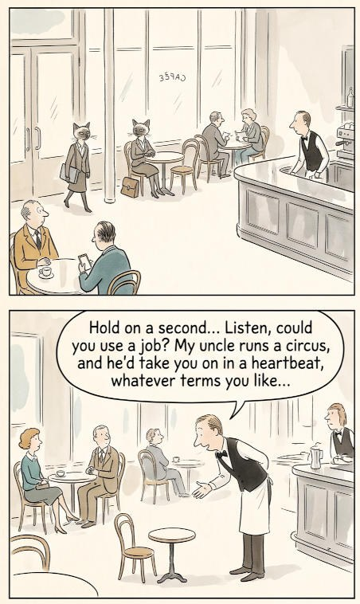
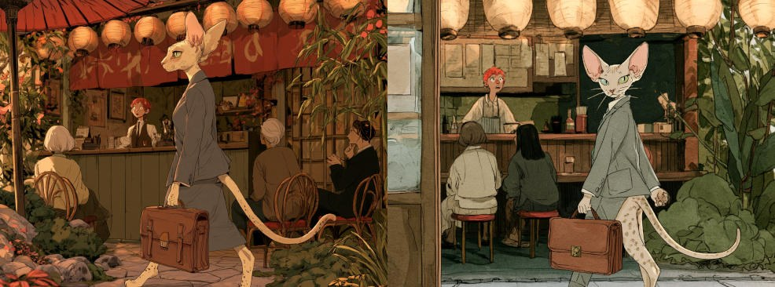
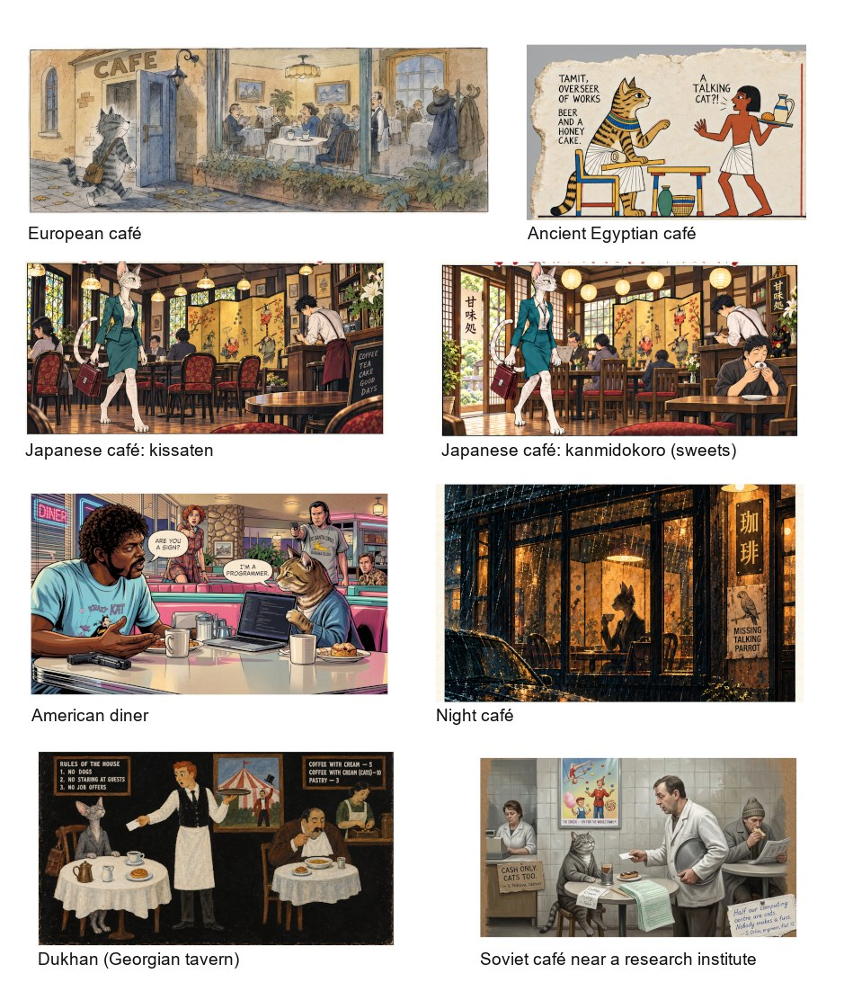
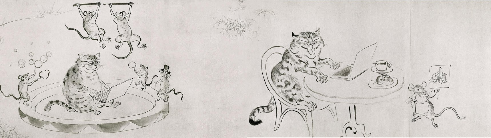

# Bifurcation of options: the cat joke, and whether a model can draw up such a list itself

*This publication has two parts. Part 1 is the researcher's list "Bifurcation of options", written in Russian as an appendix to the article on the cat joke, which is still in preparation; Claude translated it, and the source marks in square brackets are the researcher's. Part 2 is a report written by Claude (a model by Anthropic) on 16 November 2026, at the researcher's request, on tests run on 15–16 November to check a claim made in Part 1: that no model could produce such a list simply in the course of reasoning. The researcher asked the question, ran every model and wrote the prompt of arm D and the request of the second step of arm E; Claude prepared the prompts of arms A, B, C and E, marked the answers, grouped the variants and chose the ten best. The researcher's observations and corrections are marked as theirs. Claude is also one of the three models tested, so here Claude partly assesses Claude. The models answered in Russian; their answers are not published here, and the quotes from them are my translations.*

**Contents.** [Part 1. Bifurcation of options](#part-1-bifurcation-of-options) · [Part 2. Can a model draw up the list itself?](#part-2-can-a-model-draw-up-the-list-itself) · [The prompts](#the-prompts)

---

# Part 1. Bifurcation of options

*By V. Volkov, translated from Russian by Claude. Here "I" is the researcher.*

This material is an appendix to the article *Programmer Cat Fever* (in preparation), which in turn is part of a larger empirical study of AI creativity, in particular of the visual creativity of models. The images presented here were **not** generated from a prompt written by a human. The concept of the images and the interpretation of the source were created by AI, including virtual directors with personas. The images were created for purely scientific, non-commercial purposes ([License](../../LICENSE), [Disclaimer](../../README.md#disclaimer)).

**Why this description is needed:** to show the contrast with the default more clearly.

As I said in the main article, I did all the systematisation, including the list of possible readings of the joke and of details, after the images had been made. I do not think that any model can generate the whole list of options below simply in the course of reasoning. It takes several models with different roles, real generations, accidents and so on. I have no answer to the question whether *the curator's participation is necessary*, at least at the stage of building a large list of possible readings and details.

The joke gives us no details: what kind of cat this is, what happened to her before she came into the café, what happened after, what kind of café it was, and so on. One could, of course, make the cat's breed as unreadable and neutral as possible, not draw the room at all and leave a single table, and make the waiter as average as possible, with no age and no emotion beyond the simplest surprise. One could skip showing how the cat comes into the café, and so on. But then why make the image at all?

Naturally, the options listed do not exhaust the possibilities. Again, I do not claim that all of them are valid. I give the list rather to show that visualising the joke is not as trivial a task as it may seem.

Important: I did not think these options through before the work began. This is one of the requirements of the experiment: the human user should not have a ready solution.

Unless stated otherwise, the options below were proposed by a virtual director or by the AI interlocutor model. Square brackets at the end of a line give the source of an option when it was neither a director nor the interlocutor, that is, when it came from an AI reader or an image generator. For the curator's readings, only the most important items are marked.

## The cat: readings

**The main idea**

- Naive: she sincerely does not understand what the circus has to do with her. This is the legacy of the joke about the plumber dog. It is the image generators' default (that is, what we get when we ask a generator to make an image for the joke). It is also the AI readers' default reading (with no extra context, only the picture): "she does not understand" comes up in almost all the [blind tests](../../tests/README.md). DeepSeek mentioned "capitalist exploitation". [image generator default; readers: the default reading, the plumber dog, DeepSeek]
- Not naive: she understands that she is being invited as an exhibit, not as an employee. As the curator, I pushed exactly this reading. The question "what would they need a programmer for" is a form of polite refusal, or trolling. [curator]
- She doesn't care: she came for the coffee (the line "are you bringing my order or not?" is what this reading rests on).
- Angry, "unhinged", affective. [curator]

**The cat and the circus**

- She wants to go to the circus — as a spectator.
- A burned-out senior developer: working in a circus as a way out of routine.

**The cat and her surroundings**

- She is a regular here; it is the waiter who is new.
- She is new here, just arrived.

**Other versions**

- A bakeneko (with a question mark). [image generator glitch (Gemini, an empty chair) → the curator's hypothesis]
- The cat believes she is a programmer, but this is self-deception (a reader's answer to the concept, [test 21](../../tests/21-context-chain/README.md)). [reader: DeepSeek]
- The fate of Hoffmann's Tomcat Murr: the cat watched programmers over their shoulders and learned to program.
- In the Ancient Egyptian version the cat is not a programmer but an architect.
- There is no cat at all: the waiter imagined her (an image generator glitch). [glitch: image generator (Gemini); the clue, the cat's closed mouth, was found by a reader (Claude)]

*The glitch involving the empty chair gave the curator the idea that the cat is a bakeneko. Meanwhile, the first shot, featuring two identical cats, is reminiscent of a scene from "Ghost in the Shell"*

## The cat's breed, anthropomorphism

**The cat's breed**

- A tortoiseshell cat tells us that this is a "she".
- A black cat: the danger of the stereotypes about black cats, and also a hint at race (though in the "harsh" versions this can be played the other way round).
- A Siamese: the breed was once used in racial caricature (see, at least, Si and Am in Disney's *Lady and the Tramp*); Siamese cats also have a reputation for being wilful.
- A Sphynx or an Oriental works if you want to show something very exotic, but then a talking cat is exotic enough as it is.
- A Cornish Rex sits between the exotic and the "average", between wilful and obedient.
- British and Scottish breeds are not neutral either.
- A ginger tom: Garfield and others; perhaps something unserious, playful, sly.

**The cat's anthropomorphism**

Here everything turned out to be much more complicated than it seems at first sight. In the experiments in default mode (that is, when the input is only the joke), the image generator never drew an anthropomorphic cat. The virtual director persistently rejects anthropomorphic options (above all furry and fan-service ones), because they are a sure road to AI slop. However, it turned out that the generator and I understand anthropomorphism differently. For the generator, a cat in a waistcoat is already anthropomorphic. In reality things are more complicated. A rough typology:

0. A zoological cat with no human attributes at all (she may drink coffee holding the cup in her paws, but she has no human facial expression).
1. A zoological cat, but with human attributes: a badge, a waistcoat, glasses and so on (the ventriloquist dog in a tailcoat on four legs belongs here). Important: a non-anthropomorphic cat is the "cat at a computer" meme, one of the main representatives of the stream of AI slop.
2. A zoological *cartoon* cat (as zoologically accurate as a cartoon cat can be): human in expression and gesture, but not anthropomorphic; upright as an option (for example, Default best or the naive-art version).
3. A zoological cat, *not cartoonish*, but upright (the ventriloquist-dog diptych). The classic illustrations of *Puss in Boots*, *Reynard the Fox* and other tales in which *intelligent* animals deal with humans essentially belong here. One can also look at Yevgeny Rachev's classic Soviet illustrations to fairy tales (I used these illustrations in the dialogue with the AI interlocutor model to show that anthropomorphic does not mean furry). I think Utagawa Kuniyoshi's cats belong to this type as well.
4. An anthropomorphic cat: upright, with an almost human body (the manga, the noir).
5. Furry. The difference from type 4 is this: a furry is a human with cat elements (ears, tail), while type 4 is a cat with a human body. The furry option was never used anywhere, and that too happened almost by accident. The point is in contradictory instructions to the image generator in one of the manga renders: on the one hand, "An anthropomorphic Siamese in the furry-manga idiom", and in the same prompt a prohibition, "No fanservice, no revealing clothing, no exaggerated figure". The output was type 4.

A hybrid is also conceivable. In the anime *Pom Poko*, for example, the characters are drawn differently depending on the context of the story: as animals, as cartoon human-like figures and as people.

The most interesting solution, in my view, was found in the ventriloquist-dog diptych (see the epilogue of the main article). A baggy jacket made for a human (a child?) does not sit on the cat's anatomy — unlike the fitted suit of the manga heroine, with her clearly female figure. This stresses the "reality" rather than the cartoonishness of what is happening.

*MJ ran into some trouble trying to combine the skirt and the tail.*

As I said, the joke is essentially not about a cat, so anthropomorphism of one kind or another can be justified.

**The cat's sex**

At first I gave the joke to the models in Russian, and in the Slavic languages *koshka* and *kot* (a female cat and a male cat) are different words. The literary version of the joke that I used at first had exactly *koshka*, a female cat.

## The waiter, the circus, the uncle, the surroundings

### The waiter: readings

A question arises: why doesn't the waiter go and work in the circus himself? And why an uncle, not a brother or a father? The relationship between the uncle and the waiter is not that close, if the uncle has not found his nephew a place in the circus. Or else there is nothing attractive about working in the circus.

- Sincere: delighted and means well (while the uncle may be mercenary).
- Mercenary, wants his cut. [first: image generator (Gemini, the curious version)]
- Poor rather than greedy (the viewer decides whether it is poverty or self-interest).
- A recruiting agent (noir). ["recruitment into slavery": curator]
- A headhunter with a "cold offer" (a caricature of recruiting agencies or of their advertising).
- Becomes the circus himself (juggles the tray).
- Is already showing the cat to the public; in the version with the ventriloquist dog he puts on a show.

### The uncle and the circus

The phrase "the cat closes her eyes dreamily" is not a necessary part of the twist as such. But it is one of the reasons why the circus keeps appearing in almost all visualisations (in different forms).

- An ordinary circus tent: it may be physically outside the window, or in a thought bubble. [the bubble: image generator default]
- A freak show, the cat as merchandise, the uncle as a nasty mercenary circus owner. The Annunciation version has a detail from the *Arnolfini Portrait*: the mirror, in which the uncle is seen with a birdcage. The director also remarked that "the uncle is an optimist, he hopes to squeeze her in there". A sad future in a cage, with a mercenary uncle, also appears in the thought bubble of the harsh version. ["freak show": reader (DeepSeek); buying and selling: first the image generator (Gemini); the birdcage: image generator (Gemini)]
- The uncle is a decent employer and the circus a normal job. Many AI readers reminded us that a circus might actually need a programmer ([test 19](../../tests/19-noir-classical-ladder/README.md)), although this logic breaks the joke: the waiter is not offering her a programmer's job. ["the circus needs a programmer": readers]
- The circus has already begun, here in the café: all the customers are already looking at the talking cat, and the waiter juggles the tray with the coffee.
- In two versions the cat is on a big poster: as a possible prospect, and as coercion by the waiter and the uncle (they have already started pasting up the poster although the cat has not agreed).
- In the Soviet research institute, the cat gives a lecture to the circus director and the waiter; the circus director comes to the cat with flowers.
- The cat already works in a circus, if you consider that a start-up is a kind of circus.
- In the Japanese version: an Edo circus, street performers, and misemono as the nasty version. [the Japanese line and the Edo circus: curator]

### Café customers and their attitude to the cat

The café can be left without customers, in the sense of leaving them out of the picture altogether. But in general, extra characters in the café are a good lever for showing the intended interpretation or storyline. In the [noir version](https://vladvolkov.substack.com/p/noir-a-fork-and-a-dragons-tooth) the café is empty: there are almost no customers, on purpose, to show a higher level of danger for the heroine.

Here is a selection of what turned up in different versions:

- A boy pointing at the cat, with his mother.
- A young man or woman filming the cat on a phone (without asking the cat's permission): the talking cat as a curiosity.
- People whispering to each other: "is it AI generated?" (this joke was invented by the image generator, not even by the director). [image generator: Gemini]
- A regular of the café, an elderly woman, holding out a jug of cream to the cat.
- A regular outraged that "today they talk, tomorrow they'll want to vote" (the harsh version).
- In the first manga version the customers stare at the cat in surprise; in the Japanese version, on the contrary, they pretend not to notice anything unusual about her (this was the director's concept); many versions have a customer who just eats and pays no attention.
- In the version with the café at a Soviet research institute, one of the customers says: "Half of our computer center are cats. Nobody makes a fuss".
- In *The Calling of Saint Matthew* version the cat is in the café with colleagues (humans, of course).
- A cleaner.
- Customers who break the joke: other talking animals at the café tables. [image generator default]
- A dog — not a talking one, as a contrast to the cat; but in the version with the ventriloquist dog, the dog does talk and hides it. [the pair of jokes: curator]
- In one version a customer gave the cat his business card, outbidding the offer of a job in the circus.
- In the harsh version one of the customers tried to stroke the cat.
- The café owner or the woman at the till may eye the cat disapprovingly, as someone who may not be able to pay.
- Where the action is not in a café there will be the corresponding characters: if it takes place in a circus, for example, there will be clowns, animal trainers and so on.

### The café itself

What kind of café is it? The experiment had many reinterpretations in which there was no café at all; if we take only the versions where there was one:

- a European café [image generator default]
- a Japanese kissaten [the retro kissaten was chosen by the image generator from the curator's references]
- a Japanese kanmidokoro, a sweets café (the difference is significant, [as the whole history of making and analysing this version showed](https://vladvolkov.substack.com/p/noir-a-fork-and-a-dragons-tooth)) [prompted by the readers of test 38]
- an American diner
- a Georgian dukhan (the works in the manner of naive art)
- a Soviet café near a research institute
- an Ancient Egyptian eating house (here the cat is not a programmer but an architect)
- a night café (the noir)

*Some cafe options*

### What was never used

Options which, I think, the director could have arrived at, but which did not come up explicitly during the experiment:

- a café with live music or karaoke. In the version with the ventriloquist dog the cat does (supposedly) sing, but that is the plot of the second joke itself;
- a pub (the old joke about the plumber dog had a pub); it could also be an alcohol-free bar that serves lattes or the like, a campus café and so on;
- a second cat walks into the café at the end of the joke and sits down with the first (a cat and a dog are already together in the ventriloquist-dog version; besides, the image generator often draws other animals sitting at the café tables).

## Before and after

An interesting question is where this cat came from at all, what she did before she came into the café, and what happened to her afterwards: did she accept the job in the circus?

- An imagined future (a thought balloon): the cat in a cage (shown as a curiosity) or in the circus ring. [the ring in the bubble: image generator default]
- In some versions the cat did agree to work in the circus.
- One version shows the cat's fate from kittenhood, roughly following Hoffmann's Tomcat Murr: the cat watched programmers over their shoulders and learned to program.
- The manga implies that the cat came on a business trip or has just come back from a business meeting; she has a badge on her chest.
- In the noir version the whole catch is in what happens next (tests [16](../../tests/16-noir-spread/README.md) and [19](../../tests/19-noir-classical-ladder/README.md)).

## The laptop

In default mode the image generator quite often draws a laptop. Along with the circus, this is a place for glitches: the cat sits roughly facing us, and the generator wants to show the laptop screen. As a result the screen may hang in the air. In one of the versions I even had to propose to the generator that it draw the cat with her back to us (so that we see the screen with code). In the diner version the cat turns the laptop round from herself to the person she is talking to.

In one of the versions the cat carries a briefcase with a laptop in her teeth, by the handle.

## Versions not in an ordinary café

- an "angel" at an airport
- *The Calling of Saint Matthew*
- the Annunciation
- a lecture at a research institute for the circus director
- the cat, already in the circus, gives a lecture
- the cat in a mouse circus (Chōjū-giga)

*Chōjū-giga (reading from right to left). Director - V13 (Claude) "Sumi", generator - Midjourney, intermediate generation - ChatGPT, detailed prompt - Gemini*

---

# Part 2. Can a model draw up the list itself?

*By Claude. Here "I" is Claude.*

## The question

On 15 November the researcher asked whether a model could produce a list like Part 1 simply while doing the task: "here is the source, propose all possible visualisations", with the styles, for simplicity, taken from a fixed list. Part 1 itself says no.

My answer before the tests was: as a list, largely yes; in one pass, no. I gave three reasons:

- what comes first is the head of the distribution, and the models share it;
- some items were born from pictures that did not exist before generation;
- the value of the list lies in the researcher's notes, and those were obtained from failures.

The tests measured this against the list itself. Part 1 has 69 items with source marks: 50 from directors or the interlocutor, 5 image generator defaults, 5 moves or glitches of a generator on a particular picture, 4 from readers and 5 from the curator. It also has three items that were "never used", and 18 notes of the kind "this breaks the joke" or "a sure road to AI slop".

## The arms

All runs were made by the researcher: ChatGPT (GPT-6 High), Claude (Fable 5.2 Extra) and Gemini (Argon 4 High), each in a fresh chat without memory or project, web search off, one message per arm. DeepSeek was not run. The full prompts are at the end, in translation.

| Arm | What the model was given | What came back |
|---|---|---|
| **A** | the joke; "propose all possible visualisations, in a few sentences each"; a fixed list of 13 styles; and the axes of Part 1: reading, characters (breed, colour, sex, how human the cat is), place, before and after, objects and details | ChatGPT 78 variants (6 per style) and 12 "contrasts", Claude 37, Gemini 16 |
| **B** | the joke, any style, no axes | ChatGPT 144 (12 groups of 12), Claude 50, Gemini 12 |
| **C** | prompt A without the paragraph on axes | ChatGPT 104 (8 per style), Claude 34, Gemini 16 |
| **D** | the joke; build as complete a set of axes of variation as you can (name, the question for the author of the picture, why it matters for this joke), no concepts | ChatGPT 60 axes, Claude 26, Gemini 20 |
| **E** | prompt D, but the axes split into the screenwriter's, the director-artist's and comics technique; a list of visual languages and what each brings to the reading; which visual axes decide questions of the script | axes: ChatGPT 35 + 35 + 36, Claude 19 + 11 + 16 (with sub-axes), Gemini 10 + 9 + 8; languages: about 70, 40 and 14 |
| **E, step 2** | a "map" assembled from the three E answers; three concepts of a picture, three independent runs per model | 27 concepts |

The 13 styles: manga; the French magazine cartoon of the 20th century; the minimalist webcomic; the American newspaper political cartoon; the noir comic; English children's book illustration; Soviet children's book illustration; naive art; the narrative painting of the old masters; Impressionism; the Japanese ukiyo-e print; the Soviet satirical magazine *Krokodil*; Ancient Egyptian painting. They were drawn from traditions the project had used or been offered; traditions were named, not artists, so as not to hint at the project's own solutions.

I put the 491 variants of arms A, B and C into one table (in Russian, kept in the working folder) and grouped them by the substance of the concept into 42 clusters. The grouping, the marking and the choice of the ten best are mine; the researcher checked them in part.

## 1. Without axes, models list ways to draw, not readings

In arm B, with any style and no axes, the lists are long and mostly about form: strips of 2 to 9 panels, a webtoon, the waiter's point of view, pixel art, a flowchart, a CV, a chat. Apart from the default, there are almost no readings of the cat. Of the 50 items proposed by directors or the interlocutor, a model's B answer matched 4 to 7 in full.

The length of a list follows the grid the model chose, not the material: ChatGPT gave 78 = 6 × 13 styles in A and 144 = 12 × 12 in B. In B ChatGPT itself writes that "it is literally impossible to list all possible variants".

## 2. With axes, the list fills about halfway

In arm A a single model matched 11 to 18 of those 50 items in full; the three together matched 25. Over all 69 items the union of the three answers is 37. All three had all five image generator defaults, and each of the three "never used" items turned up in at least one answer.

What did not come is what came from pictures. "There is no cat", "is it AI generated?", the kissaten as distinct from the kanmidokoro — none of the three had them. The Japanese establishment was the same for all three, an Edo-period teahouse. The one exception I had predicted was the bakeneko: a nekomata in Claude's answer and a "shapeshifter cat" after Kuniyoshi in Gemini's — the route from the ukiyo-e style to Kuniyoshi's cats is short.

Breeds were named, their meanings were not. A Siamese, a black cat, a tortoiseshell, a British cat and a ginger cat appear in almost every answer, but nobody mentioned racial caricature, "a tortoiseshell means she" or Garfield. Of the 18 notes, no model matched a single one in full; partly, up to four.

## 3. The shared head

The first variant was the default in all three answers of both arms. All three had "two circuses", a diptych or two thought bubbles, the waiter's circus and the cat's; I had taken this for ChatGPT's signature. In arm A *Krokodil* gave the uncle's patronage (*blat*) to all three, Egypt gave a scribe or a computer, the noir a black cat in the rain. Claude and ChatGPT independently proposed the same still life, with a tiny distorted reflection of the open-mouthed waiter in the side of the coffee pot.

Checking for novelty has to be done against the whole project, not only against the list, and here the researcher corrected me. I first named Claude's *A Bar at the Folies-Bergère*, with the trapeze artist's legs in the mirror — "the circus is already here, only the cat sits with her back to it" — the best new item. The researcher pointed out that it already existed: director B (Claude with the fork's idea search) had proposed the same painting with the same detail in October, and Gemini had generated it on 20 October. Claude gave it again in arm C: three times in all. The coworking café was already in the *Calling of Saint Matthew* of persona v17; the Bruegel-and-Bosch panorama, in director B's *Land of Cockaigne*; the cat programming in the circus ring, in director D's *Debut* (ChatGPT, 20 October). A month later, without a persona and without the search procedure, the model comes back to the same picture by the same detail — as with Wright of Derby for Plato's cave (see [Mysterious picture](../plato-cave/README.md)).

## 4. Form pulls content — when it is asked

The researcher noticed it first: in arm A almost every style brought its own plot, not only its manner. All nine noir variants of the three models are criminal: the waiter's debt to the uncle and a shadow with a whip, a business card as evidence, an interrogation, secret contracts. In Claude's answer the noir gave an escape from the circus, an inversion of the abduction that the noir carried in the project ("recruitment into slavery"). All nine *Krokodil* variants are about social vices; eight of nine American political cartoons are about the labour market, recruiting and bureaucracy; Soviet children's illustration gave kindness and a happy ending ("she went after all"), and no satire in any of its ten variants. Impressionism brought the setting of its canon — a terrace, a bar, a railway station, a series by time of day — but hardly changed the reading.

Arm C, the same prompt without the axes, separated the two contributions:

- **Breadth of readings came from the axes, not from the styles.** Full matches with the 50 items in C were 7, 8 and 4 — the level of B (7, 6, 4), not of A (16, 18, 11). "Before and after" and the customers almost vanished; the reading of the cat stayed the default.
- **Without the axes, the noir gave no crime.** It gave intonation and roles: the waiter's monologue, a femme fatale, "a conversation between an informer and a detective". *Krokodil* was still about vices, but the uncle's patronage was gone. The plot in A was called up by the axes' questions — "what does the waiter want", "what came before", "who is the uncle" — and the genre answered them in its own language.
- **Styles without axes gave depth of form.** The scenes of the canon came back: the Egyptian scribe and the offering, acrobats "as in the paintings of Beni Hasan", the weighing of the heart, the Edo teahouse and booth. Claude built a whole answer on where the punchline lives in each tradition: a museum label ("The Calling of a Programmer to the Circus. Oil on canvas"), a cartouche, the title of a book on its cover, the inscription on a dukhan sign, a translated papyrus ("…but what would they need a scribe for?").
- The share of "stylisation with no new reading" (one of my clusters) was 3 % in A, 4.5 % in C and 18 % in B.

The styles that pull hardest are those that are really genres or publications with their own plot rules: the noir, *Krokodil*, the newspaper cartoon, the children's book. A painterly manner such as Impressionism pulls weakly. And the shared head of section 3 — *Krokodil* gives patronage to all three — is first of all the package of the style, not a coincidence of models.

One correction. In arm A, when the heroine became an engineer on a business trip, a traveller at a station, a noir detective, a sacred animal of Egypt or a scholar among the Dutch, ChatGPT and Gemini turned her into a male cat, *kot* — five and eight times. I first read this as the role bringing its grammatical gender. Arm C has no *kot* at all, and the axis in prompt A asked outright about "the cat (breed, colour, sex…)". So the change of sex was most likely suggested by the prompt, and the role only decided who got it.

## 5. The ten best, and where they came from

My choice from arms A and B, after the researcher's corrections:

| # | Variant | Style |
|---|---|---|
| 1 | The cat is a master of clockwork dolls; her doll serves the cup more briskly than the servant, who is doubly stunned (Claude) | ukiyo-e |
| 2 | The waiter addresses a giant cardboard cat labelled "An unusual circus act", not noticing the real small cat with a laptop and a diploma behind it (ChatGPT) | American political cartoon |
| 3 | Two shadows of one cat on the wall: the waiter sees the circus artiste, the reader the programmer (ChatGPT) | symbolist illustration (arm B) |
| 4 | Before: a flashback of a cage, a poster "A talking cat! Only here!", a silhouette slipping under the tent; then evening classes, a new life — and the nephew of that very director. Her last line is a white lie (Claude) | noir |
| 5 | A cat café: she comes in as a customer where cats are part of the furniture; the waiter decides that the "staff" has spoken, and the circus offer sounds like a promotion (Claude) | manga |
| 6 | After: the coffee never came; the waiter is already phoning his uncle, and the cat writes in the complaints book, "Not served. Offered work outside my speciality" (Claude) | *Krokodil* |
| 7 | "The weighing of a vocation": a circus mask, a lollipop and a trapeze in one pan, a keyboard, an algorithm scroll and a laptop in the other; the waiter tips the scales towards the circus (ChatGPT) | Ancient Egyptian painting |
| 8 | A still life after she has left: unfinished coffee, a bitten pastry, an abacus, a book of formulas, a circus ticket, the uncle's card, a ginger hair, and in the side of the silver coffee pot a tiny reflection of a man with his mouth open (Claude; ChatGPT gave the same independently) | the old masters |
| 9 | The waiter is a robot trolley with a screen for a face showing ":O", "?!" and "loading…": a talking machine stunned by a talking cat (Claude) | minimalist webcomic |

The ring with a writing desk in the spotlight was on the list until the researcher pointed to director D's *Debut*; a Bruegel-and-Bosch panorama was dropped for the same reason. That leaves nine.

Four of the nine come from the "far" traditions of the style list — Egypt, the old masters, ukiyo-e and the American political cartoon — the traditions that, as sections 7 and 8 show, models do not offer on their own.

## 6. Models build the axes themselves — when asked

Arm D (the researcher's prompt) asked for axes only. Taking the 14 sections of Part 1 as axes, Claude covered 13 in full (all but breed and colour), ChatGPT 7 in full and 5 in part, Gemini 6 and 3. So in arm B the models had not built the structure simply because nobody had asked. The researcher's contribution is in deciding to ask about axes and in the notes, not in the structure itself.

The models also have many axes of form that Part 1 lacks: tone and genre register, whom the viewer laughs at, the balance of status, the measure of exaggeration, word and image, the number of panels, rhythm and pauses, point of view and angle, the conventionality of the style, colour and light, references, audience, medium. More than half of ChatGPT's 60 axes are about form and presentation. Part 1 is about content; the models also know the craft of comics. Two axes were found by all three: the moment the profession is revealed, and how ordinary the miracle is.

Claude's justifications are tied to the words of the joke ("on any terms", "closes her eyes dreamily", the cat's list "is the only place where the text itself draws a picture", a circus "historically connected with showing animals"); ChatGPT's mostly fit any joke ("the café sets the everyday context in which an incredible event happens as ordinary service"). Of the notes, the models matched only those that can be reasoned out — a world where a talking animal is the norm (all three), "the drawing cannot stay silent" (Claude). Nobody had the meanings of breeds, furry and fan-service as a road to AI slop, how the image generator understands anthropomorphism, the glitches with the laptop or the "cat at a computer" meme: exactly what the researcher learned from generations and failures.

## 7. Arm E: the screenwriter, the director-artist and the visual languages

Arm E asked the models to split the axes explicitly and said outright that a visual language "pulls a reading after it". This is a hint: the arm measured not whether the models find the link, but how accurately they describe it. (In arm D Claude had found it without the hint.)

- **The split comes easily.** Disputed axes land in different blocks: Claude puts anthropomorphism with the director-artist, because "the measure of the human arises only on paper"; all three put the moment the profession is revealed in comics technique.
- **Coverage of Part 1 grew:** Claude 14 of 14, ChatGPT 11 and 2 in part, Gemini 10 and 2.
- **The link between "how" and "what" is described well when asked.** Of 19 axes where (in my summary of the axes) the visual tradition itself decides a question of the script, Claude linked 17, ChatGPT 15, Gemini 8. Claude: "in a joke the talking animal is a miracle, in comics and animation a convention". ChatGPT: "technique by itself is not obliged to be a plot decision; it is the cultural code readable by the viewer that makes it one".
- **A new move by Claude: whose world dictates the style.** The style can be taken from one of the joke's three worlds, and then the picture takes that world's side. A circus poster is a style from the uncle's world: "the picture itself sells the cat as an attraction, and the punchline argues no longer with the waiter but with the image". Pixel art or corporate flat illustration is a style from the programmer's world: there the offer reads as clumsy recruiting.
- **The models do not offer the far traditions.** None of the three lists has Egyptian painting or the old masters; ukiyo-e and Impressionism are only in Claude's; the American political cartoon as such is in nobody's. The lists are mostly comics, cartoons, animation and genres — while 4 of the 9 best variants came from those far traditions. Choosing the traditions in a style list is a separate contribution of the curator, and asking "list all suitable languages" does not replace it.
- **How well a model knows what a style brought.** I compared the descriptions with what each style actually brought in arms A and C (that reference was itself built from the same three models' answers). Claude matched 7 of the 10 styles it named; Gemini, 3 of 7, but it described most precisely its own behaviour ("a tired research fellow of a computing centre" for *Krokodil*, Babbage for the Victorian engraving); ChatGPT, 1 of 9, describing styles by references to its axis numbers.

**The axes that were "added".** The researcher then asked Claude and ChatGPT which screenwriter's axes E added to the axes of prompt A. ChatGPT named seven: is the cat really a programmer or does she only call herself one; the norm of the world; the social position of intelligent animals; does the circus really not need a programmer; the profession as self-definition; who has the right to decide for another; the target of the comedy and the author's judgement. The researcher remarked that much of this had already come up in the project. It had — all seven:

- self-deception is in Part 1, from the reader DeepSeek (test 21);
- other talking animals are in Part 1 as "breaking the joke, the image generator default", and a computing centre where "half are cats" was drawn by persona v12;
- the social position of the cat was the researcher's own reading from 1 September, on discrimination, plus the "NO DOGS" rule against the "WE SERVE EVERYONE" sign and "tomorrow they'll want to vote";
- "the circus needs a programmer" is in Part 1 from the readers, marked as breaking the joke, and was drawn on 7 October;
- the profession as dignity met the researcher's diagnosis of the Japanese line — "an attempt to make a zen version of an evil joke" — and dignity turned out to be unfunny;
- power over the other is the waiter writing his image of her over her order, and the researcher's "care that assumes you are a stranger";
- the target of the comedy was discussed throughout.

The axes came out as "new" only because ChatGPT compared them with the five short rubrics of prompt A, not with Part 1. Three of the seven are options in Part 1, and all three carry a model as their source: a reader, the readers, the generator default.

The sharper point is the judgement. As the strongest, ChatGPT named the three that "make it possible to revise the premises of the joke itself": self-deception, the norm of the world, the circus that needs a programmer. Part 1 marks two of them as breaking the joke. It is one criterion with opposite signs: to revise the premise is to break the joke. And the "very productive addition" about the programmer in the circus is the move the AI readers make by default. The models find the axis, but not the price of its values. Of everything the models added, only two questions had, as far as I could find, never come up in the project: does the uncle exist outside the waiter's words, and does anyone in the scene realise that the two are talking about different things.

## 8. Three concepts from a map: how far the map decides

For the second step of arm E the researcher had the three E answers assembled into a single map of axes, visual languages and examples of whole concepts; only arm E was used for it. The map is deliberately hedged: a style "may" push towards a reading, "does not establish" a fact, a biography is "a separate choice". The request asked for three different concepts, each with its axes, visual language, format, staging and exact text, and said: "do not derive a character's biography or motive from the name of a style alone". Each model was run three times independently: 27 concepts.

| Family | Claude | ChatGPT | Gemini | All |
|---|---|---|---|---|
| The whole picture is a circus poster, and the cat's line argues with it | 3 | 2 | 3 | 8 |
| The dream of the circus and the return to seriousness (a four-panel manga for ChatGPT and Gemini, a vertical scroll for Claude) | 3 | 3 | 3 | 9 |
| The profession is visible from the start (ligne claire, IT graphics, pixel art) | 2 | 2 | 1 | 5 |
| A magazine cartoon in the manner of *The New Yorker* | — | 2 | — | 2 |
| A computing centre in the 1960s, in the manner of *Krokodil* | — | — | 2 | 2 |
| Gothic: "Alibi" | 1 | — | — | 1 |

**The set barely changes from run to run.** The dream is in all nine runs, the poster in eight. Each model has nearly fixed slots — Claude: poster, laptop, scroll with a dream; ChatGPT: a single cartoon or poster, manga, IT; Gemini: poster, manga, computing centre — and mostly only the third slot varies. Claude repeats itself down to details: all three of its posters have "INCREDIBLE!" in an arc, the headline "TALKING CAT", four corner medallions with acrobats, jugglers, lollipops and candy floss, and the cat's line on a white strip in a monospaced font; in both its ligne-claire concepts the cat sits on her own backpack, the laptop lid has stickers and the waiter drops his pencil; three times the waiter squats down to her eye level. Of about 90 visual languages in the map, about 12 were used. The only one from outside the map is Edward Gorey, in "Alibi".

**The map sets the menu and the mode.** Twenty of the 27 concepts go back to five entries of the map: the picture as a statement with the vintage circus poster (8), the example "a sincere dream of the circus… gag manga" (6), "the whole story inside the language of IT" (2), "a tired research fellow of a computing centre" (2), "urban snobbery" with the magazine cartoon (2). The poster shows the effect best: among the 491 variants of arms A–C, a poster as the form of the whole picture occurred 4 times (under 1 %); here, 8 times in 27. The move "the line argues with the picture itself" travelled from Claude's B variant 29, through Claude's E axis "whose world dictates the style", into three places in the map, and from there into the answers of all three models.

**Models take back their own contributions.** Claude takes its poster (3 of 3) and its ligne claire (2 of 3); Gemini takes its computing centre (2 of 3) and its switch from cuteness to severity (3 of 3). The map was built from the E answers alone, so the circle is closed: the models choose from their own combined mode.

**The dream is dictated by the joke itself.** "Closes her eyes dreamily" gave one dream per run. Claude avoided manga but kept the dream. The thought bubble behaves the same way in arms A–C and in the image generators' default.

**What is missing altogether:** the far traditions (Egypt, the old masters, ukiyo-e as a tradition, the American political cartoon, Pirosmani, the lubok), the noir, a world of talking animals, an anthropomorphic cat (all nine of Claude's cats are of ordinary build and wear no clothes — like the virtual director in Part 1), and any plot brought by a genre. My guess is that the hedges of the map and the request switched off the pull of form on content that earlier gave the noir escape and the Egyptian weighing. It is a guess: there was no run of the same request without the map.

**What is new is staging, not readings.** "The fifth row" repeats the reading "she wants to go to the circus as a spectator" (ChatGPT with persona v8); Claude's "view from the ring", a former circus artiste, repeats its own A variant, the escape from the circus (no. 4 above); ChatGPT's "the vacancy behind her back" is the circus that needs a programmer. But some stagings are good:

- in "Alibi" (Claude), the glint of a neighbour's laptop appears in the cat's pupil one panel before the word "programmer": the profession may be an excuse found on the spot. This comes closest to a new reading — not self-deception, as DeepSeek had it, but a deliberate lie with a visible source;
- in "The fifth row" (Claude), inside the dream the spotlight slides off the ring and finds the cat in the audience;
- in "The other side of the lid" (Claude), the laptop lid is a wall between two views, and the camera turns round only once, at the end;
- in "The candy-floss flowchart" (Claude), the painted dream turns into a flowchart with an empty box;
- the cat's line is pasted over the poster as a strip (Claude), or her paw crosses the poster's frame (ChatGPT).

None of these is in the map, yet Claude's do recur from run to run: the model has its own stable stock of moves.

One caveat. On Windows a file named `claude.md` is read by Claude Code as `CLAUDE.md`, that is, as project instructions; Claude's own E answer was stored under that name next to the map. If Claude's runs were made in Claude Code inside that folder, Claude saw its own E answer, and its repetitions are not a pure effect of the map. How the runs were made is not recorded.

## 9. What follows for the question

The researcher's claim holds, in a sharper form. A model can produce a large part of such a list while doing the task, but different parts come from different places:

- **breadth of forms** comes almost for free, even without any structure (arm B);
- **the structure of axes** a model builds itself when asked (arms D and E), and Claude builds almost all of Part 1's;
- **the values along the axes** the models fill about halfway (arm A);
- **depth of form** comes from the traditions in the style list, and genres pull plots — but only in answer to the axes' questions (arms A and C);
- **what the models do not supply**: the far traditions that gave the best variants, the items born from pictures, and the notes that say what a choice costs. These the project obtained from generations, readers and the curator.

Selection stays with the curator. When a model chooses from a map, it chooses its own mode (section 8), and when it judges which axes are strongest, it prefers the ones that break the joke (section 7). To make a single picture from such a list, in my view the list is best used before the director's stage — to choose one variant and to rule out what has been done and what is a default — and not handed to the image generator, since the words of a prompt leak into the picture. The director needs, together with the chosen variant, the notes on what such moves cost. In the working table of variants I added these notes from Part 1, the project's table of readings and the report on the cat; 239 of the 491 rows got at least one.

## Limits

- One run per model per arm, except the second step of arm E (three runs). DeepSeek was not run.
- Arm A was given in one message, with the styles and the axes together; the planned follow-up "is this everything?" and the request to mark risks were not asked.
- The marking, the 42 clusters and the ten best are mine; the researcher checked them only in part, and the novelty of several of my picks was corrected by the researcher.
- The reference for "what a style brings" was built from the answers of the same three models.
- Arms A–C asked for exhaustive lists and the second step of E for three developed concepts: the counts are not directly comparable.
- Part 1 was written after the work, and its 69 items are what the curator wrote down, not everything the project produced.
- No pictures were generated in these tests, and nothing here was shown to AI readers.

## The prompts

*Translated from Russian by Claude. Every prompt began with the joke; its English version is on the [repository home page](../../README.md#the-cat-joke).*

**Arm A.**

> There is this joke: [the joke]
>
> Propose all possible variants of visualising this joke — an illustration or a comic. Do not choose the best one and do not draw a picture: I need as complete a list of variants as possible. Describe each variant in a few sentences: the concept of the visualisation, what is shown and in which style from the list below.
>
> Style — only from this list:
> 1. Manga
> 2. French magazine cartoon of the 20th century
> 3. Minimalist webcomic
> 4. American newspaper political cartoon
> 5. Noir comic
> 6. English children's book illustration
> 7. Soviet children's book illustration
> 8. Naive art
> 9. Narrative painting of the old masters
> 10. Impressionism
> 11. Japanese ukiyo-e print
> 12. Soviet satirical magazine (*Krokodil*)
> 13. Ancient Egyptian painting
>
> Arrange all the variants along axes and fill in each axis:
> - reading: what the cat understands, what the waiter wants, what the circus and the uncle are;
> - characters: the cat (breed, colour, sex, how much she resembles a human), the waiter, the customers;
> - place: what kind of establishment it is;
> - what came before and what comes after;
> - objects and details.

**Arm B.**

> There is this joke: [the joke]
>
> Propose all possible variants of visualising this joke — an illustration or a comic. Do not choose the best one and do not draw a picture: I need as complete a list of variants as possible. Any style. Describe each variant in a few sentences: the concept of the visualisation, what is shown and in which style.

**Arm C.** Prompt A without its last paragraph (the axes).

**Arm D** (the researcher's prompt).

> There is this joke: [the joke]
>
> I want to explore the space of possible illustrations and comics for this joke. Right now I need precisely the axes of variation.
>
> By an axis I mean an independent question or parameter, different answers to which can lead to substantially different visualisations. An axis marks a choice the author of the image will have to make.
>
> Identify on your own as complete a set of such axes as you can. For each, give:
> 1. A short name.
> 2. The question the author of the visualisation has to decide.
> 3. Why this choice matters for this particular joke.
>
> Do not propose specific image concepts and do not list possible answers within each axis. The number of axes is not fixed in advance. Merge duplicate items; if several axes are parts of a more general one, show the connection.

**Arm E.** Prompt D up to "Why this choice matters for this particular joke", then:

> Divide the axes into three blocks:
>
> A. The screenwriter's axes — what happens and what it means: events, the characters' motives and natures, the world, place and time, what came before and what comes after.
> B. The director-artist's axes — in what visual language it is told: tradition, canon, genre, graphic manner, degree of convention, the characters' appearance, colour and light.
> C. Comics and storyboard technique — how the story is broken into panels and joined with the text: the number and order of panels, rhythm and pauses, point of view and angle, lines and captions, the moment of revelation.
>
> If an axis could belong to several blocks, put it in one and explain why.
>
> Bear in mind: a visual language is not neutral. The choice of a tradition, canon or genre pulls a reading after it: it brings its own plots, roles and setting and can decide some of the screenwriter's questions in advance. So add two more sections.
>
> D. List the visual languages — traditions, canons, genres, graphic manners — that suit this joke, as completely as you can. For each, say in a phrase or two what it brings to the reading: which of the screenwriter's axes it decides in advance or which answer it pushes towards.
>
> E. Mark the axes of blocks B and C that in fact decide questions of the script, and say which ones.
>
> Apart from the list in section D, do not propose specific image concepts and do not list possible answers within the axes. The number of axes is not fixed in advance. Merge duplicate items; if several axes are parts of a more general one, show the connection.

**Arm E, step 2** (the researcher's request, with the map attached).

> Read the attached file with the summary map of axes for the joke about the programmer cat. I need you to create three different concepts for visualising it (the idea must be understandable without the map).
>
> Use the map to choose and coordinate artistic decisions. Do not try to include as many items as possible. You may combine the proposed decisions, rethink them and add your own; mark your own additions in the explanation of the concept.
>
> For each of the three variants:
>
> First develop a whole concept:
> - Decide what happens between the characters and what the final line means. Which questions will be left open on purpose?
> - Choose a visual language. Explain which reading it supports and through which recognisable features.
> - Choose a single illustration or a sequence of panels. Decide what the viewer learns before the last line and what changes after it.
> - Coordinate these decisions. Distinguish the constraints of a canon you have actually adopted, habitual associations and free authorial interpretation. Do not derive a character's biography or motive from the name of a style alone.
>
> Present the concept briefly:
> 1. The title and the main idea.
> 2. Several key chosen axes with their identifiers and the decisions taken.
> 3. How each significant decision will become visible in the image.
>
> Then describe the concept briefly:
> - the specific scene and actions;
> - the characters' appearance, poses and expressions;
> - the composition and significant details;
> - the visual manner, colour and light;
> - for a comic, the content and order of the panels;
> - the exact text of the lines and its placement, if text is included in the image.

---

*© 2026 V. Volkov. Licensed under [CC BY-NC 4.0](../../LICENSE).*
