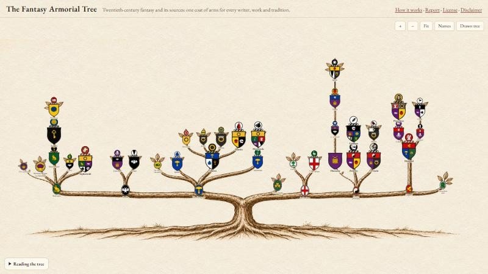
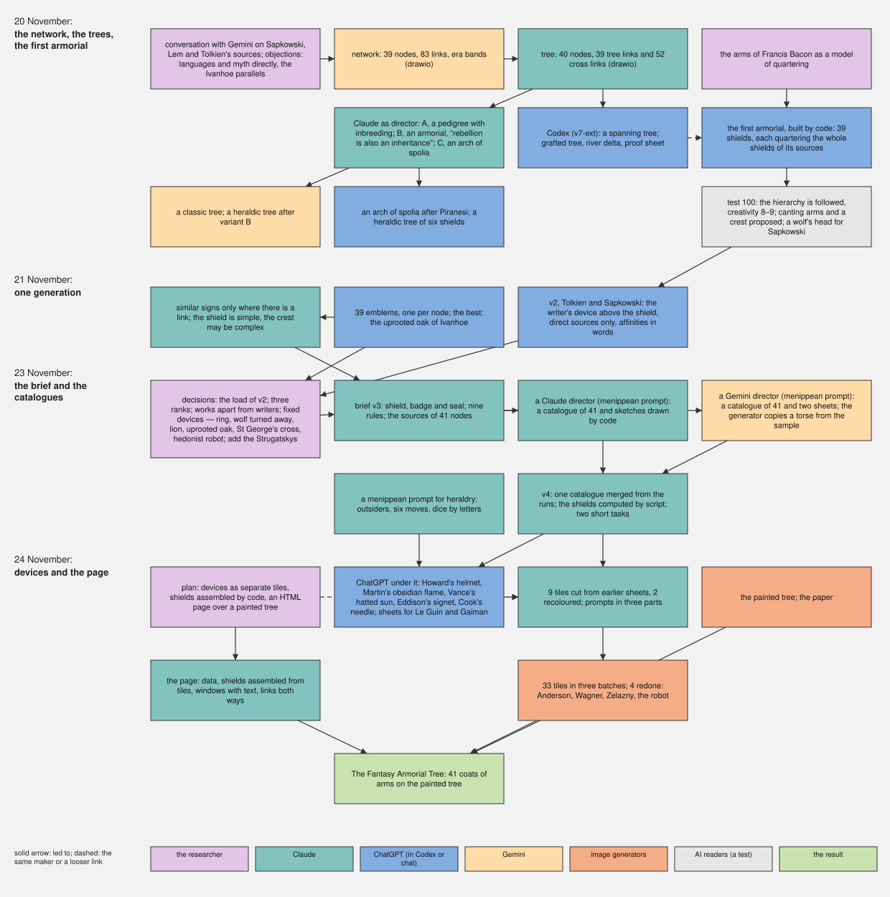
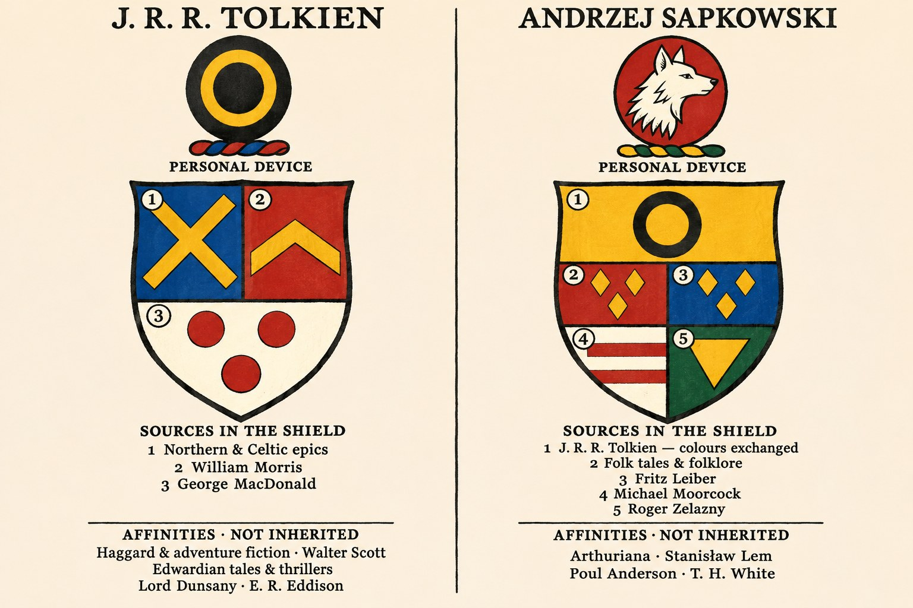
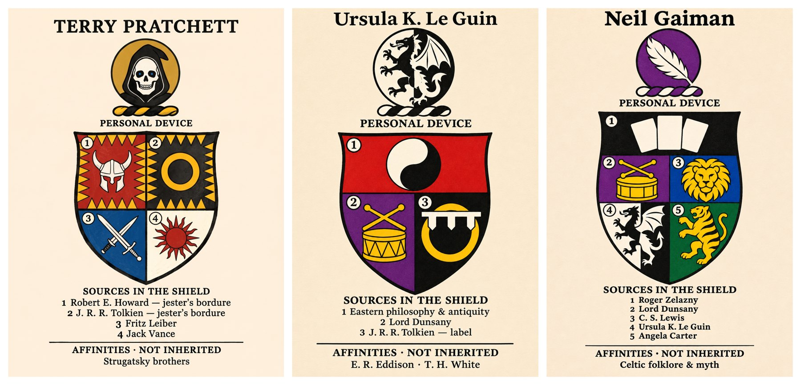
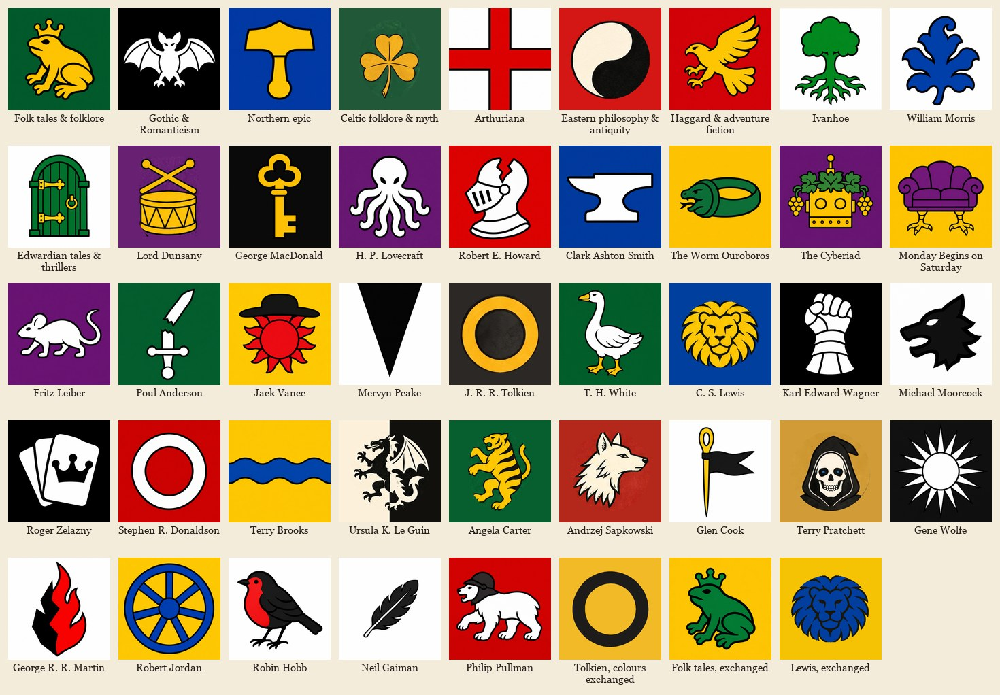
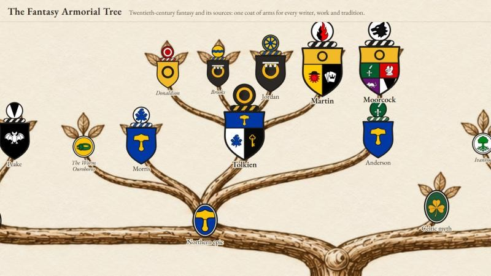
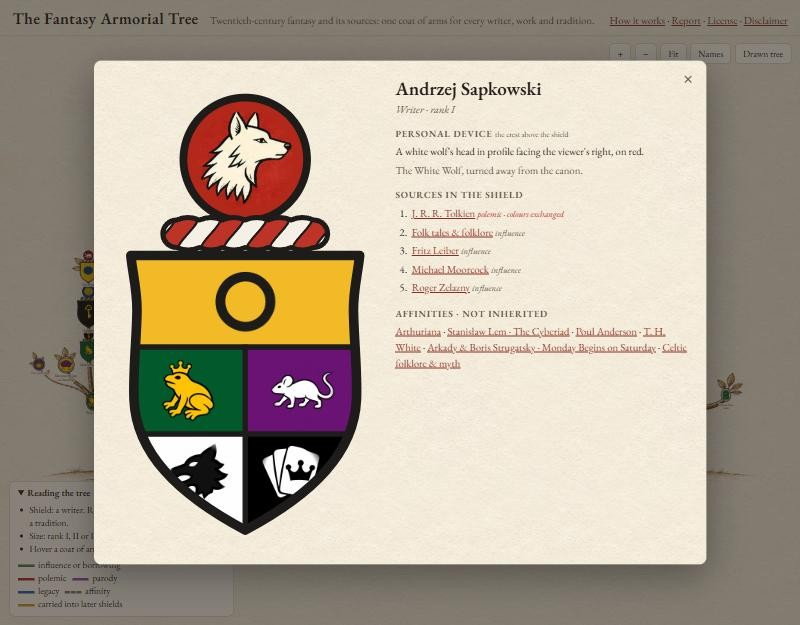

# The fantasy armorial: twentieth-century fantasy as a tree of coats of arms

*This report was written by Claude (a model by Anthropic) on 24 November 2026, at the researcher's request, from the materials of the "Cat programmer" experiment. The researcher set the subject, ran every model, made the decisions marked as theirs, chose the final devices and generated most of the images. I wrote the briefs v3 and v4, merged the catalogue, wrote the menippean prompt for heraldry, the code of the page and this report. ChatGPT, Gemini and other Claude instances contributed as described below; "I" is the Claude instance that wrote this report.*

*The page: 41 coats of arms on a painted tree. Writers have shields with a crest, single works round badges, traditions oval seals; the size shows the rank.*

## What it is

The armorial draws the genealogy of twentieth-century fantasy as heraldry. Every writer gets a coat of arms. The shield carries the devices of the writers and traditions the writer drew on, and the writer's own device stands above the shield as a crest. Polemic, legacy and parody each change the inherited device in their own way, so the kind of link can be read off the shield. It began on 20 November as a side topic and ended on 24 November as an interactive page: 29 writers, 4 single works and 8 traditions, with the text in HTML and the coats of arms assembled by code from 44 small device images.

The road there went through five models, a reading test, two briefs and several rejected versions:

*Who made each step, by colour. Solid arrows: led to; dashed: the same maker or a looser link.*

## 1. From a network to the first armorial (20 November)

The subject came from a conversation between the researcher and Gemini about Sapkowski, Lem and the sources of Tolkien. The researcher objected twice: Tolkien took languages and myth directly, not through Morris and Dunsany, and *Ivanhoe* has parallels in *The Lord of the Rings* (Saruman and De Bracy, Rowena and Arwen, Gurth and Sam). Gemini drew up a network of 39 nodes and 83 links in drawio. Claude, in another chat, reworked it into a tree: 40 nodes, 39 tree links and 52 cross links.

ChatGPT, working in Codex as a virtual director with the v7-ext prompt, built its own spanning tree from Gemini's network and drew three versions: a botanical tree with grafts, a river delta after the nineteenth-century "rivers of time", and a printer's proof sheet. Its method was new to the experiment. The exact layout is computed by code from the data, and the image generator receives it as a reference for the composition, not for the style. A Claude director proposed three more ideas: a pedigree of *The Wheel of Time* with inbreeding, an armorial on the thesis "rebellion is also an inheritance", and an arch of spolia. The arch and a heraldic tree of six shields were drawn; Gemini drew a classic tree and its own heraldic tree after the armorial idea.

The researcher then asked for an armorial in the manner of the arms of Francis Bacon, which are quartered. ChatGPT built it with code, not with an image generator. There were 39 shields, and every writer's shield quartered the whole shields of its sources, nested, with a small personal shield in the centre. Polemic exchanged the colours of the contested part, Donaldson's shield was Tolkien's turned upside down, and Brooks and Jordan carried a label.

What I found in its data:
- **The personal shields meant nothing.** They were handed out in a cycle from a list of patterns, so two coincidences read as false links. Scott's personal shield was the arms of "Edwardian tales", and Martin's was the Northern epic with exchanged colours, which looks exactly like polemic.
- **The complexity reflected the conversation, not the genre.** The writers with the most sources, Sapkowski with nine and Tolkien with eight, were the ones the conversation with Gemini had been about.

## 2. Test 100: what the readers saw

The first armorial went to the four AI readers in [test 100](../../tests/100-fantasy-armorial-nested-links-and-creativity/README.md), with questions on the hierarchy, on errors and on creativity.
- **The hierarchy.** ChatGPT and Claude read the printed source numbers and followed it through two levels of nesting. Gemini found the numbers too blurred and got about half. DeepSeek read numbers that are not there.
- **The lines.** Nobody followed the lines between the columns.
- **Creativity.** All four scored it 8 or 9.
- **Telling the arms apart.** Asked whether someone who does not read the names could tell whose arms are whose, Claude and Gemini proposed canting arms and a crest above the shield for the writer's own device, and Gemini proposed a wolf's head for Sapkowski. ChatGPT defended the abstract devices as more like real heraldry.

## 3. One generation (21 November)

The next sheet, v2, was made by ChatGPT in Codex. It showed only Tolkien and Sapkowski. Each writer has a personal device above the shield, on a cord: a gold ring on black for Tolkien, a white wolf on red for Sapkowski. The shield holds only the direct sources, as simple devices with no nesting, and affinities are written under the shield in words. The researcher took its load as the measure for everything that followed.

*v2, built by ChatGPT in Codex: the writer's device above, the direct sources in the shield, affinities in words.*

Three things were still wrong:
- **Two systems of signs.** The two writers had figurative devices, and their sources had the old abstract patterns.
- **An inverted hierarchy.** Sapkowski's parent in the tree is folk tales, but the largest field, the chief, went to the polemic with Tolkien.
- **Look-alike sources.** Folk tales and Leiber had the same three lozenges, so they read as one source in two colours.

In a separate chat, ChatGPT proposed a figurative emblem for each of the 39 nodes. The best was Scott's: the uprooted oak from *Ivanhoe*, the shield of the Disinherited Knight, a real literary arms meaning "disinherited" on a sheet about inheritance. Its emblems repeat: six blades, six circles, six passages (windows, doors, gates). I checked the pairs against the links, and many repetitions follow kinship. That gave a rule: similar signs only where there is a link. The best emblems were composite, such as a crown with battlements or a banner on a pen. They work large, as a crest, but hardly at one centimetre in a quarter of another shield. Heraldry separates the two in the same way: a crest or a badge may be complex, a charge in the shield is simple.

## 4. The researcher's decisions and the brief (23 November)

The researcher fixed:
- **The load:** as in v2.
- **Three sizes:** by the writer's weight in the field of fantasy.
- **Works apart from writers.** A book or cycle that entered fantasy alone gets a round badge; a tradition gets an oval seal.
- **Fixed devices:**
  - Tolkien, a ring;
  - Sapkowski, a wolf turned the "wrong" way (*contourné*). This is a convention of this armorial, not a historical rule: Sapkowski turns away from the canon, and from Tolkien in particular;
  - Lewis, a lion or a lion's face;
  - *Ivanhoe*, the uprooted oak;
  - Arthuriana, St George's cross;
  - *The Cyberiad*, the head of a hedonist robot. The researcher's idea was a nod to a well-known cartoon robot; the page draws a robot of its own;
  - optional ideas: a black wolf for Moorcock, a deck of cards for Zelazny, a dragon for Le Guin, a hooded skull for Pratchett, a clover for Celtic folklore, a bat for the Gothic.
- **New nodes:** the Strugatskys, whose method the researcher found close to Sapkowski's and Pratchett's.
- **Canting arms:** sometimes.

From this I wrote brief v3.
- **Carriers:** shield with crest, round badge, oval seal.
- **Ranks:** three.
- **Nine rules:**
  1. One generation: a source enters the shield by its own device, not by its whole shield.
  2. At most five fields.
  3. The kind of link shows in a closed set of transformations: influence and borrowing keep their colours; polemic exchanges them; legacy adds a label; parody a jester's bordure.
  4. Affinities stay outside the shield, in words.
  5. Similar signs only where there is a link.
  6. One or two flat figures that survive one centimetre.
  7. Metal on colour.
  8. No central escutcheon.
  9. Canting arms sometimes.
- **The data:** a table of sources for all 41 nodes.

Two links in that table are mine and not in the network: Celtic folklore as a source of Howard, and folk tales as the source of the Strugatskys.

## 5. Three catalogues, and where they diverged

The researcher ran brief v3 with two directors, a Claude and a Gemini, each with the experiment's "menippean" director prompt in place. ChatGPT was later given v4 instead. Both directors returned a full catalogue of 41 devices, the composition of every shield, a self-check and two sample sheets: Pratchett, and the badge of *Monday Begins on Saturday* beside the seal of Celtic folklore.

*Left: Gemini's sheet for Pratchett (brief v3). Right: ChatGPT's sheets for Le Guin and Gaiman (brief v4), the best sheets of the series.*

**Where they agreed** — independently:
- the Strugatskys on chicken legs: Claude chose the translating sofa of the research institute, Gemini a laboratory flask;
- Le Guin's dragon in counterchanged colours;
- an old red sun for Vance answered by a new sun for Wolfe;
- every canting arms I had listed.

Gemini found a real bridge: Elric is called the White Wolf, which links Moorcock to Sapkowski's White Wolf. Its self-check found three unrelated birds — Haggard's falcon, White's goose and Hobb's robin — and the collision came from my own list of canting arms.

**Where they diverged** showed the gaps in my brief:
- the rule of five fields was read in two ways;
- I had not said where a parody goes;
- I had not said what to do with a writer whose only parent is an affinity, as Dunsany is;
- I had not given carriers for two group nodes, Haggard and the Edwardians;
- the robot was a question of rights: Claude refused to copy the cartoon robot and drew its own, Gemini drew it "with a nod".

**The generator.** On Gemini's second sheet the generator added a torse above the badge and the seal, copied from the sample sheet, and printed "RANK II". Gemini's own review of the sheet did not mention either.

**The cost was high.** By its own account, the Claude run generated about 216,000 tokens for a catalogue of some 42 KB. ChatGPT's two v4 tasks took 14% and 17% of a five-hour usage limit. Three things drove it:
- the whole context re-read at every step;
- long outputs asked for in one pass;
- the grounding of book details by fetching whole texts from the web.

## 6. Brief v4 and a menippean prompt for heraldry

**Brief v4.** I merged the two catalogues into one, marking where each device came from, and closed the gaps. The compositions of the 29 shields were computed by a script, not by a model, so the models only had to look at what remained. The ranks changed on the models' objections: Morris down to II, Dunsany and Lewis up to I.

Brief v4 has two short tasks:
1. **A review:** one open device (Howard), the pairs of devices of one silhouette class that could be confused at one centimetre, at most three other edits.
2. **Generator prompts** for two sheets.

**The menippean prompt.** The researcher asked that the models take something from the menippean director prompt. I wrote a simplified version for heraldry.
- **The first sign is a draft.** The first device that comes to mind is usually the title turned into an object: a wheel for *The Wheel of Time*, a broken sword for *The Broken Sword*. It is written down as a draft.
- **An outsider chooses the book detail the device rests on.** There are six seats: an innkeeper painting a sign, a master of another craft, a thing or beast from the books, a jester who takes the name literally (canting arms), a herald of another century, and someone nobody in the books listens to.
- **Dice choose one of six moves:** down, threshold, an outsider's point of view, misalliance, crowning and uncrowning, doubling.
- **The dice are the letters** of the node's label.
- **Craft is kept:** the rules of the armorial, the one-centimetre test, metal on colour.

**ChatGPT's run under it.** ChatGPT counted the dice correctly for all nine nodes. The jester fell four times out of nine, because four-letter first names are common: Poul, Jack, Gene, Glen. It grounded every detail with a link to a text. The researcher chose Howard's device from its two candidates: a battered helmet with a split crown.

Of its eight alternatives I took four:
- Martin: one flame, half of it a black shard of obsidian — the "frozen fire" of dragonglass;
- Vance: the old red sun of the Dying Earth wearing Cugel's hat;
- Eddison: the world-serpent brought down to a signet ring;
- Cook: the Black Company's pennon on a sewing needle with one eye.

I rejected four:
- a cauldron on a hammer handle for the Northern epic: at one centimetre it becomes a pot;
- a sword in a cradle for Anderson: a second figure;
- half a wheel grown into half a leaf for Jordan: the wheel is lost;
- a wolf's head crowned with a sun for Wolfe: it breaks the rule of similar signs, since Wolfe has no link to Moorcock or Sapkowski. My brief v4 had lost the warning about it that v3 carried.

ChatGPT's sheets for Le Guin and Gaiman were the best of the series. The label sits over the upper arc of Tolkien's ring, and the counterchanged dragon holds both large and in a quarter.

## 7. Devices, shields and the page (24 November)

**The plan.** The researcher decided how the result should be built:
- device images as separate small tiles;
- shields assembled from them by code, with no text or numbers on the shields;
- an HTML page with a painted tree;
- a window for each coat of arms, with the text in HTML.

The researcher also asked whether to regenerate the shields themselves as paintings. I advised against it, for three reasons:
- **The same device in every shield that inherits it is what makes the armorial readable.** Tolkien's ring stands in ten shields. Ten generations would give ten rings.
- **Every regenerated shield would need checking.** That would mean 29 more generations to look over.
- **The page could no longer highlight the field** of the source the reader points at.

We kept the assembly and gave it a finish instead: the shape of the shield was taken from Gemini's sheet, and the crest stands on a twisted torse.

**The tiles.** Nine devices were cut from earlier successful sheets:
- from ChatGPT's sheets: Le Guin's dragon, the yin-yang, Dunsany's drum, Lewis's lion, Carter's tiger;
- from Gemini's sheets: Pratchett's hooded skull, Tolkien's ring, the clover;
- from the v2 sheet: Sapkowski's wolf, which already faced right.

Two exchanged-colour variants, Tolkien's and Lewis's, were made by recolouring the cut tiles. The other 33 were generated in three batches, by where the device will appear: in other shields (where it shrinks to a centimetre), as a crest (in a circle), or on a badge or seal. The run records name a built-in image generator — ChatGPT's image_gen, where they say which. Each prompt came with a strip of cut tiles as the sample, instead of a whole sheet that the generator could copy objects from.

Four tiles were redone:
- **Anderson's sword** broke too near the tip and read as whole at small size;
- **Wagner's gauntlet** came out as a soft glove with an open palm; the second, clenched one was kept by the researcher, although at small size it can read as a raised fist;
- **Zelazny's cards** were blank rectangles until a crown was put on the front card;
- **the robot's wreath** circled its face like a frame instead of sitting on its head.

Moorcock became the head of a black wolf facing left, a mirror pair to Sapkowski's white wolf facing right.

*The 44 tiles: 41 devices and three exchanged-colour variants. Nine were cut from earlier sheets; the rest were generated.*

**The page.** The page assembles each shield in SVG from the tiles, takes the field colour from each tile's edges so it blends in, and draws the label, the jester's bordure and the exchanged colours itself. The painted tree was generated from the code-drawn layout, but not exactly: the coats of arms are placed on its knots by coordinates read off the painting. The paper is a generated texture made seamless. A window opens for each coat of arms with its sources, affinities and the shields it passed into. Links show from both ends, and pointing at a source lights up its field.

*Around Tolkien: Donaldson (Tolkien's ring, colours exchanged), Brooks and Jordan (with a label), Martin (polemic in the chief), Moorcock; below, the Northern epic, Morris, Anderson and the badge of The Worm Ouroboros.*

*Sapkowski's window: Tolkien's ring in exchanged colours in the chief; folk tales, Leiber, Moorcock and Zelazny below.*

## 8. What I take from it

1. **The default device is the title turned into an object** — a wheel, a broken sword, a sun. It is the head of the distribution, the same pull that the experiment found in its pictures. The menippean dice moved several devices off it. The dice have a bias of their own, though: four-letter first names made the jester fall four times out of nine.
2. **An armorial is recognised by repetition.** It works when the same device appears in every shield that inherits it. Assembling the shields by code keeps that exact; regenerating them would not.
3. **An image generator copies objects from a sample sheet** — the torse, the rank. A strip of bare tiles is a safer sample.
4. **The one-centimetre test catches what a large view hides.** Most failures read well large and were lost small: Anderson's break, Zelazny's cards.
5. **The models' self-reviews missed things that a look found:** the torse and "RANK II" on Gemini's sheet. Several errors were the researcher's catches: the robot's wreath, the phase of the torse's twists, the coats of arms standing off the knots.
6. **Cost follows the shape of the task.** One long task re-read at every step is expensive. A brief split into steps, with the mechanical parts done by a script, is much cheaper.

## Limits

- The armorial was read by AI readers only in its first version (test 100). Its final form has not been tested on readers, human or AI.
- The links were drawn up with models. No literary scholar checked them, and two of them — Celtic folklore and the Strugatskys — are my proposals.
- The book details marked † on the page come from a model's reading and have not been checked.
- Ranks are judgements, not measurements.
- The device images are generated. Several are close to common motifs, and the writers' names are used only to identify them.

## Materials

| What | Where |
|---|---|
| The first armorial and its reading test | [test 100](../../tests/100-fantasy-armorial-nested-links-and-creativity/README.md) |
| The page | published separately by the researcher; its explanation page has the rules, the credits, the license and the disclaimer |
| The diagram of how it was made | above; a drawio version is kept in the analysis folder |

---

*© 2026 V. Volkov. Licensed under [CC BY-NC 4.0](../../LICENSE).*
