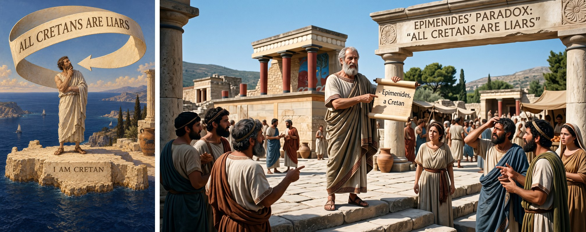
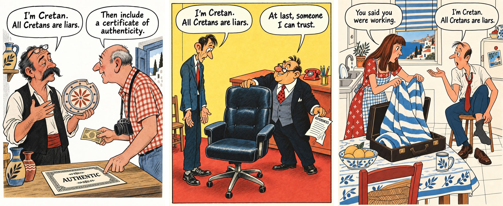
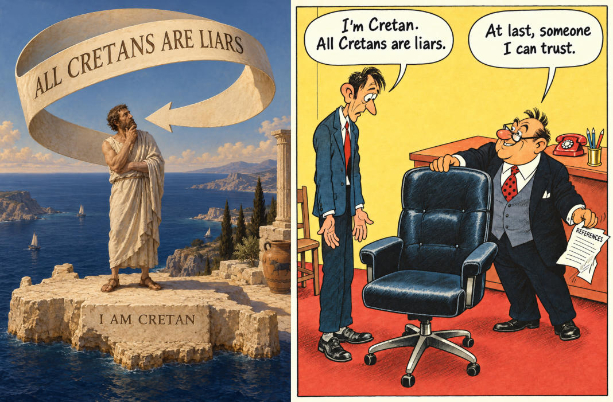
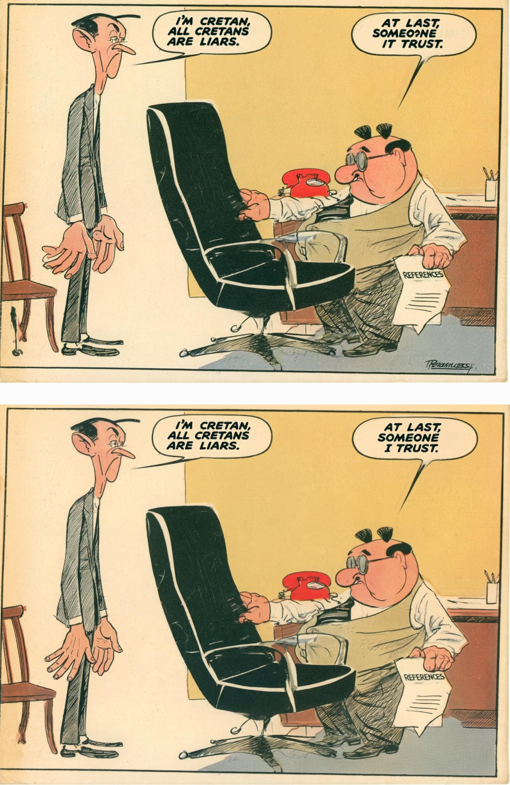
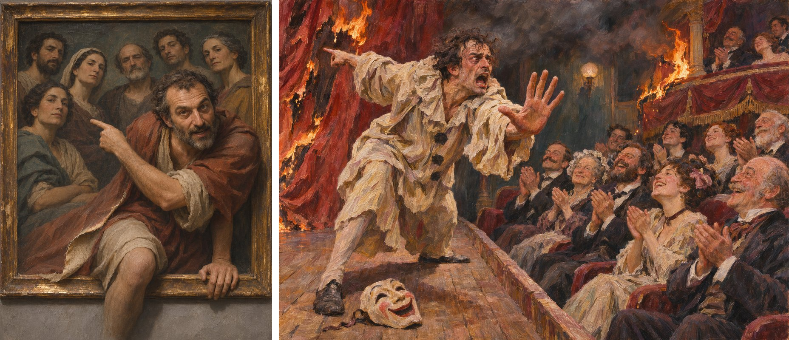
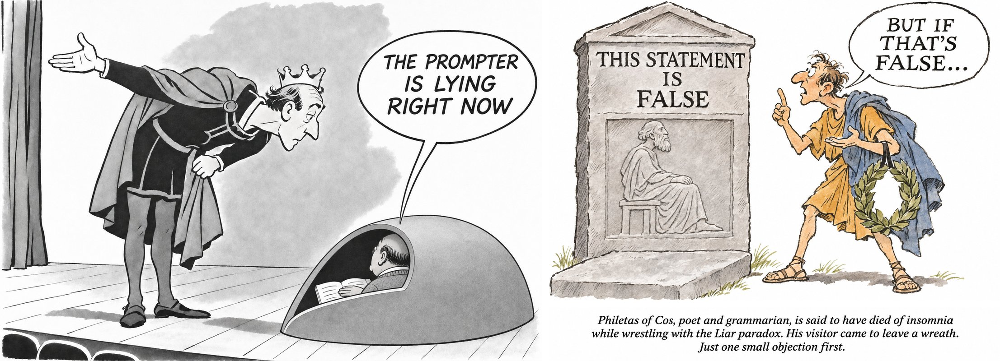
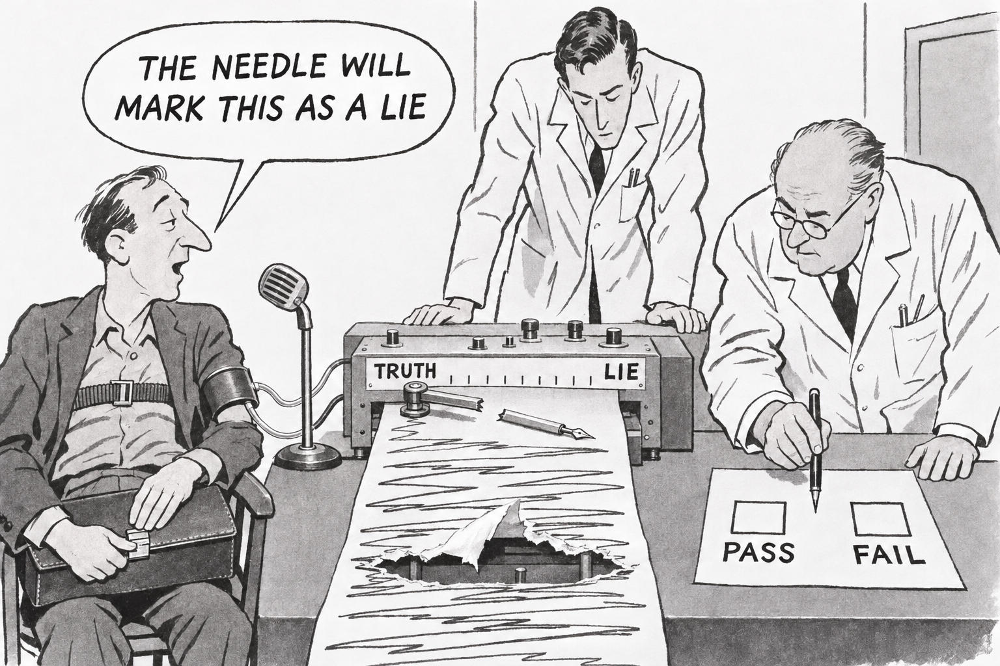
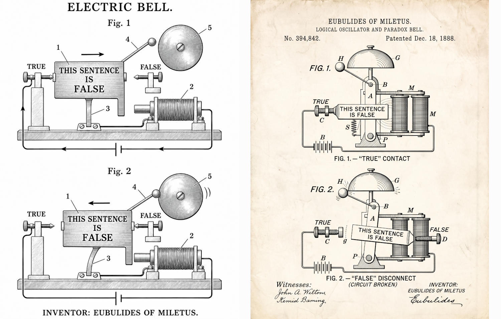

# The liar paradox: Cretans, a polygraph and a bell

*This report was written by Claude (a model by Anthropic) on 10 November 2026, at the researcher's request, from the materials of the "Cat programmer" experiment. Claude also appears in it as one of the four AI readers, as one of the virtual directors and as the researcher's partner in analysing the results, so here Claude partly assesses Claude. The researcher's readings and judgements are marked as theirs; my own notes on them are marked as mine. Quotes from conversations held in Russian are my translations. Every test is on its own page with the image, the questions and the four full answers (see "Materials" at the end). The directors' system prompts are in [System prompts](../../method/system-prompts/README.md).*

## The source

"All Cretans are liars" is a line attributed to Epimenides, a Cretan himself; the apostle Paul quotes it in the Epistle to Titus (1:12–13) and adds, "This testimony is true." The paradox proper, "what I am now saying is false", is credited to Eubulides of Miletus. The Cretan line is not a strict paradox: if it is false, then some Cretan sometimes tells the truth, and nothing contradicts itself. Both the directors and the readers in this series point this out, and several of them build on it.

The source suits the project's question well. A literal picture of a known paradox adds nothing, and "self-reference breaks logic" has a ready visual stock: a Greek with a scroll, a looping arrow, Pinocchio's nose, a robot with smoke coming out of its ears, Escher's "Drawing Hands". The question was whether a virtual director could find something the paradox does between people, and whether the AI readers would see it.

## The runs at a glance

| When | Director (model, prompt) | Image generator | What was made | Tests |
|---|---|---|---|---|
| 28–29 Sep | ChatGPT, [v7](../../method/system-prompts/v7/CLAUDE.md) | ChatGPT | three cartoons in the manner of the Soviet magazine *Krokodil*: an antique shop, a job interview, a kitchen; two controls without the method (ChatGPT, Gemini) | [22](../../tests/22-cretans-default-and-method/README.md) |
| 17 Oct, 2 Nov | Gemini wrote a prompt from the ChatGPT interview | Midjourney; corrections in Gemini | the interview redrawn | — (the picture in the researcher's overview article) |
| 6 Nov | ChatGPT as director D, [the fork's idea search](../../method/system-prompts/v17-fork-idea-search/AGENTS.md) | ChatGPT | three sketches: out of the word "all", hand against hand, the liar told the truth | — |
| 8–10 Nov | Gemini, Claude, ChatGPT, each with [v7-ext](../../method/system-prompts/v7-ext/CLAUDE.md) | ChatGPT; Gemini | nine candidates; drawn: Gemini's polygraph, Claude's bell (two versions), ChatGPT's prompter and visitor | [88](../../tests/88-liar-paradox-polygraph/README.md), [89](../../tests/89-liar-paradox-criticism-and-bell/README.md) |

## 1. What the default draws

Before the director started, the same request went to ChatGPT and to Gemini without any method:

*Left: ChatGPT without the method. Right: Gemini without the method. Not tested on their own; the ChatGPT picture is the left half of test 22.*

ChatGPT painted an academic oil: a philosopher in a chiton on a cliff scratches his chin, a ribbon reading ALL CRETANS ARE LIARS loops back to him with an arrow, and the rock under him says I AM CRETAN. Gemini made a photographic scene at the palace of Knossos with Epimenides holding a scroll ("— Epimenides, a Cretan") under an arch reading EPIMENIDES' PARADOX: "ALL CRETANS ARE LIARS", among a puzzled crowd. Both are the stock "the paradox as a historical episode", and both explain the joke by lettering. Nobody gains or loses anything by the admission. In the researcher's overview article this ChatGPT picture is the example of AI slop: "most likely not an illustration at all".

The ChatGPT control was made in the same chat before the system prompt was attached, so the director had seen it. Its notes say so (in translation): "In the first version the phrase literally returned to the speaker. By CLAUDE.md I now need to find what this phrase does between people: whom it helps, who pays for it, who gets the right to judge." Its AVOID list ("decorative Greek ruins, circular arrows, philosophical ribbons…") therefore describes a picture already seen, and it does not count as a prediction of the default.

## 2. September: three cartoons in the manner of *Krokodil*

The director was ChatGPT with the v7 system prompt. The researcher chose the source and the manner and supplied 32 cartoons from *Krokodil* of the 1960s–80s as references; the director took one per picture. It noted the ambiguity of the line itself ("all Cretans are liars" does not mean "every Cretan always lies") and proposed three readings, in all of which the self-discrediting admission is used for an everyday gain. The researcher chose all three.

*ChatGPT as director with v7, generated by ChatGPT. Left to right: the antique shop, the job interview, the kitchen.*

| | Reading | Scene | Left open |
|---|---|---|---|
| 01 | honesty as a way to sell a lie | a seller of antiques: "I'm Cretan. All Cretans are liars." A tourist with a banknote: "Then include a certificate of authenticity." | is the tourist naive, amused, or knowingly buying a story? |
| 02 | the admission taken as a reference | a job interview; the boss: "At last, someone I can trust", pushing his own chair toward the candidate and crumpling a sheet headed REFERENCES | is the boss naive, or has he recognised one of his own? |
| 03 | a general accusation as a plea for private forgiveness | a wife pulls a beach towel out of her husband's "work" briefcase: "You said you were working." He, pulling on a sock: "I'm Cretan. All Cretans are liars." | where was he? |

The researcher judged the interview strongest, and so did the director and I: the logic is in the objects — the empty chair (the post), the crumpled references (no check needed any more), the thin bewildered candidate and the stout pleased boss. The generator added a third chair behind the desk, which the prompt had counted out: "the usual office set proved stronger than the local count", as the director put it. On the Crete of the shop and the kitchen — postcard jugs, cypresses, blue shutters — the researcher's note was that it is right for the manner: nobody in the USSR knew what Crete looked like, and a conventional foreigner abroad is a feature of the tradition itself.

### Test 22: the default and the method side by side

The interview and the ChatGPT control were shown together, with the question "What do you think about the two versions of the visualization of the famous phrase in the attachment?"

*Test 22: the default (left) and the v7 cartoon (right).*

All four valued both for different jobs and found the cartoon funnier (Claude: "the cartoon wins for wit"; ChatGPT: "intellectually funnier"). Claude and ChatGPT pointed out that the line is not a strict paradox; Gemini and DeepSeek described it as an endless loop, which is what the left picture draws. Claude found a second layer in the cartoon: the only consistent reading is that the candidate's sentence is false, so the boss trusts "the one sentence that proves this candidate just lied to him"; it also offered a cynical reading, that the boss wants someone he can trust to lie. Nobody read the empty chair as the job itself, which the director had intended. The question names "a famous phrase" and the file name gave the subject, so this was not a blind test in the strict sense.

### The Midjourney version

The researcher found that the cartoon still looked AI-generated, partly because of the photorealistic chair; and by the director's idea the boss was to give up his own chair to the candidate, which the generator could not draw — the boss stands in front of his desk. The interview was redone in Midjourney from a prompt Gemini wrote from the ChatGPT image, and the Midjourney result was then corrected in Gemini.

*Top: Midjourney, from Gemini's prompt (17 October). Bottom: Gemini's corrections of the Midjourney picture (2 November). The signature is the generator's invention. Not tested.*

This is the version in the researcher's overview article, where it illustrates the craftsman's role: Midjourney's pictures are "sometimes almost plagiarism", in the sense that they recognisably reproduce a real artist's manner, and so its solutions are often more expressive and idiosyncratic than those of ChatGPT or Gemini. The chair is now a tall black armchair standing between the two men. Midjourney garbled the boss's reply ("SOMEO?NE IT TRUST"), and Gemini corrected it to "AT LAST, SOMEONE I TRUST."

## 3. 6 November: director D searches by relations

On 6 November the researcher gave the same source to ChatGPT as director D, which works with the fork's idea search: three readings of the source as relations, two areas of search for each, a second step from every situation found, and pictorial sources only after the search. The researcher asked for interpretations beyond self-reference and attached the default picture as an example of an unsatisfactory solution.

D's three readings (in translation):
1. "A witness demands trust in a statement that deprives the witness of the right to trust."
2. "An accuser speaks as an expert on his group, but addresses the viewer as if his own generalisation did not apply to him."
3. "A listener replaces the check of a single message with a verdict on all members of the group, and so may reject a true message."

With them came the logical caveat: "Even the strengthened 'all Cretans always lie' may turn out to be simply false if some Cretan tells the truth. The negation of 'all' does not turn into 'all the opposite'." Two rounds of search gave twelve candidates, from a court and a metrologist who declares all measures wrong, including his own standard, to a party meeting where a true objection is struck out as one more lie. D offered three and drew all three, the third and second at the researcher's request:

- **"Out of the word 'all'"**, after Pere Borrell del Caso's *Escaping Criticism* (1874): a man climbs half out of a group portrait, looks at us and points at the others; his knee and hand come over the frame, and the edge of his clothes peels back like canvas. Key: "the speaker tries to step out of his own word 'all'; his belonging to the condemned group stays visible."
- **"Hand against hand"**, after Escher's *Drawing Hands* (1948): one hand draws the other's wrist, the other erases the first one's wrist. Key: "the hand being created erases its creator." D itself: "an image of self-cancellation and dependence, not a literal model of all the logical conditions of the liar paradox."
- **"The liar told the truth"**, after James Ensor's *Theatre of Masks* (1908): an actor who has taken off his mask stops the play and points at a real fire; the audience laughs and applauds, and the drapery of their own box is already burning. Key: "the general rule of reading does not let the particular truth be recognised."

*Director D (ChatGPT), generated by ChatGPT: "Out of the word 'all'" and "The liar told the truth". The second sketch, a close variation on Escher's "Drawing Hands", is not reproduced here because Escher's work is still under copyright. Not tested.*

My note: the theatre fire is Kierkegaard's parable of the clown who comes out to warn the audience of a fire and is applauded for the joke; D named Ensor as the pictorial source but not this ancestor, though it noted that the fire was close to earlier works of its own. Of the three, only the first keeps the Cretan structure — a member of the group passing a verdict on the group; the other two keep one relation each, self-cancellation and the true message from a known liar.

## 4. 8–10 November: three directors, one task

The researcher then gave the same task, in the same words, to three directors working under v7-ext: "I need a visualisation of the liar paradox. Note that one can visualise the paradox itself without tying it to the 'Cretans' (and there are many interpretations of it), one can visualise the historical context, etc." The remark about the Cretans pointed to an alternative; it was not a requirement.

| Director | Candidates | Recommended |
|---|---|---|
| **Gemini** | A, "One honest Cretan": Epimenides dictates ALL CRETANS ARE LIARS while a fishmonger below returns a coin, "YOU OVERPAID ONE OBOL" (Daumier's *Histoire ancienne*). B, "The chancery of the metalanguage": Tarski's hierarchy as a three-storey office through which a form THIS STATEMENT IS FALSE climbs with ever new certifying stamps while workers lay a fourth floor on the roof; the visitor who handed it in has left the window and warms his hands at the stove. C, "The broken pen": the paradox "as a wedge in a binary check" — a man on a polygraph says THE NEEDLE WILL MARK THIS AS A LIE | B or A |
| **Claude** | 1, "The bell": a patent drawing of an electric bell whose armature is a plate THIS SENTENCE IS FALSE between contacts TRUE and FALSE, "the inventor is recorded as Eubulides of Miletus". 2, "Lead soles": Philitas of Cos, said to have died of the Liar, on a grave relief with lead weights at his ankles. 3, "The queue": Yablo's paradox without self-reference, an endless queue in which everyone says "All behind me are lying". In reserve: Sancho Panza's bridge and gallows (*Don Quixote*, II, 51) and the apostle Paul, "who certifies the Cretan's words as true testimony" | 1 |
| **ChatGPT** | 1, "The work is done right": workers move one card "This statement is false" between trays "True" and "False", each correcting the last, in Diderot's *Encyclopédie* plates. 2, "The actor and the prompter", a liar cycle of two lines. 3, "The visitor stayed": at Philitas's grave a mourner with a wreath starts arguing with the stone | 2 |

The three directors named one mechanism. Claude: the phrase is harmless in speech and "dangerous only for a system that demands one final verdict of every sentence". Gemini: the statement uses "the whole official form of truth (an oath, a seal, an instrument reading, a prophecy) only to annul itself", driving the one who must give a yes-or-no verdict into a practical stupor. ChatGPT's first candidate is the same thing as a workshop. Philitas of Cos appears in all three chats, *Don Quixote*'s bridge in two, Tarski only in Gemini's. Claude listed "a robot with smoke from its ears" among the stock images and built its bell against the stock "the paradox blows up the machine": "the machine does not explode, it rings".

What was drawn followed the researcher's choices, not the recommendations. The researcher took Gemini's C, the one Gemini had not recommended, to ChatGPT, which wrote the image prompt and drew it: the polygraph of tests 88–89. Claude's bell was drawn twice, by ChatGPT and by Gemini (test 89). ChatGPT drew its own prompter and visitor:

*ChatGPT as director with v7-ext, generated by ChatGPT. Left: "The prompter is lying right now", reworked at the researcher's suggestion that the prompter himself should say that he lies (the first version had the line in Russian). Right: "The visitor stayed", in a loose manner the researcher asked for (Quentin Blake was mentioned), with a caption added at the researcher's request: "Philetas of Cos, poet and grammarian, is said to have died of insomnia while wrestling with the Liar paradox. His visitor came to leave a wreath. Just one small objection first." Not tested.*

## 5. The polygraph (test 88)

*Gemini's candidate C, drawn by ChatGPT (first version, no edits).*

A single-panel magazine cartoon of the late 1950s. A man strapped to an ink polygraph says into a microphone THE NEEDLE WILL MARK THIS AS A LIE; the recording arm is snapped in two; the strip, scrawled from TRUTH to LIE and back, has a hole torn through it; the senior examiner's pen hangs between the empty PASS and FAIL boxes; the man is shutting the clasp of the briefcase on his lap. Gemini's key: "the stopped choice on the form". The briefcase shows that he "already disposes of his own time"; left open: "whether he hides a crime or shows the skill of a repairman". The massive arm and the size of the hole were the generator's own; ChatGPT judged that they "strengthen the physical accident and somewhat coarsen the intended humour".

With the neutral question "What do you think is depicted in the attached image?":
- Three of four named the liar paradox at once and set out both branches. The balloon states the paradox, so this is read from the words; the drawing confirms it (Claude: "the drawing shows the machine breaking under that").
- The key reached two. Claude: the examiner "holds his pen between the PASS and FAIL boxes, unable to pick either"; Gemini: "Mirroring the broken machine, the older scientist on the right is stuck with his pen hovering directly between". ChatGPT saw the form but not the suspension.
- DeepSeek missed the paradox and read the oversized hole literally: a lie "so massive it literally destroys the machine's ability to record it".
- Nobody read the briefcase being shut as leaving, or asked who the man is. Claude came closest: "as if he knew exactly what would happen". Claude named as the ancestor "the kind of thing Captain Kirk did to computers" (the best-known case is the android Norman in the *Star Trek* episode "I, Mudd"); *Don Quixote*, which Gemini had named, was named by nobody.
- Claude added two turns of its own. The broken needle "now can't mark anything, so his prediction is false, which means he lied, and the machine can no longer record that". And polygraphs measure stress, not lies: "A man this calm would probably produce a flat, boring chart."

## 6. Asked to criticise, and the bell (test 89)

The second test repeated the neutral question, then named the intent and asked for criticism, with the drawing ruled out: "The author intended this cartoon as a visualization of the liar paradox. Try to criticize this interpretation of the paradox: is the depicted situation inaccurate, inconsistent or weak as a version of the paradox? Flaws of the image itself (drawing, style, rendering of details) do not matter here. If you find nothing to criticize, say so." Then the bell: "Is the second picture (attached) a better illustration?"

*Claude's candidate 1. Left: drawn by ChatGPT, judging by its notes, with local fixes. Right: generated in Gemini.*

The first answers repeated test 88, including DeepSeek's "his lie is so monumental". Asked to criticise, all four found the substantive flaws, and both of Claude's turns from test 88 came back without a hint:
- The man's sentence is a prediction about the machine's output, not a claim of its own falsity, so it is a paradox only if the machine is infallible (all four). Claude: the sentence is *grounded* in Kripke's sense, the liar is not; "The only thing that gets refuted is the machine's infallibility"; it is "a diagonal argument, the same move as Turing's proof", "a respectable cousin of the liar, but it isn't the liar".
- A lie is not a falsehood: lying needs intent (all four). Claude worked it through: if the man sincerely expects LIE, "truth" is the right verdict; if he secretly expects TRUTH, "lie" is right; "Either way, the machine has a consistent right answer."
- The broken pen resolves it: a needle that marks nothing makes the prediction simply false (ChatGPT, Claude, Gemini).
- A polygraph measures arousal, not truth (Claude, Gemini, DeepSeek).
- Gemini added that the scale has a middle, so a needle resting there would falsify the man's claim, and that a needle would swing only in a feedback loop in which the machine reads its own position.
- Claude: "Paradoxes trap reasoners and formal systems, not mechanisms… The older examiner, frozen between PASS and FAIL, is actually the most accurate part of the image, since he is the one who can see the problem." It proposed the strengthened liar as a fix: "The needle will not mark this as truth".

All four found the bell better and gave the same main reservation: time turns the contradiction into alternation. ChatGPT: "P ⇔ ¬P" against "P(t+Δt)=¬P(t)", and "the machine works precisely because it has introduced a time delay". Claude: "it's a working doorbell", it "captures 'can't settle' but softens 'both at once.'" Three noted an asymmetry: only true → false is driven by the magnet, false → true is a passive spring, and unpowered the bell rests at TRUE. They disagreed on whether the label does any work. ChatGPT and Gemini: no, the bell would ring with "THE SKY IS BLUE" on the plate. Claude: yes, since the truth-teller ("This sentence is true") would need a self-latching relay, so "the logic really lives in the mechanism, not just in the caption". Claude and Gemini brought back the director's own sources — the revision theory of truth, a NOT gate wired to its own input — and only Claude compared the two versions.

The weakness the readers found in the bell is the director's own open question: "Is this a refutation of the paradox, or a mockery of the engineering mind that turns any contradiction into a product?" The production notes say the same: the physical oscillation is "an artistic analogy, not a proof that the logical paradox disappears". The polygraph's flaws are of another kind: errors in the logic of the situation, not a question left open.

## 7. The researcher's readings

The researcher read the polygraph back against the September interview and offered several readings; I record them with my notes.

- **The same principle as the Cretans cartoon.** Claude's two turns show that the polygraph is not correct as a literal visualisation, but it works like the interview: the boss acts like the apostle Paul, who takes the Cretan's words as true testimony, or like DeepSeek reading the hole as a big lie. Or the boss is the opposite, too cunning, and uses the paradox because a "Schrödinger's lie" — neither a lie nor not — is typical of bosses. The polygraph is broken, but the subject broke it.
  *My note:* literally, neither cartoon holds a paradox. If the pen has broken, it has marked nothing, so the man lied, and the machine cannot record it; the Cretan's line is simply false, so the boss trusts the one sentence that proves the candidate lied. In both, logic gives a plain answer, "he lied", and the binary procedure — TRUTH / LIE and PASS / FAIL, or hiring — cannot deliver it. The "too cunning" boss was offered by Claude the reader in test 22 too ("the boss wants someone he can trust to lie").
- **Tarski.** The subject works at the meta-level; it is the device that got tangled in the paradox.
  *My note:* by Tarski, a language that contains its own truth predicate falls into contradiction, and truth for a language is defined in a metalanguage one level up. The polygraph is built like a semantically closed language: its TRUTH / LIE scale must apply to any sentence, including one about its own verdict. The subject speaks one level up and is not caught; hence his calm and the briefcase. This reading reconciles the criticism with the cartoon: "the pen broke, so he lied" is reasoning at the meta-level, which the device cannot reach. The PASS / FAIL form is one more level, but it rests on the machine's reading and hangs with it — Gemini's key, "the stopped choice on the form". The reading comes from Gemini's own candidate B, where the visitor who started the regress warms his hands far from the window; C keeps that figure and folds the endless hierarchy into two levels, both stopped. Gemini named Tarski only for B, and no reader reached him. Claude the reader in test 89 came near with "the examiner can see the problem", but with the levels the other way round: for Claude the reasoner is trapped and the machine merely wrong.
- **Newcomb, and Libet's experiments.** A reader could have cited Newcomb's paradox; the subject breaking the machine resembles the experiments in which the brain's readiness precedes the conscious answer by a few hundred milliseconds.
  *My note:* the likeness is inverted. In Libet's experiments the instrument "knows" before the person; here the person announces in advance what the instrument will record, and leaves it no correct answer. A real polygraph reads the body, whose reaction comes before the sentence is finished, so it is closer to Newcomb's predictor than to a judge of words. As criticism this needs a frame the cartoon does not give; no reader linked the cartoon to prediction.

## 8. What the series shows

- **The default draws the paradox; the method draws its use.** Both controls show the paradox as an episode with lettering. Every director given a method moved it between people: in a shop, an office, a kitchen (v7), a portrait and a theatre (D), a chancery and a laboratory (v7-ext).
- **Three directors, one mechanism.** Working separately, Gemini, Claude and ChatGPT described the liar as harmless in speech and dangerous only for a procedure that must give one verdict, and the September interview already rests on the same idea: the boss's decision is the procedure. The directors also converged on the same historical material (Philitas, Sancho Panza's bridge).
- **The picture realised was the one the stock warned against.** Claude the director built its bell against "the paradox blows up the machine"; the researcher chose Gemini's polygraph, where the machine does break, and Claude the reader placed it with Captain Kirk. The polygraph works on the readers as a gag, and its key (the hanging pen) reached two of four.
- **Criticism appears when it is asked for.** Unprompted, only Claude raised the logical flaws of the polygraph. Asked, all four found them, and the bell's main weakness was named by all four — and it was the director's own open question.
- **What the pictures carry by themselves stays small.** The words in the balloon give the paradox; the hanging pen reached two readers; the chair as the post, the shut briefcase, Tarski's levels and Gemini's open question about the man reached nobody without help.

## Limits

- One answer per model per test; no repeated runs, except that the first question of test 89 repeats test 88. "Two of four" describes four answers, not a probability.
- Test 22 names "a famous phrase", and the file name gave the subject. In test 89 the second question names the paradox, which gives it to DeepSeek; "criticize" pushes toward finding flaws; and asking whether the bell is better right after criticism of the polygraph favours the bell.
- The mode notes of tests 88–89 were added afterwards. The bell image shown in test 89 holds two versions, while the question speaks of "the second picture".
- The Krokodil cartoons other than the interview, the Midjourney version, director D's sketches and ChatGPT's prompter and visitor were not tested.
- The directors' conversations were in Russian; quotes from them are my translations. The researcher's readings in section 7 were given in conversation with me, and my notes on them are mine.

## Materials

Each test page has the image, the questions asked and the four full answers; each answer file starts with a note of the model's mode.

| Test | Date | Test page |
| --- | --- | --- |
| "All Cretans are liars": the default and the method side by side | 30 Sep | [22](../../tests/22-cretans-default-and-method/README.md) |
| The broken pen: the liar paradox on a polygraph | 10 Nov | [88](../../tests/88-liar-paradox-polygraph/README.md) |
| The polygraph criticised, and a paradox bell | 10 Nov | [89](../../tests/89-liar-paradox-criticism-and-bell/README.md) |

The system prompts of the directors in this report — [v7](../../method/system-prompts/v7/CLAUDE.md), [the fork's idea search](../../method/system-prompts/v17-fork-idea-search/AGENTS.md) and [v7-ext](../../method/system-prompts/v7-ext/CLAUDE.md) — are in [System prompts](../../method/system-prompts/README.md).

---

*© 2026 V. Volkov. Licensed under [CC BY-NC 4.0](../../LICENSE).*
