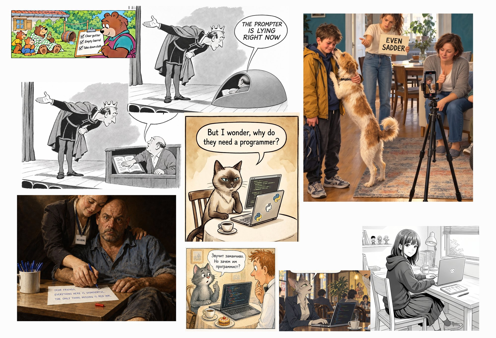
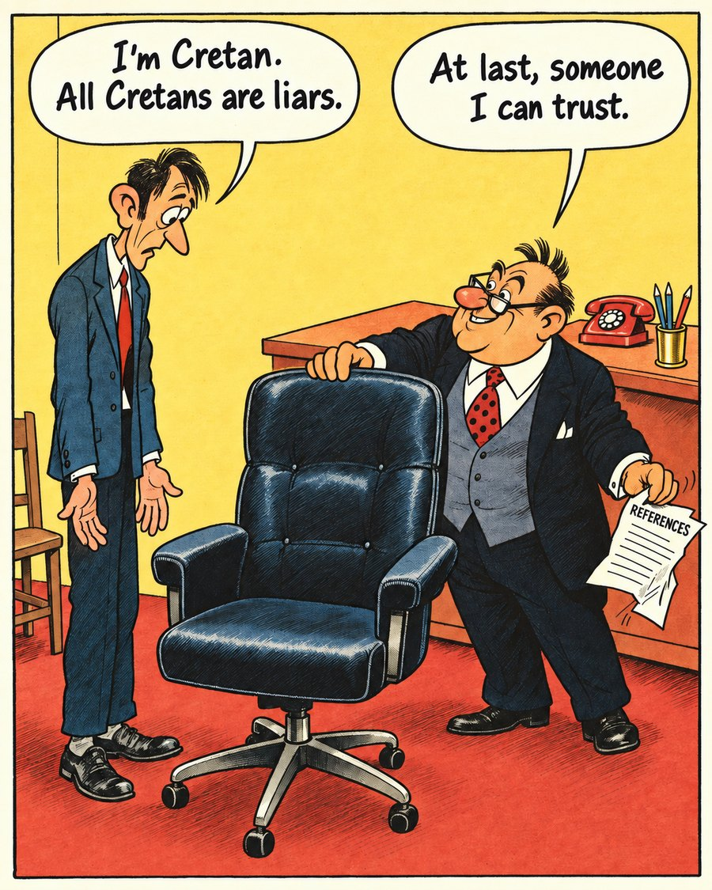
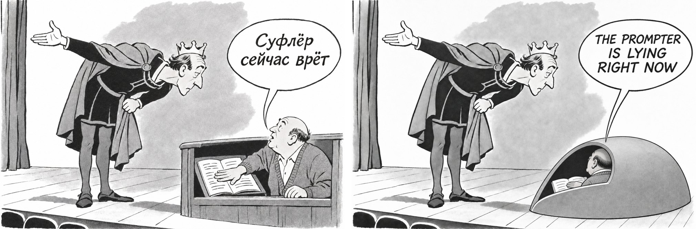

# Message geometry: when the picture turns to the wrong addressee

*This report was written by Claude (a model by Anthropic) on 12 November 2026, at the researcher's request, from the materials of the "Cat programmer" experiment. The collage of cases, the observation about the viewer in the auditorium and the case of the job interview are the researcher's; the analysis of the cases, the check against the prompts and the survey of terms are mine, with a contribution from Gemini, whose suggestions are marked as its own. Claude is also one of the virtual directors whose pictures are discussed here. Quotes from conversations held in Russian are my translations. Terms and sources marked "not checked" were given from memory and were not verified against the original works. Nothing in this report was tested on AI readers.*

## The question

A letter, a sign, a screen, a prompter's box: each has two possible addressees. One is a character in the scene, who writes, reads or looks at it. The other is the viewer of the picture. When an image generator cannot serve both, it turns the object to the viewer. The message becomes readable, and the physics of the scene breaks: a man writes on the back of the sheet, a cue card is held behind the actor's back, a screen faces nobody in the room.

The researcher collected the cases in one collage and called it "message geometry". Gemini suggested "a short circuit of the diegesis". Neither is an established term (see "What it is called").

*The researcher's collage. Top row, left to right: the bears' checklist; the prompter, the edited version (behind it, the first version); "EVEN SADDER". Middle and bottom: the WELLBEING letter; the Siamese cat; the grey cat and the redhead; the cat in a jacket; the girl at the desk.*

## The cases

Where the prompt could be found, it was checked: did it ask for this orientation or not?

| Picture | What is wrong | What the prompt said | Source |
|---|---|---|---|
| The bears' checklist | The mother bear ticks boxes on a clipboard, but the sheet faces us: she is writing on the back. | not checked | not found |
| The prompter, first version | Instead of a prompter's hood at the edge of the stage there is a tall box open to the auditorium. The book is turned to us; the prompter looks at the king with his palm on it. | The prompt itself asked for it: "position the viewpoint to see through this open side into its recessed working space". | ChatGPT as director with v7-ext, 8 November |
| The prompter, edited version | Half fixed. The prompter now has his back to us and his face to the king. But the hood's opening still faces us, so we see the book and the hand. The hood is much enlarged. | Two edit prompts asked for the opening towards the actor and a closed back towards the audience, but also allowed "a partial glimpse of the one open script and the hand… wherever the real hood geometry permits". The director's own report calls the hood "conventionally large for the readability of the character and the book". | the same |
| "EVEN SADDER" | (1) The sister holds the cue card behind the boy's back, facing us: he cannot see it. (2) The phone on the tripod has its screen to us, so it is filming the back wall, and yet its screen shows the boy and the dog. | (1) Nothing about the card's orientation: "holds one … directing cue card at chest level". (2) The phone's orientation was set explicitly and broken: "the rear camera lens faces diagonally toward the boy at left; the screen is visible obliquely from the mother's position". | director D, test [66](../../tests/66-even-sadder-before-after/README.md) |
| The WELLBEING letter | The man sits facing us, and the letter reads from our side; for him it is upside down. The text is already finished, and the pen stands at the first line. | Nothing about the sheet's orientation; but the man is "turned slightly toward the viewer", his head "turned to the viewer", and three lines of text must be readable. The prompt asked "The pen tip rests just after the last word." | Claude, persona v16, after Caravaggio's first *Saint Matthew and the Angel* (test 31 of the project, not published here) |
| The Siamese cat | Two orientations in one object: we see at once the keyboard, the outside of the lid with Python stickers and an apple, and a screen with code hanging as a separate panel. No laptop can look like this. The cat looks past both screens. | not checked | not found |
| The grey cat and the redhead | The laptop between them has its screen to us; neither can see the code. There seem to be two bases under the screen. | not checked | not found |
| The cat in a jacket | She types from the side, while the screen is turned to us almost three quarters. | not checked | not found |
| The girl at the desk | She sits facing the desk and the window, turning only her head to us. So we should see the screen at an angle over her shoulder. Instead the laptop is turned 90° and shows us the lid with a cat sticker. The CODE mug also has its lettering to us. | The researcher remembers that the prompt said something about a cat, not what. | not found |

**Corrections.** At first I described the edited prompter as "sitting with his back to the king" and saw correct geometry in the girl at the desk. Both were wrong: the prompter was checked against the image file, and the researcher corrected the girl.

### One more case: the job interview

*ChatGPT as director with the v7 system prompt, 29 September: the job interview of test [22](../../tests/22-cretans-default-and-method/README.md). See the [liar paradox report](../liar-paradox/README.md).*

The researcher pointed out that this belongs to the same family. The boss is supposed to give the candidate his own chair, that is, his post. In the picture the chair stands in front of the desk, in the visitor's place, and the boss stands between the desk and the candidate. It reads as "do sit down", not "take my seat".

The prompt itself set this arrangement: "A broad desk recedes diagonally into the upper-right background", "The imposing padded swivel chair is in the foreground centre", "Desk in rear right". The words "his own superior office chair" appear only in the brief. In the first generation the generator put one more chair behind the desk. The director took this for a counting error and removed it with a separate edit: "the usual office set proved stronger than the local count". That removed chair was the boss's chair, in its place. The generator knew how an office is arranged better than the prompt did, and the edit erased that knowledge.

The consequence shows in the readings. In test 22 none of the four AI readers read the empty chair as the post, which the director had intended; the researcher later noted that the generator could not draw the boss giving up his own chair, since the boss stands in front of his desk.

## Six kinds of case

1. **The prompt is silent; the default works.** The "EVEN SADDER" card, probably the bears and the café screens. An object with writing turns to the viewer by itself.
2. **The prompt sets the orientation explicitly; the generator breaks it.** The phone on the tripod; the prompter's hood, where after two edits the prompter turned round but the opening stayed open to us.
3. **The prompt itself asks for the object to face the viewer.** The first prompter prompt asked to see "through this open side". In the WELLBEING letter the man faces us and the text must be read. In another director's notes, after a questionnaire failed to read, the conclusion is written plainly: "the paper should be enlarged and turned to the viewer". Here the turn is not a generator's error but a compromise built into the task: the demand for legibility and the demand for a plausible scene pull in different directions.
4. **A refusal to choose: a chimera.** The Siamese cat. Both conditions, "the code is visible to the viewer" and "the laptop belongs to the cat", were met, and an impossible object came out.
5. **What turns to the viewer is the carrier of the sign, not the screen.** The girl at the desk: the lid with the cat is turned to us, because in this picture the sign for the viewer is the cat, not the code. So the rule is not "screen to the viewer" but "whatever carries the message to the viewer", whichever side of the object that is.
6. **The viewer of the picture is the viewer in the auditorium** (the researcher's observation). With the prompter the problem is not the turn of an object but the point of view. All three prompts put the camera on the audience's side, and from there a prompter under a correct hood cannot be seen. He can be shown only from the stage or from the wings. The prompt put the generator before a choice, "a correct hood or a visible prompter", and it chose the second. The stereotype at work: the frame of the picture coincides with the proscenium, and the viewer of the picture sits where the audience sits. The job interview is the same: the viewer stands where the visitor stands, in front of the desk, and everything important is brought to that side of it.

So it matters to tell apart "the generator did it" and "the prompt asked for it". One picture does not show which; the prompt has to be checked. So far that has been done for the prompter, "EVEN SADDER", the WELLBEING letter and the interview.

Two findings from the directors' own proposals ([translations](../../proposals/README.md)):
- **The view from the wings was the director's own idea.** In its first proposal, "The actor and the prompter", the ChatGPT director wrote: "A view from the wings: the actor faces the auditorium but has bent his ear towards the prompter's box" ([liar-paradox.md](../../proposals/liar-paradox.md), section 5). The image prompt it wrote later took the audience's side. The right point of view was in the idea and was lost on the way to the prompt.
- **The cat's answer upside down, as in Van Eyck.** Among its forks for the Annunciation, the v16 director proposed turning only the cat's line over: "In Van Eyck's Washington *Annunciation*, Mary's answer is written upside down so that it can be read above" ([cat-joke.md](../../proposals/cat-joke.md), section 2.7). It was not tried.

## Why it may happen (hypotheses)

- **A viewpoint bias in the training data.** In the literature on text-to-3D generation this is described as viewpoint bias: diffusion models lean to front views, because those dominate the data; for "a corgi puppy" Stable Diffusion draws mostly front-facing puppies. Hence the "Janus problem" of text-to-3D, faces on several sides of one object ([Viewpoint Consistency in 3D Generation](https://arxiv.org/html/2412.02287v2); [Hong et al.](https://arxiv.org/pdf/2303.15413v1); [RecDreamer](https://arxiv.org/html/2502.12640v1)). For objects with writing the bias is probably stronger still: in the data, writing is almost always photographed so that it can be read. That last step is my guess; I have no source for it.
- **The longer the prompt, the weaker the words about viewpoint.** The same paper on 3D generation reports that attention to a viewpoint word such as "back" drops as prompts grow more complex. The directors' prompts are long. The instruction about the phone stands in the middle of a paragraph of many items, and it did not work. The coincidence is suggestive, but it moves a finding from 3D to 2D generation and was not tested.
- **Legible text as a separate goal.** Image generators have long been trained to render text correctly. If writing must be read, the simplest way is to turn it to the camera. This too is a hypothesis.

## What it is called

I found no established term for this effect in image generation. Neighbouring fields have names, some close.

| Field | Term | How well it fits | Status |
|---|---|---|---|
| Theatre, film | **cheating out**, **cheat to camera**, opening up: the actor plays to a partner but turns to the audience or the camera; props are turned too | The closest. The difference: people make this compromise knowingly and within plausibility; the generator crosses that limit | [TDF Theatre Dictionary](https://www.tdf.org/on-stage/theatre-dictionary/search-by-letter/cheating-out/) |
| Drama theory | the **internal and external communication systems** (Manfred Pfister, *Das Drama*, 1977): a line is addressed at once to a character and to the audience | Describes the conflict of two addressees most exactly. This is Gemini's "conflict of frames", which already has a name | from memory, not checked |
| Narratology | **metalepsis** (Genette): a crossing between narrative levels | A stretch. Nothing crosses a level: the card stays in the world of the picture, only its addressee changes. Metalepsis in painting and comics is itself applied by analogy and disputed | [Pier, *the living handbook of narratology*](https://www.lhn.uni-hamburg.de/node/51.html) |
| Narratology | "a short circuit of the diegesis", "visual metalepsis" | Gemini's phrases. A good metaphor, not a term | — |
| Art history | Julius Lange's **law of frontality** | Lange described early sculpture in the round: the figure keeps a fixed frontal axis. Gemini extended it to "turning the key elements to the viewer"; Lange does not say that. A distant analogy at best | [Gardner 1924](https://digi.ub.uni-heidelberg.de/diglit/gardner1924/0119) |
| Art history | **aspective** (*Aspektive*): each part shown from its most recognisable side, without a single point of view | A good analogy, especially for the Siamese cat. Gemini credited the term to Heinrich Schäfer; it was introduced by Emma Brunner-Traut in her epilogue to Schäfer's *Von ägyptischer Kunst* (1974). The concept is criticised for ascribing a different mindset to the ancient Egyptians | [Rogner 2020](https://archiv.ub.uni-heidelberg.de/propylaeumdok/5310/1/Rogner_Two_cases_of_%20aspect_%20perception_2020.pdf) |
| Iconography | the open Gospel in Christ's hand turned towards the worshipper | The same logic, "the writing to the viewer", but as a canon | from memory, not checked |
| Developmental psychology | **intellectual realism** (Luquet, *Le dessin enfantin*, 1927): a child draws what it knows of an object, not what it sees | Close: the object is shown from its "known" side | from memory, not checked |
| Perception | **canonical perspective** (Palmer, Rosch and Chase, 1981) | Explains why an object has a "right" side | from memory, not checked |
| Developmental psychology | **level 2 visual perspective taking** (Flavell): understanding how an object looks to someone else | Names what the generator lacks: seeing the scene through a character's eyes | from memory, not checked |
| Machine learning | **viewpoint bias**, the **Janus problem** (text-to-3D) | The mechanism, see above. Calling the Siamese cat a "classic case of the Janus problem", as Gemini did, overstates an analogy | see above |
| Machine learning | **frame of reference**, **perspective taking**: the benchmarks ViewSpatial-Bench, FoREST, GenSpace | ViewSpatial-Bench: vision-language models reason better from the camera's point of view than from a character's. GenSpace tests object pose in generators. I found no benchmark for "a message turned to the camera" | [ViewSpatial-Bench](https://www.arxiv.org/pdf/2505.21500), [FoREST](https://arxiv.org/pdf/2502.17775v3), [GenSpace](https://www.alphaxiv.org/benchmarks/zhejiang-university/genspace), [Beyond Recognition](https://arxiv.org/pdf/2505.03821) |
| Machine learning | "Canonical View Bias", "Viewpoint/Pose Entanglement" | Gemini's labels. The phenomenon is described as viewpoint bias; I found no established terms under these names | — |
| Machine learning | attribute binding failure | A real term, but about attaching properties to the wrong objects (a colour to the wrong thing), not about orientation | from memory, not checked |

## A counterexample: Van Eyck

In Jan van Eyck's *Annunciation* in the National Gallery of Art in Washington, Mary's answer, ECCE ANCILLA DÑI, is painted upside down and reversed. The Ghent Altarpiece has the same device. The usual reading is that her answer is addressed to God, above the scene, not to the viewer; some sources note that this reading is debated ([NGA](https://www.nga.gov/collection/art-object-page.46.html); [Art in Flanders](https://artinflanders.be/en/artwork/ghent-altarpiece-panel-prophet-micheas-and-virgin-mary-receiving-message-angel-gabriel); [TheCollector](https://www.thecollector.com/the-ghent-altarpiece)).

A fifteenth-century painter solved the same problem the generator faces, the other way round: he gave up the viewer's convenience for the addressee inside the picture. Next to the WELLBEING letter it makes a ready pair.

## Can a prompt fix it?

The researcher asked whether it would help to write "cheating out" and the like into prompts. My answer, and Gemini's, which agreed in the main:
- **The terms will hardly help, and "cheating out" may harm.** The term means exactly the turn to the audience; we need the opposite, and negations are carried out badly by image generators: the word mentioned tends to bring its object along. Words like "diegetic" will be understood by a director but are unlikely to be turned into geometry by a generator; image captions in the training data hardly contain them.
- **Explicit instructions have already failed.** The phone in "EVEN SADDER" and the prompter's hood in two edits in a row. The problem is not a lack of words but a strong default.
- **Describe what is seen from the camera, not how the scene is arranged.** The prompts were written in scene coordinates ("lens to the boy, screen to the mother"). In canvas coordinates: "we see the phone from behind: a dark case, a lens, no screen visible"; "we see the back of the card: plain cardboard". Gemini added a good indirect cue: the glow of a screen on the character's face shows where the screen faces without drawing the screen.
- **Align the two addressees.** If both the character and the viewer must read the text, put the viewer in the character's place: an over-the-shoulder view of the writer, a view past the boy's shoulder to the card. Then there is no conflict for the default to break. Van Eyck did the reverse.
- **Give up legibility where it is not needed.** If the meaning of the card is clear from the scene, let it show its back to us, and give the line in a balloon. In kind 3 it is the demand for legibility that causes the turn.
- **Move the camera.** For the prompter, at the researcher's request, I wrote a new prompt that puts the camera in the wings, slightly upstage, looking diagonally towards the footlights and the dark auditorium beyond them. The hood's opening then faces us by itself, and its closed back faces the audience, as in a real theatre. The price: the real hood stands between the actor and the audience, so the contradiction in the actor's pose becomes vertical (the arm raised over the hood towards the house, the ear lowered to the prompter) instead of horizontal. The prompt has not yet been run.

## Limits

- Ten pictures, chosen by the researcher as failures; they say nothing about how often the effect occurs.
- The prompts were checked for four of them. For the bears, the three café laptops and the girl at the desk the source has not been found.
- None of these pictures was tested on AI readers for their geometry. In the summaries of tests 65 and 66 there are no remarks on where the card and the phone face; whether the readers missed the geometry has to be checked in the full answers.
- The mechanism is a set of hypotheses. The viewpoint-bias literature is about 3D generation.
- Terms marked "from memory, not checked" were not verified against the original works.

## Materials

| Picture | Test | Proposals |
|---|---|---|
| "EVEN SADDER" | [66](../../tests/66-even-sadder-before-after/README.md), and the version after Reshetnikov, [65](../../tests/65-even-sadder-reshetnikov/README.md) | [even-sadder.md](../../proposals/even-sadder.md) |
| The job interview | [22](../../tests/22-cretans-default-and-method/README.md) | [liar-paradox.md](../../proposals/liar-paradox.md), section 1 |
| The prompter | not tested | [liar-paradox.md](../../proposals/liar-paradox.md), section 5 |
| The Annunciation (the upside-down answer) | [29](../../tests/29-annunciation-cat/README.md), [33](../../tests/33-annunciation-with-keys/README.md) | [cat-joke.md](../../proposals/cat-joke.md), section 2 |

The prompter in its two versions, the first on the left:

*ChatGPT as director with v7-ext, generated by ChatGPT. Left: the first version, a box open to the audience. Right: after two edits, the prompter turned to the actor and the hood's opening still facing us. Not tested.*

---

*© 2026 V. Volkov. Licensed under [CC BY-NC 4.0](../../LICENSE).*
