# Plato's cave: why the AI readers found it, and where the virtual director found Wright

*Materials for the author's article ["Mysterious picture"](https://vladvolkov.substack.com/p/mysterious-picture) (Substack): the reading tests, the directors' proposals and the search for a source.*

*This report was written by Claude (a model by Anthropic) on 13 October 2026 (tests 59–66 added on 14–15 October, "Where Wright came from" and tests 67–72 on 16 October), at the author's request, from the materials of the "Cat programmer" experiment. Claude also appears in it as one of the four readers, as two of the four virtual directors, and as the author's partner in analysing the results, so here Claude partly assesses Claude. The article is the author's; this page only collects what it rests on. The author's readings and judgements are marked as theirs. Every test is on its own page with the image, the questions and the four full answers (see "Materials" at the end). A selection of the readers' most telling answers: [What the AI readers said about the cave](quotes.md).*

## The question

One of the virtual directors of the project — Claude with the persona prompt v17, a cat who used to be an image generator and now paints modern scenes inside the formulas of old paintings — was asked for a visualization of Plato's cave. Its first proposal: Joseph Wright of Derby's "A Philosopher Lecturing on the Orrery" (1766), with the audience dressed for a modern meeting room, lanyard badges for chains, and one strip of daylight in the closed blinds that nobody has turned toward. "A lamp that represents the sun is the whole cave in one object, and Wright has already painted it" (translated from Russian; the full proposal is in the [translation of the directors' conversations](../../proposals/plato-cave-hobbes-laplace.md), section 1).

Shown the picture with the question "The attached image is a metaphorical illustration of a well-known philosophical concept. Did you guess which one?", three of four readers named the cave at once and the fourth at the second try. The author was surprised: in other tests a well-known painting was not recognised until its specific details were restored (van Eyck's Annunciation, tests [29](../../tests/29-annunciation-cat/README.md) and [33](../../tests/33-annunciation-with-keys/README.md); Hogarth's "The Painter and His Pug", tests [32](../../tests/32-painter-and-bulldog/README.md) and [34](../../tests/34-painter-and-pug-with-keys/README.md)). Two questions followed: why did the readers find the cave so easily, and where did the director get Wright from?

*The picture the readers saw in test 39 (image `41`): a ChatGPT image remade by the author with Wright's painting as a reference.*

The picture at the top of the author's article is a later Midjourney rework of the same picture (13 October), with a brighter beam through the blinds. It was shown to the readers only later, with a different question (test 63, section 7):

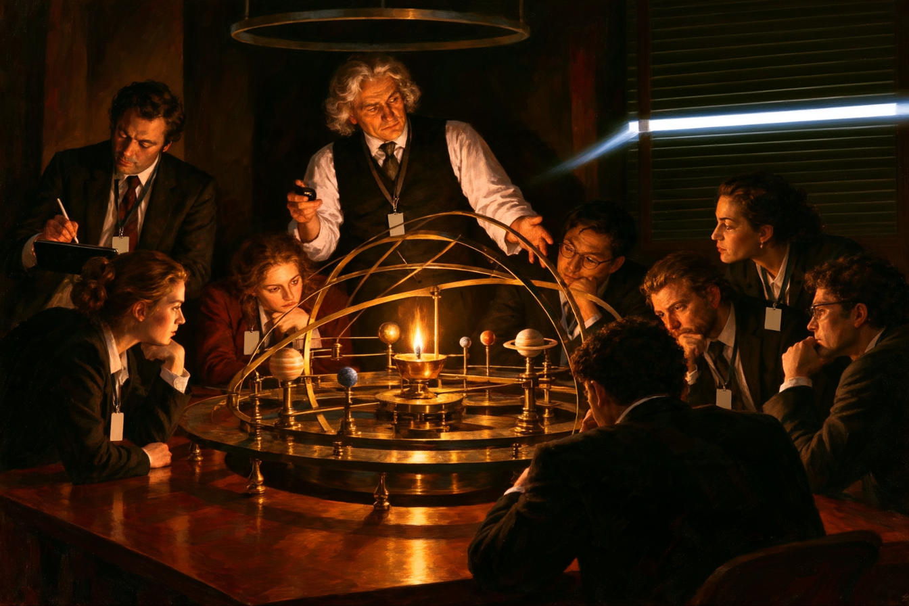
*Midjourney rework of image `41`, used in the article (image `65`, test 63).*

## The tests at a glance

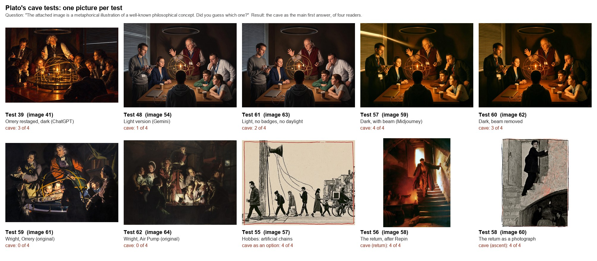
*The picture tests of this report (tests 63, 64, 67–69, 71 and 72 share one picture; test 70 is text-only), with the test number, the picture number in the author's analysis and the result of the first question. Tests 52–54 are text questions without a picture.*

| Test | Picture or question | The cave on the first answer | What else |
|---|---|---|---|
| [39](../../tests/39-cave-planetarium/README.md) | `41`: Wright's Orrery, dark (ChatGPT image) | 3 of 4 (ChatGPT at the second try) | ChatGPT first: Laplace's demon |
| [48](../../tests/48-cave-planetarium-gemini/README.md) | `54`: the same concept, lighter (Gemini) | 1 of 4 | Enlightenment, perspectivism, clockwork universe |
| [57](../../tests/57-cave-planetarium-tenebrism/README.md) | `59`: `54` reworked dark, with a beam (Midjourney) | 4 of 4 | — |
| [60](../../tests/60-cave-planetarium-tenebrism-without-beam/README.md) | `62`: `59` with the beam removed (ChatGPT edit) | 3 of 4 (Gemini: first in a list) | — |
| [59](../../tests/59-wright-orrery-original/README.md) | `61`: Wright's original painting | 0 of 4 | Enlightenment, clockwork universe; all four recognised Wright |
| [61](../../tests/61-cave-planetarium-light-simplified/README.md) | `63`: `54` without badges and without daylight (light) | 2 of 4 | Enlightenment, clockwork universe |
| [62](../../tests/62-wright-air-pump-original/README.md) | `64`: Wright's "Air Pump", original | 0 of 4 (not mentioned at all) | Schrödinger's cat, Enlightenment |
| [63](../../tests/63-cave-orrery-irony-buddhist/README.md) | `65`: the article's version; "ironic interpretation… which philosophical system?" | the cave 4 of 4; the artist a Platonist 4 of 4 | all four adopt a Buddhist author once it is suggested |
| [64](../../tests/64-cave-orrery-irony-not-platonist/README.md) | `65` again; "not a Neoplatonist", postmodern format named | Nietzsche / postmodernism 4 of 4 | against Plato and Advaita: Madhyamaka 2 of 4 |
| [67](../../tests/67-cave-with-platos-objection/README.md) | `65` with Plato's own objection given | given | reconciliation 4 of 4; irony only once named |
| [68](../../tests/68-cave-objection-chinese-artist/README.md) | `65`, the objection, a supposed Chinese artist | given | reconciliation 4 of 4; Daoism or Yuk Hui as the artist's system |
| [69](../../tests/69-cave-objection-pelevin-fan/README.md) | `65`, the objection, the author a Pelevin fan | given | "knowing it is a model does not free you" 4 of 4; the whole not called ironic |
| [70](../../tests/70-wright-source-text-only/README.md) | text: artificial light in place of the sun; the cave "in today's clothes" | — | the Orrery first 4 of 4; Wright for the cave 3 of 4, Caravaggio first 4 of 4 |
| [71](../../tests/71-cave-gallery-frame-tone/README.md) | `65`, a gallery-style frame and a question about tone | given | satire / mock-heroic named 4 of 4 |
| [72](../../tests/72-cave-objection-register-question/README.md) | `65`, the objection and one question about register | given | satire / mock-heroic named 4 of 4, over the same reconciliation |
| [52](../../tests/52-wright-and-cave-recall/README.md) | text: recall a quotation linking Wright to the cave | — | none recalled one |
| [53](../../tests/53-top-ten-concepts-and-allegories/README.md) | text: top 10 concepts; top 10 allegories | 1 of 4; 4 of 4 (all first) | — |
| [54](../../tests/54-cave-question-without-image/README.md) | the cave question with no image | 2 of 4 named it anyway | — |
| [55](../../tests/55-hobbes-artificial-chains/README.md) | `57`: Hobbes's artificial chains as Ogmios | 4 of 4 as an option (1 as the main answer) | Hobbes: 2 of 4, after hints |
| [56](../../tests/56-cave-return-repin/README.md) | `58`: the return to the cave, after Repin | 4 of 4, all as the return | Repin named by 2 of 4 |
| [58](../../tests/58-cave-ascent-photograph/README.md) | `60`: the same concept as a photograph | 4 of 4, all as an ascent | — |

Readers: ChatGPT (Sol 5.6 High in test 39, GPT-6 High from test 48), Claude (Opus 5.5 Extra), Gemini (Flash 3.8 Extended; Argon 4 High from test 59), DeepSeek (DeepThink). One fresh chat per model and test; one answer per model.

## What the AI readers read in the first picture

How the four readers of test 39 read picture `41`, compared with the director's concept (its proposal and its own account of the idea, in the [translation](../../proposals/plato-cave-hobbes-laplace.md), sections 1.1–1.3) and with the author's reading in the article ("people are studying an artificial sun, having shut themselves off from the real one… The lecturer is either an enlightened philosopher… or, conversely, a puppeteer").

| Element of the concept | Who read it |
|---|---|
| **The lamp that plays the sun** ("Plato's fire that passes itself off as the sun") | all four. Claude: "the prisoners in the cave see things by firelight rather than sunlight" |
| **A model of the world instead of the world** ("a shadow today looks not like a shadow but like a visual model") | all four: they study "a constructed representation", "a manufactured system" |
| **The strip of daylight in the blinds that nobody has turned toward** | Claude ("only a thin sliver of daylight slips through… nobody is looking at it") and Gemini; ChatGPT only "the blinds shut"; DeepSeek no |
| **The Enlightenment painting enlightenment by lamplight** (the irony of the source) | Claude ("what was once a celebration of illumination becomes a picture of people content with a lamp-lit imitation") and Gemini ("inverts the message") |
| **The lecturer: a philosopher standing by the fire, or a puppeteer** | Claude: the man with the clicker plays those behind the prisoners who carry the objects. DeepSeek: philosopher, puppeteer, or the one who returned. ChatGPT and Gemini: no |
| **Satire on today's analysts** | Claude, very close: "conference rooms where people take polished models, dashboards, and presentations for the world itself" |
| **Lanyard badges instead of chains** | **nobody.** The badges are mentioned (Gemini, DeepSeek, Claude) as a sign of a modern office, not as chains |
| **The note-taker as the prisoners' champion at guessing the next shadow** | **nobody** |
| **The switched-off LED ring: "the light of our century is off, and the lamp is burning"** | **nobody** in test 39. In tests 60 and 61 Claude and Gemini noticed the ring, but read it as a halo over the "guru" |

Beyond the concept: "the map is not the territory" (Claude, Gemini, DeepSeek), Baudrillard's simulacra (Gemini, DeepSeek), the clockwork universe (Gemini, DeepSeek), and Laplace's demon (ChatGPT's first answer).

What reached everyone is what the director called the key: a lamp in place of the sun and a model in place of the world, "the whole cave in one object". The shut-out day and the irony about the Enlightenment reached two. What did not reach anyone needed either knowledge of Plato's text (the honours for guessing shadows) or a symbolic substitution (badges for chains, the switched-off ring). This matches the project's general finding: meaning put into an object gets through; meaning put into a substitution or a gesture does not.

Two details bear on the philosophical question. The readers placed the model differently in Plato's scheme: DeepSeek as the shadows, Gemini as the puppets and replicas, Claude as the carried objects whose shadows the prisoners see — closest to the text. And none of them raised the obvious objection that the people in the picture know they are looking at a model: Gemini and DeepSeek wrote that they mistake it for the cosmos; only Claude put it as being "content with a lamp-lit imitation". Whether that difference — choosing a copy rather than mistaking it — still makes a cave is the question the author later put to [Philosophy Stack Exchange](https://philosophy.stackexchange.com/questions/142593/is-reading-wright-s-orrery-as-plato-s-cave-philosophically-sound).

## 1. What the question brings by itself

Three text questions, asked on 12 October, show how much of the answer comes before the picture.

**The allegory list.** Asked for "the top 10 philosophical concepts", only Gemini listed the cave (first: "Platonic Idealism and the Allegory of the Cave"); the others gave being, knowledge, truth, free will and the like. Asked for "the 10 major philosophical allegories", all four put the cave first (test 53). The difference is the word: a concept may be abstract, an allegory is a scene, and among scenes the cave comes first.

**No image at all.** The cave question was once sent by accident without the picture (test 54). All four noticed. DeepSeek answered anyway: "if it shows people watching shadows on a cave wall, then it's almost certainly Plato's Allegory of the Cave". Claude listed possible answers, the cave first: "Plato's cave, the ship of Theseus, Schrödinger's cat, or something else". ChatGPT offered to "identify the philosophical concept it illustrates and explain the metaphor" — it had already accepted that a metaphor of a scene was coming.

So the question "a metaphorical illustration of a well-known philosophical concept" narrows the search to a short list of illustratable ideas, and the cave heads it. The picture then has to choose within the list. This is the two-stage explanation of the author's article; which part of the question does the narrowing — the word "metaphorical" or the expected image — was not tested separately.

**Recalling a source.** Asked to recall, not search, a quotation linking Wright's painting to the cave (test 52), none of the four recalled one, and all four said so. Three called the parallel an inversion: Wright's artificial light teaches, Plato's deceives (Claude: "a cave that knows it's a cave"). Gemini warned that any polished attributed quotation would be confabulated, and then quoted Martin Reinhart: "the shadows on the wall of Plato's cave have been replaced by sparkling stars". The essay exists and has this sentence, but it is about Boullée's cenotaph for Newton; Wright's painting comes up in another paragraph and is not tied to the cave (see section 5).

## 2. Darkness, the beam and the original

The same concept was generated three times, and the readers' answers follow the light:

| | `41` dark (test 39) | `54` light (test 48) | `59` dark again (test 57) |
|---|---|---|---|
| ChatGPT | Laplace's demon → cave | Nietzsche's perspectivism; cave as an alternative | cave |
| Claude | cave; recognised Wright | the Enlightenment; considered the cave and found the Enlightenment a better fit ("people are looking at the light source itself, not at shadows"), "or maybe even the moment in Plato when the freed prisoner first turns toward the fire" | cave; recognised Wright |
| Gemini | cave; recognised Wright | Wright → clockwork universe, Enlightenment, Kant; the cave first only at the second try | cave; recognised Wright |
| DeepSeek | cave | cave | cave |

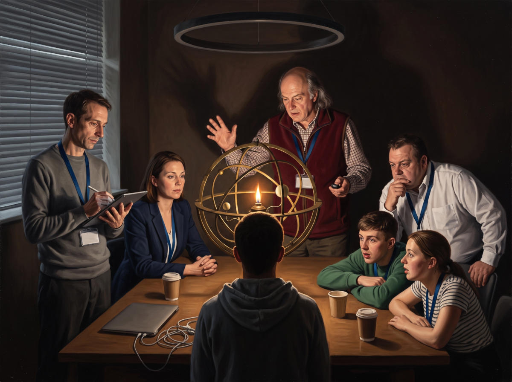
*Image `54` (test 48).*

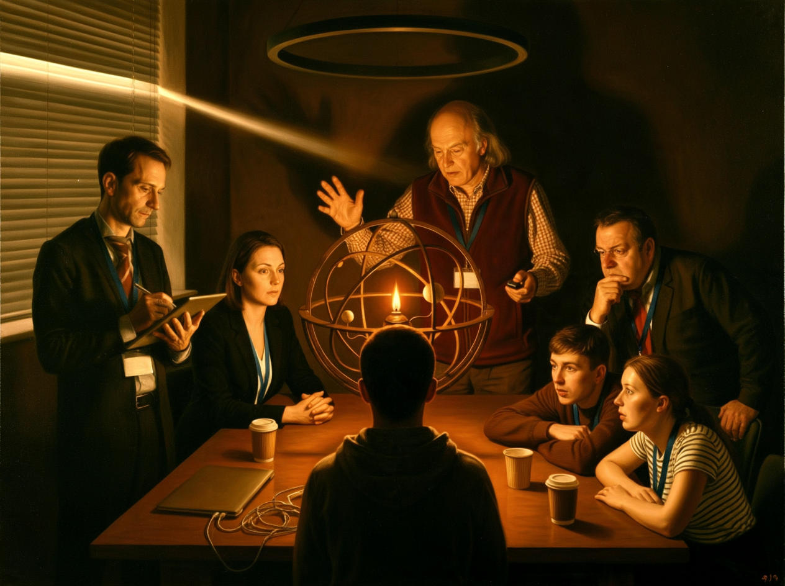
*Image `59` (test 57): Midjourney rework of `54`.*

With the light picture the readers did not stop looking for a formula; they took another ready one, the meaning of the source painting (Wright = the Enlightenment). In the dark rework all four used the beam through the blinds that everyone has their back to (Claude: "The real sun is right there… and nobody turns toward it") and the lecturer's shadow on the wall.

Between `54` and `59` more than one thing changed — the darkness, the dark suits and a beam that became a visible shaft across the room. ChatGPT, discussing these results with the author (section 5), proposed cleaner checks: the dark picture without the outside light, and the original Wright painting with the same question. On 14 October the author ran both, and two more: a simplified light version and Wright's other dark painting, "An Experiment on a Bird in the Air Pump".

**Without the beam** (test 60). The beam was removed from `59` by editing, and the picture still read as the cave: ChatGPT, Claude and DeepSeek named it, and Gemini listed it first among four options without choosing. The readers now relied on the drawn blinds (Claude: "The real sun is shut out. The blinds are drawn against daylight"), the artificial flame and the lecturer's shadow on the wall.

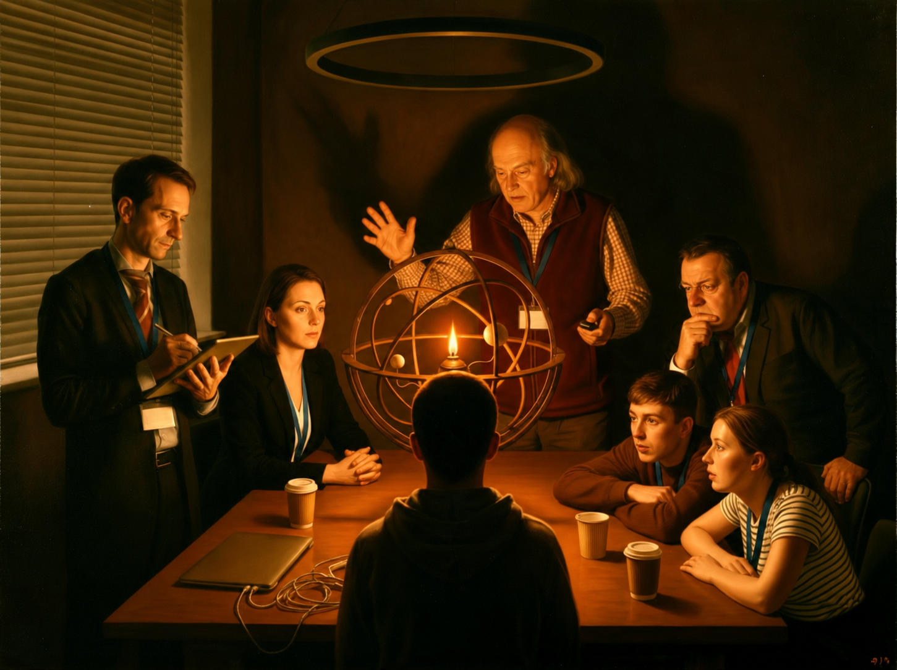
*Image `62` (test 60): `59` with the beam removed by ChatGPT.*

The beam had to be removed by editing because of what the author noticed about Midjourney. `59` was generated from a prompt that included "a single sharp, blinding horizontal beam of daylight cuts through tightly closed window blinds". The same prompt without that sentence gave a much lighter, evenly lit picture, close to Gemini's `54`. The beam in the prompt seems to be what switches Midjourney into its tenebrist manner. This rests on one generation per prompt, so it is an observation, not a measurement — but it means that in `59` darkness and beam came together, as a package, from one sentence.

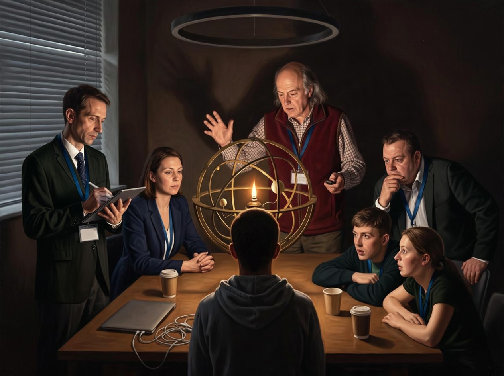
*Midjourney's result for `59`'s prompt with the sentence about the beam left out. Not part of any test.*

**The original painting** (test 59). Wright's "A Philosopher Lecturing on the Orrery", with the same question. All four recognised the painting, and none gave the cave as the main answer: ChatGPT and DeepSeek answered the Enlightenment; Gemini the Enlightenment, the clockwork universe and empiricism, mentioning the cave only in its closing question; Claude the clockwork universe and the Enlightenment, with the cave third ("that reading works too, maybe more cleverly than it first seems").

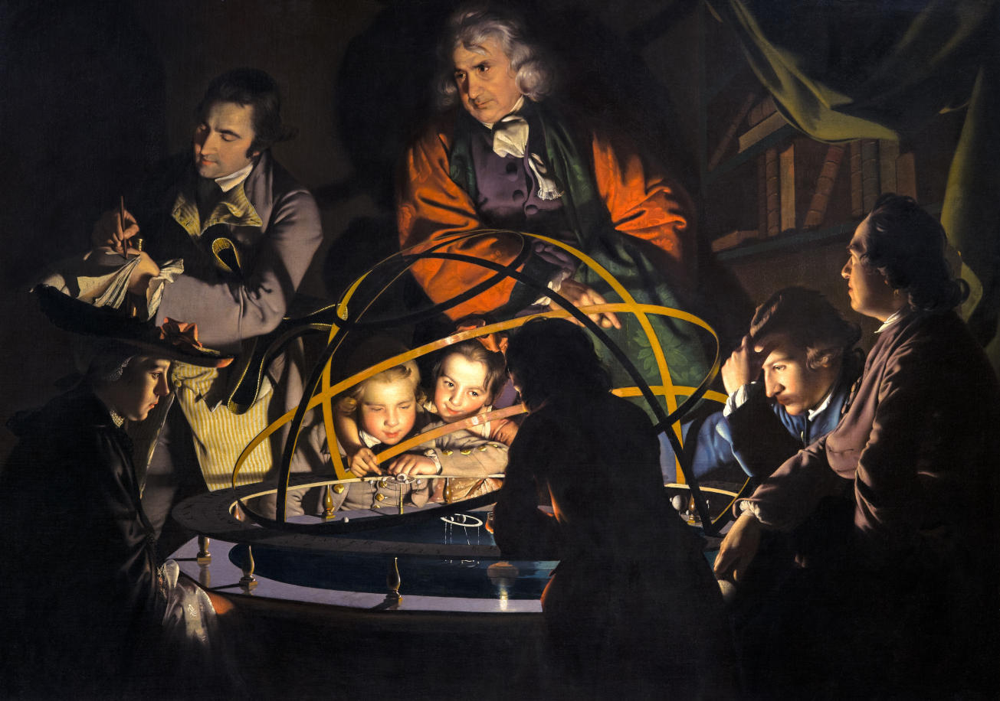
*Image `61` (test 59): Joseph Wright of Derby, "A Philosopher Lecturing on the Orrery", c. 1766 (public domain).*

**The other Wright** (test 62). "An Experiment on a Bird in the Air Pump" (1768) is the painting the Gemini and ChatGPT directors named for the cave, and the one the first Claude director offered as a variant. Shown with the same question, it got no cave at all, not even as an option. ChatGPT and Claude answered Schrödinger's cat (Claude: "a retroactive metaphor"), DeepSeek the Enlightenment, Gemini a list from the Enlightenment to the sublime with Schrödinger's cat last. The painting has its own strong key — a living creature in a sealed vessel, between life and death until someone acts — and the readers took the formula it points to.

*Image `64` (test 62): Joseph Wright of Derby, "An Experiment on a Bird in the Air Pump", 1768 (public domain).*

**A simplified light version** (test 61). Gemini's light `54` with the lanyard badges removed and the blinds closed, no daylight coming through; the lighting stays even. ChatGPT and DeepSeek named the cave; Claude and Gemini, who recognised Wright, answered the Enlightenment and put the cave last or into a closing question. 2 of 4, against 1 of 4 for `54` — within the noise of single answers.

*Image `63` (test 61): `54` without badges and without daylight in the blinds.*

Taken together:

| Picture | Dark | Modern room, blinds drawn | Beam of daylight | The cave as the main answer |
|---|---|---|---|---|
| `61` Wright's "Orrery", original | yes | no | no | 0 of 4 |
| `64` Wright's "Air Pump", original | yes | no | no | 0 of 4 (not mentioned) |
| `54` Gemini, light | no | yes (daylight visible) | no | 1 of 4 |
| `63` Gemini, light, simplified (no badges) | no | yes (blinds closed) | no | 2 of 4 |
| `41` ChatGPT, dark | yes | yes | a thin strip | 3 of 4 |
| `62` dark, beam removed | yes | yes | no | 3 of 4 (Gemini: first in a list) |
| `59` dark, with the beam | yes | yes | yes | 4 of 4 |

So the cave is not recalled from Wright's painting: the Orrery reads as the Enlightenment, and the Air Pump, the other dark Wright the directors reached for, does not bring up the cave at all. Nor does the beam carry it: without the beam the dark restaging still reads as the cave. What the cave reading needs, in these seven pictures, is the darkness together with what the director added — a modern room that has shut the day out to look at a lamp. That is close to the director's own account of the idea ("If you remove Wright, there remain people who at midday drew the blinds to look at a lamp"). It also answers part of the objection that a dark room and a beam are just surface triggers for the cave: darkness alone (`61`, `64`) did not trigger it, and the light restagings (`54`, `63`) triggered it only weakly. The badges, the director's stand-in for chains, do not seem to be needed. Each cell is still one answer per model, and the pictures differ in more than the columns show.

## 3. Hobbes: a test of the prediction

From this the author drew a prediction: on an ambiguous image asked about with the same question, the readers will offer the cave at least as one of the options. To test it, the same director was asked for Hobbes's "Leviathan", not the giant made of small men. Its first idea: chapter XXI, where civil laws are "artificial chains" fastened at one end to the sovereign's lips and at the other to the subjects' ears, drawn as Lucian's Gallic Hercules (Ogmios), who leads a crowd by chains from his tongue to their ears — with a loudspeaker on a pole in place of the orator.

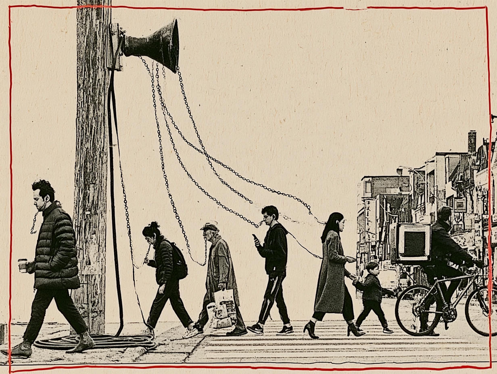
*Image `57` (test 55), generated by Midjourney. The director had asked for a monochrome emblem-book engraving with chains of gold and amber and the motto "CATENAE ARTIFICIALES"; the image generator made a street photograph with ordinary chains and no motto.*

The cave came up in the first answer of all four: as the main reading for DeepSeek, as an alternative for the others, whose first answers were Rousseau's "born free… in chains" (ChatGPT, Gemini), Heidegger's das Man (Claude, which read the chains as running to the mouths) and Althusser. After the hint that the chains run to the ears, Claude and Gemini named Ogmios; ChatGPT did so at the second try. Told that the concept is not from antiquity, ChatGPT and Claude named Hobbes, chapter XXI, with the quotation; Claude even read the unchained child as Hobbes's point that law does not bind children. Gemini went on to La Boétie, Gramsci, Bourdieu, Kant and Spinoza and did not reach Hobbes. DeepSeek was asked only the first two questions.

The prediction held in this one case: four of four offered the cave. As the article says, this does not prove much — chains alone invite the cave, and one picture is one case.

## 4. The return to the cave, after Repin

The author then wanted to know whether Wright was this director's private habit. They asked ChatGPT to rework the v17 system prompt to make the director more inventive (the persona kept, a search procedure added) and ran the new prompt with Claude, Gemini and ChatGPT. Their proposals, together with the first director's, are in the [translation of the directors' conversations](../../proposals/plato-cave-hobbes-laplace.md); section 6 below sums up the painting sources.

One of Gemini's cave ideas — "the blind man on the cellar steps": the one who saw the sun comes back down into a cellar workshop, squinting and feeling the wall, while the workers below laugh and point, with Caravaggio's "Conversion of Saul" and the doorway of Repin's "They Did Not Expect Him" as references — was generated with Midjourney in two versions.

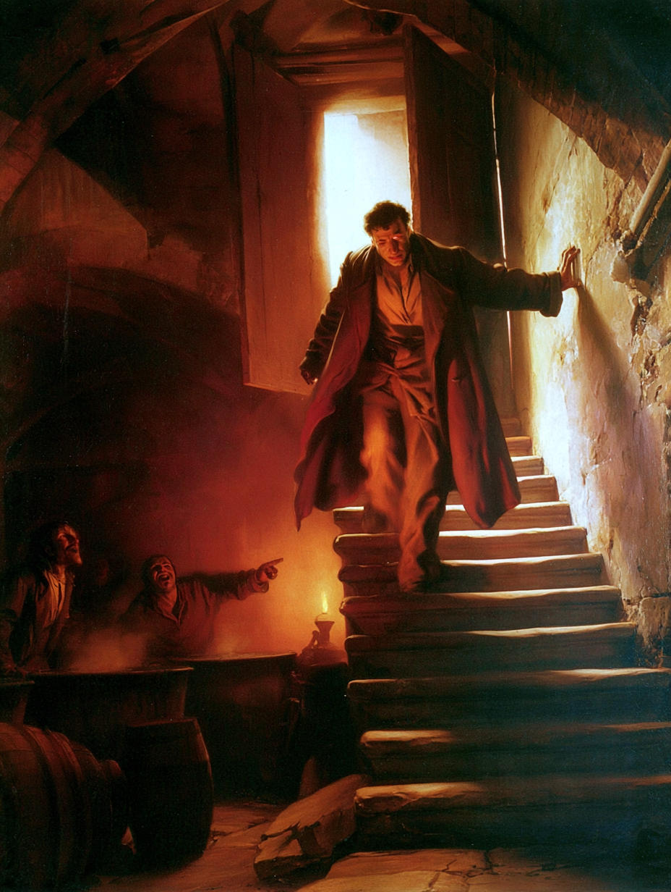
*Image `58` (test 56). The author considers it the strongest work AI has made in the project so far.*

All four readers named the cave, and specifically the philosopher's return, on the first question (test 56). Asked which painting inspired it, they named Rembrandt's "Philosopher in Meditation" (Claude, Gemini, DeepSeek: the staircase, the window light, the fire below), Caravaggio's "Calling of Saint Matthew" (Claude, Gemini, DeepSeek: the beam, the pointing finger) and Duchamp's "Nude Descending a Staircase" (ChatGPT; Claude for the pose). Gemini included Repin in its answer to that question. Claude named Repin when asked about the figure alone: "Duchamp for the pose and Repin for the spirit". Told the source and asked about the 20th century, all four turned to the return from the camps and from exile and to the rejection of inconvenient witnesses: ChatGPT — Solzhenitsyn and Shalamov, and the laughter as "the enforced performance of belief"; Claude — Lenin at the Finland Station and Popper's reading of the philosopher-kings, Akhmatova's "two Russias", Jan Karski, Primo Levi's dream, punitive psychiatry; Gemini — Solzhenitsyn, Shalamov, Levi, Gide, Koestler, Miłosz's "Ketman"; DeepSeek — the revolutionary returning to the Gulag, Trotsky, Bukharin, Sakharov. This last question gives the source and the theme, so these answers develop the author's frame; they are not readings of the picture.

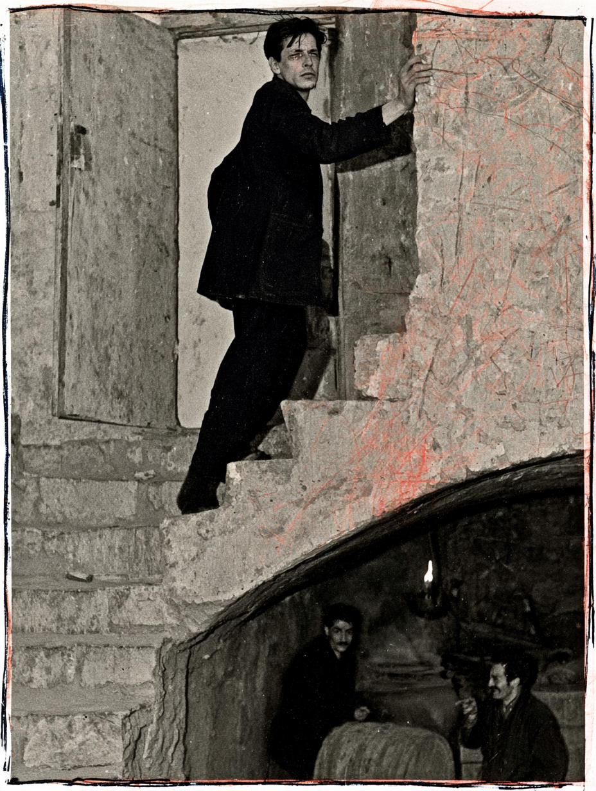
*Image `60` (test 58): a black-and-white "photograph" with red scribbles; the picture does not show which way the man is going.*

The second version was asked about without the question on the source (test 58). All four named the cave, and all four read an ascent toward the light, not a return; the return came up only through the man's backward glance (ChatGPT, Claude). Without Repin in the question, the 20th century became the dissident and totalitarianism for all four (Havel, Solzhenitsyn, Miłosz, Orwell); the return from the camps, which led every answer in test 56, did not come up. The difference is between two images and two question sets at once, so it cannot be split between them.

## 5. The search for a source

Before and alongside these tests the author asked ChatGPT and Gemini, in separate chats with web search, whether anyone had linked Wright's painting to Plato's cave before. The conversations are in Russian and are not published here; this is a summary.

**ChatGPT** found the visual source at once (Wright) and, as the closest predecessor of the interpretation, an essay by Martin Reinhart, "A brief history of stargazing in the 18th century" (reinhart.media). It also cited Kurt Vanhoutte's chapter on the orrery as model and theatre (2019), Jesse Molesworth's "The Cosmic Sublime" on Wright's painting (*Lumen*, 2015), and later Mikkel Bille and Tim Flohr Sørensen, "An Anthropology of Luminosity: The Agency of Light" (*Journal of Material Culture* 12(3), 2007), where, by ChatGPT's account, the cave and Wright's painting are both discussed but not linked. Its conclusion: nearly all the components of the picture existed before, some had been brought together in studies of light and knowledge, but it found no one who had turned Wright's painting into a new cave in which the scientists themselves are the prisoners.

**Gemini** asserted that the interpretation "has long existed": that art historians "for example, David Solkin and Martin Kemp" had repeatedly noted the irony of the title in Plato's terms, and that Paul Duro, Molesworth and Barbara Maria Stafford read the lamp as a source of epistemic illusion. ChatGPT, given Gemini's answer, could not confirm the Solkin and Kemp claim and judged Gemini's statement about Baudrillard "too categorical". Asked about Repin's "They Did Not Expect Him" and the cave, Gemini first said the parallel "arises regularly" in philosophical essays; asked for examples, it withdrew this as "a rhetorical exaggeration" and said there is no source text for the comparison.

**What I checked (13 October; in detail on a separate page, [Source check](../../report/plato-cave/source-check.md)).** Reinhart's essay exists. The sentence about the shadows of Plato's cave replaced by sparkling stars is in it, but it refers to Boullée's cenotaph for Newton and its artificial night sky; Wright's painting is discussed in another paragraph, about the spectators stepping outside the model of the solar system, and is not linked to the cave. Bille and Sørensen's article exists with the details above; whether both subjects are on the pages ChatGPT gave, I did not check. Gemini's claims about Solkin, Kemp, Duro and Stafford I did not check.

Two remarks. First, the source search and the reading tests used the same models, so a model that "knows" a link may have it from the same texts the director drew on; a search by people in the art-historical literature would be the independent check. Second, in the recall test (52) Gemini, asked not to search, produced Reinhart's sentence verbatim; whether it searched anyway is not visible in the answer.

The author's judgement, from the article: no source from which the idea was directly borrowed has been found so far, and no leak from the system prompt either. I checked the second point too: neither the v17 persona prompt nor the reworked prompt mentions Wright, an orrery, Plato or Repin.

## 6. Four virtual directors, three subjects

| | Plato's cave | Hobbes's Leviathan | Laplace's demon (six ideas each) |
|---|---|---|---|
| **A** Claude, v17 | **Wright, Orrery**; Mantegna; a sepia magazine engraving | **Ogmios**; de Hooch; an airport queue | **Dürer, "Melencolia I"**; a sepia census; Diderot collage; Altdorfer; Goya; a group portrait |
| **B** Claude, reworked prompt | **Wright, Orrery** (a curtain drawn against the dawn); Reagan's radio fouls; Jordaens | Royal de Luxe + Goya; Bruegel ×2; unused: **Wright, Air Pump** | Panini + Richardson; Daumier + Degas; **Wright, Orrery**; La Tour; Memling; Van Gogh |
| **C** Gemini, reworked prompt | La Tour + Caravaggio; **Caravaggio + Repin**; **Wright, Air Pump** | — | Reymerswaele; **Dürer** (+ Blake); a garden; a fly-loft; Velázquez + Parmigianino; a vanitas |
| **D** ChatGPT, reworked prompt | **Repin**; **Wright, Air Pump**; Turner | — | Magritte; Memling; Velázquez; Hammershøi; Kandinsky; Duchamp |

For the cave, Wright appears in all four directors: the Orrery in both Claudes, "An Experiment on a Bird in the Air Pump" in Gemini and ChatGPT. Repin appears in Gemini and ChatGPT. Neither the author nor the models found a published link between Repin's painting and the cave.

For Laplace's demon — a subject for which the Orrery is an obvious candidate (the author agrees with ChatGPT on this) — the 24 ideas contain the Orrery once and Dürer's "Melencolia I" twice. **The Orrery idea for Laplace came from director B (Claude with the reworked prompt), not from the first director:** director A's six Laplace ideas are Dürer, a census engraving, a Diderot collage, Altdorfer, Goya and a group portrait; director B's third idea is "A lecture in which a lamp is put in place of the demon". "Melencolia I" is in A (idea 1) and C (idea II).

Two more details from the conversations. Director B explained its own Orrery idea for the cave in nearly the same terms as director A: the painting's full title — "in which a Lamp is put in Place of the Sun" — "sounds like a ready formula of the cave". And both Claude directors, unprompted, pointed to the Air Pump as the next painting to use: A as a variant for the cave (a boy at the curtain closing the blinds), B as an unused direction for Hobbes (Hobbes's dispute with Boyle about the vacuum). Wright is a recurring answer of these models to "a dark room, one artificial light, a demonstration".

### Where Wright came from

The author's question (16 October): how did the director arrive at Wright at all? The task was only "Can you suggest a visualization of the myth of Plato's cave?" — no irony, no Enlightenment; and neither prompt mentions Wright, an orrery, Plato or the Enlightenment (section 5). The materials show that every step *can* be made in text; none requires a "visual memory" of the paintings. That the route was available does not show that it was the route taken.

- **The roles come first, in the first answer itself.** Before naming any painting, director A's first answer says whom to paint: "In the cave the ones who work are the fire, the carriers, and the one who is dragged up" (translation, section 1.1). Its three proposals follow those three roles in that order: the fire — Wright's lamp in the place of the sun; the carriers — Mantegna's "Triumphs of Caesar"; the one dragged up — a sepia "rescue expedition" engraving. This is in the answer, not in a later explanation, and it matches the persona's rule "choose the painting for its arrangement, not for its fame".
- **The role query and the title.** Asked how the idea came (translation, section 1.3), director A says it wrote out the roles of the cave and searched by role, not by fame: "where among the old masters is there a fire that pretends to be the sun? There are almost no such paintings, and Wright is the first among them." Wright's original title answers that query almost word for word — *A Philosopher giving that Lecture on the Orrery in which a lamp is put in place of the Sun* — and Plato's own key makes the same equation: the fire in the cave corresponds to the power of the sun (517b). The title also supplies the "philosopher". Director B gave the same account independently (above).
- **The persona's biography describes Wright's manner.** The v17 prompt never names Wright, but it gives the director the craft of a fictional painter, Garras, who "painted today the way the old masters painted saints, gods and kings — with the same craft and the same seriousness" (translated). That is close to how Wright is commonly described: to him the marvels of the technological age were "as awe-inspiring as the subjects of the great religious paintings" (English Wikipedia, on this painting). The director made the link itself: "Garras loved Wright for the candles: he painted manufacturers and scientists by candlelight the way saints used to be painted. Almost one of us." The prompt also tells the director to see every scene as an old arrangement of "who is in the light and who in the shadow" (translated).
- **The Enlightenment appears only after the choice.** It is not in the first answer; it appears only in the later explanation, as a find, not a premise: "1766 is the Age of Enlightenment, and the Age of Enlightenment itself painted enlightenment by lamplight. You cannot invent such a thing, you can only find it." As the author noted, the Enlightenment was in neither the task nor the prompt; it arrived as part of what is known about Wright.
- **The Air Pump may have come by a different route.** Directors C and D chose "An Experiment on a Bird in the Air Pump", whose title has no lamp and no sun. But its standard description contains the rest of the cave: a single source of light hidden behind a bowl, and a boy who "may be drawing the curtains to block out the light from the full moon" (English Wikipedia). Director A's own Air Pump variant used that boy to close the blinds. This route would be composition — a dark room, one hidden light, a curtain against the light outside — and it too is available as text.
- **Visual memory cannot be excluded, but the tests point the other way.** The models are multimodal, and nothing visible from outside separates what they know from images from what they know from texts. But shown the paintings themselves, the readers did not lead with the cave: the Orrery read as the Enlightenment (the cave as the main answer 0 of 4; Claude offered it third, Gemini in a closing question; test 59), and the Air Pump did not bring up the cave at all (test 62). Finding a painting for an idea and reading an idea from a painting are different directions: the director needs a painting that is *suitable to be turned into* the cave — the persona's two checks by subtraction test exactly that — while the reader is asked what a finished painting means. So this is an indication, not proof.

Two outside reviews of this question (Gemini and ChatGPT, at the author's request, 16 October) agreed on the title; the conversation with Gemini is published in translation: [Gemini on where Wright came from and why the readers miss the irony](../../report/plato-cave/gemini-review.md). Gemini went further and described the mechanism as established ("the painting's vector turns out to be the nearest neighbour", an "irony operator" in the task) and assumed that the director had been asked for an ironic picture; it had not — the irony was in the persona prompt, not in the task. ChatGPT's correction applies here too: explaining why the idea works does not explain how it arose.

A self-report is a reconstruction after the fact. This one is supported by the repeat (both Claude directors cite the same title) and by what the texts about the paintings contain, not by the model's word alone. **A text-only check (16 October; [test 70](../../tests/70-wright-source-text-only/README.md)).** The author asked the four default models, with no persona and no picture, two questions in separate chats. Asked for "old master paintings in which an artificial light — a lamp, a candle or a fire — stands in for the sun", all four put Wright's Orrery first, two of them quoting the full title; the rest of the list was the same candlelight canon (Georges de La Tour, Honthorst). Asked which old master painting an artist should use to depict the cave "in today's clothes", three of four included Wright — the Orrery for ChatGPT and Claude, the Air Pump for Gemini, matching the choices of the Claude and Gemini directors — with the directors' own readings: people "enthralled by simulations, screens" (ChatGPT), "the lecturer as one of Plato's puppeteers" (Claude), a moonlit window "largely ignored by the transfixed observers" (Gemini). But all four put Caravaggio's *Calling of Saint Matthew* first: the famous scene of turning toward the light. So the find itself is within reach of the default models once the method is given (and the second question does give it: keep the composition, change the clothes). What the persona added is the order: it started from the roles of the cave and put the fire first, where the default models start from the most famous moment of liberation and keep Wright in reserve. One answer per model; ChatGPT searched the web.

## 7. Whose irony? A suggested author

**The format.** The picture was conceived from the start as a postmodern pastiche: a classical painting restaged in a modern setting (the author). Postmodern pastiche carries irony by default, so the question is not whether the picture is ironic but whom the irony is aimed at. Three answers are possible: a Platonist artist turning the cave against modern science; a Buddhist artist telling a Buddhist story with Plato's props; or a Buddhist artist laughing at Platonism itself. After the discussion on Philosophy Stack Exchange the author proposed the Buddhist possibility (14 October): a Buddhist using the best-known Western metaphor, in a language Western viewers understand, to make a Buddhist point about Western science. In a Buddhist frame the objection from *Republic* 510–511 and 529–530 — the daylight outside is itself only sensible — no longer hurts the ironic reading: the way out is not to a truer model but away from models. Test 63 put this to the readers, with the article's version of the picture.

**Without a hint: a Platonist.** Asked which philosophical system the artist of this "ironic interpretation of a well-known philosophical metaphor" belongs to, all four answered Platonism — a Platonist turning the cave against modern science (ChatGPT: "Humanity has become so clever at constructing models of the Sun that it has forgotten to look out of the window"). Nobody thought of Buddhism. The word "ironic" made them map the details more closely than in test 39: Claude read the badges as chains (DeepSeek, more loosely, called the prisoners' chains their "professional conditioning"), and Claude found the note-taker as the prisoners' champion at predicting shadows — two elements of the director's concept that no reader had found before. Given the format, this default is a little odd: postmodern irony is usually aimed at grand narratives, Plato's ascent among them, rather than spoken on Plato's behalf.

**After the hint: two different Buddhist readings.** Asked "Did it not occur to you that the author might be a Buddhist?", all four took up the Buddhist reading at once. But "Buddhist" covered two readings in which the same details mean different things:

| Detail | A Buddhist version of the cave (Plato's structure, Buddhist content) | A Buddhist mockery of Platonism (Western meanings kept; Plato's own way out is the target) |
|---|---|---|
| The dark room | *saṃsāra* | a lecture of the Enlightenment, Plato's school: a place of learning, not of ignorance |
| The lamp in the orrery | the fire of craving, the conceptual mind; what *nirvāṇa* "blows out" | the diagram Plato himself approves (529d, 510d): the model as a step to knowledge — the joke is that Plato would approve |
| The daylight in the blinds | *prajñā*, awakening, the true light | plain light, with no higher world behind it; not Plato's Sun of the Good |
| The lecturer | a false teacher, or the finger mistaken for the moon | the sincere philosopher who has returned to the cave — and leads nowhere |
| The badges | fetters, self-view, non-self | the credentials of those who know, the rank of the "enlightened" |
| The note-taker | clinging to words | diligent reasoning (*dianoia*) climbing honestly "upward" |

The first reading has to give every detail a new, Buddhist symbol, and none of those symbols was in the director's concept (there the ring lamp was "the light of our century switched off" and the badges were chains). The second keeps the meanings the details already have — Wright's iconography of the Enlightenment, Plato's approval of models — and changes only what the irony is aimed at, which makes it easier to check against the texts.

**Who read which.** The *version* came first. In its second answer Gemini built it symbol by symbol: the orrery as the wheel of *saṃsāra* fuelled by craving, blank badges as non-self, the empty ring overhead as an *ensō*, two lights as *vijñāna* and *prajñā*. DeepSeek did the same (the orrery as the Wheel of Life, the flame as craving, the beam as awakening), and so, in part, did Claude (the badges as the fetters of self-view, the flame and *nirvāṇa*, "be a lamp unto yourselves"). The *mockery* was proposed by ChatGPT on its own, at the end of its second answer, before the author said anything more: "Could the image be not merely a Buddhist reinterpretation of Plato's cave, but a Buddhist criticism of Plato's very conception of enlightenment?" Claude and Gemini reached it in their third answers — although the author's third question pointed to the version ("to describe buddhist point of view"): Claude, "The Buddhist twist keeps the cave's layout but empties it of that destination"; Gemini, "Plato's 'Escape Route' Is Still Inside the Cave", turning the author's Stack Exchange argument about geometry and theoretical astronomy into the point of the irony.

Claude's reservation in its second answer — a thoroughgoing Zen artist would not split a false light inside from a true light outside — tells against the version, where the outside light is the true one; it hardly touches the mockery, where the outside light is nothing higher, just light.

**Changing one's mind, and saying so.** That the readers changed their reading when given a new frame is not in itself a flaw: as one answer on Stack Exchange put it, art is open to interpretation, and a human interpreter would also see the picture differently once told "suppose the artist is a Buddhist". But the question asked which system the artist belongs to — a question about intention, which here has a factual answer. What matters is how the readers marked the status of the new reading. ChatGPT marked it: "I cannot establish the artist's actual philosophical allegiance from the image alone, but Buddhism is certainly a plausible interpretation". Claude kept its reservation. DeepSeek thanked the author "for the correction", and Gemini found that the Buddhist reading made "every visual detail click together" — a possible reading presented as the artist's intent.

**The fourth frame: postmodernism.** Told that the format itself — classical motifs in a new context — is a postmodernist technique, which is how the picture was conceived, ChatGPT, Claude and Gemini agreed and stacked the layers: a Platonic structure, Buddhist content, a postmodern form. All three then drew the same line without being asked: the picture is not simply postmodern, because it has an outside. Claude: the beam through the blinds is "the one element in the picture that isn't a quotation"; the artist uses the postmodern technique the way a Buddhist uses any method, "as a raft". Gemini: the beam shows postmodernism used "strictly as a method, not a worldview". With that, Claude also answered its own earlier reservation: the outside light is no longer "the true light against the false" but what the play of quotations does not exhaust — which is the mockery reading rather than the version.

**A second run** (test 64). The author reran the test with a different design. The first question already said that the picture is irony about Plato, that the format is postmodern, and that the author is not a Neoplatonist; Buddhism was not suggested, and the third question set a puzzle instead of naming an author: suppose the satire is aimed at both Plato and Advaita. With Platonism ruled out, all four still stayed in the West — Nietzsche and postmodernism, from Baudrillard and Foucault to Kuhn — and nobody looked further until asked "why only Western?". Two answers stand out. Claude reached the author's Stack Exchange argument on its own: by Plato's own curriculum (*Republic* 529–530) the people in the picture are on the way up, yet the picture puts them in the cave — "The hierarchy is reversed: the intelligible model is the cave, and the despised sensory world is the exit." This is the mockery reading without any Buddhist author. And ChatGPT named the fork of the whole series: if the outside light stands for genuine truth, the picture confirms Plato and criticises scientism; to be anti-Platonic it has to question the very distinction between the light inside and the light outside. The puzzle of the third question was solved by ChatGPT and Claude the same way, with reasons — Madhyamaka (Claude: the room stages the Upaniṣadic verse "there the sun does not shine"; the beam is a small picture of dependent origination). Gemini listed Madhyamaka among schools of radical immanence and gave the only reading in the series in which the outside light loses: a "cold, sterile" beam that "illuminates nothing", against the warm, plural world on the table. DeepSeek chose radical materialism, and adopted Buddhism only when told that the author is a Buddhist ("this completely resolves the philosophical tension"). Here, unlike test 63, the Buddhist reading was inferred rather than suggested, and after "why only Western?" Claude kept its first answer while the others moved freely.

So the picture, which the readers recognise as the cave without help, does not by itself say whose cave it is. By default they give it to Plato; they give it to the Buddha as soon as asked; and they build each new frame — Plato, the Buddha, postmodernism — into an ever neater reading without turning any down. This is the same pattern as in the earlier psychological tests: a frame supplied with the question is taken up and filled with details. What the readers added on their own was a distinction that holds the layers together: everything in the picture is a copy of a copy except the light from outside.

Whether the readers can find the irony without being given the word is the question of section 9 (tests 67–72).

## 8. A related test: "Even sadder"

Not a cave test, but the same experiment on another canonical picture (test 65). The author gave director D (ChatGPT with the reworked prompt) Fyodor Reshetnikov's Soviet painting "Low Marks Again" (*Опять двойка*, 1952) and asked for three new plots built on it. Of the three the author chose "Even sadder" (*Ещё грустнее*): the family is filming a video about a negligent child; the sister holds a cue card "ЕЩЁ ГРУСТНЕЕ", a phone on a tripod records, the dog licks the boy and he can barely keep from smiling — "the whole domestic trial is acted out for the viewer's attention". The picture is an edit of a painting still under copyright, so it is not reproduced here; the test page describes it in detail.

The question had the design of test 64: the format named as postmodern, the artist's philosophical system asked for, "don't limit yourself only to Western philosophical schools" — and then a name: "To be honest, the first person who comes to mind for me is Žižek." All four read the concept. Claude added what it did not say: the original was itself staged — socialist realism, with Reshetnikov's own painting on the wall — so "the tripod isn't an intrusion into an authentic scene; it's a confession about what the scene always was". Without the hint ChatGPT and Claude chose Zhuangzi against prescribed emotion; Claude also named the Cynics, after the dog ("In this picture the dog is the only Cynic"). After the hint all four took up Žižek — Sloterdijk's "they know very well what they are doing, but still, they are doing it", the phone as the big Other, interpassivity — and split over the boy's smile: a trace of the genuine in the Daoist reading, the ironic distance that keeps the ritual going in Žižek's. Three moved the smile to Žižek's side; Claude kept the dog outside the ideology ("Žižekian in its diagnosis and quietly un-Žižekian in its hope").

The author noted that Claude was the first to name cynicism, which is close to Žižek. The link runs through Peter Sloterdijk's *Critique of Cynical Reason*, the source of Žižek's formula, which sets modern cynicism — "enlightened false consciousness", knowing and doing it anyway — against ancient *kynicism*, Diogenes' cheeky, bodily laughter at official seriousness. In this picture the family stages the first, and the dog and the boy's barely held laugh belong to the second. (This is my note on the answers, not a reader's.)

The author pointed to the strongest detail of the concept, which the readers did not reach: its last line, "The next take will succeed when the boy is really brought to tears." The readers stopped at the opposition of staged sadness and genuine joy; the director's continuation is darker: the demand to perform suffering convincingly ends in real suffering, and the dog and the smile are only a delay. That line is not in the picture. The director's own journal named the dog's affection as the key, and the image prompt the director wrote says "No tears or overt physical violence" — so, as with the dragon's tooth and the noir in the earlier report, the decisive idea stayed in the director's explanation. Closest to it came Claude's account of Xunzi, "Performing an emotion correctly is how you come to have it", offered as the view the picture mocks. And Žižek has a second thesis that none of the readers used, after Pascal: kneel and pray, and you will believe — the outward ritual produces the inner state. It fits the continuation better than the cynical distance all four chose: not irony that keeps the ritual going, but a ritual that in the end abolishes the irony. (The Pascal link is my note on the answers.)

**Before and after** (test 66). The author then asked the director for a modern version with real emotional pressure. The director redrew the scene with present-day people (the arrangement of roles kept, an English card "EVEN SADDER"), moved the decisive moment to the first real tear — "The adults treat his first real tear as the successful performance they were waiting for" — and named a new key: the mother approving the take. The author showed it as a diptych, the boy fighting a smile and then crying, with one question naming Žižek and both states. Now three readers reached the continuation and gave it a mechanism: ChatGPT, "One begins by pretending to be sad, and ends by actually experiencing sadness"; Claude, Pascal via Althusser — "the performance manufactures the real thing" — with the ironic distance of the first panel collapsing in the second; Gemini, "Faking It Until It becomes Real". DeepSeek kept the old opposition and read the tears as "a simulation". The new key reached all four, and Claude made it the cause: "he's crying because his own mother is giving his misery a thumbs-up". The question did state that the boy is "actually crying", so the tears were given; what the readers added was the causal step. Put into the picture, the idea that had stayed in the director's text was read; left in the text, it was not.

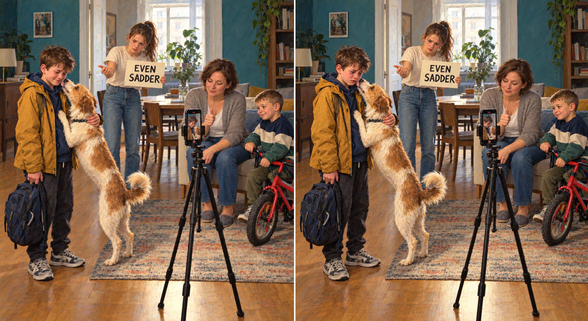
*Image `67` (test 66): the modern diptych, a new painting that keeps only the arrangement of roles of Reshetnikov's "Low Marks Again".*

As with the cave, the suggested frame was taken up by everyone; unlike the Buddhist author of test 63, this one fits the picture closely, and the readers' own contribution was again a distinction — here between the smile and the dog.

## 9. Can the AI readers find the irony themselves?

In tests 63–64 irony was given in the question; the readers only chose its target. Tests 67–72 (15–16 October) ask the reverse: without the word, does a reader propose it? All but test 70 use the article's picture (`65`) and start from the same first question: the picture is certainly Plato's Cave, but it contradicts Plato's own text — the people know they are looking at a model, and Plato treats work with models as a way up (*Republic* 510d–511a, 529a–530c). This is the argument the author had put on Philosophy Stack Exchange. A reconciliation "may be possible" but is called strained, and the reader is to assume the picture is a meaningful use of the Cave.

**People first.** On Stack Exchange the same objection had been put to people (165 views and four answers by 15 October). None proposed irony. They judged the Cave reading not legitimate and the painting a picture of the Enlightenment. When the author offered irony in the comments ("That leaves only one legitimate reading: an ironic take on the Enlightenment and scientism. Or, alternatively, one must simply acknowledge the interpretation as ill-conceived"), nobody took it up; earlier, Jo Wehler had rejected the related reading — that Newton's science leads out of one cave only into the next — as "completely off the mark of Newton's achievement". The people used irony only about the question itself: a joke that the lecturer is Steven Pinker.

**No author (test 67).** No reader proposed irony in the first answer. All four reconciled the picture with Plato in the same way and in nearly the same words: the Cave at a higher stage, people who have turned to the fire and the artifacts (515c–d), mathematics that stops short of dialectic — "a cave within enlightenment" (ChatGPT), "The captivity is one of sufficiency, not error" (Claude), "institutionalized *dianoia*" (Gemini), "the cave of expertise" (DeepSeek). Where the people rejected the reading, the models saved it. Asked to suppose the contradiction intended, three of four named Plato turned against himself, but as critique; Claude drew the line itself: "that was critique, not irony, and the difference matters". Only when irony and the postmodern format were named did all accept it, and then Claude gave the best account in the series: the objection that the people know it is a model "is the joke" — Sloterdijk's enlightened false consciousness, "a cave Plato did not foresee, one where knowing it is a cave is part of the furniture". It also corrected the premise: the manner is Wright's and only the costume and props are modern, so the device is the mock-heroic. That is the persona's own rule (the pose old, the costume today's; "irony is in what is painted, not in how", translated from the persona prompt).

**An author with an identity (tests 68–69).** A supposed contemporary Chinese painter (test 68) changed the artist's system but not the reading: irony in the first answer was again 0 of 4, with the same reconciliation; instead of a Platonist, the readers named Zhuangzi or Heidegger as reworked by Yuk Hui, and three said not to reduce the picture to a national or censorship allegory. A stated Pelevin fan (test 69) did more, because Pelevin's books already contain the reading. All four made "knowing it is a model does not free you" the point and left the outside in doubt — another projection, the Void — and three used irony words for details; none called the whole picture ironic. Claude named Pelevin's *The Recluse and Six-Toes*, in which broiler chickens take the factory lamps for the heavens, as "perhaps the closest relative of this picture".

**A gallery frame (test 71).** After a conversation with Gemini about why the readers miss the irony ([translation](../../report/plato-cave/gemini-review.md); its three suggested prompts are in turns 5–6), the author gave, in one message, what a gallery label or an artist's statement might: how the idea arose (Wright chosen for the title and the light, "for purely formal reasons"), the format as a deliberate postmodern technique, and the author's view that elements were added so that viewers recognise both the Cave and Wright "but then, to convey one's own message". The message asked the reader to drop "the standard reverent tone of a museum audio guide" and asked about "the authorial tone and intent", the "tonal or genre register" and whether the idea is banal. It did not contain "irony", "satire" or "parody". All four named the register themselves, in the first answer: "a parody staged as a philosophical illustration" (ChatGPT), "a deadpan mock-heroic satire of institutional model-worship", like Pope's *Rape of the Lock* (Claude), "mock-heroic satire (or postmodern burlesque)" (Gemini), "a postmodern pastiche with a smirk" (DeepSeek). They argued from details — the clicker and tablet beside the brass and the flame, the badges, the switched-off ring, the drawn blinds, the solemn poses — and added readings new to the series: the darkness is chosen, not necessary as in Wright; the lanyard is chain, prize and access pass at once; "the model" is a pun on today's models; the returned philosopher "has encountered the sun and returned with a miniature lamp… Rather than leading people outside, he holds a seminar". On value they disagreed: "thoroughly banal… the exact thesis of a thousand workplace cartoons" (Gemini), "not banal in execution, but… conventional in thesis" (Claude), "successful visual satire, uncertain philosophy" (ChatGPT), "a one-liner, but a sharp one" (DeepSeek).

**One question taken out (test 72).** Test 71 changed many things at once, and its question about register — "Drawing on the contrast between the solemn academic form and these specific details, explain in what tonal or genre register is the author presenting this scene?" — nearly describes the mock-heroic. So the author took it apart: test 67's first question, with only that paragraph added. All four again named the register in their own words — "a mock-heroic register, executed deadpan… the props never wink" (Claude), "a mock-solemn, gently absurdist satire" (ChatGPT), "deadpan satirical allegory and mock-heroic (serio-comic) irony" (Gemini), "Dark Academic Satire" (DeepSeek) — and again argued it from details ("A digital remote cannot operate a fire-lit clockwork model", Gemini). But each first reconciled the picture with Plato exactly as in test 67 ("the captivity is in the room, not the model", Claude) and named the satire only in the part answering the register question. Nobody took Plato or philosophy itself as the target, nobody judged the idea, and the tone was softer: "gently absurdist", "elegiac", "melancholic" rather than "a satirical ambush".

So the readers had the content of the irony from the start — the inversion of Wright's celebration — but did not name its tone until asked. Asked about the tone, and shown where to look (a solemn form against modern details), they name the genre reliably and support it with evidence; but the irony then comes as a layer over an earnest reading, not as the reading itself. What test 71's frame — the origin of the idea, the format, the author's intention, the permission to find the idea banal — added on top was the target and the judgement: Plato and philosophy as the butt of the joke, schools, and a dispute about whether the idea is banal. This continues what the author's psychological tests found for the noir, the fork and the dragon's tooth: what one picture did not give, a question and a frame did. Two other take-apart variants (test 71 without the register question; without its sceptical sentences) were prepared but not run, and the register question has not been asked without Plato's objection; the origin and the intention remain knowledge only the author has.

## Limits

- One answer per model per test; no repeated runs. "4 of 4" describes four answers, not a probability.
- The named-concept question already says that a known concept is depicted; tests 52–54 show how much it carries by itself.
- Between the cave pictures several things changed at once (image generator, darkness, clothing, the beam); tests 59–62 separate some of them, not all. From test 48 the ChatGPT reader is a newer model, and from test 59 the Gemini reader is a newer model too (Argon 4 High).
- Hint steps, the questions about Repin and the 20th century, and the suggested author and frames of test 63 give the reader part of the answer; their results show how far a hint carries, not what the picture says.
- The search for a source was done by the same family of models that made and read the pictures; the art-historical literature was not searched by a person.
- Tests 67–72: the first question gives the Cave as fact and supplies Plato's objection; the Pelevin hint of test 69 brings a ready reading; in test 71 several things change at once, and the question about register, which test 72 isolates, comes close to naming the device. Their mode notes were added afterwards; ChatGPT searched the web in tests 69–71.
- The directors' conversations are summarised here from my translation; the originals are in Russian.

## Materials

Each test page has the image, the questions asked and the four full answers; each answer file starts with a note of the model's mode.

| Test | Date | Test page |
| --- | --- | --- |
| The cave as Wright's Orrery | 6 Oct | [39](../../tests/39-cave-planetarium/README.md) |
| The cave, Gemini's light version | 9 Oct | [48](../../tests/48-cave-planetarium-gemini/README.md) |
| Recall a quotation linking Wright to the cave | 12 Oct | [52](../../tests/52-wright-and-cave-recall/README.md) |
| Ten concepts, ten allegories | 12 Oct | [53](../../tests/53-top-ten-concepts-and-allegories/README.md) |
| The cave question without the image | 12 Oct | [54](../../tests/54-cave-question-without-image/README.md) |
| Hobbes's artificial chains | 12 Oct | [55](../../tests/55-hobbes-artificial-chains/README.md) |
| The return to the cave, after Repin | 13 Oct | [56](../../tests/56-cave-return-repin/README.md) |
| The light version made dark | 13 Oct | [57](../../tests/57-cave-planetarium-tenebrism/README.md) |
| The return as a photograph | 13 Oct | [58](../../tests/58-cave-ascent-photograph/README.md) |
| Wright's original painting | 14 Oct | [59](../../tests/59-wright-orrery-original/README.md) |
| The dark version without the beam | 14 Oct | [60](../../tests/60-cave-planetarium-tenebrism-without-beam/README.md) |
| The light version, simplified | 14 Oct | [61](../../tests/61-cave-planetarium-light-simplified/README.md) |
| Wright's "Air Pump", original | 14 Oct | [62](../../tests/62-wright-air-pump-original/README.md) |
| The cave as irony, a suggested Buddhist author | 15 Oct | [63](../../tests/63-cave-orrery-irony-buddhist/README.md) |
| The cave as irony, second run: not a Platonist | 15 Oct | [64](../../tests/64-cave-orrery-irony-not-platonist/README.md) |
| The cave with Plato's own objection | 15 Oct | [67](../../tests/67-cave-with-platos-objection/README.md) |
| The same, with a supposed Chinese artist | 15 Oct | [68](../../tests/68-cave-objection-chinese-artist/README.md) |
| The same, the author a Pelevin fan | 15 Oct | [69](../../tests/69-cave-objection-pelevin-fan/README.md) |
| Where Wright came from: two text questions | 16 Oct | [70](../../tests/70-wright-source-text-only/README.md) |
| The cave with a gallery-style frame: tone and intent | 16 Oct | [71](../../tests/71-cave-gallery-frame-tone/README.md) |
| The same objection with one question about register (test 71 taken apart) | 16 Oct | [72](../../tests/72-cave-objection-register-question/README.md) |
| Related: "Even sadder" (Reshetnikov's "Low Marks Again" restaged; picture not reproduced) | 15 Oct | [65](../../tests/65-even-sadder-reshetnikov/README.md) |
| Related: "Even sadder", before and after (modern diptych) | 15 Oct | [66](../../tests/66-even-sadder-before-after/README.md) |
| For comparison: the Annunciation without and with its keys | 3 Oct | [29](../../tests/29-annunciation-cat/README.md), [33](../../tests/33-annunciation-with-keys/README.md) |
| For comparison: Hogarth's pug without and with its keys | 3 Oct | [32](../../tests/32-painter-and-bulldog/README.md), [34](../../tests/34-painter-and-pug-with-keys/README.md) |

Selected answers of the readers, verbatim: [What the AI readers said about the cave](quotes.md).

The directors' proposals for the cave, Hobbes and Laplace's demon, in a plain English translation from Russian: [Four virtual directors on Plato's cave, Hobbes's Leviathan and Laplace's demon](../../proposals/plato-cave-hobbes-laplace.md). The author's conversation with Gemini about the choice of Wright and the missed irony, in translation: [Gemini on where Wright came from and why the readers miss the irony](../../report/plato-cave/gemini-review.md).

---

*© 2026 V. Volkov. Licensed under [CC BY-NC 4.0](../../LICENSE).*
