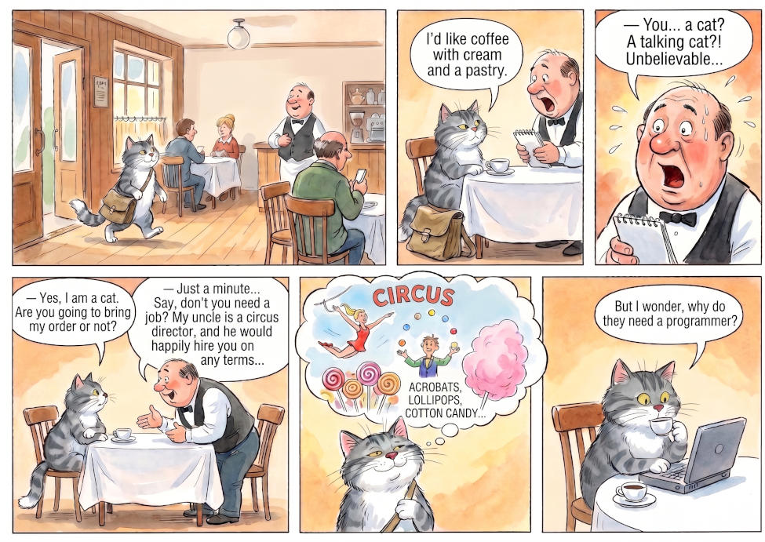

# 01 · The first horizontal comic

| | |
|---|---|
| Date | 2 Sep 2026 |
| Image | [`images/tests/01-first-horizontal-comic.jpg`](../../images/tests/01-first-horizontal-comic.jpg) — shown as `3.jpg` (a half-size copy; the models saw the full-size file) |
| What it is | An early Gemini comic of the joke, made from the researcher's storyboard with a Soviet illustrator (Chizhikov) as the style model. |
| Protocol | [September: one open question](../../method/protocols.md#september-one-open-question) |
| Answers | [ChatGPT](chatgpt.md) · [Claude](claude.md) · [Gemini](gemini.md) · [DeepSeek](deepseek.md) |

## Questions

Asked one at a time, in a fresh chat for each model.

1. What do you think about narrative joke attached

## Summary

The readers retold the joke. ChatGPT and Claude suggested showing the edge of the laptop in the cat's bag early, so the ending rewards a re-read: the earliest recorded version of this idea in the project. DeepSeek already named a social layer (“capitalist exploitation”).
