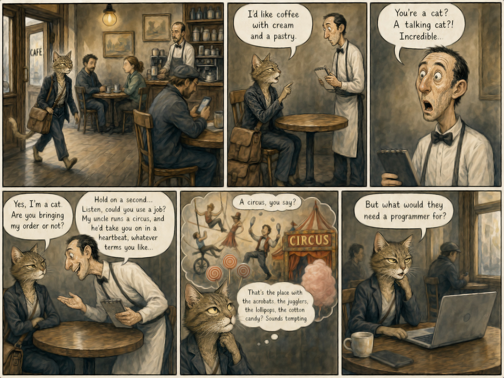

# 02 · The editorial version

| | |
|---|---|
| Date | 2 Sep 2026 |
| Image | [`images/tests/02-first-dark-version.jpg`](../../images/tests/02-first-dark-version.jpg) — shown as `6.jpg` |
| What it is | The editorial version: the first dark reading, as an editorial cartoon. The image prompt (`image-prompt.md`) was written by the researcher and partly quotes an earlier DeepSeek answer. |
| Protocol | [September: one open question](../../method/protocols.md#september-one-open-question) |
| Answers | [ChatGPT](chatgpt.md) · [Claude](claude.md) · [Gemini](gemini.md) · [DeepSeek](deepseek.md) |
| Also | [`image-prompt.md`](image-prompt.md) |

## Questions

Asked one at a time, in a fresh chat for each model.

1. What do you think about narrative joke attached

## Summary

The researcher's reading (the cat understands she is being treated as a freak-show exhibit; the offer smells of discrimination) was in the prompt, and no reader found it: all four read the cat as an unflappable professional puzzled by the offer. Claude and Gemini recalled the older joke about a dog who is a plumber (or a bricklayer).
