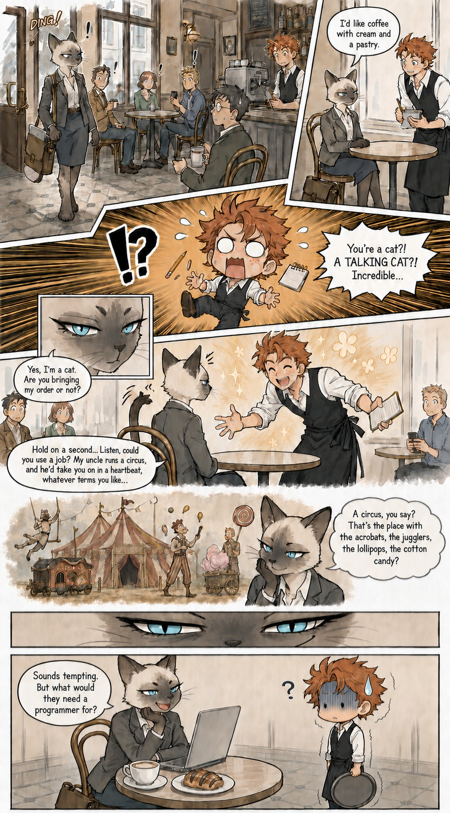

# 03 · The first manga page

| | |
|---|---|
| Date | 3 Sep 2026 |
| Image | [`images/tests/03-first-manga.jpg`](../../images/tests/03-first-manga.jpg) — shown as `cat-programmer-manga-color-v2.png` (the models saw a PNG; converted to JPEG here to keep the page light) |
| What it is | The first manga version, with manga emotion symbols. |
| Protocol | [September: one open question](../../method/protocols.md#september-one-open-question) |
| Answers | [ChatGPT](chatgpt.md) · [Claude](claude.md) · [Gemini](gemini.md) · [DeepSeek](deepseek.md) |

## Questions

Asked one at a time, in a fresh chat for each model.

1. What do you think about narrative joke attached

## Summary

About half of the researcher's reading got through, carried by discrete manga signs: Claude read “polite skepticism dressed up as enthusiasm”. Note that the file name told the readers it was manga.
