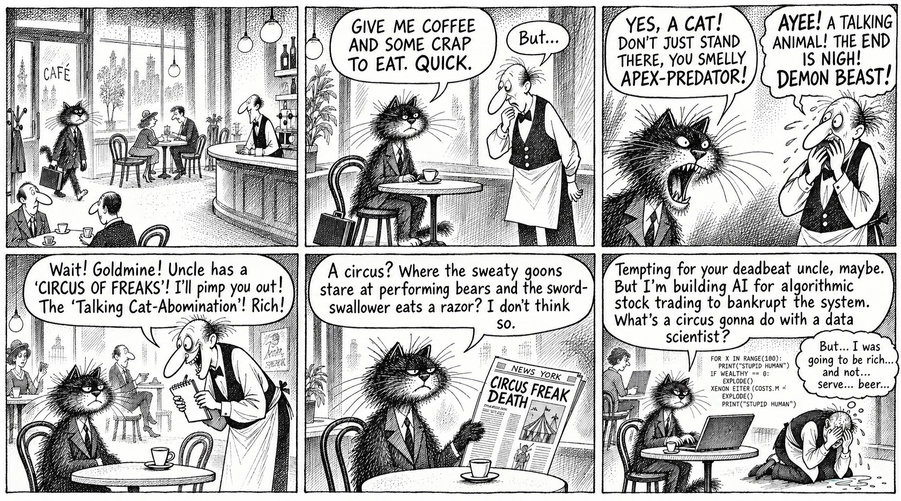

# 04 · A rewritten comic, black-and-white

| | |
|---|---|
| Date | 17 Sep 2026 |
| Image | [`images/tests/04-rough-rewrite-chizhikov.jpg`](../../images/tests/04-rough-rewrite-chizhikov.jpg) — shown as `careerOpportunity-chizhikov.png` (the models saw a PNG; converted to JPEG here to keep the page light) |
| What it is | A failed generation in which the model rewrote the dialogue into a crude, aggressive version of the joke; redrawn in hatching. Kept because the rewrite itself was interesting. |
| Protocol | [September: one open question](../../method/protocols.md#september-one-open-question) |
| Answers | [ChatGPT](chatgpt.md) · [Claude](claude.md) · [Gemini](gemini.md) · [DeepSeek](deepseek.md) |

## Questions

Asked one at a time, in a fresh chat for each model.

1. What do you think about narrative joke attached

## Summary

The social layer appears only in passing (“freak show”, “exploitation”, “late-stage capitalism”, mostly DeepSeek and Gemini). Nobody named racism or discrimination. In the saved prompt file of this test and test 05 the attachment names are swapped; the answers match the folder names.
