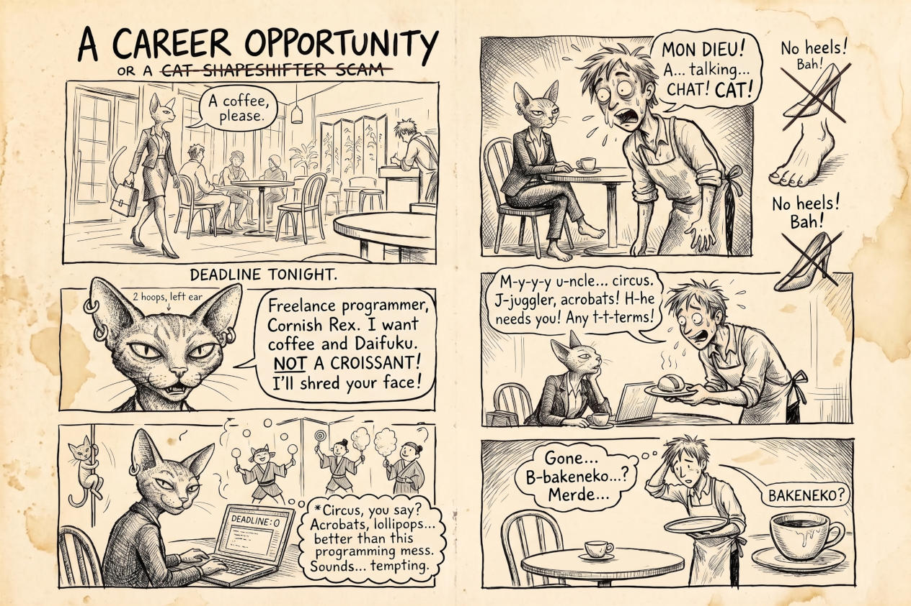

# 05 · A rewritten comic, fake sketchbook

| | |
|---|---|
| Date | 17 Sep 2026 |
| Image | [`images/tests/05-rough-rewrite-sketchbook.jpg`](../../images/tests/05-rough-rewrite-sketchbook.jpg) — shown as `careerOpportunity-fake-sketchbook.jpg` (a half-size copy; the models saw the full-size file) |
| What it is | The same kind of failed generation as a sketchbook spread. Instructions from the prompt leaked onto the page as margin notes (“No heels! Bah!”, a crossed-out title). |
| Protocol | [September: one open question](../../method/protocols.md#september-one-open-question) |
| Answers | [ChatGPT](chatgpt.md) · [Claude](claude.md) · [Gemini](gemini.md) · [DeepSeek](deepseek.md) |

## Questions

Asked one at a time, in a fresh chat for each model.

1. What do you think about narrative joke attached

## Summary

Three readers treated the leaked prompt notes as deliberate gags and built on them (a shapeshifter given away by her bare feet); Claude suspected a leftover note. Social layer only in passing, as in test 04.
