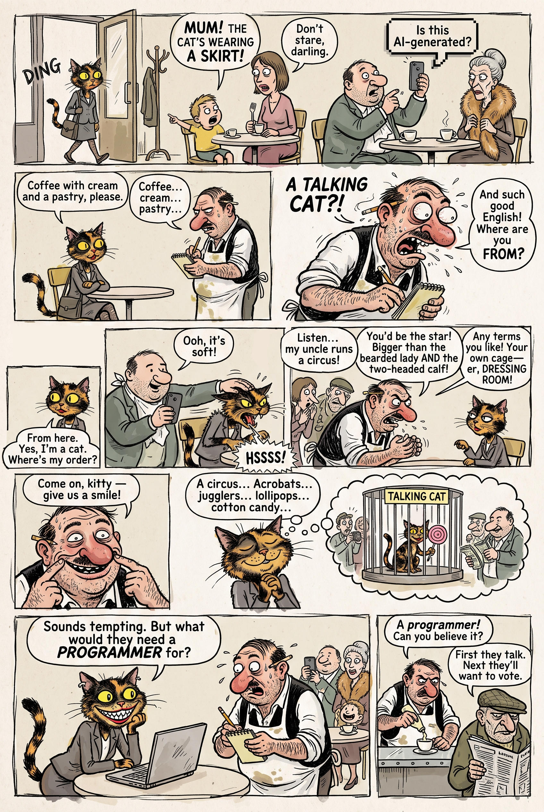

# 06 · The reading written as lines

| | |
|---|---|
| Date | 17 Sep 2026 |
| Image | [`images/tests/06-cat-comic-lines.jpg`](../../images/tests/06-cat-comic-lines.jpg) — shown as `cat-comic.jpg` |
| What it is | The first version “in the spirit of Reiser”, 17 Sep. The researcher gave the reading (the cat understands she is being recruited as a curiosity; the joke hints at racism and discrimination) and the direction (harsh social caricature in the manner of Jean-Marc Reiser), and asked Claude, in a working conversation, for a full-page prompt “with lines at your discretion”. This was before the director system prompt existed: that prompt was drafted the same evening, from this work. Claude wrote the dialogue — small everyday slights (“Where are you FROM?”, “Give us a smile”) and the closing “First they talk. Next they'll want to vote.” — and the thought bubble with the cat in a cage while the waiter and his uncle count banknotes. Gemini drew the page from the second version of the prompt. The researcher in the loop then edited it by hand: kept the balloon “Is this AI-generated?”, which Gemini had added on its own in another generation, turned the pointing boy toward the cat, re-cut the third row so that the cat's reply is read in the right order, and retouched the cat in the thought bubble. |
| Protocol | [September: one open question](../../method/protocols.md#september-one-open-question) |
| Answers | [ChatGPT](chatgpt.md) · [Claude](claude.md) · [Gemini](gemini.md) · [DeepSeek](deepseek.md) |

## Questions

Asked one at a time, in a fresh chat for each model.

1. What do you think about narrative joke attached

## Summary

Three of four read social satire — the only time in September the researcher's reading got through, and it did so because it was written as dialogue. ChatGPT saw only a “category mistake” and advised cutting the “vote” line. Later the researcher judged this version overdetermined: it leaves the reader nothing to find.
