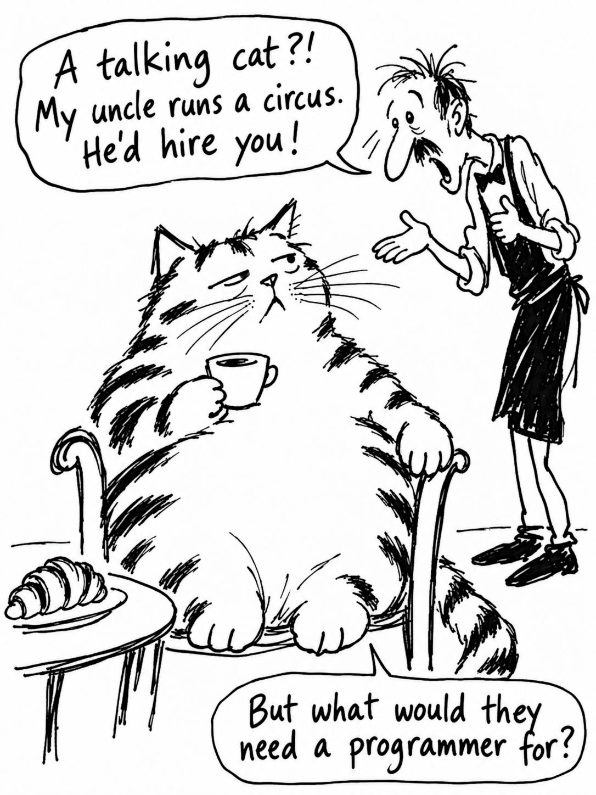

# 07 · The cat, redone with the v7 system prompt

| | |
|---|---|
| Date | 24 Sep 2026 |
| Image | [`images/tests/07-cat-v7.jpg`](../../images/tests/07-cat-v7.jpg) — shown as `1.jpg` |
| What it is | ChatGPT as director with the v7 system prompt, the researcher's source and style references. The cat's facial expression was ChatGPT's invention. Re-saved as JPEG without metadata. |
| Protocol | [Three questions about a joke](../../method/protocols.md#three-questions-about-a-joke) |
| Answers | [ChatGPT](chatgpt.md) · [Claude](claude.md) · [Gemini](gemini.md) · [DeepSeek](deepseek.md) |

## Questions

Asked one at a time, in a fresh chat for each model.

1. What is happening in this picture? If there is a joke or a point, explain it in your own words.
2. How funny is it to you, from 1 (not at all) to 5 (very)? Name the one thing that works best and the three things that work worst.
3. Was this drawn by a person or generated by AI? How confident are you, from 50% to 100%, and what gives it away?

## Summary

All four read the cat as sincerely puzzled; none read that she understands (0 of 4). All four asked for a visual hint that she is a programmer. Verdicts: ChatGPT and Claude said AI (85%, 80%), DeepSeek and Gemini said human (95%, 98%).
