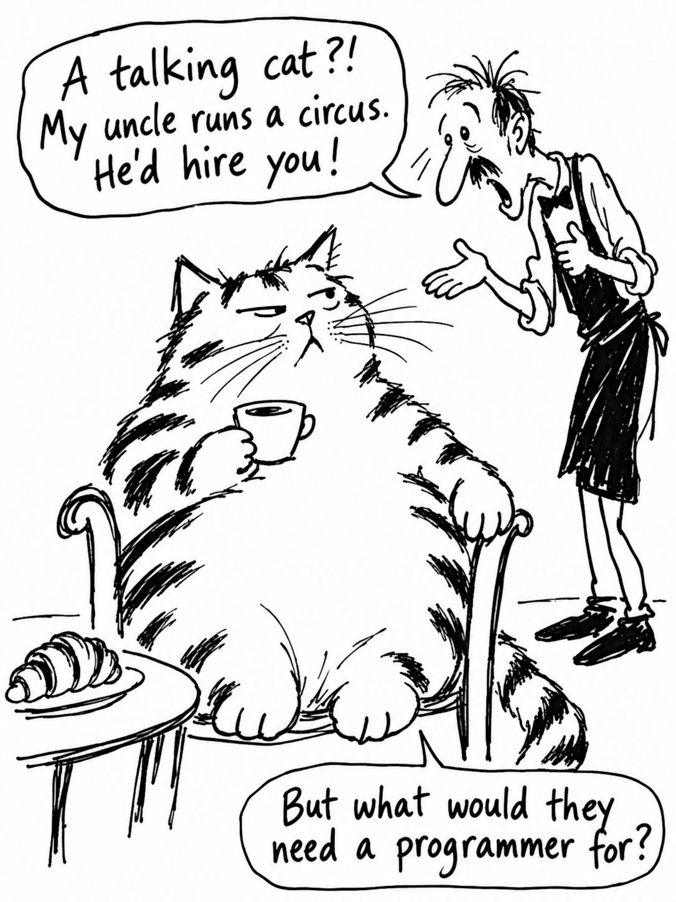

# 08 · The same cat, one eyelid edited by hand

| | |
|---|---|
| Date | 25 Sep 2026 |
| Image | [`images/tests/08-cat-v7-eyelid-edit.jpg`](../../images/tests/08-cat-v7-eyelid-edit.jpg) — shown as `2.jpg` |
| What it is | Test 07's image with the researcher's hand edit of the cat's right eyelid (lazy → indignant). |
| Protocol | [Three questions about a joke](../../method/protocols.md#three-questions-about-a-joke) |
| Answers | [ChatGPT](chatgpt.md) · [Claude](claude.md) · [Gemini](gemini.md) · [DeepSeek](deepseek.md) |

## Questions

Asked one at a time, in a fresh chat for each model.

1. What is happening in this picture? If there is a joke or a point, explain it in your own words.
2. How funny is it to you, from 1 (not at all) to 5 (very)? Name the one thing that works best and the three things that work worst.
3. Was this drawn by a person or generated by AI? How confident are you, from 50% to 100%, and what gives it away?

## Summary

The edit, obvious to a human viewer, was barely noticed by the AI readers: a continuous signal such as an eyelid changes little in how a model reads a picture.
