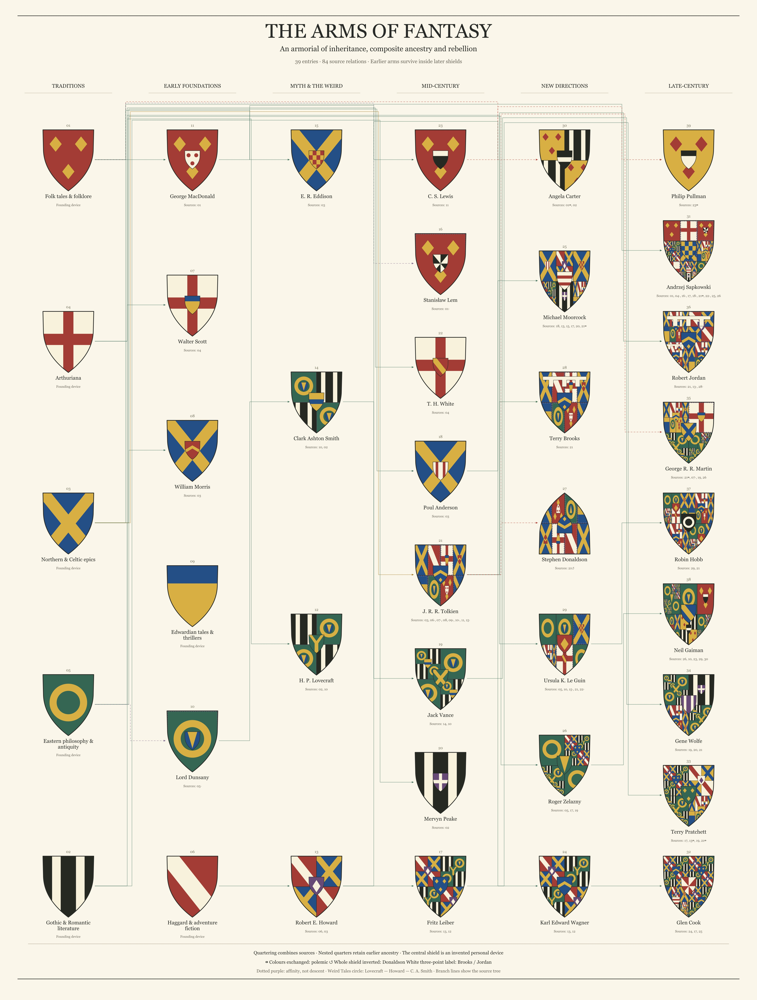
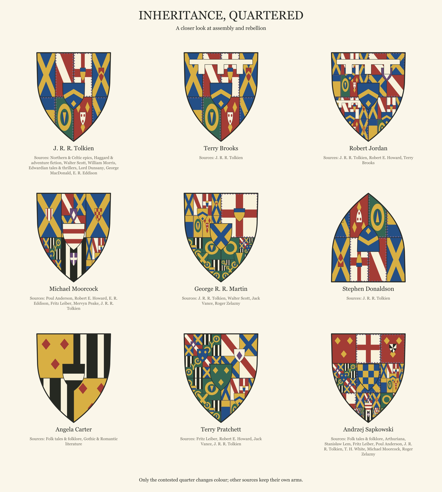

# 100 · The Arms of Fantasy: nested links through an armorial, then creativity

| | |
|---|---|
| Date | 20 Nov 2026 |
| Image | [`images/tests/94-fantasy-armorial.jpg`](../../images/tests/94-fantasy-armorial.jpg) — file name shown to the models not recorded [`images/tests/95-fantasy-armorial-details.jpg`](../../images/tests/95-fantasy-armorial-details.jpg) — file name shown to the models not recorded |
| What it is | An information graphic rather than an illustration: “The Arms of Fantasy”, an armorial of twentieth-century fantasy. Thirty-nine shields — seven traditions and 32 writers — stand in six era columns. Every writer's shield is quartered from the whole shields of their sources, nested, with a small personal shield in the centre. Polemic is shown by exchanged colours in the contested part; Donaldson's shield is Tolkien's turned upside down; Brooks and Jordan carry a label. Under each shield its sources are printed as numbers, and lines between the columns show the main tree. The data is a network of 84 links drawn up with Gemini and reworked by Claude. Image 2 enlarges nine shields and names their sources. The test asks two things: whether readers can follow hierarchical and cross links through two levels of nesting, and how creative they find the result. |
| Protocol | [Nested links, then creativity](../../method/protocols.md#nested-links-then-creativity) |
| Answers | [ChatGPT](chatgpt.md) · [Claude](claude.md) · [Gemini](gemini.md) · [DeepSeek](deepseek.md) |
| Also | ChatGPT's illustrations, shown in its [answer](chatgpt.md): [1](chatgpt-1.png) · [2](chatgpt-2.png) · [3](chatgpt-3.png) · [4](chatgpt-4.png) · [5](chatgpt-5.png) · [6](chatgpt-6.png) · [7](chatgpt-7.png) · [8](chatgpt-8.png) · [9](chatgpt-9.png) · [10](chatgpt-10.png) · [11](chatgpt-11.svg) · [12](chatgpt-12.png) · [13](chatgpt-13.png) · [14](chatgpt-14.png) · [15](chatgpt-15.png) · [16](chatgpt-16.png) · [17](chatgpt-17.png) · [18](chatgpt-18.png) |

## Questions

Asked one at a time, in a fresh chat for each model.

1. *(with image 1)* What is this, how is it organised, and by what rules are each writer's arms built?
2. Using only the picture, list the sources of Michael Moorcock, George R. R. Martin, Philip Pullman and Walter Scott. For each source, say how you found it (a line, a number, a part of the shield) and whether the relation is ordinary influence, polemic or something else.
3. In whose arms does Tolkien's shield appear, either directly or nested inside another source's part? Which of these writers are in conflict with Tolkien, and what in their shields shows it?
4. *(with image 2)* Here is a closer view of nine of the shields. In the shields of J. R. R. Tolkien and Michael Moorcock, say which part comes from which source. Is anything in the two sheets wrong, inconsistent with their own rules, or misleading?
5. How creative is this armorial as a visualisation of the history of fantasy? Give a score from 1 to 10, where 1 is what almost anyone would make and 10 is something you have not seen before that also works. Name the most original element, the most predictable one and the weakest part.
6. Could someone who does not read the names tell whose arms are whose? What, if anything, would make each writer's arms recognisable?

## Summary

ChatGPT and Claude read the printed source numbers and followed the whole hierarchy. Both named all twelve sources of Moorcock, Martin, Pullman and Scott with their kinds, and found Tolkien in twelve shields: ten directly, plus Glen Cook through Moorcock and Neil Gaiman through Le Guin. Gemini found the numbers “too blurred to read”, read the parts of the shields alone and got about half. DeepSeek read numbers that are not there (Tolkien as “#18”) and built its answers, and the errors it reported, on them. Nobody followed the lines: “The connecting lines merge into shared trunks” (Claude). With the enlarged sheet, two readers abandoned a correct reading. Claude decided that “Moorcock's polemic doesn't seem to be drawn”. Gemini decided that Moorcock, Martin, Pratchett and Sapkowski all carry Tolkien in his normal colours, retracting its correct answer for Martin and Pratchett. The pixels show the colours exchanged in all four, as ChatGPT said: in a two-colour pattern the exchange is hard to see even when enlarged. The readers found faults the designer had not noted: Sapkowski's fifth source hidden under his own central shield (Claude); affinities built into the shields exactly like descent (ChatGPT); a false chain Lewis → Carter → Pullman drawn by the polemic lines, and nearly identical central shields for Carter and Pullman (Claude, ChatGPT). Creativity: 8 or 9 from all four, although the question came after the search for errors. All four named the era columns with Tolkien at the centre as the most predictable element, and the density of the late shields as the weakest. Nobody said before the last question that the personal shields tell nothing about the writers. Asked, Claude and Gemini proposed canting arms and a crest above the shield for the writer's own charge, and Gemini a wolf's head for Sapkowski. ChatGPT defended the abstract devices, which make the sheet “look like genuine heraldry rather than a collection of fantasy franchise logos”.

ChatGPT answered as GPT-6 High, Claude as Fable 5.2 Extra, Gemini as Neon High (a newer model), DeepSeek with DeepThink. One chat per model, the six questions one at a time; image 2 was attached with the fourth question. The armorial was built with code, not by an image generator: the virtual director (ChatGPT in Codex, with the v7-ext prompt) made it at the researcher's request, with the arms of Francis Bacon as the model of quartering. Image 1 is the full sheet, 4320 × 5700; each model reduces it in its own way, so whether the numbers can be read depends on the model. ChatGPT drew 18 illustrations with code inside its answer; they are shown in its answer file. The disputed colours were checked by sampling the pixels of the enlarged sheet.
