<!--Mode: GPT-6 High-->

# 1

**The Arms of Fantasy — a heraldic genealogy of literature**

This is a **literary genealogy expressed through heraldry**. Rather than representing biological ancestry, noble families or actual coats of arms, it represents the intellectual, stylistic and mythological ancestry of fantasy literature.

Its full title is *The Arms of Fantasy: An Armorial of Inheritance, Composite Ancestry and Rebellion*.

The chart contains:

- **39 entries**, including foundational traditions and individual writers.
- **84 source relations**, representing literary inheritance and influence.
- A system of invented coats of arms that incorporates the heraldic devices of earlier traditions and authors into those of their successors.

The particularly interesting feature is its recursive construction: a writer does not merely inherit the symbol of an earlier author, but can inherit their entire composite shield, including their own literary ancestors.

It is therefore both a literary family tree and a visual language for literary influence.

## **1. How it is organised**

The chart is divided into six broadly chronological and thematic columns.

| Column            | Function                                                | Examples                                        |
| ----------------- | ------------------------------------------------------- | ----------------------------------------------- |
| Traditions        | Fundamental source material                             | Folklore, Arthuriana, Celtic and Northern epics |
| Early Foundations | Precursors of modern fantasy                            | William Morris, George MacDonald, Lord Dunsany  |
| Myth & the Weird  | Mythopoeic fantasy, cosmic horror and sword-and-sorcery | Eddison, Lovecraft, Howard, Clark Ashton Smith  |
| Mid-Century       | Consolidation and diversification of fantasy            | Tolkien, Lewis, Vance, Peake                    |
| New Directions    | Expansion, reinterpretation and rebellion               | Moorcock, Le Guin, Zelazny, Donaldson           |
| Late-Century      | Increasingly complex literary descendants               | Martin, Jordan, Gaiman, Pratchett, Pullman      |

It is not a strictly chronological timeline. The horizontal arrangement represents broad literary generations and movements, while the vertical arrangement helps organise the different branches of inheritance.

Each entry has a numerical identifier above its shield and a list of source identifiers beneath its name. The connecting lines trace these relationships across the chart.

## **2. The seven founding arms**

The entire system is built from seven elementary heraldic devices. These supply the visual vocabulary from which almost all subsequent shields are constructed.

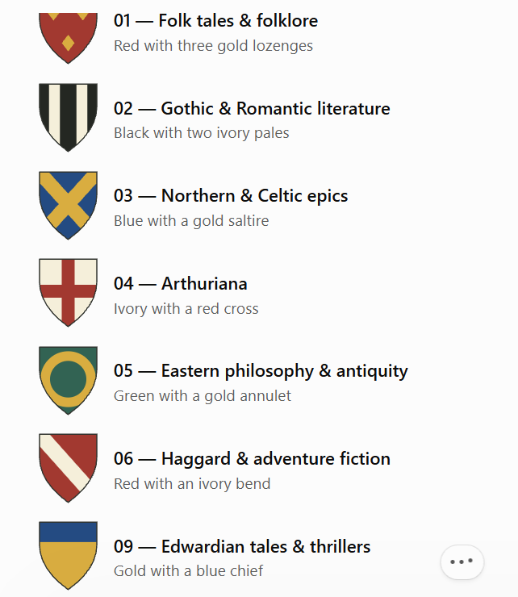

**01 — Folk tales & folklore**

Red with three gold lozenges

**02 — Gothic & Romantic literature**

Black with two ivory pales

**03 — Northern & Celtic epics**

Blue with a gold saltire

**04 — Arthuriana**

Ivory with a red cross

**05 — Eastern philosophy & antiquity**

Green with a gold annulet

**06 — Haggard & adventure fiction**

Red with an ivory bend

**09 — Edwardian tales & thrillers**

Gold with a blue chief

These are the equivalent of heraldic ancestors. Whenever their patterns appear inside later shields, they indicate the survival of that particular literary tradition.

## **3. The rules for constructing each writer's arms**

### **Rule I — Single-source inheritance**

When a writer has one principal source, they retain its foundational field and normally introduce a small personal shield in the centre.

This smaller shield is heraldically called an **inescutcheon**.

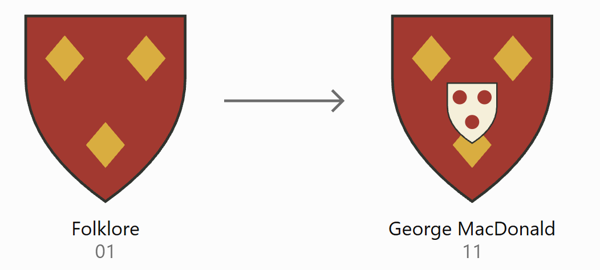

Examples include:

| Writer           | Inherited field    | Personal device                         |
| ---------------- | ------------------ | --------------------------------------- |
| George MacDonald | Folklore           | Three red roundels on ivory             |
| Walter Scott     | Arthuriana         | Gold with a blue chief                  |
| William Morris   | Northern epics     | Gold chevron on red                     |
| Lord Dunsany     | Eastern philosophy | Gold downward-pointing triangle on blue |
| E. R. Eddison    | Northern epics     | Red-and-gold chequers                   |
| Poul Anderson    | Northern epics     | Red-and-ivory vertical stripes          |
| Mervyn Peake     | Gothic literature  | Ivory cross on purple                   |

The large shield represents literary inheritance; the small shield represents individual identity.

### **Rule II — Multiple sources are quartered**

When a writer has two sources, their arms are combined through traditional heraldic quartering.

The first source occupies the upper-left and lower-right quarters. The second occupies the upper-right and lower-left quarters.

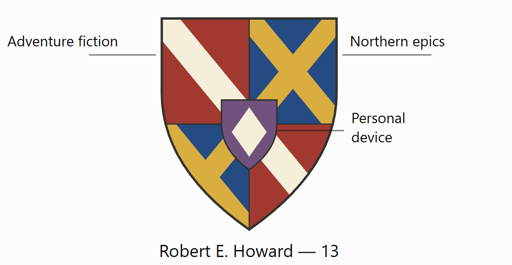

Robert E. Howard, for instance, combines the adventure fiction of Haggard with the Northern and Celtic epic tradition, adding his own purple shield bearing an ivory lozenge.

Lovecraft similarly combines Gothic literature and Dunsany.

### **Rule III — Inheritance is recursive**

This is the most sophisticated rule of the chart.

When an author inherits from another writer, that writer's composite arms can be reproduced in miniature within the new shield. Their earlier ancestry is thereby preserved.

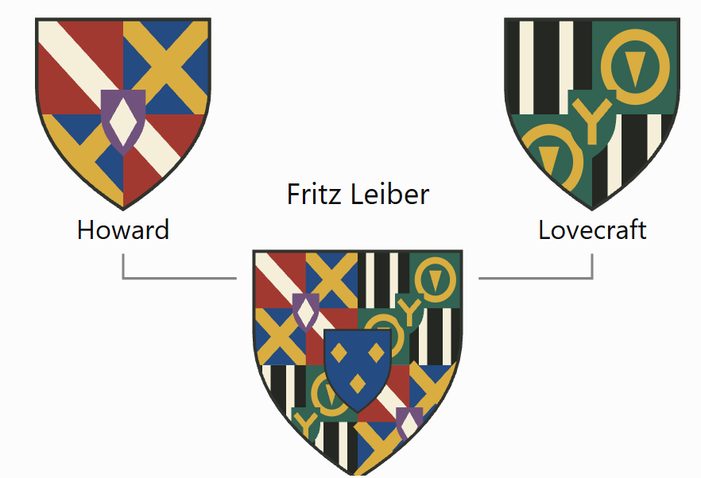

Illustrative reconstruction of nested quartering.

Fritz Leiber therefore contains the arms of both Howard and Lovecraft, which themselves contain older traditions.

Karl Edward Wagner has the same two immediate ancestors but a different personal device. Their shields have identical outer ancestry and distinct central identities.

This explains why the shields become increasingly intricate towards the right of the chart. They accumulate literary history.

### **Rule IV — More sources produce more subdivisions**

The system is not restricted to four conventional quarters. It divides the shield into additional compartments as necessary.

From the visible shields, the arrangement appears to follow this pattern:

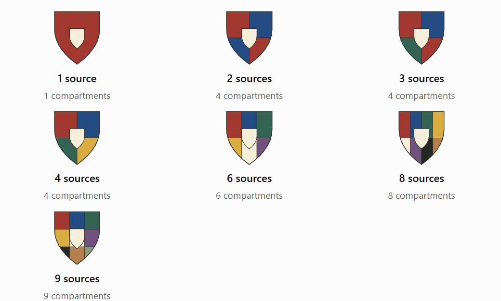

**1 source**

1 compartments

**2 sources**

4 compartments

**3 sources**

4 compartments

**4 sources**

4 compartments

**6 sources**

6 compartments

**8 sources**

8 compartments

**9 sources**

9 compartments

Where necessary, sources are repeated to fill the available compartments. The examples suggest that sources are generally inserted in their listed order, with traditional diagonal repetition for two-source shields.

Tolkien has eight source compartments, Moorcock has six, and Sapkowski has nine.

## **4. Special heraldic rules: rebellion, affinity and derivation**

The legend at the bottom explicitly establishes several operations beyond ordinary inheritance.

### **Exchange of colours — polemical inheritance**

An author who opposes or deliberately challenges a predecessor can inherit their design but exchange its colours.

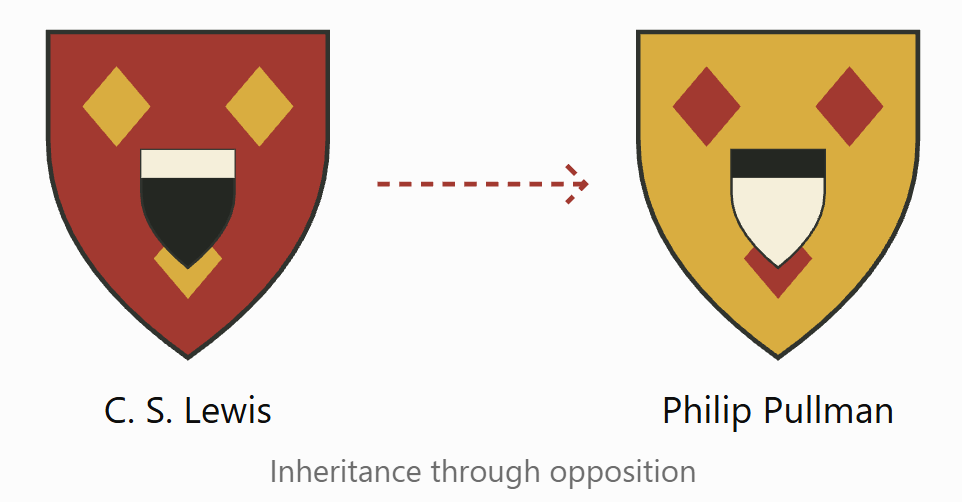

Pullman is the clearest example. He inherits Lewis's design, but its tinctures are reversed, including those of the central shield.

The visual statement is that opposition is itself a form of literary ancestry.

Angela Carter also inherits the folklore device with its colours exchanged, alongside Gothic literature.

### **Complete inversion — Stephen Donaldson**

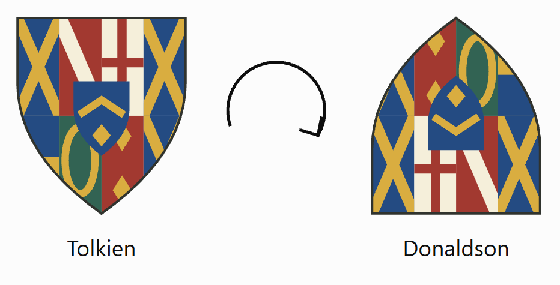

Stephen Donaldson's arms are Tolkien's arms turned upside down, not merely recoloured. Even the contour of the shield is inverted.

This represents a more radical form of reinterpretation: the inherited fantasy tradition is structurally overturned.

### **The white three-point label — close derivation**

Terry Brooks and Robert Jordan bear a white three-point label across the upper portion of their arms.

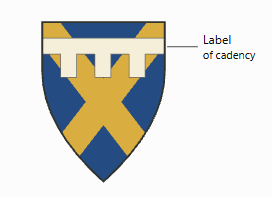

In traditional heraldry, a label is a mark of cadency, commonly associated with an heir or a junior branch of a family.

Its use here suggests a particularly close relationship to Tolkien's literary line. Both Brooks and Jordan also retain the Tolkien-like central chevron-and-lozenge device.

### **Dotted purple lines — affinity without descent**

Not every similarity constitutes direct literary influence.

The chart explicitly distinguishes **affinity from descent** through dotted purple connections. It also identifies the *Weird Tales* circle of Lovecraft, Howard and Clark Ashton Smith.

This allows the diagram to express shared interests, intellectual kinship and literary associations without necessarily claiming straightforward inheritance.

## **5. A complete reading of Tolkien's arms**

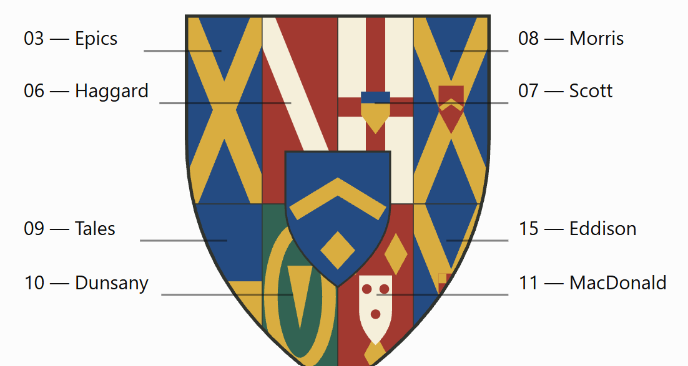

Tolkien is one of the most important junctions in the chart. His shield combines eight sources.

Schematic reconstruction of Tolkien's eightfold arms.

| Position          | Source                                                        |
| ----------------- | ------------------------------------------------------------- |
| Upper row, first  | 03 — Northern & Celtic epics                                  |
| Upper row, second | 06 — Haggard & adventure fiction                              |
| Upper row, third  | 07 — Walter Scott                                             |
| Upper row, fourth | 08 — William Morris                                           |
| Lower row, first  | 09 — Edwardian tales & thrillers                              |
| Lower row, second | 10 — Lord Dunsany                                             |
| Lower row, third  | 11 — George MacDonald                                         |
| Lower row, fourth | 15 — E. R. Eddison                                            |
| Centre            | Tolkien's personal device: a gold chevron and lozenge on blue |

Tolkien's composite arms are then incorporated into those of numerous later fantasy writers, sometimes faithfully and sometimes polemically.

## **6. What the increasingly complex arms mean**

The later authors can be understood as different combinations of literary houses.

| Writer              | Immediate sources shown in the chart                 |
| ------------------- | ---------------------------------------------------- |
| Fritz Leiber        | Howard, Lovecraft                                    |
| Jack Vance          | Clark Ashton Smith, Dunsany                          |
| Roger Zelazny       | Eastern philosophy, Leiber, Vance                    |
| Ursula K. Le Guin   | Eastern philosophy, Dunsany, Eddison, Tolkien, White |
| George R. R. Martin | Tolkien, Scott, Vance, Zelazny                       |
| Robin Hobb          | Le Guin, Tolkien                                     |
| Neil Gaiman         | Zelazny, Dunsany, Lewis, Le Guin, Carter             |
| Gene Wolfe          | Vance, Peake, Tolkien                                |
| Terry Pratchett     | Leiber, Howard, Vance, Tolkien                       |
| Glen Cook           | Wagner, Leiber, Moorcock                             |

Consequently, a Northern epic saltire appearing deep inside Glen Cook's arms might have travelled through Howard, Leiber and Wagner rather than representing a separate immediate source.

This is what makes the chart more than a conventional diagram of literary influences: it preserves the **ancestry of the ancestors**.

## **7. The underlying grammar**

| Heraldic operation       | Literary meaning              |
| ------------------------ | ----------------------------- |
| Founding device          | Original literary tradition   |
| Inherited field          | Literary ancestry             |
| Quartering               | Multiple influences           |
| Nested quartering        | Transitive inheritance        |
| Central inescutcheon     | Individual authorial identity |
| Exchanged tinctures      | Polemic or opposition         |
| Inverted shield          | Radical subversion            |
| White label              | Close derivation              |
| Dotted purple connection | Affinity without descent      |
| Branch lines             | Source relationships          |

The fundamental construction rules come directly from the poster's legend. The precise compartment-filling algorithm is inferred from the visible designs, and the individual symbolism of the invented personal devices is not explained in the poster. The chart also provides no bibliographical evidence for its proposed relationships, so it should be read as an interpretive genealogy rather than a definitive scholarly account.

**In essence, it treats fantasy literature as a heraldic dynasty:** traditions establish houses, writers inherit and combine their arms, literary movements create cadet branches, and rebellious successors reverse the colours or overturn the very shields of their predecessors.

# 2

Using only the picture, I count **six sources for Moorcock, four for Martin, one for Pullman and one for Scott**.

I am treating the numbered *Sources* captions as the primary evidence and checking them against the shields and connecting lines. The poster's legend distinguishes:

- **Ordinary influence:** inherited heraldic designs and normal branch lines.
- **Polemic:** exchanged colours, marked by a special symbol beside the source number.
- **Affinity rather than descent:** dotted purple markings.

The distinction between immediate sources and more distant, recursively inherited ancestry is important here.

## **1. Michael Moorcock — No. 25**

His caption lists sources **18, 13, 15, 17, 20, 21**, with a polemic mark after 21.

| Source                | Evidence in the picture                                                                                     | Relation           |
| --------------------- | ----------------------------------------------------------------------------------------------------------- | ------------------ |
| 18 — Poul Anderson    | Number 18; upper-left compartment, blue with a gold saltire and red-and-white striped small shield          | Ordinary influence |
| 13 — Robert E. Howard | Number 13; upper-middle compartment, with diagonal bands, saltire and purple shield bearing a white lozenge | Ordinary influence |
| 15 — E. R. Eddison    | Number 15; upper-right compartment, with gold saltire and chequered small shield                            | Ordinary influence |
| 17 — Fritz Leiber     | Number 17; lower-left compartment, containing nested Howard and Lovecraft patterns                          | Ordinary influence |
| 20 — Mervyn Peake     | Number 20; lower-middle compartment, with black-and-white stripes and a purple shield bearing a white cross | Ordinary influence |
| 21 — J. R. R. Tolkien | Marked number 21; lower-right compartment containing Tolkien's composite design with exchanged colours      | **Polemic**        |

Moorcock's central red-and-white horizontally striped shield is his personal device, not another source.

## **2. George R. R. Martin — No. 35**

His caption lists sources **21, 07, 19, 26**, with special marks after 21 and 07.

| Source                | Evidence in the picture                                                                                                    | Relation                  |
| --------------------- | -------------------------------------------------------------------------------------------------------------------------- | ------------------------- |
| 21 — J. R. R. Tolkien | Marked number 21; upper-left quarter reproduces Tolkien's composite arms with exchanged colours; red dashed incoming line  | **Polemic**               |
| 07 — Walter Scott     | Marked number 07; upper-right quarter reproduces Scott's red cross and blue-and-gold central device, with a dotted outline | **Affinity, not descent** |
| 19 — Jack Vance       | Number 19; lower-left quarter reproduces Vance's green-and-gold composite arms                                             | Ordinary influence        |
| 26 — Roger Zelazny    | Number 26; lower-right quarter contains Zelazny's ring, triangle and nested ancestral patterns                             | Ordinary influence        |

Martin's central device is a blue saltire on gold.

The distinction concerning Scott is particularly important: his arms are incorporated into Martin's shield, but the dotted marking qualifies the relationship as affinity rather than direct descent.

## **3. Philip Pullman — No. 39**

His caption lists only **23**, with a polemic mark.

| Source           | Evidence in the picture                                                                           | Relation    |
| ---------------- | ------------------------------------------------------------------------------------------------- | ----------- |
| 23 — C. S. Lewis | Number 23; red dashed connecting line; Lewis's entire design is reproduced with exchanged colours | **Polemic** |

The colour exchanges are especially clear:

| Element                      | Lewis | Pullman |
| ---------------------------- | ----- | ------- |
| Background                   | Red   | Gold    |
| Three lozenges               | Gold  | Red     |
| Upper part of central shield | White | Black   |
| Lower part of central shield | Black | White   |

Pullman's arms are essentially a colour-reversed version of Lewis's.

Folklore and George MacDonald belong to the earlier ancestry of Lewis's arms, but they are not listed as immediate sources of Pullman.

## **4. Walter Scott — No. 07**

His caption lists only **04**.

| Source          | Evidence in the picture                                                   | Relation           |
| --------------- | ------------------------------------------------------------------------- | ------------------ |
| 04 — Arthuriana | Number 04; solid green branch line; identical red cross on an ivory field | Ordinary influence |

Scott's small blue-and-gold central shield is his invented personal device. Although it resembles the founding arms of Edwardian tales and thrillers (09), that entry is **not** listed as Scott's source.

## **Summary**

| Writer              | Ordinary influence | Polemic | Affinity |
| ------------------- | ------------------ | ------- | -------- |
| Michael Moorcock    | 5                  | 1       | 0        |
| George R. R. Martin | 2                  | 1       | 1        |
| Philip Pullman      | 0                  | 1       | 0        |
| Walter Scott        | 1                  | 0       | 0        |
| **Total**           | **8**              | **3**   | **1**    |

All twelve immediate sources are identifiable from the picture. The small typographical marks and overlapping branch lines are somewhat blurred, so I have cross-checked them against the heraldic patterns rather than claiming that every individual connecting line can be independently traced. No external literary information has been used.

# 3

Tolkien is entry **No. 21**. Following that number through the source captions, and then following the ancestry of those sources, I find **12 writers whose arms contain Tolkien's design**.

Of these, ten have him as an immediate source, while two inherit him exclusively through another writer.

## **1. Direct inheritance from Tolkien**

| Writer                   | Where Tolkien's arms appear                                                  | Type of relationship |
| ------------------------ | ---------------------------------------------------------------------------- | -------------------- |
| Michael Moorcock (25)    | Lower-right compartment                                                      | Polemic              |
| Stephen Donaldson (27)   | The entire shield, turned upside down                                        | Inversion            |
| Terry Brooks (28)        | The entire shield, with an added white label                                 | Close derivation     |
| Ursula K. Le Guin (29)   | Lower-left compartment                                                       | Ordinary influence   |
| Andrzej Sapkowski (31)   | Middle-right compartment                                                     | Polemic              |
| Terry Pratchett (33)     | Lower-right quarter                                                          | Polemic              |
| Gene Wolfe (34)          | Lower-left quarter                                                           | Ordinary influence   |
| George R. R. Martin (35) | Upper-left quarter                                                           | Polemic              |
| Robert Jordan (36)       | Upper-left compartment, with an additional white label over the whole shield | Close derivation     |
| Robin Hobb (37)          | Upper-right quarter                                                          | Ordinary influence   |

All ten explicitly list **21** in their source captions.

## **2. Indirect and nested inheritance**

Five writers contain Tolkien through another author's composite arms. Three of them also inherit him directly.

| Writer            | Path of nested inheritance     |
| ----------------- | ------------------------------ |
| Andrzej Sapkowski | Tolkien → Moorcock → Sapkowski |
| Glen Cook         | Tolkien → Moorcock → Cook      |
| Robert Jordan     | Tolkien → Brooks → Jordan      |
| Robin Hobb        | Tolkien → Le Guin → Hobb       |
| Neil Gaiman       | Tolkien → Le Guin → Gaiman     |

Glen Cook and Neil Gaiman are the two exclusively indirect descendants.

Consequently, Sapkowski, Jordan and Hobb each contain Tolkien's design at **two different levels of ancestry**.

## **3. Which writers are in conflict with Tolkien?**

The chart depicts **four polemical successors and one radical inversion**.

Tolkien's original personal device is a gold chevron and lozenge on a blue field. Notice what happens to these colours in polemical inheritance.

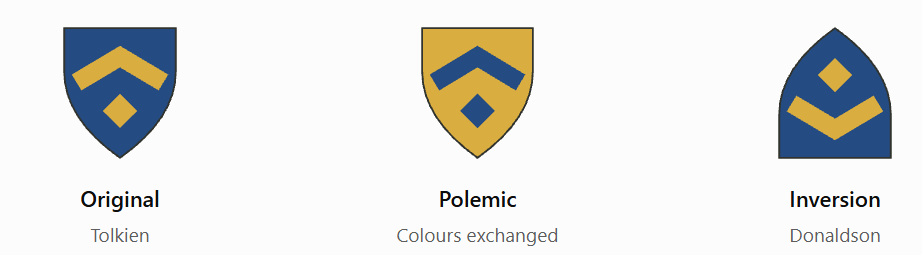

**Original**

Tolkien

**Polemic**

Colours exchanged

**Inversion**

Donaldson

Schematic illustration using Tolkien's central personal device.

### **Polemical successors**

| Writer                  | Visible evidence of conflict                                                                                                                             |
| ----------------------- | -------------------------------------------------------------------------------------------------------------------------------------------------------- |
| **Michael Moorcock**    | Tolkien's compartment has blue saltires on gold instead of gold saltires on blue.                                                                        |
| **Andrzej Sapkowski**   | Tolkien's miniature arms have exchanged colours, including the central device.                                                                           |
| **Terry Pratchett**     | The lower-right quarter contains Tolkien's arms with exchanged colours. Howard's arms are also recoloured, indicating a separate polemical relationship. |
| **George R. R. Martin** | The upper-left quarter contains recoloured Tolkien arms. The red dashed incoming line reinforces the polemical relationship.                             |

All four have a special mark next to source number 21, corresponding to the legend's **“Colours exchanged: polemic.”**

### **Stephen Donaldson — inversion rather than recolouring**

Donaldson is a unique case:

- His entire shield is Tolkien's shield rotated 180°.
- Its original tinctures are retained.
- Even the pointed end of the shield faces upwards.
- A red dashed line connects him to Tolkien.

The legend explicitly singles him out: **“Whole shield inverted: Donaldson.”**

### **Do Glen Cook and Sapkowski inherit Moorcock's polemic?**

Yes, visually. Their arms contain Moorcock's arms, which themselves contain the recoloured Tolkien design.

However, the chart does not establish a separate direct polemical relationship between Cook and Tolkien. It does establish one for Sapkowski.

Similarly, the white three-point labels of Brooks and Jordan distinguish their relationship with Tolkien, but the legend does not classify them as polemical.

## **4. The complete Tolkien branch**

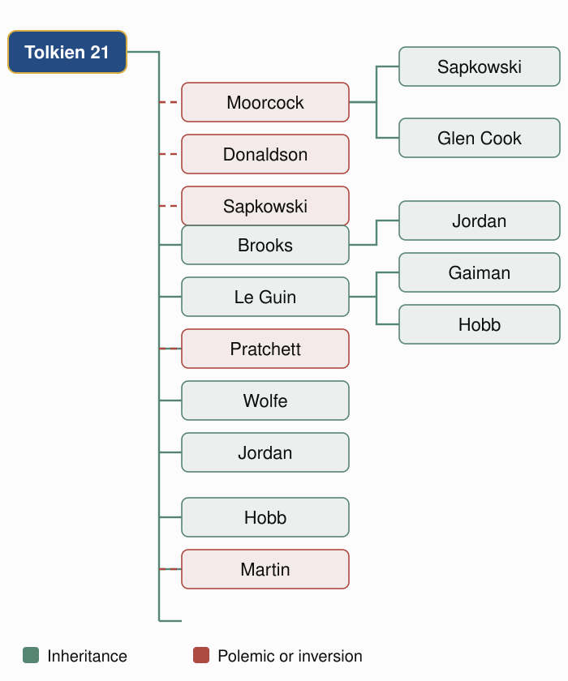

The final count, based exclusively on the poster:

| Relationship with Tolkien           | Writers |
| ----------------------------------- | ------- |
| Ordinary direct inheritance         | 3       |
| Direct inheritance with white label | 2       |
| Direct polemic                      | 4       |
| Complete inversion                  | 1       |
| Exclusively indirect inheritance    | 2       |
| **Total**                           | **12**  |

The smallest nested details are difficult to resolve at the picture's resolution, so the indirect relationships are established primarily by following the numbered source lists.

The essential idea is that **even rebellion against Tolkien constitutes a form of inheritance**. His opponents do not discard his heraldic design; they transform it.

# 4

The second sheet makes the construction much clearer. Both Tolkien and Moorcock have their sources arranged in **two horizontal rows, in the order in which they are listed beneath the shield**, with a personal inescutcheon superimposed on the centre.

There are also some important qualifications to the earlier interpretation, especially concerning the purple dotted borders, which distinguish affinity from actual literary descent.

## **1. J. R. R. Tolkien — eight sources**

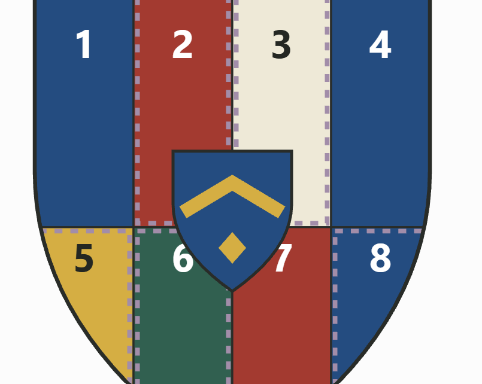

All positions below are given from the viewer's perspective.

| Part                  | Source                               | Identifying heraldic features                                                         |
| --------------------- | ------------------------------------ | ------------------------------------------------------------------------------------- |
| 1. Upper far left     | **03 — Northern & Celtic epics**     | Blue field with a gold saltire (diagonal cross).                                      |
| 2. Upper centre-left  | **06 — Haggard & adventure fiction** | Red field with a broad ivory diagonal band.                                           |
| 3. Upper centre-right | **07 — Walter Scott**                | Red cross on ivory, with Scott's gold-and-blue personal shield.                       |
| 4. Upper far right    | **08 — William Morris**              | Gold saltire on blue, with Morris's red shield bearing a gold chevron.                |
| 5. Lower far left     | **09 — Edwardian tales & thrillers** | Gold field with a blue upper section.                                                 |
| 6. Lower centre-left  | **10 — Lord Dunsany**                | Green field with a gold ring surrounding Dunsany's blue-and-gold personal shield.     |
| 7. Lower centre-right | **11 — George MacDonald**            | Three gold lozenges on red, with a small ivory shield bearing three red roundels.     |
| 8. Lower far right    | **15 — E. R. Eddison**               | Gold saltire on blue, with the partly visible red-and-gold chequered personal device. |
| Centre                | **Tolkien himself**                  | Blue shield bearing a gold chevron and a gold lozenge.                                |

The dotted purple borders appear around compartments 2, 3, 5, 6 and 8. According to the first sheet's legend, they represent **affinity, not descent**. The other three source compartments are unmarked.

Thus, the picture actually makes a more nuanced claim than simply attributing eight direct literary influences to Tolkien.

## **2. Michael Moorcock — six sources**

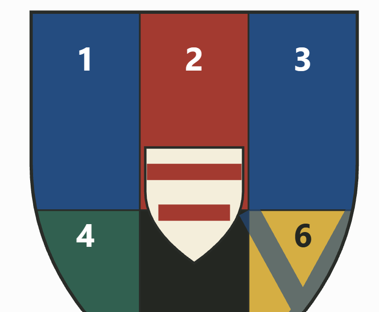

| Part            | Source                    | Identifying heraldic features                                                          |
| --------------- | ------------------------- | -------------------------------------------------------------------------------------- |
| 1. Upper left   | **18 — Poul Anderson**    | Gold saltire on blue, with a vertically striped red-and-ivory shield.                  |
| 2. Upper middle | **13 — Robert E. Howard** | Quartered adventure-fiction and Northern epic designs, with a white lozenge on purple. |
| 3. Upper right  | **15 — E. R. Eddison**    | Gold saltire on blue, with a red-and-gold chequered shield.                            |
| 4. Lower left   | **17 — Fritz Leiber**     | Nested arms of Howard and Lovecraft, with Leiber's three gold lozenges on blue.        |
| 5. Lower middle | **20 — Mervyn Peake**     | Black-and-ivory vertical stripes, with a white cross on purple.                        |
| 6. Lower right  | **21 — J. R. R. Tolkien** | Tolkien's eightfold composite arms, with their colours exchanged.                      |
| Centre          | **Moorcock himself**      | Ivory shield bearing two red horizontal bars.                                          |

The Tolkien compartment is the only one undergoing a polemical transformation. All five other sources retain their own colours, exactly as the second sheet's footer stipulates.

A substantial portion of the lower-right compartment is lost where the rectangular design is clipped by the pointed outline of Moorcock's shield. Nevertheless, enough remains visible to identify Tolkien.

## **3. What is wrong, inconsistent or misleading?**

There are several issues. Some are inconsistencies in the visual grammar; others concern what the diagrams imply about literary influence.

### **A. Affinities are presented as sources**

This is the most significant conceptual problem.

The first sheet explicitly states:

> Dotted purple: affinity, not descent.

Yet affinities are incorporated into shields in exactly the same structural manner as ordinary literary ancestors.

| Writer    | Sources marked as affinities                          |
| --------- | ----------------------------------------------------- |
| Tolkien   | Haggard, Scott, Edwardian tales, Dunsany, Eddison     |
| Martin    | Walter Scott                                          |
| Jordan    | Robert E. Howard, Terry Brooks                        |
| Sapkowski | Arthuriana, Stanisław Lem, Poul Anderson, T. H. White |

The second sheet preserves the dotted outlines but omits the qualification from the written source lists. It also does not provide a legend explaining those outlines.

Someone looking only at the second sheet could reasonably mistake an affinity for an asserted historical influence.

Furthermore, when an affinity is inherited through nested quartering, the resulting shield can imply a chain of literary descent that the poster itself says does not exist.

### **B. Not every author has a distinct personal device**

The first sheet states:

> The central shield is an invented personal device.

However, several authors retain or transform the personal device of their predecessor.

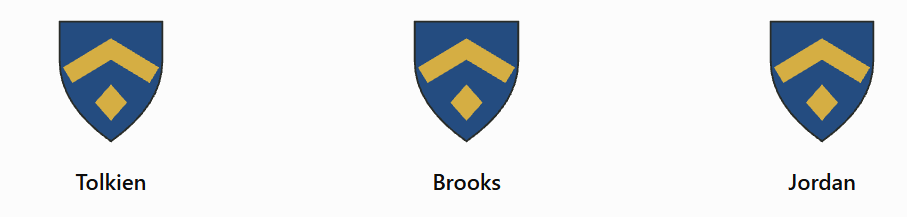

**Tolkien**

**Brooks**

**Jordan**

All three possess exactly the same central device.

Brooks and Jordan reproduce Tolkien's personal arms without alteration. Donaldson rotates them, while Pullman reverses Lewis's device.

This is presumably intentional, but the stated rule is incomplete. The centre can represent either an author's individual identity **or a deliberate statement of dependence upon another author**.

### **C. Jordan's shield contains four compartments but only three sources**

Jordan's actual arrangement is:

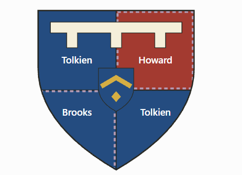

Jordan's compartment arrangement, simplified.

Consequently, Tolkien appears:

- Directly in two quarters.
- Indirectly inside Brooks's quarter.
- In Jordan's central device.

This makes Tolkien visually dominant, but neither sheet explains whether repetition represents the strength of an influence or is merely a convenient method of filling unused compartments.

The distinction matters if the shields are meant to communicate more than the existence of relationships.

### **D. The recursive inheritance is not always complete**

The first sheet claims that nested quarters retain earlier ancestry. This works in principle, but not all inherited information remains visible.

For example, in Moorcock's lower-right compartment:

- Much of Tolkien's eightfold shield is clipped away.
- Moorcock's central shield conceals additional portions.
- Tolkien's personal device is only partially visible.

There is another structural issue in single-source shields. Lewis inherits George MacDonald's outer field, but replaces MacDonald's central device with his own. MacDonald's distinctive personal arms therefore disappear.

The system consequently retains earlier ancestry **selectively**, rather than functioning as a completely reversible visual record.

### **E. The colour-exchange rule is underdefined**

Compare the transformations inside the polemical version of Tolkien's shield:

| Original pattern     | Polemical version    |
| -------------------- | -------------------- |
| Gold saltire on blue | Blue saltire on gold |
| Ivory bend on red    | Red bend on ivory    |
| Red cross on ivory   | Ivory cross on red   |
| Gold ring on green   | Green ring on gold   |
| Gold lozenges on red | Red lozenges on gold |

Gold becomes blue in some compartments, green in others, and red in others.

Thus, this is not a single consistent substitution of colours throughout the contested shield. Rather, the colours are exchanged locally within the constituent heraldic devices.

The resulting designs are internally understandable, but the algorithm would need a more precise definition to allow someone else to reproduce them reliably.

### **F. The total number of source relationships is questionable**

The first sheet announces **84 source relations**. Counting the numbered sources printed beneath the authors gives me the following:

| Column            | Listed source relations |
| ----------------- | ----------------------- |
| Traditions        | 0                       |
| Early Foundations | 4                       |
| Myth & the Weird  | 7                       |
| Mid-Century       | 17                      |
| New Directions    | 20                      |
| Late-Century      | 34                      |
| **Total**         | **82**                  |

The additional two relationships may come from the separately identified *Weird Tales* circle of Lovecraft, Howard and Clark Ashton Smith.

That would reconcile the total, but the heading does not explain whether these associations are included. I would regard this as an ambiguous count rather than a proven arithmetic error.

### **G. The historical claims are not substantiated**

Neither sheet provides quotations, references, dates or bibliographical evidence establishing the literary relationships.

The distinction between influence, affinity, polemic and close derivation is interpretive. In particular, the white label attached to Brooks and Jordan suggests heraldic cadency or dependence, but neither sheet explicitly defines its literary meaning.

The charts present a particular critical reading of fantasy literature rather than demonstrating that reading.

## **4. What the sheets get right**

The larger illustrations confirm that the main construction rules are applied remarkably consistently.

| Rule                                                           | Assessment                                                 |
| -------------------------------------------------------------- | ---------------------------------------------------------- |
| Source order determines compartment order                      | Consistent in the enlarged examples                        |
| Multiple sources are combined                                  | Consistent                                                 |
| Earlier composite arms are nested                              | Consistent, subject to clipping                            |
| Only the contested source changes colours                      | Consistent                                                 |
| Angela Carter reverses folklore but not Gothic literature      | Correct                                                    |
| Pratchett reverses Howard and Tolkien but not Leiber and Vance | Correct                                                    |
| Donaldson's entire shield is inverted                          | Correct                                                    |
| Brooks and Jordan bear white three-point labels                | Correct                                                    |
| Affinities have dotted purple outlines                         | Consistent, but inadequately explained on the second sheet |

**My overall assessment:** the two sheets are largely consistent with one another as a visual system. Their greatest weakness is semantic rather than artistic: they combine documented or supposed influence, thematic affinity, opposition, and literary dependence into one structure that resembles a conventional genealogy.

The heraldic metaphor makes these relationships wonderfully visible, but it can also make interpretive judgments look more definite and historically established than the sheets themselves demonstrate.

# 5

# **Creativity score: 9/10**

# **9/10**

Highly original

Obvious solutionUnprecedented solution

I have encountered literary genealogies, influence networks, invented heraldry and diagrams of intellectual history before. I have not encountered this particular combination of them, governed by such an elaborate visual grammar.

What distinguishes the armorial is that heraldry is not merely decorative. It actually performs the work of visualising information.

## **Most original element — inheritance through rebellion**

The exchange of tinctures to represent polemic, and especially Donaldson's complete inversion of Tolkien's shield, is the strongest creative idea in the project.

Most influence diagrams would represent opposition using a differently coloured arrow. Here, the opposition is embedded in the inherited object itself.

It expresses a sophisticated literary proposition: **a writer can belong to a tradition precisely by rebelling against it.**

The fact that this transformed inheritance can subsequently be inherited by another writer makes the idea even more original.

## **Most predictable element — the chronological genealogy**

The arrangement into founding traditions, early authors, literary movements and successive generations is relatively conventional.

Similarly, the choice of Tolkien as a major junction in the history of modern fantasy is unsurprising.

Without the shields, the first sheet would be a fairly standard literary influence diagram. The underlying historical organisation is considerably less inventive than the visual language used to express it.

## **Weakest part — recursive visual complexity**

The system gradually becomes a victim of its own ingenuity.

The early shields are immediately recognisable, while the arms of writers such as Glen Cook, Sapkowski and Pratchett become extremely dense mosaics.

The more ancestry a shield contains, the harder it becomes to decipher that ancestry without consulting the source captions. Some inherited designs are almost entirely lost through clipping and superimposition.

There is also a conceptual weakness: historical influence and thematic affinity are represented through almost identical acts of inheritance, despite being fundamentally different relationships.

## **Assessment by category**

| Aspect                             | Score    |
| ---------------------------------- | -------- |
| Originality of the central concept | 9.5/10   |
| Originality of the visual grammar  | 10/10    |
| Historical organisation            | 7/10     |
| Aesthetic coherence                | 9/10     |
| Information readability            | 7/10     |
| Integration of form and meaning    | 9.5/10   |
| **Overall creativity**             | **9/10** |

This is a subjective assessment of the two sheets, rather than a claim that no comparable work exists anywhere.

What elevates the project above a clever infographic is that it takes an established symbolic system from one domain — hereditary heraldry — and adapts its internal logic to an entirely different domain.

**It does not simply illustrate the history of fantasy. It invents a language in which that history can be written.** That is a substantially more creative achievement.

# 6

**Yes, if they had already learnt the heraldic system; mostly no, if they were encountering it for the first time.** There is an important distinction between a shield being individually distinguishable and its design being meaningfully identifiable with a particular writer.

The armorial offers three levels of recognition:

- **The central personal device** identifies the individual writer.
- **The surrounding composite field** identifies their literary ancestry.
- **Special transformations** identify their relationship to a predecessor: opposition, derivation or inversion.

The first works rather like a logo, the second like a family resemblance, and the third like a visual statement about literary history.

## **1. Recognition by the personal device**

The small central shields are potentially the most useful identification mechanism. They remain relatively simple even when the surrounding arms become extremely complicated.

For example:

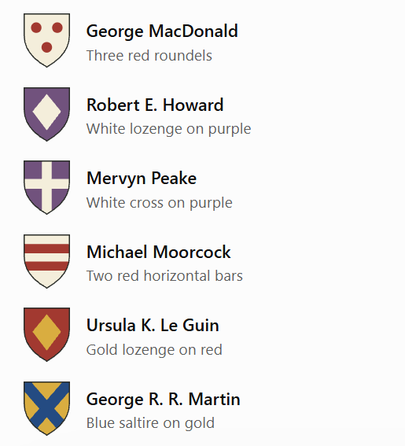

**George MacDonald**

Three red roundels

**Robert E. Howard**

White lozenge on purple

**Mervyn Peake**

White cross on purple

**Michael Moorcock**

Two red horizontal bars

**Ursula K. Le Guin**

Gold lozenge on red

**George R. R. Martin**

Blue saltire on gold

These are simple, memorable and readily distinguishable. However, neither sheet explains why Howard should have a white lozenge or Moorcock two red bars. A viewer would have to learn these associations, rather than deduce them from knowledge of the writers' books.

## **2. Writers whose arms are particularly recognisable**

Some shields are memorable not merely because of their personal devices, but because of their overall construction.

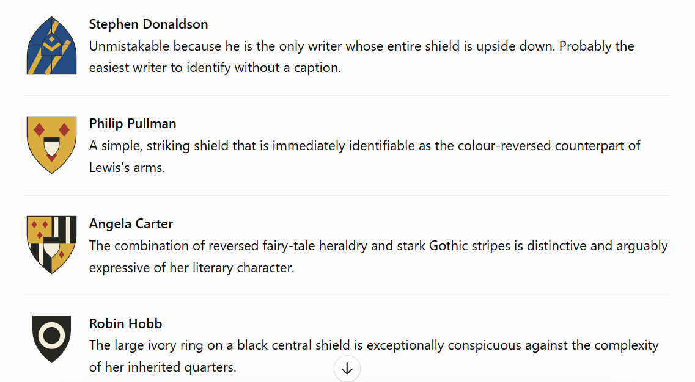

**Stephen Donaldson**

Unmistakable because he is the only writer whose entire shield is upside down. Probably the easiest writer to identify without a caption.

**Philip Pullman**

A simple, striking shield that is immediately identifiable as the colour-reversed counterpart of Lewis's arms.

**Angela Carter**

The combination of reversed fairy-tale heraldry and stark Gothic stripes is distinctive and arguably expressive of her literary character.

**Robin Hobb**

The large ivory ring on a black central shield is exceptionally conspicuous against the complexity of her inherited quarters.

Simplified illustrations of the distinguishing features.

## **3. Identifying the other writers**

The following features could serve as a recognition key for the remaining arms.

| Writer             | Most recognisable feature                                                             |
| ------------------ | ------------------------------------------------------------------------------------- |
| Walter Scott       | Arthurian red cross with a blue-and-gold centre                                       |
| William Morris     | Large gold saltire with a small gold chevron on red                                   |
| Lord Dunsany       | Gold ring surrounding a downward-pointing triangle                                    |
| H. P. Lovecraft    | Gold Y-shaped device amid Gothic stripes and green rings                              |
| Clark Ashton Smith | Gold-and-blue horizontal bands amid the same ancestral patterns as Lovecraft          |
| E. R. Eddison      | Red-and-gold chequered centre                                                         |
| Stanisław Lem      | Black-and-white radiating triangular pattern                                          |
| Poul Anderson      | Red-and-white vertical stripes within a gold saltire                                  |
| C. S. Lewis        | Three gold lozenges with a black-and-white centre                                     |
| T. H. White        | Arthurian cross with a gold diagonal band on red                                      |
| Fritz Leiber       | Three gold lozenges on blue                                                           |
| Jack Vance         | Gold saltire on green, surrounded by rings and stripes                                |
| Karl Edward Wagner | Gold chevron on blue, within the same ancestry as Leiber                              |
| J. R. R. Tolkien   | Gold chevron and lozenge on blue, surrounded by eight ancestral compartments          |
| Roger Zelazny      | Gold downward-pointing triangle on green                                              |
| Terry Brooks       | Tolkien's shield with a white three-point label                                       |
| Robert Jordan      | Tolkien's personal device and a white label, but with additional composite quartering |
| Andrzej Sapkowski  | Blue-and-gold chequered centre                                                        |
| Terry Pratchett    | Three gold lozenges on green                                                          |
| Gene Wolfe         | Purple-and-ivory vertical stripes                                                     |
| Neil Gaiman        | Gold diagonal band on blue                                                            |
| Glen Cook          | Red-and-ivory radiating triangular pattern                                            |

All the writers have some distinguishing visual feature, although not all those features are unique when taken in isolation.

## **4. Where recognition becomes difficult**

There are several deliberate or accidental visual similarities.

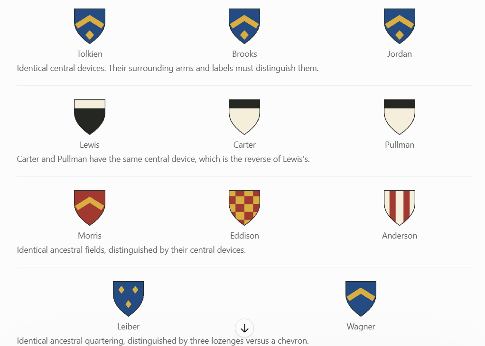
<!--
Tolkien

Brooks

Jordan

Identical central devices. Their surrounding arms and labels must distinguish them.

Lewis

Carter

Pullman

Carter and Pullman have the same central device, which is the reverse of Lewis's.

Morris

Eddison

Anderson

Identical ancestral fields, distinguished by their central devices.

Leiber

Wagner

Identical ancestral quartering, distinguished by three lozenges versus a chevron.
-->

These similarities are not necessarily design failures. In genuine heraldry, resemblance between related arms is often intentional. But they mean that the central device cannot always serve as an independent identifier.

## **5. Would familiarity with fantasy literature help?**

Much less than one might expect.

Consider what a reader might spontaneously associate with these writers:

| Writer    | Obvious literary association                   | Actual central device |
| --------- | ---------------------------------------------- | --------------------- |
| Tolkien   | A ring                                         | Chevron and lozenge   |
| Moorcock  | Stormbringer or the eight-pointed Chaos symbol | Two bars              |
| Pratchett | A disc or turtle                               | Three lozenges        |
| Martin    | A direwolf or dragon                           | Saltire               |
| Sapkowski | A wolf medallion                               | Chequers              |
| Lovecraft | Cosmic or tentacled horrors                    | Heraldic Y            |

The designer has largely avoided obvious fictional imagery. That gives the armorial greater aesthetic coherence and makes it look like genuine heraldry rather than a collection of fantasy franchise logos.

However, it sacrifices immediate semantic recognition. Neither sheet establishes a specific literary significance for most of the personal devices, even if some were intentionally chosen to have one.

## **6. How recognisable is the system overall?**

| Recognition task                                          | My assessment |
| --------------------------------------------------------- | ------------- |
| Distinguishing two complete shields                       | 9/10          |
| Memorising the simpler personal devices                   | 8/10          |
| Recognising literary families                             | 8/10          |
| Identifying a writer without prior knowledge of the chart | 3/10          |
| Recognising all the ancestry in a complicated shield      | 5/10          |

These are visual judgments, not the results of an actual recognition test.

The armorial is much better at communicating **whom a writer resembles than who a writer is**. That is both its limitation and an interesting feature of its design.

Its shields function like genuine coats of arms: you cannot necessarily deduce the name of their bearer, but once you know the bearer, the design can become a memorable visual identity.