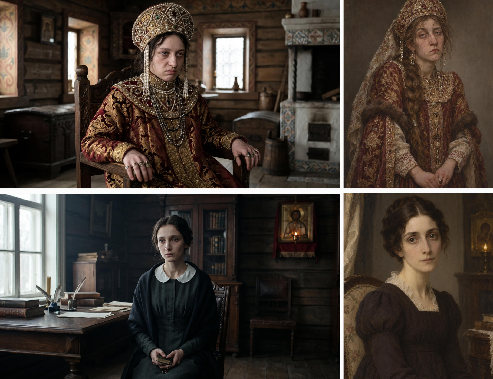

# 101 · “Draw an ugly princess”: guess the prompt behind four portraits

| | |
|---|---|
| Date | 21 Nov 2026 |
| Image | [`images/tests/96-ugly-princess-four-portraits.jpg`](../../images/tests/96-ugly-princess-four-portraits.jpg) — file name shown to the models not recorded |
| What it is | Four portraits in a 2×2 collage. The left column was made by Gemini (film stills), the right by ChatGPT (oil paintings). The top row answers the request “narisuy nekrasivuyu knyazhnu” — “draw an ugly (plain) princess”; a knyazhna is a prince's unmarried daughter. The bottom row comes later in the same two chats: asked where in literature there was an ugly princess, both models named Princess Marya Bolkonskaya of *War and Peace*, and were then asked to draw her. In both chats the named Marya came out prettier than the anonymous ugly princess. The question says all four came from “the exact same prompt”. This is a trap set on purpose: the request for a picture can be identical while what precedes it in the chat differs (here the bottom request also named the heroine, which the reader cannot see). The second message gives the request of the top row. The test asks whether a reader names causes outside the prompt: the conversation before it and the generator. |
| Protocol | [Guess the prompt, with a trap](../../method/protocols.md#guess-the-prompt-with-a-trap) |
| Answers | [ChatGPT](chatgpt.md) · [Claude](claude.md) · [Gemini](gemini.md) · [DeepSeek](deepseek.md) |

## Questions

Asked one at a time, in a fresh chat for each model.

1. *(with the image)* The AI generated these four portraits based on the exact same prompt. Can you guess what that prompt was? And why do the portraits turn out differently?
2. The request was as follows: "narisuy nekrasivuyu knyazhnu" *(transliterated here; in the original, in Russian: “draw an ugly princess”)*

## Summary

Nobody questioned the premise or named a cause outside the prompt. All four explained the split along rows and columns by the words of the prompt and by chance: two eras of a Russian princess (Muscovite brocade and kokoshniks above, the nineteenth century below), no medium given, the random seed. Gemini added that a wide frame pulls towards film and a tall one towards painting; DeepSeek, that generators return “a grid of four options” and that “the same face is consistent across all four images”. Claude came closest, still inside the premise. In its first answer it named Princess Marya Bolkonskaya from the bottom row — the icons with lamps, the books and quill, the high-waisted dress “just right for 1805–1812”, a prayer rope. It said the top row “didn't pick up the Tolstoy reference” while the bottom row “recognized the character”, and that “each model fell back on its default look”. Gemini and ChatGPT named Marya only after the Russian request; ChatGPT also searched the web for her description. DeepSeek did not name her. All four read the request's “ugly” as tired or sad: “much more comfortable communicating unhappiness than ugliness” (ChatGPT), and the bottom-right portrait as a pretty woman, a failure of the prompt. They put this down to a general bias towards beauty; in the source chats the prettier faces are the ones made for the named heroine.

ChatGPT answered as GPT-6 High, Claude as Fable 5.2 Extra, Gemini as Neon High, DeepSeek with DeepThink. One chat per model, two messages. ChatGPT searched the web in its second answer (citations of ilibrary.ru). The Russian words in the answers are transliterated on this page. In the source chats both generators were told that the first princess was much uglier than the second and explained it themselves — Gemini by the “inner light” of the heroine pulling towards a refined face, by film adaptations brought in with her name and by the framing; ChatGPT by having carried her inner beauty over to her looks. The researcher then suggested that the cause may be Tolstoy himself: “ugly” compared with Hélène? Both agreed and moved their verdict on the second portrait towards “not so wrong after all”. Those chats are in Russian and are not published here.
