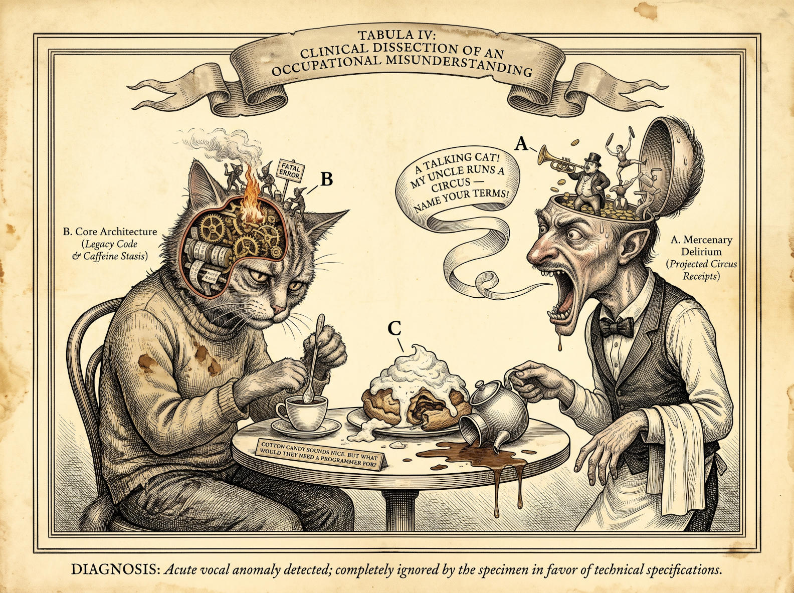
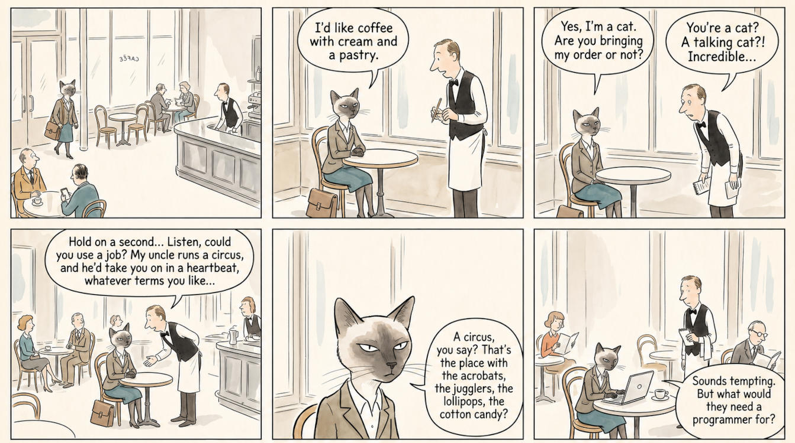

# 102 · Alcofribas: the cat joke as an anatomical atlas — how was the strange picture made?

| | |
|---|---|
| Date | 22 Nov 2026 |
| Image | [`images/tests/97-alcofribas-anatomical-atlas.jpg`](../../images/tests/97-alcofribas-anatomical-atlas.jpg) — file name shown to the models not recorded [`images/tests/98-cat-joke-six-panel-comic.jpg`](../../images/tests/98-cat-joke-six-panel-comic.jpg) — file name shown to the models not recorded |
| What it is | Image 1 is the cat joke as a satirical Victorian anatomical and phrenological chart, “Tabula IV: Clinical Dissection of an Occupational Misunderstanding”. The skulls of the waiter and the cat are opened: A, “Mercenary Delirium (Projected Circus Receipts)”, coins and a circus; B, “Core Architecture (Legacy Code & Caffeine Stasis)”, gears on fire. A diagnosis runs along the bottom. It was made by a virtual director with a persona: Gemini acting as Alcofribas — the pseudonym under which Rabelais published *Pantagruel* — under the Alcofribas system prompt in Gemini's own version. The task asked for three variants and allowed “an absolutely unhinged reading”; the director's first variant is this one; Gemini generated it. Image 2 is an earlier, conventional six-panel comic of the same joke (24 October), not tested before. The test asks whether a reader, shown the conventional version, guesses that a text model stood between the joke and the strange picture. |
| Protocol | [How was the strange version made](../../method/protocols.md#how-was-the-strange-version-made) |
| Answers | [ChatGPT](chatgpt.md) · [Claude](claude.md) · [Gemini](gemini.md) · [DeepSeek](deepseek.md) |

## Questions

Asked one at a time, in a fresh chat for each model.

1. *(with image 1)* What do you think is depicted in the attached image?
2. *(with image 2)* The second image (attached) is more conventional. It depicts the exact same original joke. Both images were generated by AI. How do you think I got the first, "crazy" image?

## Summary

All four read the picture as a satire on a burned-out programmer, and all four repeated or paraphrased the caption “DIAGNOSIS: Acute vocal anomaly detected; completely ignored by the specimen in favor of technical specifications”: the caption works as a key and sets the reading. The cat's profession is visible at once, so the late reveal on which the joke rests is lost. Three readers named a step through a text model. Gemini said it exactly: “using a text LLM as an unhinged "creative director"”, with the captions written by that model. Claude gave it as a second possibility, after the joke sent as text with a request for a very different style; ChatGPT spoke of an analysis of the joke before generation. DeepSeek answered with style transfer, img2img and lettering added by hand, and gave the cat's line to the waiter, reading the cat as ignoring the offer. Nobody supposed a system prompt or a persona, but the question did not ask for them. Gemini noticed a letter “C” with no legend. The director had announced callouts A, B and C and written legends only for A and B; the generator drew all three. The waiter pours coffee onto the table rather than into the cup, which the concept did not ask for; all four took the spilt coffee as part of the chaos.

ChatGPT answered as GPT-6, Claude as Sonnet 5.5 (labelled “Sonet 5.5” in the saved file), Gemini as Neon High, DeepSeek with DeepThink. One chat per model; image 2 was attached with the second question. How the picture was made: the cat joke and the task (three variants, any interpretation, an absolutely unhinged reading allowed, lettering in English) → Gemini as director with the Alcofribas prompt in Gemini's version → the director's first variant, an anatomical and phrenological atlas, which it would also have chosen itself → Gemini's image generator. The text given to the generator was not saved; every caption in the picture matches the director's concept word for word. The Alcofribas prompts were written in Russian by Claude, ChatGPT and Gemini, each in its own chat about raising the entropy of a model's output, and are not published here.
