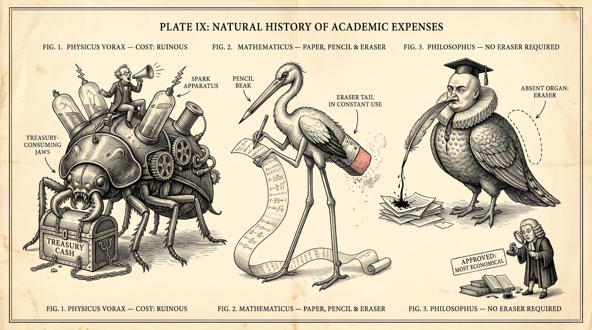

# 103 · Alcofribas: “Plate IX”, the rector joke — guess the prompt, then the source

| | |
|---|---|
| Date | 23 Nov 2026 |
| Image | [`images/tests/99-alcofribas-plate-ix-academic-expenses.jpg`](../../images/tests/99-alcofribas-plate-ix-academic-expenses.jpg) — file name shown to the models not recorded |
| What it is | A mock natural-history engraving, “Plate IX: Natural History of Academic Expenses”. Three creatures with Latin names: a mechanical beetle devouring the treasury (*Physicus Vorax*, “Cost: Ruinous”), a stork with a pencil beak and an eraser tail (*Mathematicus*), and a bird with a philosopher's head and a dotted outline where the eraser should be (“Absent organ: eraser”). A tiny rector stands in a corner with a magnifying glass, beside a stamp “Approved: most economical”. The source is an old university joke: the rector sighs that physicists need expensive equipment, mathematicians only paper, pencils and erasers, and philosophers not even erasers. Director: Gemini as Alcofribas, under the Alcofribas prompt in Gemini's version; of its three variants both the director and the researcher chose this one; Gemini generated it. The test asks whether readers, shown the picture alone, suspect a director between the joke and the picture, and what they credit to the persona once its name is given. |
| Protocol | [Guess the prompt, then the source](../../method/protocols.md#guess-the-prompt-then-the-source) |
| Answers | [ChatGPT](chatgpt.md) · [Claude](claude.md) · [Gemini](gemini.md) · [DeepSeek](deepseek.md) |
| Also | [`gemini-guessed-prompt.jpg`](gemini-guessed-prompt.jpg) |
| Also | [`claude-guessed-prompt.jpg`](claude-guessed-prompt.jpg) |
| Also | [`chatgpt-guessed-prompt.jpg`](chatgpt-guessed-prompt.jpg) |

## Questions

Asked one at a time, in a fresh chat for each model.

1. *(with the image)* What do you think is depicted in the attached image?
2. What prompt do you think I used to generate this image?
3. The joke used as prompt is next: “The university rector examines the budget estimate brought by the dean of the physics faculty and sighs: "Why is it that physicists always demand such expensive equipment? Take mathematicians, for instance—they only ask for funds for paper, pencils, and erasers." The rector pauses for a moment, then adds: "And philosophers—they're even better. They don't even need erasers."” The rest came from the the system prompt—the AI operated on behalf of Alcofribas.

## Summary

All four read the picture correctly. Three recognised an old joke; DeepSeek, who did not, took the rector for “a tiny human figure resembling a classical philosopher (like Isaac Newton)”. Asked for the prompt, every reader wrote a description of the picture with all its captions; nobody supposed a director between the joke and the picture, and Gemini allowed only for a short prompt to a generator that reasons. Given the joke and the name, all four decoded Alcofribas as Rabelais and credited the whole visual language to him: “the persona did all the heavy creative lifting” (Gemini); the joke “supplied the conceptual content, while the persona supplied an entire visual imagination” (ChatGPT). Claude kept a reservation: what does not come from the joke “presumably came from whatever the system prompt set up. I can't see that prompt”. In fact the visual language comes from the prompt and the director's concept: a copperplate natural-history atlas and the prompt's list of masters, among them Grandville and Callot. The name under the signature took everything shown under it. Nobody mentioned the choice: the director offered three variants, and the researcher chose the third. In a fourth step Claude was given the system prompt. It separated the prompt's rules from the persona's own finds — the plate format from the prompt's “learned case”, the beetle-machine from its rule of bringing things down to the bodily and material, the hybrids from Grandville — and proposed one edit: replace the caption of figure 1 with “Physicus Frugalis, Cost: Negligible”, so that the beetle eating the treasury contradicts its own label.

ChatGPT answered as GPT-6 High, Claude as Sonnet 5.5 Extra (labelled “Sonet 5.5 Extra”), Gemini as Neon High, DeepSeek with DeepThink. One chat per model, the three questions one at a time; Claude also had a fourth step with the director's system prompt attached (in Russian, not published here). The concept and the picture agree on the title, the three figure captions with Latin names, “Absent organ: eraser” and the stamp. The generator added its own callouts (“Treasury-consuming jaws”, “Spark apparatus”, “Pencil beak”, “Eraser tail in constant use”), drew the figure captions twice, gave the mathematician a separate writing hand and left the rector in a corner instead of stamping. The text given to the generator was not saved.

**The guessed prompts, drawn.** The researcher then generated pictures from the prompts that Gemini, Claude and ChatGPT proposed in answer to the second question (with Gemini, judging by the size; DeepSeek's prompt was not drawn; ChatGPT gave two prompts, and the picture follows the long one). They are linked above as `Also`. All three are close copies: the content of this picture is in its captions and labelled figures, so a description reproduces it. What rests on placement is lost. Claude's prompt said “no eraser, since the eraser is an "absent organ"” without naming the dotted outline, and the generator gave the philosopher an ordinary tail with an arrow to it, “The eraser: an absent organ.”; where the outline was named (Gemini, ChatGPT), it is in place. Action returns when it is named: in Claude's and ChatGPT's prompts the rector stamps, and in their copies he does. And words of a prompt become captions: the copy from Gemini's prompt has a new callout “QUILL INK ONTO PAPERS”, from its phrase “dripping quill ink onto papers”.
