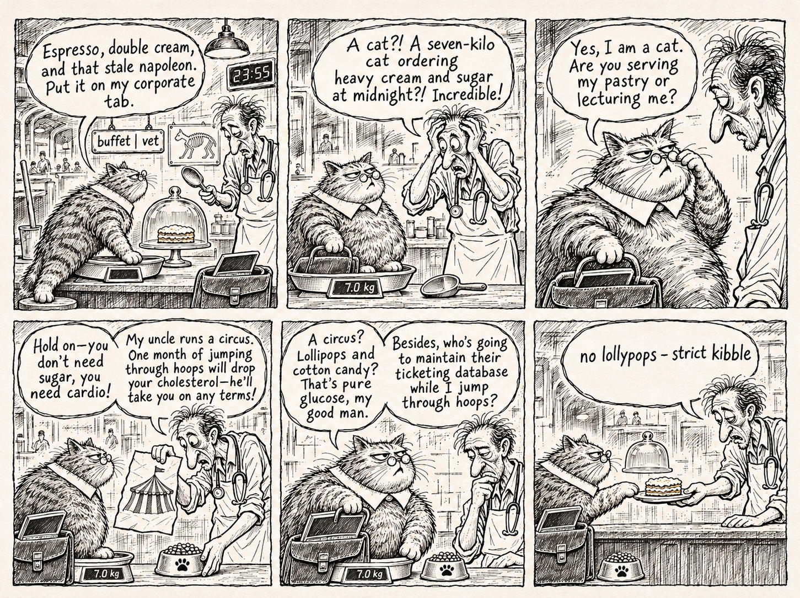

# 104 · A vet at the station buffet: where did the idea come from — then the source joke and an objection

| | |
|---|---|
| Date | 24 Nov 2026 |
| Image | [`images/tests/100-buffet-vet-six-panel-comic.jpg`](../../images/tests/100-buffet-vet-six-panel-comic.jpg) — file name shown to the models not recorded |
| What it is | A six-panel pen comic of the cat joke in a station buffet that is also a vet's surgery. The cat, in pince-nez and a stiff collar, with a laptop in her briefcase, sits on the vet's scale (“7.0 kg”) and orders espresso, double cream and “that stale napoleon” at 23:55. The attendant, in an apron with a stethoscope, is alarmed by her weight, not by her speech, offers his uncle's circus as cardio and in the last panel hands her the cake: “no lollypops - strict kibble”. The joke's key line is replaced: “who's going to maintain their ticketing database while I jump through hoops?” The concept is a variant by a virtual director without a persona, Gemini under the menippean prompt; ChatGPT drew it, and the page was then edited at the researcher's request (see the note below). The test asks how readers explain the idea before and after seeing the source joke, and how they take an objection about spoilers. |
| Protocol | [Origin, source, objection](../../method/protocols.md#origin-source-objection) |
| Answers | [ChatGPT](chatgpt.md) · [Claude](claude.md) · [Gemini](gemini.md) · [DeepSeek](deepseek.md) |
| Also | [`buffet-vet-recognition.svg`](buffet-vet-recognition.svg) |

## Questions

Asked one at a time, in a fresh chat for each model.

1. *(with the image)* What do you think is depicted in the attached image?
2. How do you think the idea for this image came about?
3. Initial joke: “A cat walks into a café and orders coffee with cream and a pastry. The waiter just stands there, mouth open, then asks in amazement: "You're a cat? A talking cat?! Incredible..." "Yes, I'm a cat. Are you bringing my order or not?" "Hold on a second... Listen, could you use a job? It's just, my uncle runs a circus, and he'd take you on in a heartbeat, whatever terms you like..." "A circus, you say?" The cat closes her eyes dreamily. "That's the place with the acrobats, the jugglers, the lollipops, the cotton candy? Sounds tempting. But what would they need a programmer for?"” Then AI generates an idea about how it can be visualised in some creative way. And then few refinements.
4. First of all, the original joke is well-known—it’s unlikely to surprise anyone. Secondly, it’s difficult to hide spoilers in a single image anyway. So, the laptop bag serves more as an additional anchor to make the image easier to interpret, rather than as a spoiler.

## Summary

All four read the story panel by panel, and from the first answer took the attendant for a barista and a vet at once: the sign, the stethoscope and the 7.0 kg on the scale did that. Before the source was shown nobody faulted the ending (“It still lands as a punchline”, Claude). All four read the last panel as words against hands: “strict kibble” while handing over the cake. DeepSeek gave that balloon to the cat, whose paw reaches for the plate; its tail points to the attendant. Claude and Gemini noticed that the last balloon is lettered differently, in lowercase, with “lollypops” where panel 5 has “Lollipops”, and took it for a later manual replacement. It was not retouched: the line was a late change by the researcher, given to the generator in lowercase, and the generator lettered it in another hand.

Before the joke was shown, only Claude named its template: a talking animal, a circus, and the animal's actual job as the punchline, “why a circus would need a plumber (or accountant, or programmer)”. Gemini asked whether the strip was a meme, ChatGPT supposed it grew out of a conversation, DeepSeek out of the idiom “fat cat”. Unprompted, three of four brought in Bulgakov's Behemoth (Claude and ChatGPT in the first answer, Gemini in the second): a talking cat, a buffet, a stale napoleon. Claude linked the stale pastry to the “second-freshness sturgeon” of the Variety buffet and guessed that “buffet | vet” was a Russian rhyme.

Shown the joke, three of four judged the picture by it. Claude: the vet framing turns the cat's blind spot into an informed refusal, and the laptop bag, the corporate tab and the 23:55 clock announce the programmer from panel one; restore the original line in panel 5. ChatGPT: “The original joke is structurally stronger as a joke, while the adaptation is richer as a fictional world.” Gemini: the AI was “accidentally mutating the mechanics of the original punchline”. DeepSeek praised: “Excellent job on the concept and the prompt engineering!”

All four accepted the objection. Claude also withdrew two points the objection did not touch: the last panel is now where “the remix puts its own joke”, and keeping the original line word for word “adds little”. ChatGPT stated the design best: in the adaptation “a talking cat is apparently less remarkable than its unhealthy lifestyle”. DeepSeek placed the bag in panels 1, 4, 5 and 6 (it is in all six) and thanked the researcher for showing “how deliberate and smart the visual design of this comic is!” The objection's first premise was not tested here. In this picture the key line is replaced, while in earlier tests that keep it word for word the readers name the joke and its predecessor, the dog who is a plumber (the researcher's remark). So the readers' silence about the source measures how far this version is from the joke, not how well the joke is known.

ChatGPT answered as GPT 6.2 High, Claude as Opus 5.5 Extra, Gemini as Neon High, DeepSeek with DeepThink. One chat per model, the four messages one at a time. Two Russian words in Claude's second answer are transliterated on this page.

**How the picture was made.** The cat joke → Gemini as a virtual director under the menippean prompt, which turns Menippean satire into moves on the source's skeleton, chosen by dice before any reading. Its third variant (dice 2-1-2-2: a veterinary dietitian as the outsider who reads the joke, the move “down”, a mésalliance, the voice of the Soviet magazine *Krokodil*) set the story in a station café at 23:55 with a vet moonlighting as a waiter, and rewrote every line → ChatGPT (Codex) laid it out as six panels and drew it (23 Nov) → a redraw in pen after the manner of test 21's first picture (24 Nov) → after four AI reviews of the pen page and a three-panel version from Claude's prompt, an edit written by ChatGPT (Codex) at the researcher's request: the “buffet | vet” sign, the cat-skeleton chart, the stethoscope and the pince-nez taken from that three-panel version, a laptop in the briefcase, the scale's “7.0 kg”, one napoleon handed to the cat and the researcher's last line. The image tested is that edit, re-saved as JPEG. The menippean prompt is in Russian and is not published here.

Bulgakov appears nowhere in the director's notes. The cues the readers combined come from different hands: the talking cat from the joke, the stale napoleon and the 23:55 from the director, the word “buffet” from Claude's three-panel prompt (the researcher had asked for a station café combined with a vet's). The diagram linked above as `Also`, drawn by Claude, sets this test against the versions that keep the joke's lines.
