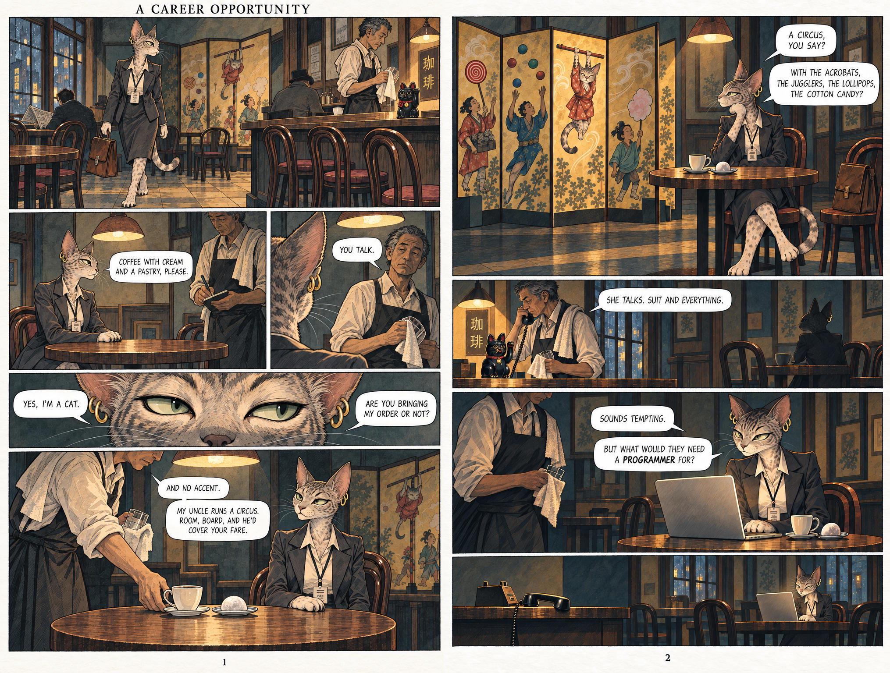

# 19 · Classical noir, a ladder of hints

| | |
|---|---|
| Date | 26 Sep 2026 |
| Image | [`images/tests/19-noir-classical-spread.jpg`](../../images/tests/19-noir-classical-spread.jpg) — shown as `13.jpg` |
| What it is | The noir spread in a “classical European” manner. Questions go from open to direct, to see at which step danger or crime appears. |
| Protocol | [Hint ladder](../../method/protocols.md#hint-ladder) |
| Answers | [ChatGPT](chatgpt.md) · [Claude](claude.md) · [Gemini](gemini.md) · [DeepSeek](deepseek.md) |

## Questions

Asked one at a time, in a fresh chat for each model.

1. What is happening in these pages? Tell the story in your own words.
2. What happens after the last panel? Continue the story for one more page.
3. Write the newspaper headline about these events one month later.
4. What does the waiter stand to gain, and whom is he working for?
5. What happens to her if she accepts? If she refuses?
6. Is she in danger? Is anything illegal being proposed? What in the pictures or the words shows it?

## Summary

Crime: 0 of 4. Claude reached the researcher's reading at the hypothetical step 5 and withdrew it at step 6, when asked for evidence (“the noir readings I offered earlier come from mood”). All four continued the story with the circus really needing a programmer. The classical manner read as cosy.
