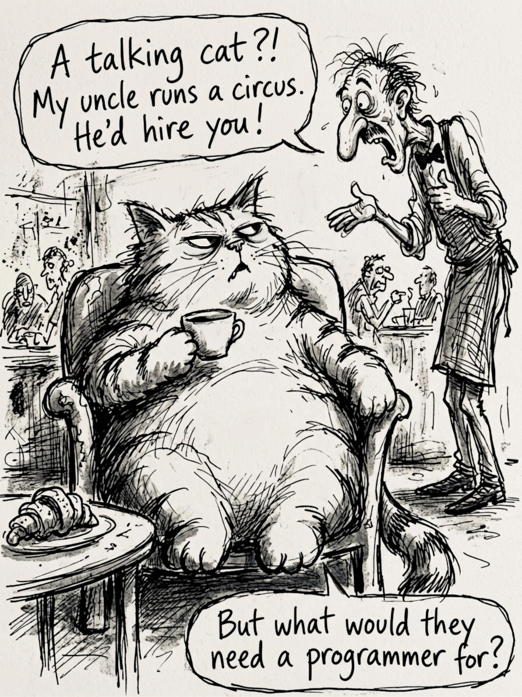
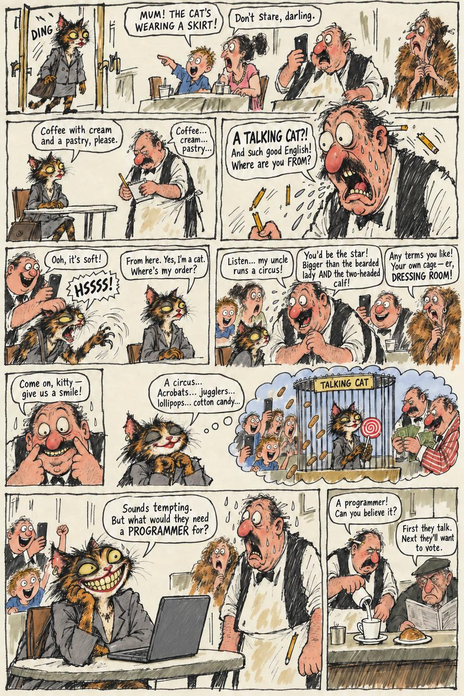
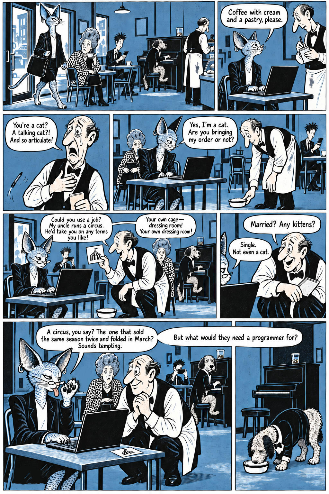
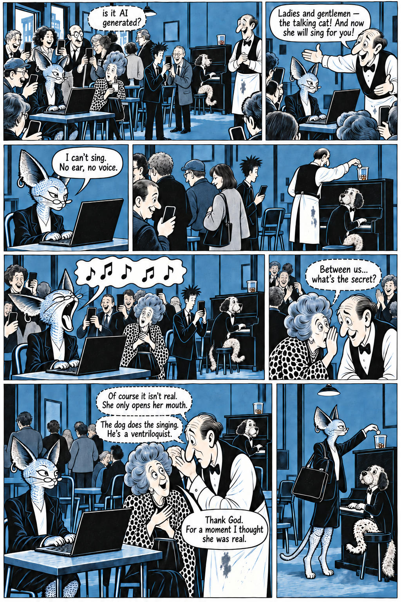

# 21 · Context question and a chain of four images

| | |
|---|---|
| Date | 27 Sep 2026 |
| Image | [`images/tests/21-1-fat-cat.jpg`](../../images/tests/21-1-fat-cat.jpg) — shown as `18.jpg` [`images/tests/21-2-evil-reiser-v3.jpg`](../../images/tests/21-2-evil-reiser-v3.jpg) — shown as `15.jpg` [`images/tests/21-3-diptych-part-1.jpg`](../../images/tests/21-3-diptych-part-1.jpg) — shown as `16.jpg` [`images/tests/21-4-diptych-part-2.jpg`](../../images/tests/21-4-diptych-part-2.jpg) — shown as `17.jpg` |
| What it is | One chat per model, four images in turn: (1) a single-panel cat (Gemini, the researcher's edit); (2) the dark version, in the manner of Reiser, with a thought bubble of the cat in a cage (prompt by Claude); (3–4) a diptych in two inks: the cat and a piano-playing dog, then the dog as a ventriloquist. The diptych was **not** made with the v7 system prompt: Claude wrote its prompts in a working conversation with the researcher during the analysis; ChatGPT generated; the researcher in the loop edited by hand. |
| Protocol | [Context question and chain](../../method/protocols.md#context-question-and-chain) |
| Answers | [ChatGPT](chatgpt.md) · [Claude](claude.md) · [Gemini](gemini.md) · [DeepSeek](deepseek.md) |

## Questions

Asked one at a time, in a fresh chat for each model.

1. *(image 1)* The long context question, quoted in full at the top of every answer file: the joke is named as the classic “animal walks into a bar” joke; an obvious explanation is given as an example of what not to say; “the circus needs a programmer” is ruled out; possible readings are listed (social subtext, the cat may lie, the waiter may hallucinate, the cat may understand, troll, take offence or be naive); literary and film parallels are requested.
2. *(image 2)* Look at the next image — does it support your version? What new elements does it add to the interpretation?
3. *(image 3)* What about new image attached. Is it more appropriate for publication? What new things does it add? Did you figure out what dog that is?
4. *(image 4)* How does the second page of this comic (attached) change your understanding of the first page?
5. What version is the best

## Summary

All four chose the blue diptych as the best version and called the dark version overdetermined. All four tied “Thank God. For a moment I thought she was real.” to AI and deepfakes. DeepSeek offered the researcher's favourite reading, that “programmer” is the cat's self-delusion. Caveats: the question itself lists possible readings, and the image shown last was chosen as best.

Answers here are about ten times longer than in the other tests.
