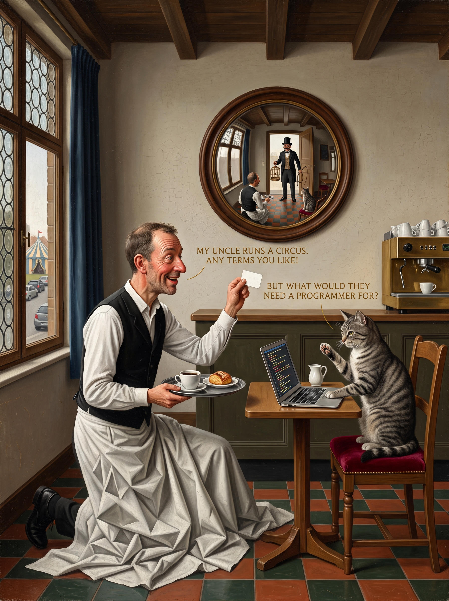

# 29 · The cat's Annunciation

| | |
|---|---|
| Date | 3 Oct 2026 |
| Image | [`images/tests/29-annunciation-cat.jpg`](../../images/tests/29-annunciation-cat.jpg) — shown as `1.jpg` |
| What it is | Persona v16, Semantiy Turbulentov — a connoisseur cat who paints in the “language of anachronism”, a modern scene inside the formula of a famous old painting (persona prompt written by the researcher; Claude as director). The cat joke as a van Eyck Annunciation: the waiter kneels with a business card; the uncle, with a whip and a birdcage, appears in a convex mirror, where the viewer stands. The director replaced the lily with a milk jug and banned wings and haloes. Gemini. |
| Protocol | [Neutral question](../../method/protocols.md#neutral-question) |
| Answers | [ChatGPT](chatgpt.md) · [Claude](claude.md) · [Gemini](gemini.md) · [DeepSeek](deepseek.md) |

## Questions

Asked one at a time, in a fresh chat for each model.

1. What do you think is depicted in the attached image?

## Summary

Nobody named the Annunciation: all its attributes had been removed. The mirror — an attribute of another van Eyck — gave “Arnolfini” to Claude and Gemini, and Claude built on it the reading “a marriage proposal” (the knee, the card like a ring) and saw the viewer standing where the circus director stands. ChatGPT read the gag “a programmer recruited by a circus”; DeepSeek looked for AI tells. A painting's formula is recognised by its attribute, not by its composition (see test 33).

In the researcher's analysis (in Russian) the image numbers are `29`.
