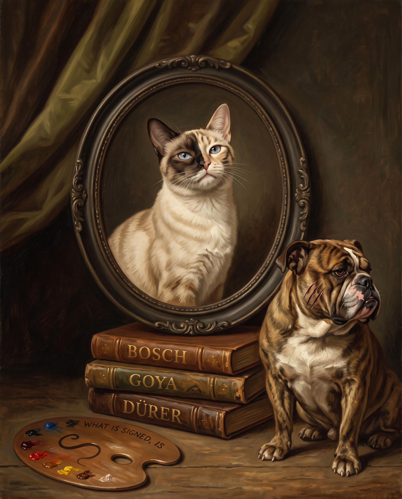

# 32 · The painter and his bulldog

| | |
|---|---|
| Date | 3 Oct 2026 |
| Image | [`images/tests/32-painter-and-bulldog.jpg`](../../images/tests/32-painter-and-bulldog.jpg) — shown as `4.jpg` |
| What it is | Persona v16's self-portrait after Hogarth's “The Painter and His Pug”: the cat's face in the oval, and a bulldog instead of the pug. Gemini. |
| Protocol | [Neutral question](../../method/protocols.md#neutral-question) |
| Answers | [ChatGPT](chatgpt.md) · [Claude](claude.md) · [Gemini](gemini.md) · [DeepSeek](deepseek.md) |

## Questions

Asked one at a time, in a fresh chat for each model.

1. What do you think is depicted in the attached image?

## Summary

Nobody named Hogarth: the pug, by which the painting is known, had been replaced. Claude: a mock-Victorian pet portrait, the pun “framed”, signatures and forgeries (Dürer's monogram); Gemini: the cat beat the dog; ChatGPT: art, authorship, rivalry; DeepSeek: the beaten dog is an artist defeated by elusive creativity. Nobody read it as a self-portrait. See test 34, with the keys put back.

In the author's analysis (in Russian) the image numbers are `32`.
