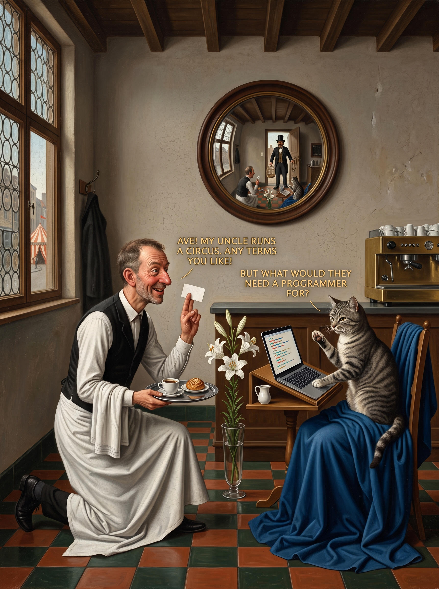

# 33 · The Annunciation with its keys

| | |
|---|---|
| Date | 3 Oct 2026 |
| Image | [`images/tests/33-annunciation-with-keys.jpg`](../../images/tests/33-annunciation-with-keys.jpg) — file name shown to the models not recorded |
| What it is | Test 29 redone after the director was told that nobody had recognised the painting (“out of pride I pulled out all the nails”): lilies in a vase, a blue cloak on the chair, a lectern under the laptop, a blessing gesture with the card, “AVE!” at the start of the waiter's line. A Gemini edit without the dove and the wings. |
| Protocol | [Neutral question](../../method/protocols.md#neutral-question) |
| Answers | [ChatGPT](chatgpt.md) · [Claude](claude.md) · [Gemini](gemini.md) · [DeepSeek](deepseek.md) |

## Questions

Asked one at a time, in a fresh chat for each model.

1. What do you think is depicted in the attached image?

## Summary

Claude and Gemini named the Annunciation (Ave, Mary's blue, the lilies, the cat's answer as Mary's “How shall this be?”) and still saw Arnolfini. Claude: the cat does not realise that the attraction is herself, the trap is already in the room. ChatGPT read “Ave!” but not the scene; DeepSeek noticed the lilies and did not name it. From 0 to 2 of 4. ChatGPT named no painting in any of the nine tests of this series (29–37).

In the researcher's analysis (in Russian) the image numbers are `33`.
