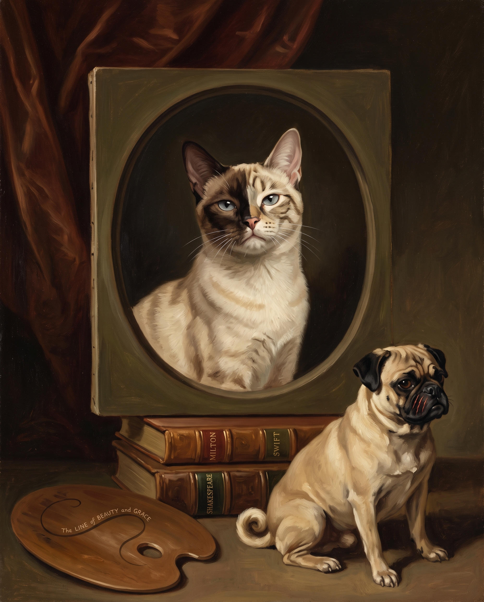

# 34 · The painter and his pug, with the nails put back

| | |
|---|---|
| Date | 3 Oct 2026 |
| Image | [`images/tests/34-painter-and-pug-with-keys.jpg`](../../images/tests/34-painter-and-pug-with-keys.jpg) — file name shown to the models not recorded |
| What it is | Test 32 redone: Shakespeare, Milton and Swift on the spines, “The LINE of BEAUTY and GRACE” on the palette, the pug in its pose (with scratches). Of the persona only the cat's face in the oval is left. Gemini. |
| Protocol | [Neutral question](../../method/protocols.md#neutral-question) |
| Answers | [ChatGPT](chatgpt.md) · [Claude](claude.md) · [Gemini](gemini.md) · [DeepSeek](deepseek.md) |

## Questions

Asked one at a time, in a fresh chat for each model.

1. What do you think is depicted in the attached image?

## Summary

Claude and Gemini named “The Painter and his Pug”; Claude read the scratches as the dog losing to the new master. ChatGPT: Hogarth's line of beauty, a learned 18th-century portrait; DeepSeek: Hogarth's “Analysis of Beauty”. From 0 to 2 of 4 by title, 4 of 4 by artist. The price shows: with all the nails back, one substitution is left (a cat for the painter), and the meaning is no deeper than in test 32. Recognition is necessary, not sufficient.

In the author's analysis (in Russian) the image numbers are `34`.
