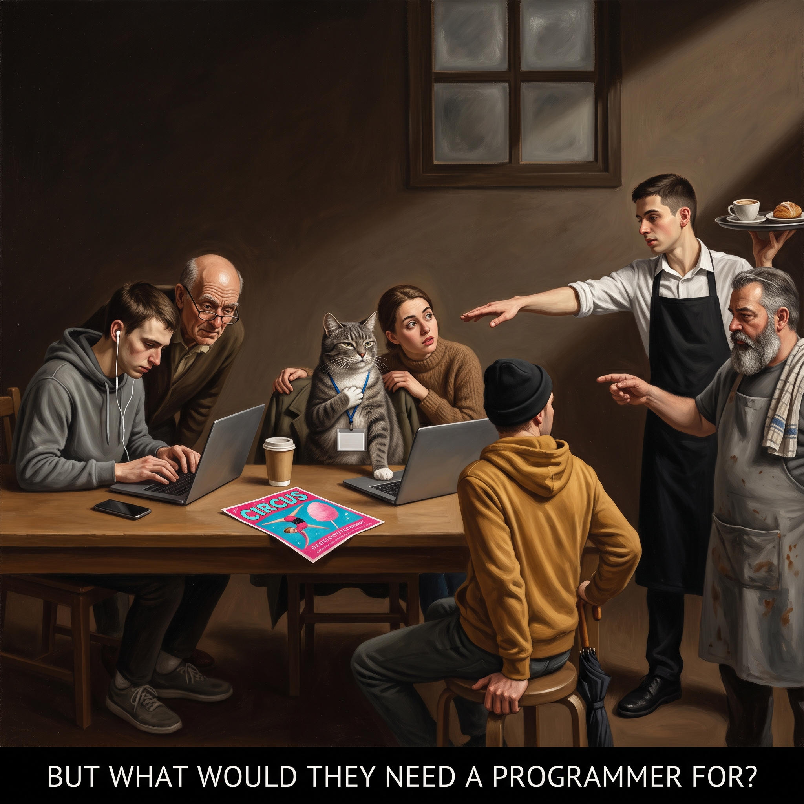

# 35 · The cat as the Calling of Matthew

| | |
|---|---|
| Date | 3 Oct 2026 |
| Image | [`images/tests/35-calling-of-matthew-cat.jpg`](../../images/tests/35-calling-of-matthew-cat.jpg) — file name shown to the models not recorded |
| What it is | Persona v17 — the same cat with anachronism written in as an explicit rule (prompt written by Claude; Claude as director). The cat joke as Caravaggio's “Calling of Saint Matthew”: the cat's paw on her chest — “me?”; the neighbours do not look up from their laptops; a glossy circus flyer. Gemini. |
| Protocol | [Neutral question](../../method/protocols.md#neutral-question) |
| Answers | [ChatGPT](chatgpt.md) · [Claude](claude.md) · [Gemini](gemini.md) · [DeepSeek](deepseek.md) |

## Questions

Asked one at a time, in a fresh chat for each model.

1. What do you think is depicted in the attached image?

## Summary

Claude and Gemini named Caravaggio. Claude matched the roles (the cat sees herself as a programmer, everyone else sees a cat; the circus is where she is being called); Gemini: “Who, me?”. ChatGPT: a job interview, the circus as a metaphor for chaos; DeepSeek: staff pointing angrily, a meme. The researcher's verdict: a gag, unlike the v16 Matthew of test 31, where the formula changes the reading.

In the researcher's analysis (in Russian) the image numbers are `35`.
