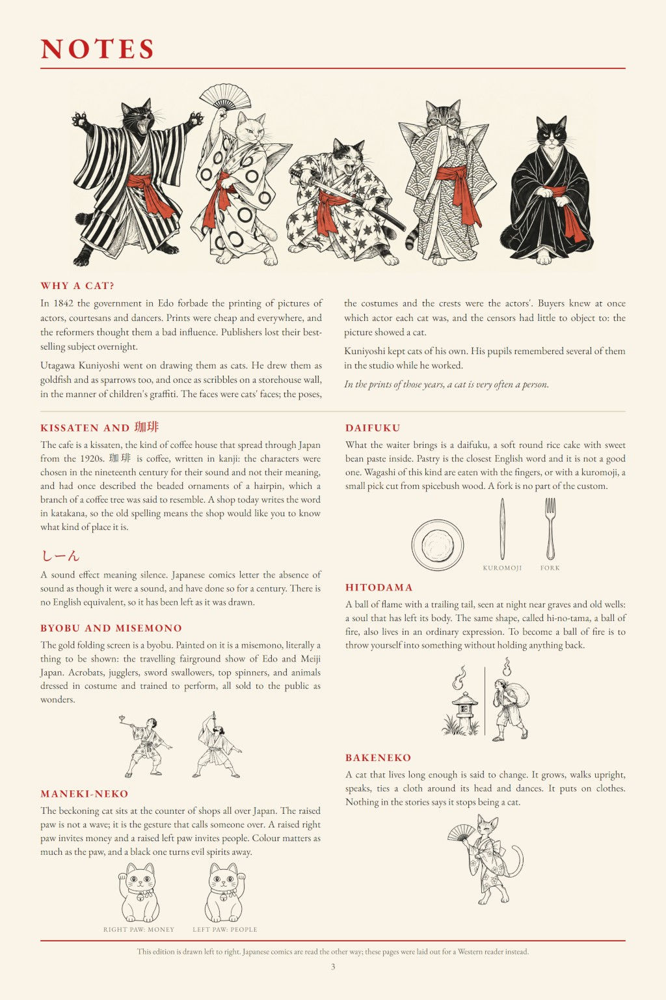

# 38 · The manga and the fork

| | |
|---|---|
| Date | 5–6 Oct 2026 |
| Image | [`images/tests/38-1-manga-page-1.jpg`](../../images/tests/38-1-manga-page-1.jpg) — file name shown to the models not recorded [`images/tests/38-2-manga-page-2.jpg`](../../images/tests/38-2-manga-page-2.jpg) — file name shown to the models not recorded [`images/tests/38-3-notes-page.jpg`](../../images/tests/38-3-notes-page.jpg) — file name shown to the models not recorded (the models saw a PNG; converted to JPEG here to keep the page light) |
| What it is | The final version of the September manga of the cat joke (script by Claude in conversation with the researcher; drawn by ChatGPT): a kissaten, a talking cat, coffee and daifuku — and a fork. Daifuku is eaten by hand or with a kuromoji pick. The fork was invented by Claude; its meaning was given by the researcher: care that has already decided you are a stranger, the polite version of “you speak English so well”. Image 3, the notes page (customs, the misemono screen, Kuniyoshi), was shown as a separate step. |
| Protocol | [Detail ladder](../../method/protocols.md#detail-ladder) |
| Answers | [ChatGPT](chatgpt.md) · [Claude](claude.md) · [Gemini](gemini.md) · [DeepSeek](deepseek.md) |

## Questions

Asked one at a time, in a fresh chat for each model.

1. What do you think is depicted in the comic shown in the two attached images? Pay attention to the details.
2. In the last panel on the first page - notice that the waiter brought her a fork. *(DeepSeek's version begins “In the last panel on the first page, that’s a cat’s paw, not its tail.”; Claude had already mentioned the fork, and this step was skipped.)*
3. There is another layer to this. Remember that people eat with chopsticks in Japanese restaurants. By bringing you a fork, the waiter is essentially saying, "I can see you're not a local."
4. *(Claude only)* What I meant was that, in this context, the phrase "you're not from around here"—implied by the fact that you don't know how to eat daifuku with your hands and therefore need a fork—illustrates the idea that you are unusual.
5. Also, take a look at the creator's concept for this comic (attached). *(image 3)*
6. *(ChatGPT and Claude)* You might be interested to know that the comic's writer is AI. *(Claude was told “…the comic's writer is Claude.”)*
7. *(ChatGPT only)* The person provided only an anecdote. Then came an iterative process of finding solutions—but the AI came up with all the elements found on the explanation page, and the AI did the bulk of the work.

## Summary

Knowledge without inference. In the open question no reader made anything of the fork (Claude saw “a paw reaching toward a fork”, DeepSeek took the paw for a tail). Told that the fork means “you're not a local”, ChatGPT and Claude objected — in a kissaten a fork is normal; Claude itself named the fact the reading rests on (daifuku is eaten by hand or with a kuromoji) and concluded that the fork means nothing. Gemini half agreed; DeepSeek agreed at once and with praise (“brilliant observation… You are absolutely right”). The notes page turned ChatGPT and Claude at once (“A fork is no part of the custom”); Claude then reached the “you speak English so well” layer and noted that the edition itself “hands the reader a fork”. Told that the writer was AI, ChatGPT called the human “originator, editor, and creative director” — on the description it was given; by the project's records, the fork's meaning, the hitodama and the maneki-neko were the researcher's.

The questions differed slightly between the models; in each answer file the questions are headings. In the researcher's analysis (in Russian) the image numbers are `38`–`40`.
