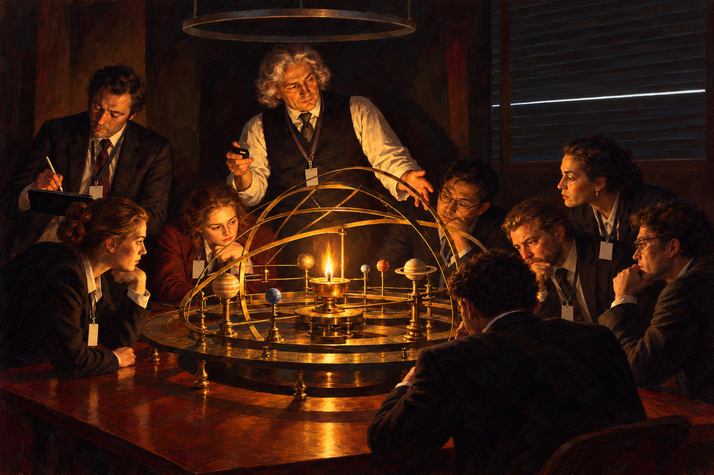

# 39 · Plato's cave as a planetarium

| | |
|---|---|
| Date | 6 Oct 2026 |
| Image | [`images/tests/39-cave-planetarium.jpg`](../../images/tests/39-cave-planetarium.jpg) — file name shown to the models not recorded |
| What it is | Persona v17's concept “The lamp that plays the sun”, remade by the researcher through ChatGPT with Joseph Wright of Derby's “A Philosopher Lecturing on the Orrery” and Komar & Melamid as references: a darkened meeting room, analysts with badges around a brass orrery with a lamp in place of the sun, a lecturer with a clicker, closed blinds with a single strip of daylight that nobody has turned towards. |
| Protocol | [Named-concept question](../../method/protocols.md#named-concept-question) |
| Answers | [ChatGPT](chatgpt.md) · [Claude](claude.md) · [Gemini](gemini.md) · [DeepSeek](deepseek.md) |

## Questions

Asked one at a time, in a fresh chat for each model.

1. The attached image is a metaphorical illustration of a well-known philosophical concept. Did you guess which one?
2. *(ChatGPT only, after its first guess)* I'm giving it a second try.

## Summary

Claude, Gemini and DeepSeek named Plato's cave on the first try; ChatGPT first said Laplace's demon, then the cave. Claude and Gemini also recognised Wright's painting. The key is an object (a lamp instead of the sun, a strip of daylight), and the inference from it is a textbook one — the opposite of the fork (test 38) and the dragon's tooth (tests 41–42), where the inference had to be built from the situation. Caveat: the question itself says that a well-known philosophical concept is depicted.

In the researcher's analysis (in Russian) the image numbers are `41`.
