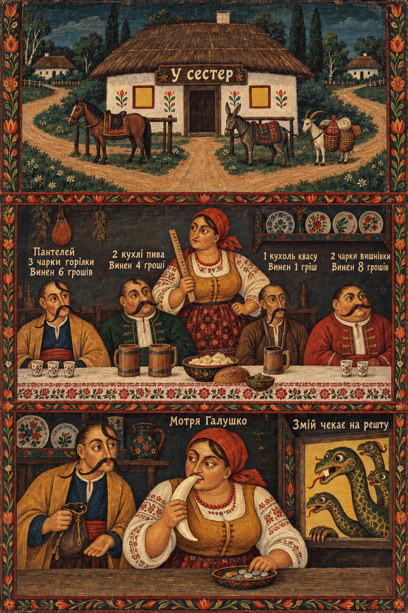

# 41 · The dragon's tooth

| | |
|---|---|
| Date | 5 Oct 2026 |
| Image | [`images/tests/41-dragon-tooth.jpg`](../../images/tests/41-dragon-tooth.jpg) — file name shown to the models not recorded |
| What it is | A triptych by the Ukrainian-language version of persona v10, generated by ChatGPT from the director's description: Motria's tavern at a crossroads. In the lower panel the nobleman Panteley pays with a dragon's fang, Motria bites the fang like a coin, and the gap-toothed Zmiy (a dragon) waits in the window for his change — “Змій чекає на решту”. The image generator drew four heads and no clear gap. |
| Protocol | [Neutral question](../../method/protocols.md#neutral-question) |
| Answers | [ChatGPT](chatgpt.md) · [Claude](claude.md) · [Gemini](gemini.md) · [DeepSeek](deepseek.md) |

## Questions

Asked one at a time, in a fresh chat for each model.

1. What do you think is depicted in the attached image?

## Summary

Nobody saw the joke. ChatGPT: a horn or tusk, the dragon waiting for change as fairy-tale absurdity; Claude: an “oversized and tusk-like” object, perhaps part of the joke, and *решта* as either change or “the rest of the guests”; Gemini: a tusk or a silver ingot; DeepSeek: the dragon as a metaphor of debt or punishment, a parable about drinking. Readers who missed the mechanism completed a moral instead — noir in reverse: the idea is a kind fairy-tale joke, the readers made it a warning.

In the researcher's analysis (in Russian) the image numbers are `44`.
