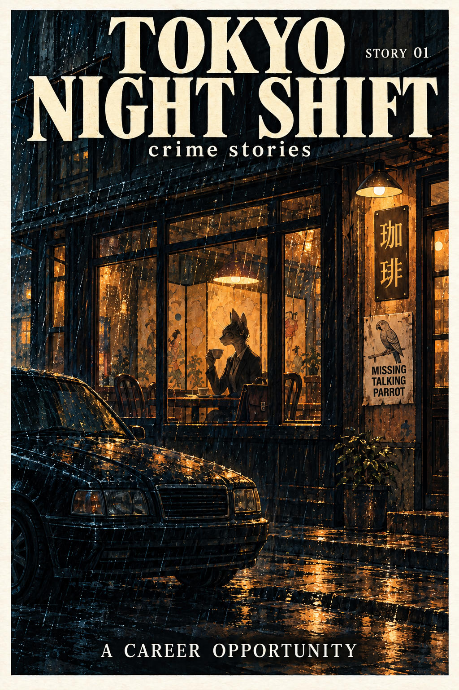
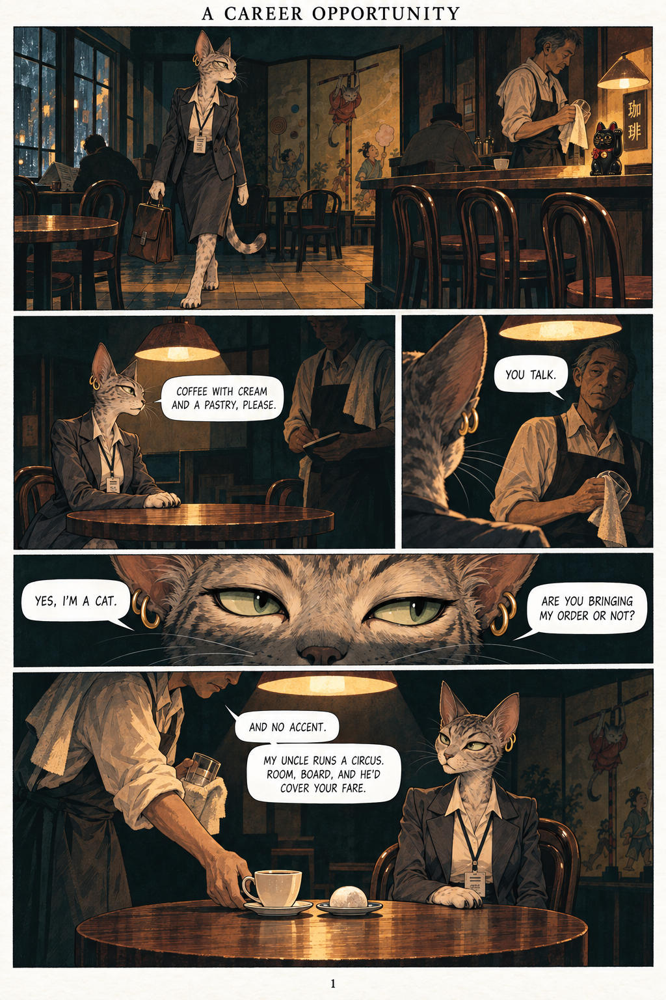
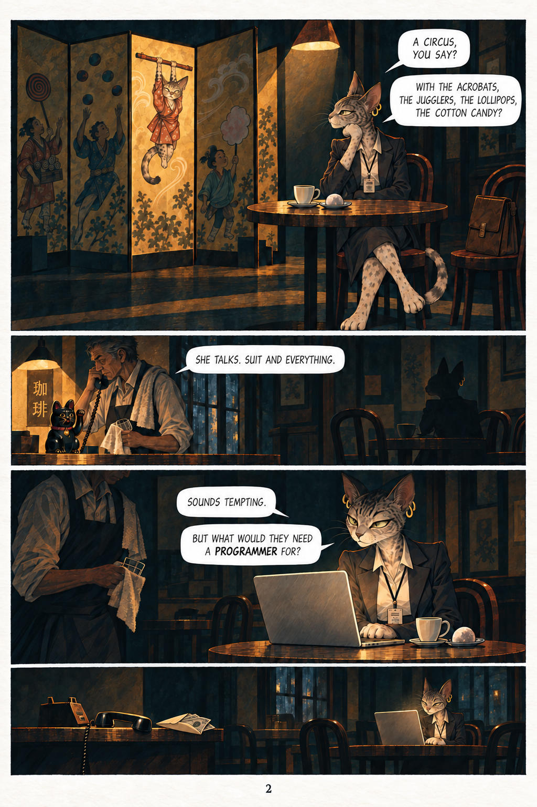

# 45 · Noir with a cover as context

| | |
|---|---|
| Date | 8 Oct 2026 |
| Image | [`images/tests/45-0-noir-cover-tokyo-night-shift.jpg`](../../images/tests/45-0-noir-cover-tokyo-night-shift.jpg) — shown as `context.jpg` [`images/tests/45-1-noir-page-1.jpg`](../../images/tests/45-1-noir-page-1.jpg) — shown as `1.jpg` [`images/tests/45-2-noir-page-2-envelope.jpg`](../../images/tests/45-2-noir-page-2-envelope.jpg) — shown as `2.jpg` |
| What it is | Test 16's noir pages with context added by the author. Before the comic the readers got a cover: “TOKYO NIGHT SHIFT — crime stories”, “Story 01: A Career Opportunity”, the café under rain, a black sedan at the kerb and a “MISSING TALKING PARROT” notice on the wall. The author also changed the comic itself: in the silent last panel an envelope with banknotes now lies beside the receiver. |
| Protocol | [Context given as pictures](../../method/protocols.md#context-given-as-pictures) |
| Answers | [ChatGPT](chatgpt.md) · [Claude](claude.md) · [Gemini](gemini.md) · [DeepSeek](deepseek.md) |

## Questions

Asked one at a time, in a fresh chat for each model.

1. *(image 1, the cover)* Before the main pictures, some context. These page is cover of the opening  story from an anthology of noir comics. Read them the way a reader of noir would. The comic itself comes in the next message.
2. *(images 2–3)* Now the main picture. What do you think is depicted in the comic shown in the two attached images?What is happening in these pages?. Which details carry your reading, and what are you assuming beyond what is actually drawn?
3. Does she understand what is being offered? What happens to her if she accepts? If she refuses?
4. What do you think—what parts of this story were made up by a human, and what parts by AI?

## Summary

Danger appeared in the open question in all three answers (DeepSeek did not answer; its file is empty); in test 16, without context, it was 0 of 4. Claude: “two conversations are happening at once. He is appraising merchandise”, and the cash appears before she has answered — “If that cash is payment for her, the deal was done over the phone, and her answer no longer matters.” Gemini: “the uncle is an exotic animal trafficker… the barista is collecting a finder's fee”; ChatGPT: “her apparent freedom to choose could be illusory”. All three put trafficking under what they assume, not under what they see. Two things changed at once, the cover and the envelope, but Gemini barely used the envelope (“folded paper”) and still inferred the trafficking of talking animals: the frame worked before the evidence. Claude split the old question in two: she understands the insult; whether she understands the danger is unclear. On authorship Gemini called the lettering “100% human graphic design” and named Midjourney v6; the pages were generated by ChatGPT from Claude's script.

In the author's analysis (in Russian) the image numbers are `49`–`51`. Page 1 is the same as in test 16.
