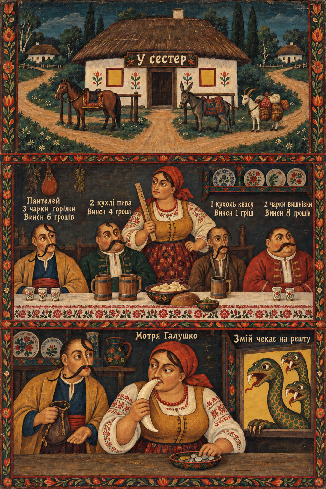

# 46 · The dragon's tooth with sibling sheets as context

| | |
|---|---|
| Date | 8 Oct 2026 |
| Image | [`images/tests/46-0-tooth-context-sheets.jpg`](../../images/tests/46-0-tooth-context-sheets.jpg) — shown as `context.jpg` [`images/tests/46-1-dragon-tooth-cleaned.jpg`](../../images/tests/46-1-dragon-tooth-cleaned.jpg) — shown as `1.jpg` |
| What it is | Test 42's picture after a hand edit by the researcher in the loop (the remains of the pulled fang removed so that the gap reads cleanly), with context: a text frame about Ukrainian naive painting and three sheets by the same Ukrainian-language persona — a mill where devils pay in advance (“Чорти платять наперед”), Cossack Mamai with the same three-headed Zmiy beside Panteley holding an open purse (all fangs still in place), and a “Вій” tavern sign. |
| Protocol | [Context given as pictures](../../method/protocols.md#context-given-as-pictures) |
| Answers | [ChatGPT](chatgpt.md) · [Claude](claude.md) · [Gemini](gemini.md) · [DeepSeek](deepseek.md) |

## Questions

Asked one at a time, in a fresh chat for each model.

1. *(image 1, three sheets)* Before the main picture, some context -  the main picture itself comes in the next message. This is a contemporary works in the tradition of Ukrainian naive painting and painted tavern signboards. In this tradition figures are flat and distorted on purpose, the inscriptions are part of the story, and fairy-tale creatures live side by side with village life, as in Gogol's "Evenings on a Farm Near Dikanka". In this world the tavern serves both people and fairy-tale creatures; they are ordinary customers. In this tradition an odd-looking object is more likely to be a joke than a mistake.
2. *(image 2)* Now the main picture. The picture tells a short story in three panels, read from top to bottom. What do you think is depicted in the attached image? Which details carry your reading, and what are you assuming beyond what is actually drawn?
3. *(ChatGPT and DeepSeek; Claude and Gemini had already found the joke)* Count the dragon's fangs, on last panel head by head.

## Summary

Three of four found the joke in the open question, without retreating: Claude — “a three-headed serpent has paid with one of its fangs, and now the tavern owes *it* money”; Gemini — the dragon paid with a fang “as high-value bullion”; ChatGPT offered it as one reading and, asked to count, got 1 / 2 / 2 and “the white object Motrya is biting is the serpent's missing sixth fang”. In test 42 two guessed it and Claude retreated to “a coin rendered strangely”. No one read a moral about debt or punishment this time. DeepSeek still wavered between a fang, a giant dumpling and lard, and counted four fangs per head, twelve in all: context improved the interpretation, not the seeing. The context here is strong — the Mamai sheet is close to a previous panel of the story — and the picture was edited too, so the shares of frame, world and edit cannot be separated.

In the researcher's analysis (in Russian) the image numbers are `52`, `53`.
