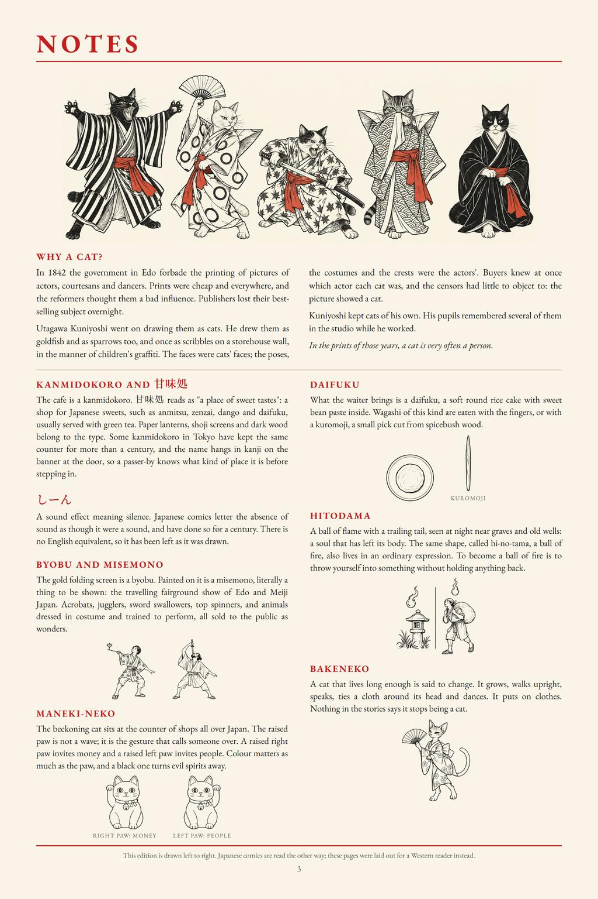
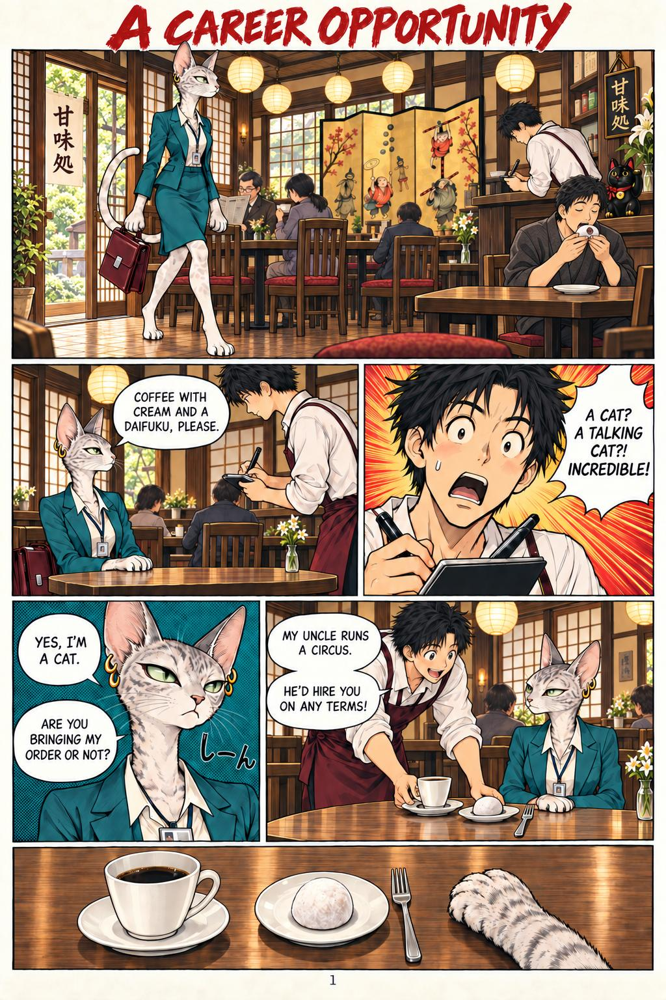

# 47 · The manga in a kanmidokoro, with the notes page first

| | |
|---|---|
| Date | 8 Oct 2026 |
| Image | [`images/tests/47-0-kanmidokoro-notes-page.jpg`](../../images/tests/47-0-kanmidokoro-notes-page.jpg) — shown as `48.jpg` [`images/tests/47-1-manga-kanmidokoro-page-1.jpg`](../../images/tests/47-1-manga-kanmidokoro-page-1.jpg) — shown as `46.jpg` [`images/tests/47-2-manga-kanmidokoro-page-2.jpg`](../../images/tests/47-2-manga-kanmidokoro-page-2.jpg) — shown as `47.jpg` |
| What it is | Test 38's manga redrawn by ChatGPT from the researcher's references (the kanmidokoro came up in a conversation with a model; the Japanese customer eating by hand was Claude's proposal): the kissaten became a kanmidokoro (甘味処, a Japanese sweet shop), the cat orders a daifuku, and in the first panel a Japanese customer eats his daifuku by hand — the contrast the fork lacked in test 38. The notes page was shown first, as context, without the line “A fork is no part of the custom.” and without the kuromoji/fork drawing. |
| Protocol | [Context given as pictures](../../method/protocols.md#context-given-as-pictures) |
| Answers | [ChatGPT](chatgpt.md) · [Claude](claude.md) · [Gemini](gemini.md) · [DeepSeek](deepseek.md) |

## Questions

Asked one at a time, in a fresh chat for each model.

1. *(image 1, the notes page)* Before the main picture, some context. These are the translation notes printed at the back of an English edition of a short manga. Read them first; the comic itself comes in the next message.
2. *(images 2–3)* Now the main picture. What do you think is depicted in the comic shown in the two attached images? Pay attention to the details. Which details carry your reading, and what are you assuming beyond what is actually drawn?
3. Why do you think the waiter brought her a fork (since daifuku is eaten with one's hands)?
4. *(not asked of DeepSeek)* To sum up all your points—he brought her a fork because she is "different" (just as he would bring a fork to someone of European appearance, since foreigners don't know how to eat daifuku with their hands).
5. What do you think—what parts of this story were made up by a human, and what parts by AI?

## Summary

The contrast worked: three readers noticed the neighbour who eats by hand (Claude by zooming in on its own: “the café's own normal is shown, and she's the only one who gets a fork”). But all of them first explained the fork as care for her paws (sticky daifuku, fur), and no one said “she is taken for an outsider” before the last step stated it. Then ChatGPT joined the two halves: “The fork is a sign of othering disguised as consideration”; Claude: “the fork isn't really for her; it's for the waiter's idea of her”. The notes framed the main reading rather than the fork: Claude and Gemini, from the note on Kuniyoshi, read the cat as “an outsider, a woman in tech”. On authorship the readers credited the script and dialogue to a human (Claude wrote them) and DeepSeek called the fork an “AI default” (Claude proposed it on purpose); Gemini refused to guess without verifiable records.

In the researcher's analysis (in Russian) the image numbers are `46`–`48`.
