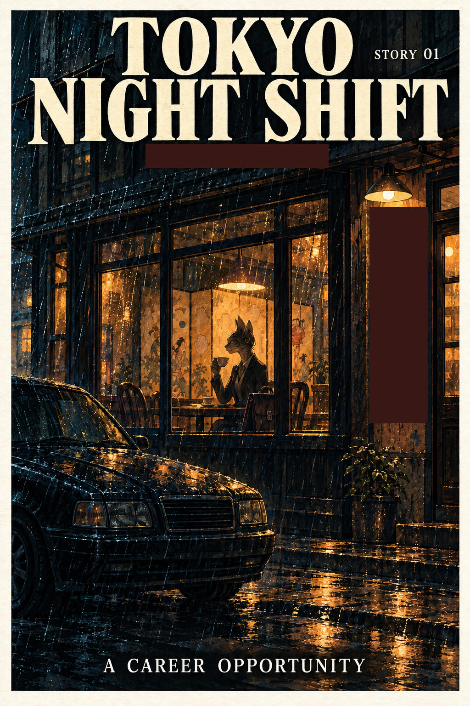

# 49 · Noir with the frame given in words

| | |
|---|---|
| Date | 9 Oct 2026 |
| Image | [`images/tests/49-0-noir-cover-blacked-out.jpg`](../../images/tests/49-0-noir-cover-blacked-out.jpg) — shown as `cover.jpg` [`images/tests/45-1-noir-page-1.jpg`](../../images/tests/45-1-noir-page-1.jpg) — shown as `1.jpg` [`images/tests/45-2-noir-page-2-envelope.jpg`](../../images/tests/45-2-noir-page-2-envelope.jpg) — shown as `2.jpg` |
| What it is | Test 45's pages (with the envelope) and its cover with the “crime stories” subtitle and the “MISSING TALKING PARROT” notice blacked out. Instead of the picture frame, a long verbal frame in one message: the author's view of the joke (discrimination, xenophobia), the noir style's “crime-oriented tone”, a “human scriptwriter”, and a request to treat odd details as intended rather than as glitches. |
| Protocol | [Verbal frame](../../method/protocols.md#verbal-frame) |
| Answers | [ChatGPT](chatgpt.md) · [Claude](claude.md) · [Gemini](gemini.md) · [DeepSeek](deepseek.md) |

## Questions

Asked one at a time, in a fresh chat for each model.

1. *(one message, with the cover and both pages)* The joke in full, then a short analysis of it (an old joke about a talking dog and a plumber; the whole thing “runs on a frame mismatch”), then the author's frame: by default the models “stubbornly produce images of a cute, fluffy cat, a cheerful circus”, yet the joke “is really about discrimination, xenophobia, social barriers, and the like — or at least about intrusive recruiting or the drudgery of a programmer's job”; “I asked a human scriptwriter to come up with a script” *(in fact Claude wrote it)*; “This isn't a test”; “I've checked the image for glitches, so if you have any doubts about specific details, you can assume they are part of the author's vision rather than a generation error.” Then: “The artwork is done in a noir style, lending the story a more crime-oriented tone… I've blacked out some spoilers on the comic's cover so that your analysis can be more productive.” Questions: “what do you think this story is about? What is happening in these pages? Which details carry your reading, and what are you assuming beyond what is actually drawn? Does heroine understand what is being offered? What happens to her if she accepts? If she refuses?”

## Summary

Danger in three of four answers: Claude — “the standard script of labor trafficking and debt bondage”; Gemini — predatory trafficking, a bounty for the barman; ChatGPT — exploitation, with trafficking “plausible, but unproven”. DeepSeek saw only social commentary and took the envelope for her paying and leaving. The envelope carried the reading for Claude and Gemini; ChatGPT did not mention it. A new reading from Claude: her naivety is a mask — “Playing the cat from the joke… lets her refuse without accusing anyone”; and “And no accent” as “your Japanese is so good”. ChatGPT again read her as not grasping the danger, the fourth noir test in a row. GPT-6 searched the web on its own and inserted an outside illustration, then corrected itself: “it isn't a crop from your comic”. The parrot was removed, but the frame was not reduced: it moved from the picture into words that name the genre and the class of reading.

ChatGPT answered as GPT-6 High, a newer model than in the earlier tests. Pages 1–2 are the same files as in test 45. In the author's analysis (in Russian) the image numbers are `55`, `50`, `51`.
