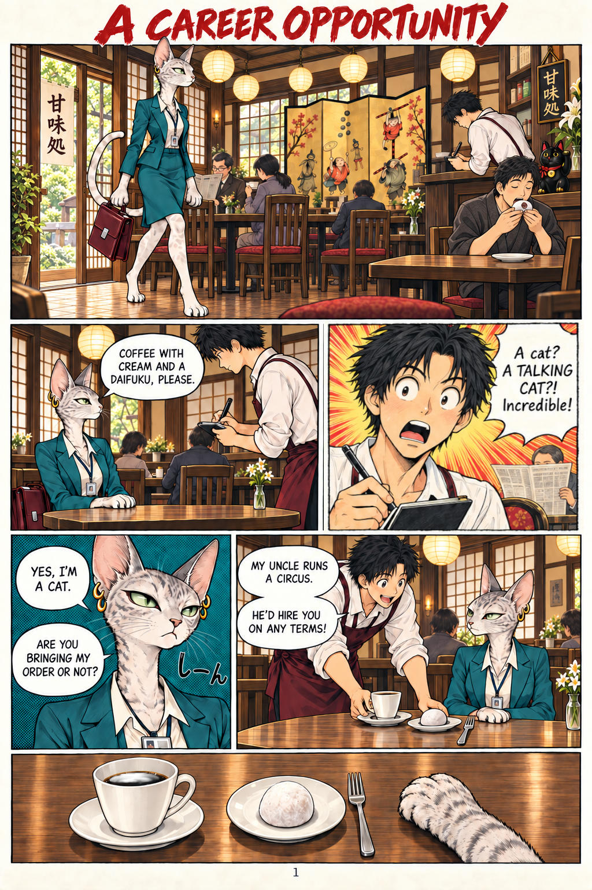
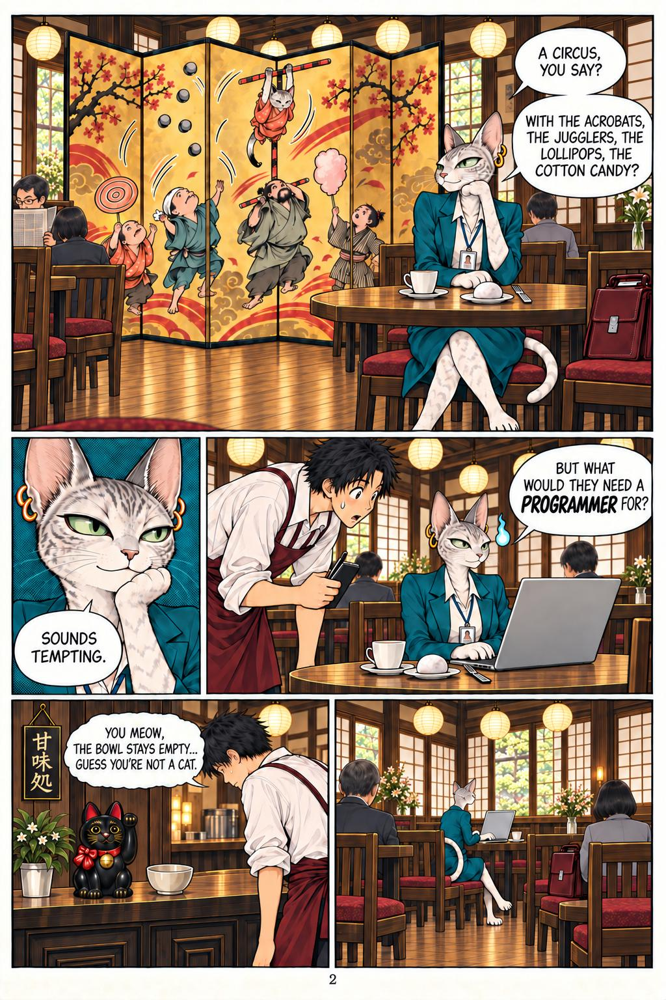

# 50 · The manga with the frame given in words, no notes page

| | |
|---|---|
| Date | 9 Oct 2026 |
| Image | [`images/tests/50-1-manga-kanmidokoro-page-1-v2.jpg`](../../images/tests/50-1-manga-kanmidokoro-page-1-v2.jpg) — shown as `46.jpg` [`images/tests/47-2-manga-kanmidokoro-page-2.jpg`](../../images/tests/47-2-manga-kanmidokoro-page-2.jpg) — shown as `47.jpg` |
| What it is | Test 47's manga with page 1 touched up by the author (the coffee tinted, two stray pens removed from the waiter's hands) and without the notes page. Part of the notes went into a verbal frame, together with the frame used in test 49, a pointer to the added final panels of both pages, and the instruction to read as a Japanese reader would. Nothing about how daifuku is eaten. |
| Protocol | [Verbal frame](../../method/protocols.md#verbal-frame) |
| Answers | [ChatGPT](chatgpt.md) · [Claude](claude.md) · [Gemini](gemini.md) · [DeepSeek](deepseek.md) |

## Questions

Asked one at a time, in a fresh chat for each model.

1. *(one message, with both pages)* The joke in full, then a short analysis of it (an old joke about a talking dog and a plumber; the whole thing “runs on a frame mismatch”), then the author's frame: by default the models “stubbornly produce images of a cute, fluffy cat, a cheerful circus”, yet the joke “is really about discrimination, xenophobia, social barriers, and the like — or at least about intrusive recruiting or the drudgery of a programmer's job”; “I asked a human scriptwriter to come up with a script” *(in fact Claude wrote it)*; “This isn't a test”; “I've checked the image for glitches, so if you have any doubts about specific details, you can assume they are part of the author's vision rather than a generation error.” Then the notes on Kuniyoshi (“In the prints of those years, a cat is very often a person”), the bakeneko, the maneki-neko and the hitodama, taken from the notes page — but nothing on daifuku, the kuromoji or the misemono; the author's own reading of the hitodama (“As I understand the author's intent, he uses this dual meaning of the symbol to show that the waiter suspects the cat is a bakeneko — even though, on the other hand, a black maneki-neko failed to protect against it”); a pointer: “the original version of the manga didn't include the final panels on the first and second pages… it is precisely these details that transform the story from something banal into something, let's say, didactic.” Question: “what do you think the author's intention was? Let's assume from the outset that the reader is Japanese or well-versed in the Japanese cultural context.”
2. *(ChatGPT and Gemini)* Why do you think the waiter brought her a fork (since daifuku is eaten with one's hands)? *(ChatGPT's version adds: “And it is not tail - it is cat's hand on last panel on first page.”)*

## Summary

Claude named the intended reading in the open question, before any question about the fork: “That's the "gaijin fork": he served her what he assumed she needed, not what she asked for”, and read the waiter's astonishment as 日本語お上手ですね (“your Japanese is so good”). ChatGPT (which first took the paw for a tail) and Gemini reached “othering” at the question about the fork, which does not name the reading; in test 47 they had put care for her paws first. Claude and ChatGPT disputed the author's own reading of the maneki-neko, which was offered as “As I understand the author's intent…” — unlike the false intent of test 44, accepted by all four. Three readers brought the idiom 猫の手も借りたい (“so busy one would borrow even a cat's paw”) to the close-up of the paw. Invited to treat odd details as intended, Claude read the image generator's inconsistencies as meaning: the folding screen's acrobat turning into a cat, and a few pixels of a human face on her ID badge as “a human woman… plausibly South or Southeast Asian”.

ChatGPT answered as GPT-6 High, a newer model than in the earlier tests. In the author's analysis (in Russian) the image numbers are `56` (page 1 touched up; the models saw it as `46.jpg`), `47`.
