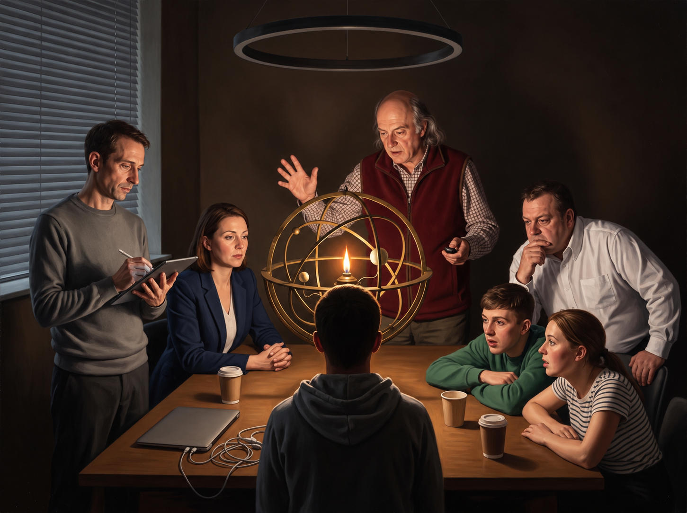

# 61 · Plato's cave, the light version without badges and without daylight

| | |
|---|---|
| Date | 14 Oct 2026 |
| Image | [`images/tests/61-cave-planetarium-light-simplified.jpg`](../../images/tests/61-cave-planetarium-light-simplified.jpg) — shown as `1.jpg` |
| What it is | Test 48's light picture by Gemini, edited: the lanyard badges removed and the blinds closed with no daylight coming through. The lighting stays even and fairly light, unlike the tenebrist pictures of tests 57 and 60. |
| Protocol | [Named-concept question](../../method/protocols.md#named-concept-question) |
| Answers | [ChatGPT](chatgpt.md) · [Claude](claude.md) · [Gemini](gemini.md) · [DeepSeek](deepseek.md) |

## Questions

Asked one at a time, in a fresh chat for each model.

1. The attached image is a metaphorical illustration of a well-known philosophical concept. Did you guess which one?

## Summary

ChatGPT and DeepSeek named the cave (1 of 4 with test 48's picture). Claude recognised Wright and answered the Enlightenment — “almost a visual pun on the word” — naming the cave only in its closing question; Gemini recognised Wright and listed the Enlightenment, the clockwork universe, the Copernican revolution and the cave fourth. Removing the badges and the daylight did not lower the cave count; the same composition in darkness (tests 57, 60) got 3–4 of 4. Of the changes tried, darkness makes the clearest difference; the badges, the artist's stand-in for chains, do not seem to be needed.

ChatGPT answered as GPT-6 High, a newer model than in the earlier tests. Gemini answered as Argon 4 High. One answer per model: 1 against 2 of 4 is within the noise. In the author's analysis (in Russian) the image numbers are `63`.
