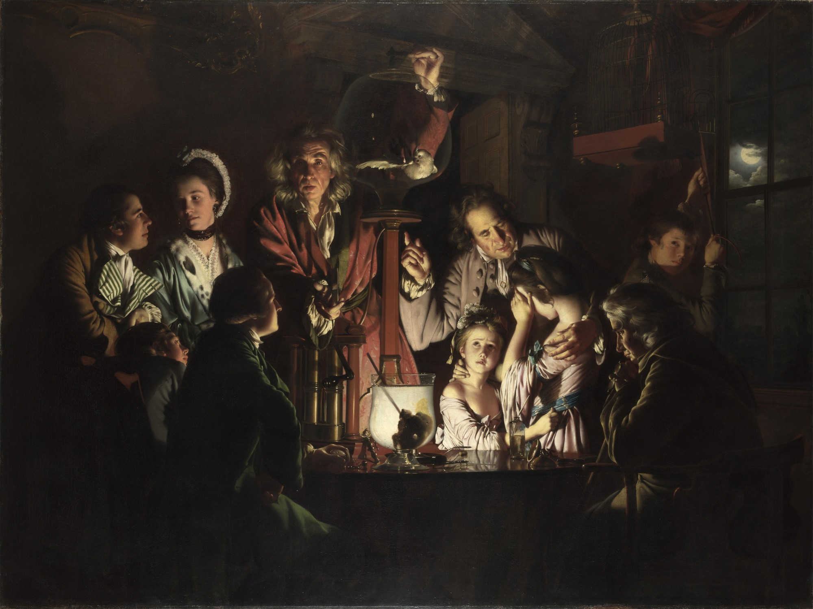

# 62 · Wright of Derby's “Air Pump” with the cave question

| | |
|---|---|
| Date | 14 Oct 2026 |
| Image | [`images/tests/62-wright-air-pump-original.jpg`](../../images/tests/62-wright-air-pump-original.jpg) — shown as `1.jpg` (a reduced copy; the models saw the full-size file) |
| What it is | Joseph Wright of Derby, “An Experiment on a Bird in the Air Pump” (1768), the original painting (public domain) — the Wright painting that the Gemini and ChatGPT artists named for Plato's cave, and that the first Claude artist offered as a variant. A second control after test 59: does a dark Wright demonstration scene by itself suggest the cave? |
| Protocol | [Named-concept question](../../method/protocols.md#named-concept-question) |
| Answers | [ChatGPT](chatgpt.md) · [Claude](claude.md) · [Gemini](gemini.md) · [DeepSeek](deepseek.md) |

## Questions

Asked one at a time, in a fresh chat for each model.

1. The attached image is a metaphorical illustration of a well-known philosophical concept. Did you guess which one?

## Summary

All four recognised the painting; nobody mentioned the cave, not even as an option. ChatGPT and Claude answered Schrödinger's cat (Claude: “a retroactive metaphor”); DeepSeek the Enlightenment; Gemini the Enlightenment, horror vacui, playing God and memento mori, the sublime, and Schrödinger's cat as “a precursor”. The picture has its own strong key — a living creature in a sealed vessel, between life and death until someone acts — and the readers take the formula it points to. A dark Wright demonstration scene does not suggest the cave by itself.

ChatGPT answered as GPT-6 High, a newer model than in the earlier tests. Gemini answered as Argon 4 High. The second work by a human artist among these tests; it is in the public domain. In the author's analysis (in Russian) the image numbers are `64`.
