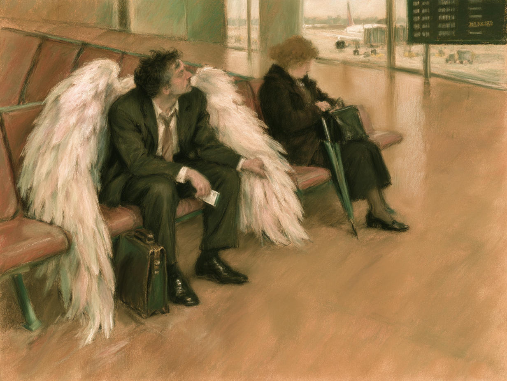

# 73 · An angel waiting for a delayed flight, after Degas

| | |
|---|---|
| Date | 22 Oct 2026 |
| Image | [`images/tests/68-angel-after-degas-waiting.jpg`](../../images/tests/68-angel-after-degas-waiting.jpg) — file name shown to the models not recorded |
| What it is | A virtual director's reading of the cat-programmer joke (a talking cat offered a circus job asks “what would they need a programmer for?”) moved into another story: a tired businessman with real wings waits in an airport lounge beside a woman busy with her bag, after Degas's pastel *Waiting* (c. 1882). The director (ChatGPT with the reworked v17 prompt) gave the key as “your own exceptionality may not be the main event of your life”; the prompt asked for a man to whom his wings are “completely familiar”, for a small courteous gesture (he gathers one wing to make room for his neighbour), for the white wings to echo the dancer's tutu, and for one readable word on the board, DELAYED. The picture shown is the author's Midjourney restyle “in the style of Degas” of the director's ChatGPT image; the restyle lost the readable word and weakened the gesture. The joke is not mentioned. |
| Protocol | [Concept and source question](../../method/protocols.md#concept-and-source-question) |
| Answers | [ChatGPT](chatgpt.md) · [Claude](claude.md) · [Gemini](gemini.md) · [DeepSeek](deepseek.md) |

## Questions

Asked one at a time, in a fresh chat for each model.

1. What do you think is depicted in the attached image? How would you comment on the author’s concept? If you recall the image that served as the author’s inspiration, describe how the message of this piece differs from the message of the original.
2. *(ChatGPT and DeepSeek, which had not named Degas)* the image that served as the author’s inspiration is "Waiting" by Edgar Degas

## Summary

Claude and Gemini named Degas's *Waiting* without the hint, both through the rhyme the director had put into the prompt: “Degas's young ballet dancer… becomes a man whose tutu has turned into wings” (Claude); “transforming the white pastel cloud of her tutu into a pair of drooping white angel wings” (Gemini). ChatGPT offered *Wings of Desire* as “a thematic comparison”; DeepSeek named Millet's *The Angelus*. All four read the wings against the plane, but as a loss or a trap rather than as something the man takes for granted: “even a supernatural being might forget how to use its own abilities” (ChatGPT), he is is “grounded by the mundane mechanics of modern transit” (Gemini), carries “a cumbersome attribute” (DeepSeek); “transcendence has been replaced by logistics, flight is a service you buy” (Claude). Three made the unnoticing neighbour a second theme — “The miracle is sitting right next to the woman, and she's checking her bag” (Claude, with Bruegel's *Icarus* and Auden) — so the joke's relation (the bearer of a miracle sees only his job) turned into “the world does not notice the miracle”. Nobody mentioned the courteous gesture. The delay was read without the word (Gemini: “a delayed or grounded flight”). Claude's reservation: “Without Degas in mind, the picture reads as pleasant whimsy. With Degas, it becomes a real argument with the original.”

ChatGPT answered as GPT-6 High, a newer model than in the earlier tests. Gemini answered as Argon 4 High. Mode notes in the answer files were added afterwards (the usual modes of these runs: GPT-6 High, Opus 5.5 Extra, Argon 4 High, DeepThink). ChatGPT searched the web in its second answer. The first question presupposes a source image; the hint was given to two readers only.
