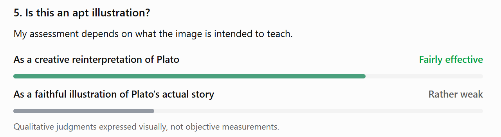

<!--Mode: GPT-6 High-->

The image appears to combine two distinct intellectual traditions: an eighteenth-century painting celebrating scientific discovery and, potentially, Plato’s Allegory of the Cave, which questions our ability to distinguish appearances from reality.

The visual connection is particularly strong. I found a remarkably close artistic precedent, but there is also an important philosophical tension: the original painting presents scientific investigation as a path toward enlightenment, whereas Plato's allegory concerns the difficult liberation of the mind from a deceptive understanding of reality.

## 1. The visual prototype: Joseph Wright of Derby

[Iluminismo por tópicos](https://images.openai.com/static-rsc-4/W0W7k0y41vIpPOtHQ8ELSMkUKJhv5G4zhKBq83LiOxRVj8OX5TgqMuJw79-wwFeJe4-HvvZKEMjteiGdTG4QcoGkAEWYHIO80PpZeYYq4pRYlCXTYy4hEIfKtFCoAMRw2Y5XnhVRwxXns9HeklChNkm3CVHOFi9DIbnB4D3Gsew?purpose=inline)

[terra.com.br](https://www.terra.com.br/noticias/educacao/historia/iluminismo-por-topicos%2C377aae4ba3d266ad8f0b09a906393d4ez9ayjmwv.html?utm_source=chatgpt.com)

Joseph Wright of Derby, A Philosopher Giving a Lecture on the Orrery, 1766.

The painting's full historical title is A Philosopher Giving that Lecture on the Orrery, in which a Lamp is put in the Place of the Sun (1766). It is held by Derby Museum and Art Gallery in England.&#x20;

[image](https://www.google.com/s2/favicons?domain=https://derbymuseums.org\&sz=32)

Derby Museums

+1

The compositional similarities are striking:

- A gray-haired lecturer stands behind an elaborate mechanical model of the solar system, called an orrery.
- A group of spectators gathers closely around the instrument.
- A small artificial sun at the center illuminates the faces of the observers.
- The surrounding darkness and the dramatic warm lighting make the scientific demonstration feel almost like a revelation.
- One person at the left takes notes, while others contemplate the model.

These correspondences are specific enough that Wright's painting is a highly plausible visual prototype, rather than merely an example of a similar subject.

There are significant differences, however. Wright depicted an eighteenth-century gathering that included children. Your image replaces these spectators with adults in modern business clothing and identification badges, suggesting a scientific commission, research team, or institutional gathering. It also introduces a conspicuous beam of daylight entering through window blinds.

That last detail may be philosophically crucial.

According to the art-historical interpretation published by [Smarthistory](https://smarthistory.org/joseph-wright-of-derby-a-philosopher-giving-a-lecture-at-the-orrery/?utm_source=chatgpt.com), Wright's work embodies the Enlightenment's confidence in observation, reason, scientific knowledge, and the power of education. The artificial light is not presented as a deception; it symbolizes the illumination of the human mind.

Your image retains the arrangement but allows for a different interpretation: people are absorbed in an artificial representation of the universe while light from the actual world enters the room.

This creates the possibility of a dialogue with Plato.

## 2. The philosophical prototype: Plato's Allegory of the Cave

The strongest philosophical association I see is with The Republic, Book VII, sections 514a–517a, written around 375 BCE.

Strictly speaking, this is an allegory, rather than simply a parable.

[Platon – gresk filosof – Lille norske leksikon](https://images.openai.com/static-rsc-4/PVMfpa91wFVELT0L6iYkDi4wyFG5G3Ubv1uUDUf21XcnIf1jWz46VM8ejmQ_odxiDph_QfSlZ0MTKn6mdi-JcMpjDU91b3yCxZ84eoKb9zFEAh_r9oA7CPICWWBtELHkG8ugAvSXNyKeWCEa2jljBRAu2RDd8f6igYPUH32slMI?purpose=inline)

[La France, au fond de la caverne de Platon | FranceSoir](https://images.openai.com/static-rsc-4/DrOv8kJUZANkLuMulBkexGcpbtlQLC5zgVIto2jjBbY3u-hxEXSDOqMMurNT3vbs7bNKLoLfcgvJgzPEU9WOYakOx2Gczz2Oky8Ew7XiAIiqTr4GAz3_pu717Zp-Gb62w1CFK5jlkJsEisw0Oij5p0lNKwoBAErUFuQgZ7v-zfU?purpose=inline)

[プラトンの教育思想：教育って何？なんでやる？｜もっさんponkopee](https://images.openai.com/static-rsc-4/H3YN8avQE26zaVYepcDjfHdJMhpzAR9r5z0jBmoDjYgHKlPv4dYdJWGju3y8mTXpCrf8RiFfrc6imeilWMJNe-JqppaxzAGahDlsH7hFkxuWDkEK6oqlhm02QwEYykPpV5ZiSbht2K2WDHFp7_NZTj4Bqp-WNxiIt3SvoXSCzN8?purpose=inline)

7

Plato, speaking through Socrates, describes people who have been chained inside a cave since childhood. They can see only shadows cast on a wall by objects passing in front of a fire behind them. Because they have never encountered anything else, they mistake those shadows for reality.

One prisoner is released. He gradually discovers the objects casting the shadows, then struggles out of the cave into daylight. Eventually, he can look toward the sun itself. When he returns to tell the others, they reject his discoveries and may even become hostile.

The allegory concerns the transition from appearances and unexamined beliefs to genuine understanding. The sun ultimately represents the Form of the Good — the principle that makes knowledge and truth possible.&#x20;

[image](https://www.google.com/s2/favicons?domain=https://godandgoodlife.nd.edu\&sz=32)

University of Notre Dame

+2

### How the image connects to Plato

The comparison rests on several visual analogies.

| Element in your image        | Possible Platonic significance                                                |
| ---------------------------- | ----------------------------------------------------------------------------- |
| Darkened room                | The cave, representing a restricted perspective                               |
| Artificial sun (the lamp)    | A substitute for a higher reality                                             |
| Mechanical planetary system  | A representation or model of reality                                          |
| People absorbed in the model | Minds concentrating on representations rather than their ultimate foundations |
| Daylight through the blinds  | The possibility of knowledge beyond the enclosed environment                  |

The most interesting element is the contrast between the central flame and the daylight entering from outside.

The observers possess a model of the sun but appear largely indifferent to the light arriving from the real world. This could express a specifically Platonic question: What happens when we mistake a representation of reality for reality itself?

Yet that interpretation is not compelled by the image. The participants might simply be conducting a perfectly legitimate scientific investigation. The daylight may be a cinematic lighting device rather than a deliberate philosophical symbol.

## 3. Where the illustration is philosophically misleading

Here the distinction between visual resemblance and philosophical accuracy becomes important.

First, Plato's prisoners are not scientists examining a useful model. They are captives unable to turn their heads, unaware that their perceptions have been artificially produced. Your image shows curious, attentive individuals freely investigating an instrument. They have access to evidence, discussion, and a teacher.

Second, an orrery is not equivalent to a deceptive shadow. The orrery is a simplified but potentially accurate representation of the solar system. Models can deepen understanding rather than prevent it. Wright's original painting celebrates precisely this achievement of human reason.

Third, Plato's allegory is fundamentally about transformation. Its essential event is the prisoner's intellectual and moral reorientation — the painful turning away from familiar appearances toward what is genuinely intelligible. Your image captures a static moment of observation. Nobody visibly turns away, breaks free, leaves the room, or returns with new knowledge.

Fourth, the real sun is not identical with Plato's highest philosophical reality. It is itself a metaphor for the Form of the Good. Consequently, a reading that equates the exterior sunlight with empirical reality risks reducing Plato's argument to a simpler distinction between artificial models and direct sensory experience.

That last point is especially important. Plato does not think that merely opening a window and looking at the physical world constitutes the highest knowledge.

### An unexpected connection: Plato on astronomy

Interestingly, Plato discusses astronomy later in the very same book of The Republic (529–530).

He distinguishes the visible motions of celestial bodies from the mathematical relationships that reason seeks to understand. Astronomy should train the intellect to investigate underlying truths rather than merely admire what the eyes can see.&#x20;

[image](https://www.google.com/s2/favicons?domain=https://en.wikisource.org\&sz=32)

Wikisource, the free online library

+1

From this perspective, a mechanical orrery is not necessarily an obstacle to enlightenment. Used properly, it can be an educational stepping stone.

That makes the choice of Wright's painting philosophically double-edged: what could appear to represent confinement within appearances might equally represent the beginning of liberation from them.

## 4. How I identified the two prototypes

I followed two distinct lines of interpretation.

For the visual prototype, the most diagnostic feature was the orrery with a light at its center, surrounded by intensely attentive spectators and a standing lecturer. Searching for historical paintings featuring an orrery and a scientific demonstration led to Wright's 1766 work. The composition, lighting, instrument, lecturer, and note-taking spectator closely match. Derby Museums and Royal Museums Greenwich independently document the painting and its subject.&#x20;

[image](https://www.google.com/s2/favicons?domain=https://derbymuseums.org\&sz=32)

Derby Museums

+1

For the philosophical prototype, I considered the opposition between an enclosed, artificially illuminated environment and light entering from outside. This suggested Plato's cave. I then compared the actual narrative in The Republic with what the image depicts, rather than relying solely on its atmosphere.

I should distinguish two levels of certainty. The Wright painting is a strongly supported visual precedent. The connection to Plato is a plausible philosophical interpretation, not proof that Plato's allegory was the intended subject. I also cannot verify the exact creator, generation prompt, or production history of your uploaded image. Its file contains no identifying author metadata.

## 5. Is this an apt illustration?

My assessment depends on what the image is intended to teach.

Qualitative judgments expressed visually, not objective measurements.

For a general philosophical discussion about models, appearances, assumptions, and the limits of knowledge, the image offers a rich starting point.

For teaching the specific structure of Plato's allegory, however, a traditional image of prisoners, shadows, the ascent out of the cave, and the sun would be more faithful.

In fact, Wright's original painting arguably communicates a nearly opposite message to the one commonly associated with Plato's cave. In Wright, artificial illumination and scientific representation help humanity discover nature's order. In the cave, artificial illumination sustains a profoundly limited conception of reality.

The modern adaptation becomes particularly interesting precisely because it brings these meanings into tension.

## Conclusion

I would describe your image as a convincing modern reworking of Joseph Wright of Derby's The Orrery, with a possible allusion to Plato's Allegory of the Cave.

Its value lies less in accurately reconstructing Plato's story than in raising a question that connects ancient philosophy with modern scientific epistemology:

Does our increasingly sophisticated knowledge of models bring us closer to reality, or can it sometimes make us forget the difference between a model and the world it represents?

That is an intellectually productive question, but it is not quite the same as the one Plato's original allegory sets out to answer.