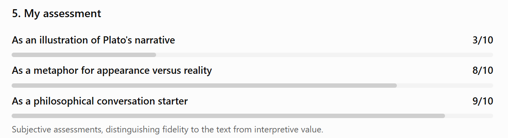

<!--Mode: GPT-6 High-->

My interpretation is that the image is a modern reworking of a famous eighteenth-century painting, and that the philosophical parable it is intended to evoke is Plato’s Allegory of the Cave.

What interests me most is that the visual prototype and the philosophical parable are not entirely compatible. In fact, they represent two rather different attitudes toward human knowledge.

I haven't used an internet search. What follows is based on visual recognition, my knowledge of the philosophical texts, and my interpretation of the image.

## 1. How I identified the image prototype

The strongest candidate is A Philosopher Giving a Lecture on the Orrery, painted by Joseph Wright of Derby in 1766.

The resemblance is not merely thematic. Several visual elements suggest a connection:

- A mechanical model of the solar system, called an orrery, occupies the center of the composition.
- An artificial light source substitutes for the Sun.
- A group of people gathers around the model, with their faces illuminated by its light.
- A central intellectual figure appears to guide the others.
- The dramatic contrast between darkness and illumination makes the acquisition of knowledge the emotional center of the scene.

The original Wright painting is a celebrated image of the Enlightenment. Its subject is not simply astronomy but the human ability to understand nature through observation, mathematics, and scientific explanation.

Your image introduces modern clothing, identification badges, a more contemporary gathering of researchers, and an important additional detail: a bright beam of daylight entering through the window blinds.

That last detail is particularly significant for the philosophical interpretation.

I would call Wright's painting a plausible visual ancestor, rather than claim that the image was demonstrably derived from it. Establishing its actual production history would require evidence beyond visual inspection.

## 2. How I identified the parable

My interpretation is Plato's Republic, Book VII, where Plato presents the Allegory of the Cave.

In the allegory, human beings are prisoners in an underground cave. They are constrained to look at shadows cast on a wall by objects passing in front of a fire behind them. Having known nothing else, they mistake these shadows for reality.

One prisoner is freed. Gradually, he turns toward the fire, leaves the cave, encounters the world outside, and eventually comes to see the Sun. This is an intellectual as well as a physical transformation.

The allegory explores the distinction between appearance and reality, the difficulty of genuine education, and the philosopher's journey toward understanding what Plato calls the Form of the Good.

Three features of your image suggested this connection to me:

First, the enclosure. The people are gathered inside a dark room, absorbed in a representation of the universe rather than the universe itself.

Second, the two kinds of illumination. There is the artificial fire at the center of the model and the natural daylight entering from outside. This invites a distinction between knowledge constructed within a limited environment and a reality existing beyond that environment.

Third, the direction of attention. Nearly everyone is looking inward, toward the artificial universe. Nobody seems interested in the light entering from outside.

This is potentially a powerful visual metaphor for Plato's distinction between being absorbed in appearances and turning toward a deeper reality.

## 3. How philosophically accurate is the image?

Here I would distinguish between its metaphorical effectiveness and its fidelity to Plato's actual argument.

The image succeeds at communicating an epistemological question: Are we studying reality itself, or merely a representation that we have mistaken for reality?

But Plato's allegory is considerably more radical.

His prisoners are not scientists examining an imperfect model. They are people who do not even recognize that they are looking at representations.

The people in this image, by contrast, appear intelligent, curious, attentive, and capable of critical discussion. They are deliberately examining an orrery, a scientific instrument designed to represent the movements of celestial bodies.

That is a major philosophical difference.

An astronomical model is not necessarily a source of illusion. It can be precisely the means by which human beings overcome illusion.

Indeed, Plato assigns mathematics an important role in the education of the philosopher. Mathematical reasoning can help direct the mind away from dependence on immediate sensory appearances and toward intelligible relationships.

In that respect, the figures around the orrery might already be engaged in something resembling the beginning of Plato's educational ascent.

There is also a second problem. Plato's cave is fundamentally about the transformation of the knower, not merely the difference between an artificial and a natural light source. The difficult process of turning around, questioning one's beliefs, and eventually returning to the cave is absent from the picture.

The image depicts contemplation, but not intellectual liberation.

## 4. Is this particular visual prototype an apt choice?

I find it artistically compelling but philosophically ambiguous.

Wright's original painting celebrates scientific illumination. The central lamp, representing the Sun, symbolizes the power of rational inquiry to make the universe intelligible.

Plato's cave, on the other hand, exposes the danger of confusing what is familiar and visible with what is genuinely real.

Using Wright's composition to depict Plato's allegory creates an interesting reversal: the scientific instrument that originally represented intellectual progress becomes a possible symbol of intellectual confinement.

That reversal can be fruitful, but it also risks suggesting something Plato does not necessarily claim: that scientific modeling itself prevents access to truth.

The particularly interesting addition is the external daylight. Without it, I would read this image principally as a modern homage to Wright's painting and the spirit of scientific discovery. With it, the image begins to suggest a Platonic contrast between the artificial illumination inside and the greater illumination outside.

Yet this depends on the viewer interpreting that light philosophically rather than simply as a dramatic cinematic effect.

## 5. My assessment

Subjective assessments, distinguishing fidelity to the text from interpretive value.

The most interesting question this image raises, in my view, is whether the orrery constitutes another layer of illusion or a genuine step toward understanding the cosmos.

Those interpretations lead in opposite directions. Under the first, the people are analogous to Plato's prisoners. Under the second, they are already beginning to escape the cave through rational investigation.

And this brings me to my central judgment:

The image is better at asking Plato's question than at illustrating Plato's answer.

It beautifully dramatizes the distance between a representation and the reality it represents. But it does not establish that the people are deceived, nor that the reality beyond the room is intellectually superior to the knowledge they are constructing within it.

That ambiguity is what makes the image interesting philosophically, even though it prevents it from being a particularly faithful illustration of the original allegory.