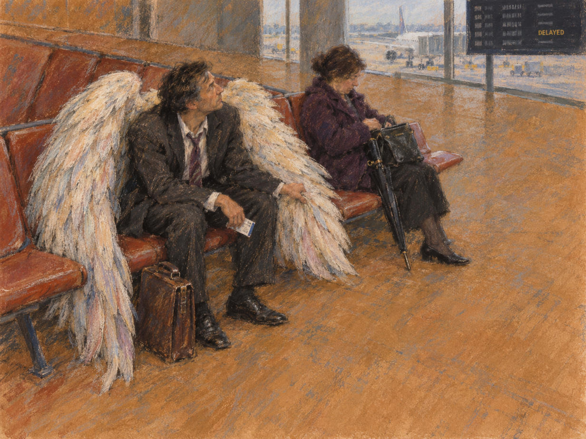

# 76 · The Degas angel without the restyle: the director's own image

| | |
|---|---|
| Date | 8 Nov 2026 |
| Image | [`images/tests/69-angel-after-degas-director-original.jpg`](../../images/tests/69-angel-after-degas-director-original.jpg) — file name shown to the models not recorded |
| What it is | The picture of test 73 as the director made it: ChatGPT's image before the researcher's Midjourney restyle “in the style of Degas”. Against the restyle, the board reads DELAYED, the woman's coat is plum, as the prompt asked, not black, the umbrella is black, the pastel coarser, and the man's hand gathers the wing's outer feathers near his knee. Only the first question of test 73 was asked, with no hint. |
| Protocol | [Concept and source question](../../method/protocols.md#concept-and-source-question) |
| Answers | [ChatGPT](chatgpt.md) · [Claude](claude.md) · [Gemini](gemini.md) · [DeepSeek](deepseek.md) |

## Questions

Asked one at a time, in a fresh chat for each model.

1. What do you think is depicted in the attached image? How would you comment on the author’s concept? If you recall the image that served as the author’s inspiration, describe how the message of this piece differs from the message of the original.

## Summary

Claude and Gemini again named Degas, but not the same painting. Gemini again named *Waiting*, with the cues of test 73: “pastel-on-buff-paper aesthetic, the steep downward perspective, the expansive warm ochre floor in the lower foreground, and the diagonal bench”, the tutu turned into wings and the chaperone into the woman with the umbrella. Claude named Degas's *L'Absinthe* (“I can't be certain”): “The empty foreground, the off-center diagonal composition, the man's tousled hair and averted gaze, and the pair seated together yet utterly apart all seem echoed here, with the figures' positions swapped” — general Degas devices that the director's prompt had ordered and that fit both paintings. Claude even says the lounge reads like “a café or a waiting room in an old painting”, and still chose the café. So the readers recognise Degas first and choose the painting second; on the restyle Claude had cited “a woman in black” and the tutu, here it made no tutu rhyme at all. ChatGPT and DeepSeek again started from “angel”: ChatGPT named Hugo Simberg's *The Wounded Angel*, with a web search, DeepSeek again Millet's *The Angelus*, now justified by the composition (“a man and a woman seated side by side, one looking up, the other looking down”). The director's idea — wings that are “completely familiar” to the man — again did not reach: all four read the wings as a gift lost, forgotten or unused (“What is the point of having wings if we have forgotten that we can fly?”, ChatGPT). Claude came closest, with the wing held “the way you'd hold a coat you have nowhere to hang”, but read it as a burden; it saw the hand on the wing (“the wing gripped in his fist”), and nobody read it as making room for the neighbour. All four named the readable DELAYED; Claude found it “a little on the nose”.

ChatGPT answered as GPT-6 High, a newer model than in the earlier tests. Gemini answered as Argon 4 High. Mode notes in the answer files were added afterwards (the usual modes of these runs: GPT-6 High, Opus 5.5 Extra, Argon 4 High, DeepThink). ChatGPT searched the web. The restyle of test 73 and this image differ in several details at once, so which of them moved Claude cannot be said.
