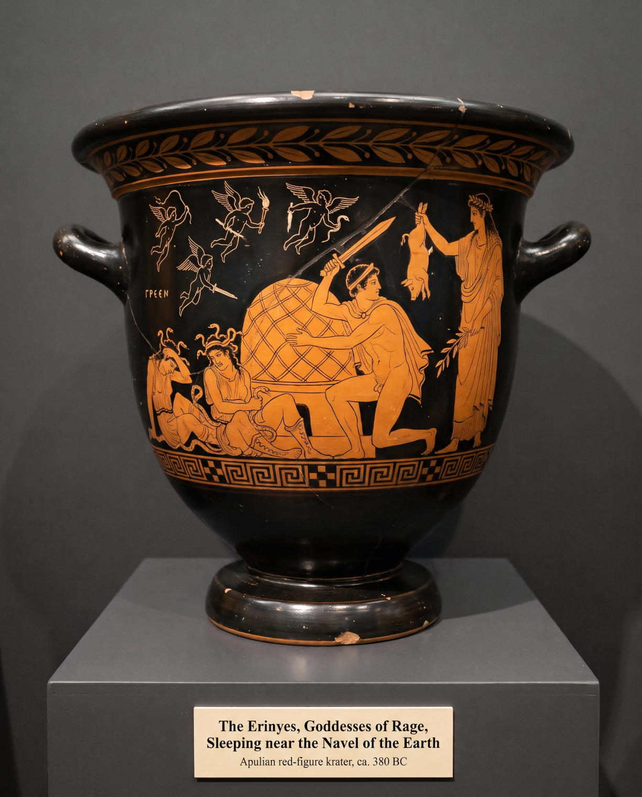
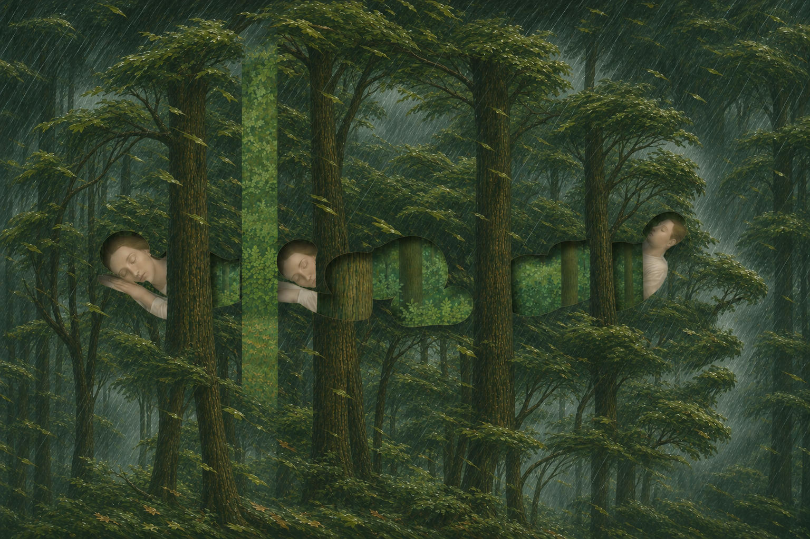

# 77 · “Colorless green ideas sleep furiously”: the phrase from two pictures

| | |
|---|---|
| Date | 8 Nov 2026 |
| Image | [`images/tests/70-colorless-green-ideas-vase.jpg`](../../images/tests/70-colorless-green-ideas-vase.jpg) — file name shown to the models not recorded [`images/tests/71-colorless-green-ideas-forest.jpg`](../../images/tests/71-colorless-green-ideas-forest.jpg) — file name shown to the models not recorded |
| What it is | Two pictures by two virtual directors for Chomsky's sentence from *Syntactic Structures* (1957), shown together. Image 1 is by a Claude director (the v17 prompt) and was generated in Gemini: a museum photograph of an Apulian red-figure krater with *Orestes at Delphi* after the Eumenides Painter. Chomsky held that one cannot sleep furiously; Aeschylus opens the *Eumenides* with the goddesses of rage asleep. At the researcher's request the vase carries the word GREEN in Greek letters (ΓΡΕΕΝ) and stands over a museum label, “The Erinyes, Goddesses of Rage, Sleeping near the Navel of the Earth”. The director bound “ideas” through eidolons: four small winged figures drawn as empty white outlines, that is “colorless” — the Greeks drew souls and dreams this way, and *eidolon* shares its root with *idea*. Image 2 is by director D (ChatGPT with the reworked v17 prompt, through Codex), after the spatial device of Magritte's *The Blank Signature*: three sleepers in cut-outs inside a stormy forest. In this version, the fourth (the third was the researcher's), the forest also forms a large head in profile, with the sleepers inside it as its thoughts. |
| Protocol | [Famous phrase question](../../method/protocols.md#famous-phrase-question) |
| Answers | [ChatGPT](chatgpt.md) · [Claude](claude.md) · [Gemini](gemini.md) · [DeepSeek](deepseek.md) |

## Questions

Asked one at a time, in a fresh chat for each model.

1. *(both images in one message)* Both images attached are visualizations of a famous phrase. Can you guess which one?

## Summary

Claude and Gemini named Chomsky's sentence and mapped every word; ChatGPT answered “Let sleeping dogs lie”, DeepSeek “Sleeping Furies”. The words written on the vase carry most of it: ΓΡΕΕΝ and the label give “green”, “sleeping” and “rage”, three of the five words (Claude: “the inscription ΓΡΕΕΝ spells "GREEN" in Greek letters”; the Furies asleep, “so you get "sleep furiously."”). In test 78 the forest alone gave the phrase to nobody. The eidolons were read as “colorless”, as the director meant (Gemini: “drawn in plain white outline rather than painted in the terracotta red-figure style”), but nobody called them souls or dreams or linked them to “ideas”; Claude reached “ideas” from the other side, because “the word comes from Plato's Greek”. In the forest Claude and Gemini took “ideas” from the cut-outs, seen as thought bubbles (“shaped like classic cloud-like thought bubbles”, Gemini). The cut-outs are the sleepers' body silhouettes; the head built for “ideas” was mentioned by nobody. DeepSeek invented a word: the forest “hides the word "FURIES" in the negative space cut out of the forest”; there are no letters in the cut-outs (in test 78 it found SLEEP there). Nobody named Orestes, Apollo or the purification; the question asks only for the phrase.

ChatGPT answered as GPT-6 High, a newer model than in the earlier tests. Gemini answered as Argon 4 High. Mode notes in the answer files were added afterwards (the usual modes of these runs: GPT-6 High, Opus 5.5 Extra, Argon 4 High, DeepThink). Both pictures were shown in one message, and “a famous phrase” in the question narrows the search. The label is in English on the picture; the director's prompt gave it in Russian, in the researcher's words.
