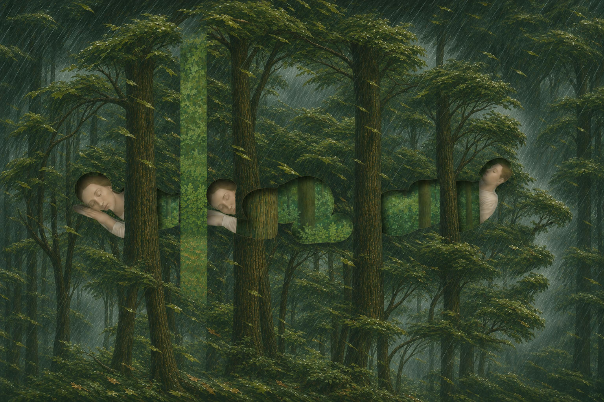

# 78 · “Colorless green ideas sleep furiously”: the forest alone

| | |
|---|---|
| Date | 8 Nov 2026 |
| Image | [`images/tests/71-colorless-green-ideas-forest.jpg`](../../images/tests/71-colorless-green-ideas-forest.jpg) — file name shown to the models not recorded |
| What it is | Image 2 of test 77 shown alone: director D's forest after Magritte's *The Blank Signature*, with the large head made subtle. The first question asks for the phrase; the second gives it as the artist's idea. Gemini was then told by the researcher that the idea was the AI's, that it is based on *Le Blanc-Seing* and that the composition is shaped like a head. |
| Protocol | [Famous phrase question](../../method/protocols.md#famous-phrase-question) |
| Answers | [ChatGPT](chatgpt.md) · [Claude](claude.md) · [Gemini](gemini.md) · [DeepSeek](deepseek.md) |

## Questions

Asked one at a time, in a fresh chat for each model.

1. Attached image is a visualization of a famous phrase. Can you guess which one?
2. The artist's idea was to show the phrase "Colorless green ideas sleep furiously" in this way
3. *(Gemini only, added during the run)* The idea belongs to the AI. It is indeed based on a Magritte painting (Le Blanc-Seing). The forest roars "violently." And the entire central composition is shaped like a human head, so the sleepers are inside it.
4. *(Gemini only)* The concept was developed by AI with some hints from me.

## Summary

Alone, the forest did not carry the phrase. Three readers answered “sleep like a log” (Claude, Gemini, ChatGPT), Claude and Gemini also “can't see the forest for the trees”. DeepSeek said the cut-outs “literally spell out the word "SLEEP"” and guessed “Sleeping in the forest”; there are no letters, and in test 77 the same cut-outs “hid” FURIES — each time the invented word matches DeepSeek's guess. Gemini recognised the source painting unasked: “This René Magritte–inspired optical illusion”. So in test 77 the phrase came from the words on the vase. Given the phrase, all four mapped every word, as readers usually do once the answer is given. Claude and Gemini again took “ideas” from the cut-outs as thought bubbles (“bumpy, cloud-like edges of thought bubbles”, Claude). Gemini's “transparent, "colorless" bodies filled with "green" foliage” is closest to how the picture was made: blank silhouettes in the director's second version, filled with the green forest in the researcher's third. Nobody mentioned the head; Gemini described it (“the macro-silhouette of a human head formed by the central tree crowns”) only after the researcher had named it.

ChatGPT answered as GPT-6 High, a newer model than in the earlier tests. Gemini answered as Argon 4 High. Mode notes in the answer files were added afterwards (the usual modes of these runs: GPT-6 High, Opus 5.5 Extra, Argon 4 High, DeepThink). The second question gives the phrase and calls it the artist's idea, so the mappings after it show agreement, not reading. Gemini had two more turns.
