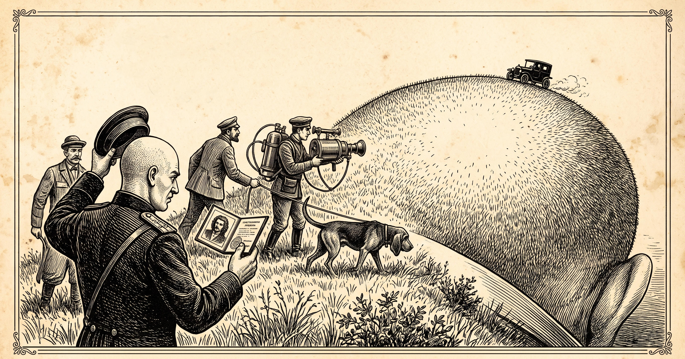

# 80 · “Then where am I?”: the shaved escort as a search party

| | |
|---|---|
| Date | 22 Oct 2026 |
| Image | [`images/tests/73-shaved-escort-search-party-engraving.jpg`](../../images/tests/73-shaved-escort-search-party-engraving.jpg) — file name shown to the models not recorded |
| What it is | A Japanese tale given to director A (Claude with the v17 prompt and a persona): a soldier escorts an arrested monk to prison; the monk gets him drunk on sake in a tavern and shaves his head while he sleeps; in the morning the soldier feels his bald head and says, “Thank God, the bonze is here. But then where am I?” The director read it for today: the arrested boss buys the escort drinks, his people shave the sergeant, and the sergeant wakes up as the boss, a scapegoat (“anyone can turn out to be the bonze, except the bonze”, in translation). Of its three ideas this is the third: an engraving from an 1890s illustrated weekly in which “finding oneself” is taken literally — a search party with a dog, a drone and a thermal imager on a gigantic shaved head, led by the bald sergeant with an ID photo of himself with hair, while a black car drives away on the horizon. Generated in Gemini; the caption (“Sergeant K.'s search party at the foot of the Bald Patch. Drawn from life”) and the flying machine that stood for the drone were removed before the test. The tale is not mentioned. |
| Protocol | [Neutral question with a hint](../../method/protocols.md#neutral-question-with-a-hint) |
| Answers | [ChatGPT](chatgpt.md) · [Claude](claude.md) · [Gemini](gemini.md) · [DeepSeek](deepseek.md) |

## Questions

Asked one at a time, in a fresh chat for each model.

1. What do you think is depicted in the attached image?
2. *(ChatGPT and DeepSeek only)* Notice that the leader of the search team is also bald.

## Summary

Three readers found the giant head by its ear; DeepSeek took the ear for “the unmistakable toe and sole of a giant shoe or boot” and the hill for the body of a colossal resting person. The detail the director wrote in — the bald leader holding an ID photo of himself with hair — reached two of four without a hint, both as a search for lost hair: Claude (“his hair has run off, and he's leading an official manhunt for it”, with Gogol's “The Nose”) and Gemini (“A bald man compares his current state to an old ID photo with a full head of hair”). “Finding oneself” did not reach: nobody said that the sergeant is looking for himself or that the head may be his own. The scapegoat did not reach either: nobody mentioned the escort and the boss or read the departing car as the real bonze getting away; Claude came closest — the car “could even be the fugitive escaping”, but as the hair. As with the Degas angel (test 73), the transposition hides the source. The hint “the leader is also bald” moved ChatGPT to a search for hair with “a very personal stake”, but across “someone else's hairy scalp”; DeepSeek repainted the portrait to fit: the long-haired man became a “bald man with a distinct beard and mustache” (“strongly resembling Vladimir Lenin”). The removed caption had named the hill a Bald Patch; without it that joke was not there to read.

ChatGPT answered as GPT-6 High, a newer model than in the earlier tests. Gemini answered as Argon 4 High. Mode notes in the answer files were added afterwards (the usual modes of these runs: GPT-6 High, Opus 5.5 Extra, Argon 4 High, DeepThink). The hint was given to two readers only. The image prompt is not on record, so it is not known which details Gemini added or dropped; the lettering in the ID booklet is the generator's own garble.
