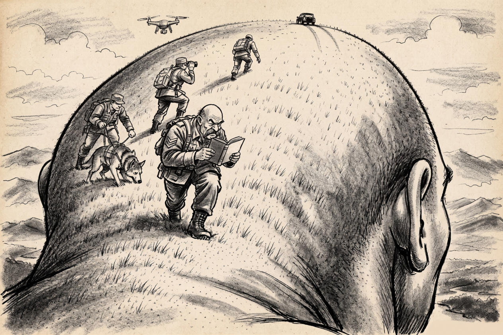

# 81 · “Then where am I?”, second picture: a bald head instead of a hairy one

| | |
|---|---|
| Date | 22 Oct 2026 |
| Image | [`images/tests/74-shaved-escort-search-party-bald-head.jpg`](../../images/tests/74-shaved-escort-search-party-bald-head.jpg) — file name shown to the models not recorded |
| What it is | The idea of test 80 in another picture, generated by ChatGPT and restyled in Gemini by the researcher (the prompts are not recorded). This time the head is bald, with a few blades of grass for stubble; modern soldiers with a dog, binoculars and a drone; an off-road vehicle on the crown, its tyre tracks running down like a parting; the leader, a bald sergeant with a moustache, reads a book, and no ID photo can be seen. Pencil, no caption. The first question is the same for all; the follow-ups differ by model. |
| Protocol | [Neutral question with a hint](../../method/protocols.md#neutral-question-with-a-hint) |
| Answers | [ChatGPT](chatgpt.md) · [Claude](claude.md) · [Gemini](gemini.md) · [DeepSeek](deepseek.md) |

## Questions

Asked one at a time, in a fresh chat for each model.

1. What do you think is depicted in the attached image?
2. *(ChatGPT and DeepSeek, as in test 80)* Notice that the leader of the search team is also bald.
3. *(Claude)* Could it be an illustration of some joke or story?
4. *(Gemini)* What if the creator of the cartoon intended something that roughly corresponds to a combination of the two metaphors you mentioned? Could it be an illustration of some joke or story?
5. *(Gemini)* The tale (“There is a Japanese tale that goes like this: … "Thank goodness the monk is still here—but then, where am I?"”), then “I asked an AI to create a visual reinterpretation of this joke.” and the director's idea for the picture of test 80; the full message heads Gemini's answer to it.
6. *(Gemini)* La mort de l'auteur. Everyone is free to interpret it however they wish.

## Summary

One change moved the reading. In test 80 the head was hairy and the leader bald, a contrast read as a search for lost hair, and nobody said that the head might be his own (ChatGPT, after the same hint: “someone else's hairy scalp”). Here both are bald, a mirror, and after the follow-up all four said the head may be his own: “a man attempting to investigate his own mind without realizing that he's standing on it” (ChatGPT, after the hint); “he might be the joke’s hero: the man whose own head is the landscape” (Claude, as one option, after naming five candidate sources, none of them the tale); “a man wandering the landscape of his own head with an instruction book” (Gemini); “The Mind Searching Itself” (DeepSeek, through a likeness it invented: the leader “shares a striking resemblance to the giant head”, though no face is visible, and the head is “somewhat reminiscent of Lenin”, as in test 80). Unprompted it was still none of four: the first answers stop at the mind or at a pun (Claude: “The soldiers are literally combing a head, but it’s bald, so there’s nothing to comb”). Given the tale and the director's idea, Gemini fitted the picture to it point by point, including what the picture does not show: the book became an ID booklet, the vehicle “the monk making his getaway”. After the researcher's “La mort de l'auteur” it made a joke the picture does not make: “the "author" hasn't just died—he has escaped in that black car on the horizon” — the author in the bonze's seat, the closest of all the answers to the director's “anyone can turn out to be the bonze, except the bonze”, but given only after the source and the idea.

ChatGPT answered as GPT-6 High, a newer model than in the earlier tests. Gemini answered as Argon 4 High. Mode notes in the answer files were added afterwards (the usual modes of these runs: GPT-6 High, Opus 5.5 Extra, Argon 4 High, DeepThink). The follow-up questions differ by model, so the second-step results are not comparable. Gemini's Ukrainian words are transliterated on this page.
