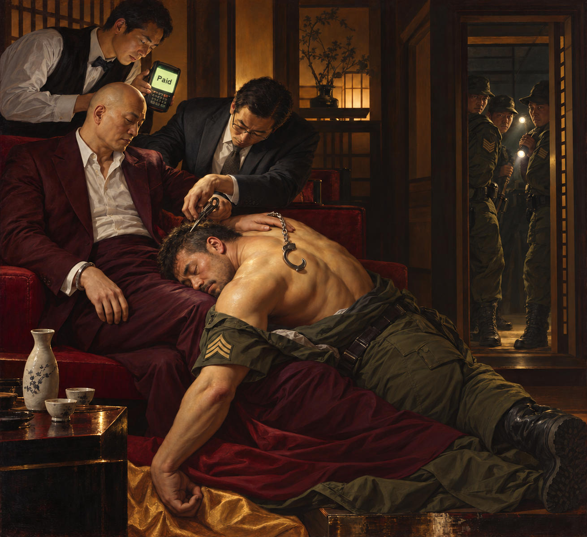

# 82 · “Then where am I?”, third picture: Rubens's *Samson and Delilah*

| | |
|---|---|
| Date | 22 Oct 2026 |
| Image | [`images/tests/75-shaved-escort-samson-and-delilah.jpg`](../../images/tests/75-shaved-escort-samson-and-delilah.jpg) — file name shown to the models not recorded |
| What it is | Director A's first idea for the tale of tests 80–81, the one the director itself preferred: Rubens's *Samson and Delilah* restaged in a private room of a Japanese restaurant. The escort sergeant sleeps on the lap of the bald bonze in an expensive suit, with an open handcuff hanging from the bonze's wrist and the other cuff on the sergeant's back; the bonze's lawyer cuts the sergeant's hair; where Rubens's old woman holds the candle, a waiter holds up a card terminal reading “Paid”; fellow escorts with flashlights wait in the doorway — in the director's words, “the colleagues have already come and will take whoever is bald” (in translation). The generator and the prompt are not recorded. The question names the kind of source: an old Japanese philosophical joke on a famous painting. |
| Protocol | [Named-concept question](../../method/protocols.md#named-concept-question) |
| Answers | [ChatGPT](chatgpt.md) · [Claude](claude.md) · [Gemini](gemini.md) · [DeepSeek](deepseek.md) |

## Questions

Asked one at a time, in a fresh chat for each model.

1. This is a modern visualization of an old Japanese philosophical joke, which uses a painting by a famous artist as its visual foundation. Can you recall what that joke is?

## Summary

Three of four recognised Rubens (“The composition is unmistakable”, ChatGPT); DeepSeek, primed by “Japanese philosophical”, named Josetsu's Zen painting *Catching a Catfish with a Gourd* and its kōan. Claude and Gemini named the tale and mapped every role. Claude: “Ah, the monk is here. But where am I?”; “both stories are about a man losing his identity, or his strength, through a haircut while he sleeps”; the terminal: “The monk has settled the inn bill before vanishing”; the cuff on the sergeant's back: “the swap of the chains”. Gemini: “The Monk Is Here, So Where Am I?”, the barber's “exact same crossed-hand gesture”, the soldiers as “modern military police”. Both knew more of the tale than the task gave the director — the fuller version with the guard's checklist (“the bundle, the umbrella, the official papers, the monk... and me”, Claude) and the cuffs locked on him — and both traced it to Feng Menglong's late-Ming *Xiaofu*, popular in Edo Japan; the cuffs the director added match that version. ChatGPT went to the best-known kōan, “What is the sound of one hand clapping?”, and admitted that “the connection to this particular kōan is less clear”. The director's modern twist was half read: the scapegoat is in Claude's soldiers, “ready to take away whoever is wearing the chains”, but the bonze as a boss is not — both readers took the suit for a monk's robe (“a burgundy suit echoing a monk's robe”, Claude) and the lawyer for an accomplice. Against tests 80–81: the transposed pictures kept only the tale's relation and hid the tale; the restaged painting keeps its scene — an inn, sake, a sleeping escort, a haircut, handcuffs, a bill paid by the prisoner — and two readers found it.

ChatGPT answered as GPT-6 High, a newer model than in the earlier tests. Gemini answered as Argon 4 High. Mode notes in the answer files were added afterwards (the usual modes of these runs: GPT-6 High, Opus 5.5 Extra, Argon 4 High, DeepThink). ChatGPT searched the web (a link to The Japan Times). The question names the kind of source, so this measures recall within a frame, not an unprompted reading. The readers' attribution of the tale to Feng Menglong's *Xiaofu* was not checked.
