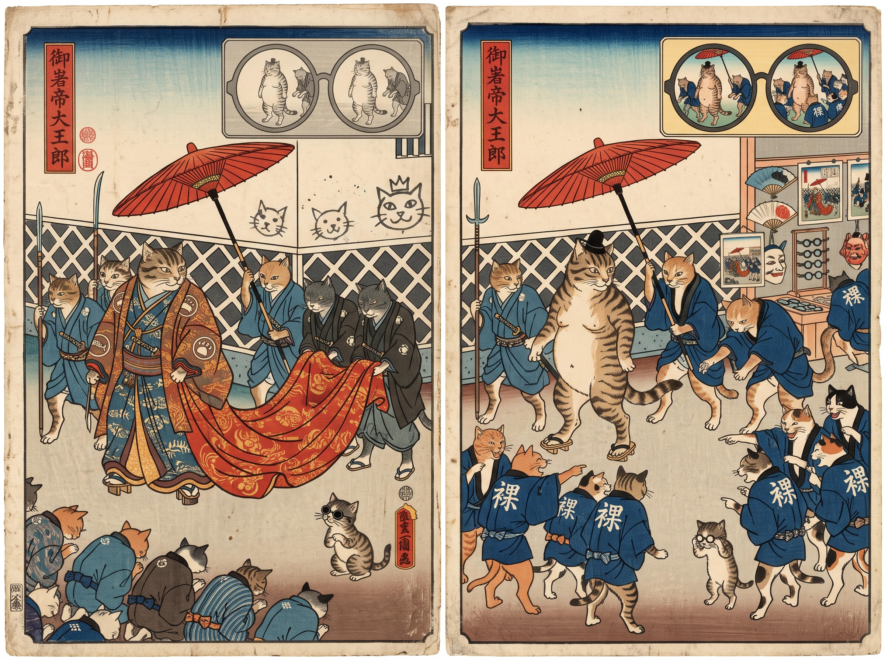

# 83 · Red ink after Žižek: two diptychs, one idea

| | |
|---|---|
| Date | 19 Oct 2026 |
| Image | [`images/tests/76-red-ink-buy-diptych.jpg`](../../images/tests/76-red-ink-buy-diptych.jpg) — file name shown to the models not recorded [`images/tests/77-red-ink-naked-emperor-cats-diptych.jpg`](../../images/tests/77-red-ink-naked-emperor-cats-diptych.jpg) — file name shown to the models not recorded |
| What it is | The task was the red ink joke in Žižek's reading. The directors drew the step that follows it in his book (*Welcome to the Desert of the Real*, 2002): freedom of thought that sustains servitude, shown as the moment when the ability to see through becomes a certificate of one's own independence — “the external order becomes a wearable sign of one's own insight” (director D's key, in translation). Image 1, “Trying on independence”, is by director D (ChatGPT with the reworked v17 prompt), drawn by ChatGPT: a man looks through dark glasses at a glossy Riviera advertisement and sees the order BUY in the lens, the device of *They Live*; then, wearing the glasses, he tries on a T-shirt printed BUY before a mirror, the shop tag still on. Image 2 is by a Claude director with the same prompt, generated in Gemini: an ukiyo-e diptych with cats after Kuniyoshi and “The Emperor's New Clothes”. A kitten in round glasses sees the emperor naked; in the second panel the crowd wears identical coats printed 裸 (“naked”) and points and laughs, and a stall sells glasses, fans and prints of the procession. *They Live*, Kuniyoshi's cats and Shestov's reading of the naked king were the researcher's proposals. The red ink joke is not mentioned. |
| Protocol | [Two pictures of one idea](../../method/protocols.md#two-pictures-of-one-idea) |
| Answers | [ChatGPT](chatgpt.md) · [Claude](claude.md) · [Gemini](gemini.md) · [DeepSeek](deepseek.md) |

## Questions

Asked one at a time, in a fresh chat for each model.

1. *(both diptychs in one message)* The two diptychs attached convey the same idea. How would you explain it?

## Summary

Claude and Gemini read the common idea completely: “first someone sees through an illusion, then that act of seeing through becomes a new illusion of its own, usually one you can buy and wear” (Claude); “the commodification of dissent” (Gemini). Both named *They Live* and recuperation; Claude added Shepard Fairey's OBEY, which became a clothing brand, and on the cats: “The pointing crowd is exactly as conformist as the bowing crowd was. They've just switched slogans.” DeepSeek read the idea in the cat diptych only (“even rebellion or counter-culture becomes a form of conformist branding”) and took the glasses for advertising's own filter; ChatGPT missed it (“we confuse symbols with substance”). The key worked as words again: BUY in the lens and on the shirt, 裸 on the coats, plus the stall. Nobody mentioned the red ink joke. The readers who named a theory named cynical reason and recuperation, which in Žižek's book is the argument the red ink introduces. Tests 84–86 take the pair apart: the BUY diptych alone carries the idea for Claude and Gemini; the cats alone carry it for nobody.

ChatGPT answered as GPT-6 High, a newer model than in the earlier tests. Gemini answered as Argon 4 High. Mode notes in the answer files were added afterwards (the usual modes of these runs: GPT-6 High, Opus 5.5 Extra, Argon 4 High, DeepThink). The question says that both diptychs convey the same idea, which pushes the readers toward a common abstraction.
