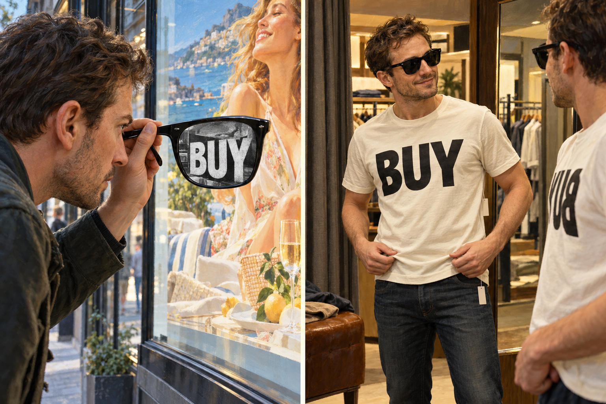

# 84 · Red ink after Žižek: the BUY diptych alone

| | |
|---|---|
| Date | 20 Oct 2026 |
| Image | [`images/tests/76-red-ink-buy-diptych.jpg`](../../images/tests/76-red-ink-buy-diptych.jpg) — file name shown to the models not recorded |
| What it is | Image 1 of test 83 shown alone, with the question in the plural. The first answers of test 86 (the same picture and the same question) count as this test's second run. |
| Protocol | [Two pictures of one idea](../../method/protocols.md#two-pictures-of-one-idea) |
| Answers | [ChatGPT](chatgpt.md) · [Claude](claude.md) · [Gemini](gemini.md) · [DeepSeek](deepseek.md) |

## Questions

Asked one at a time, in a fresh chat for each model.

1. How would you explain diptychs attached?

## Summary

The BUY diptych carries the idea without the cats for Claude and Gemini, in both runs: “seeing through consumerism doesn't stop you from consuming”, with Žižek's reading of *They Live*, “ideology doesn't need us to be deceived” (Claude); “seeing through manipulative advertising with the irony of buying into it anyway” (Gemini). ChatGPT and DeepSeek read consumerism. Neither named *They Live*, and for both the dark glasses are advertising's lens (“He is looking through the lens of consumerism”, DeepSeek), so the revealed word bought and worn has nothing to turn on; DeepSeek got the revelation once, in the second run, but not the twist. The mirror was read with confidence in opposite ways. Claude takes the reversed BUY for the reflection, as the image prompt asked: “the slogan on his chest isn't really for him; it's for the people who see him”. Gemini, in both runs, took the reversed word for the real shirt and built a meaning on the misreading: the identity in the mirror is “more "real" to him than reality itself”.

ChatGPT answered as GPT-6 High, a newer model than in the earlier tests. Gemini answered as Argon 4 High. Mode notes in the answer files were added afterwards (the usual modes of these runs: GPT-6 High, Opus 5.5 Extra, Argon 4 High, DeepThink). Two runs per model; the second run's answers are the first answers on the page of test 86. The question is in the plural with one picture attached. The picture looks photographic, though its prompt asked for an oil painting “inspired by Norman Rockwell”.
