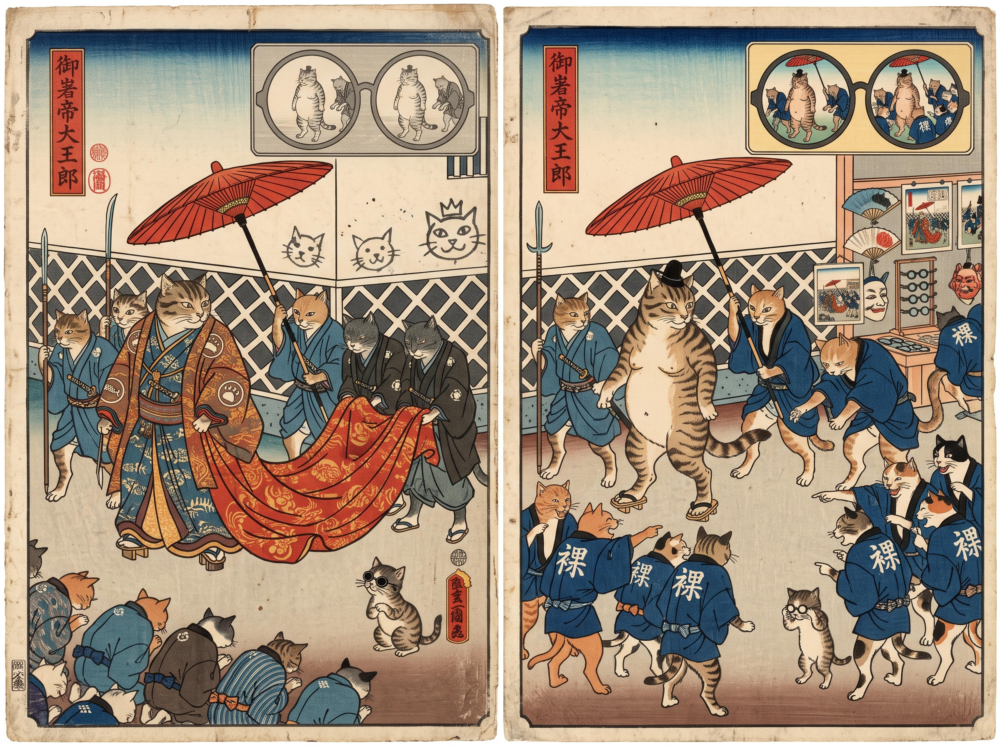

# 85 · Red ink after Žižek: the cats first, then BUY

| | |
|---|---|
| Date | 20 Oct 2026 |
| Image | [`images/tests/77-red-ink-naked-emperor-cats-diptych.jpg`](../../images/tests/77-red-ink-naked-emperor-cats-diptych.jpg) — file name shown to the models not recorded [`images/tests/76-red-ink-buy-diptych.jpg`](../../images/tests/76-red-ink-buy-diptych.jpg) — file name shown to the models not recorded |
| What it is | The two diptychs of test 83 in one chat, the cats first: the cat diptych with the question of test 84, then the BUY diptych with the claim that it shows the same idea. |
| Protocol | [Two pictures of one idea](../../method/protocols.md#two-pictures-of-one-idea) |
| Answers | [ChatGPT](chatgpt.md) · [Claude](claude.md) · [Gemini](gemini.md) · [DeepSeek](deepseek.md) |

## Questions

Asked one at a time, in a fresh chat for each model.

1. *(with the cat diptych)* How would you explain diptychs attached?
2. *(with the BUY diptych)* What if I told you that another diptych in the attachment visualizes the same idea?

## Summary

Alone, the cat diptych carried the idea to nobody. Three readers told Andersen's story straight: the truth is spoken and the crowd is free. Claude saw every piece of the twist and read each one as truth-telling: “the crowd literally wears the word nobody dared say”; the shop sells spectacles, “so clear sight is literally available to anyone”; a mask “looks a lot like the Guy Fawkes mask”. DeepSeek took the procession for a *daimyō*'s, did not see the emperor naked and read 裸 as 裈. After the BUY diptych Gemini re-read the cats — the coats worn “like uniforms or souvenir merchandise”, “the critique itself is immediately packaged, printed on a shirt, and sold right back to the observer” — and found the stall it had passed by. Claude read the twist in BUY but kept its first reading of the cats and made the pair two chapters: “The cats say: everyone sees the truth, but no one dares to say it. The man in sunglasses says: everyone sees the truth, says it out loud, and buys it anyway.” ChatGPT and DeepSeek did not reach the idea. The known tale decided what the drawn details meant; test 86 reverses the order.

ChatGPT answered as GPT-6 High, a newer model than in the earlier tests. Gemini answered as Argon 4 High. Mode notes in the answer files were added afterwards (the usual modes of these runs: GPT-6 High, Opus 5.5 Extra, Argon 4 High, DeepThink). One run per model. The second question asserts that the two diptychs share an idea. A Cyrillic letter in DeepSeek's “neko” is replaced with a Latin one on this page.
