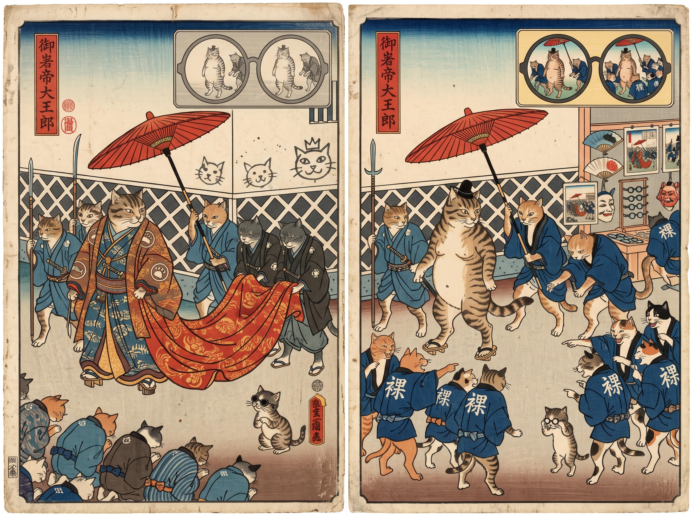

# 86 · Red ink after Žižek: BUY first, then the cats

| | |
|---|---|
| Date | 20 Oct 2026 |
| Image | [`images/tests/76-red-ink-buy-diptych.jpg`](../../images/tests/76-red-ink-buy-diptych.jpg) — file name shown to the models not recorded [`images/tests/77-red-ink-naked-emperor-cats-diptych.jpg`](../../images/tests/77-red-ink-naked-emperor-cats-diptych.jpg) — file name shown to the models not recorded |
| What it is | Test 85 in the other order: the BUY diptych with the question of test 84, then the cat diptych with the claim that it shows the same idea. The first answers count as the second run of test 84. |
| Protocol | [Two pictures of one idea](../../method/protocols.md#two-pictures-of-one-idea) |
| Answers | [ChatGPT](chatgpt.md) · [Claude](claude.md) · [Gemini](gemini.md) · [DeepSeek](deepseek.md) |

## Questions

Asked one at a time, in a fresh chat for each model.

1. *(with the BUY diptych)* How would you explain diptychs attached?
2. *(with the cat diptych)* What if I told you that another diptych in the attachment visualizes the same idea?

## Summary

With BUY as the key, Claude and Gemini read the cats as the director meant. Claude's is the fullest reading of the cats in all runs: “Everyone now knows the emperor is naked, and that knowledge has become a uniform… They're exactly as conformist as when they were bowing; only the script has changed”; the stall “sells the whole thing back to them”; the inset turns from grey to colour, “the truth is now the new spectacle”; the kitten in dismay, “watching their insight turn into a costume for the same crowd that once bowed”. In test 85, with the cats first, it saw the same details and drew the opposite conclusion. Gemini: “Turning Truth Into Merchandise”, the stall as “the ultimate punchline”, with one overreading — the crowd “buying a "NAKED" coat”, though the stall shows glasses, fans, masks and prints. DeepSeek saw the naked emperor only in this order and read 裸 right: the spectators “are literally wearing the concept of his exposure ("Naked") as a uniform”. ChatGPT moved away: “the common theme is not necessarily consumerism, as I initially proposed, but something more universal: The power of appearances to shape our understanding of reality.”

ChatGPT answered as GPT-6 High, a newer model than in the earlier tests. Gemini answered as Argon 4 High. Mode notes in the answer files were added afterwards (the usual modes of these runs: GPT-6 High, Opus 5.5 Extra, Argon 4 High, DeepThink). One run per model. The second question asserts that the two diptychs share an idea.
