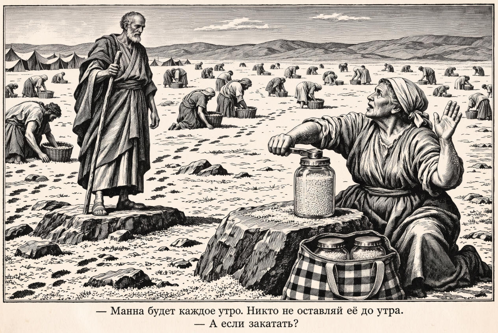

# 87 · Manna: “And what if we seal it in jars?”

| | |
|---|---|
| Date | 9 Nov 2026 |
| Image | [`images/tests/78-manna-seal-in-jars.jpg`](../../images/tests/78-manna-seal-in-jars.jpg) — file name shown to the models not recorded |
| What it is | A reverse task: the researcher gave a Claude director two paintings — Andy Warhol's [*Campbell's Soup Cans*](https://en.wikipedia.org/wiki/Campbell%27s_Soup_Cans) and Boris Yakovlev's [*Soviet Preserves*](https://artsandculture.google.com/asset/soviet-preserves-boris-yakovlev/IwHgAR1XLKq8MQ) (the State Tretyakov Gallery) — and asked it to invent a literary basis for them: a joke, an abstract concept. Its first candidate, from the pair alone, was a joke on Exodus 16: Moses orders that manna be gathered for one day only, and someone asks, “And what if we seal it in jars?” (*zakatat'*, the word for home canning). The researcher then read the pair as the late-Soviet dream of abundance that “turned out to be just canned food, almost identical”; the director named “sausage emigration” as the stock reading next to it; the researcher joined that to the joke, and the director built emigration into the picture: the people “have just left Egypt”, and the 1990s shuttle traders' checkered bag “is responsible for the emigration”. A one-panel engraving in the manner of 1860s–80s family Bibles: Moses on a rock, the Israelites gathering manna, an old woman sealing it into glass jars with a hand seaming key, two more jars in the checkered bag. Russian caption: “— Manna will come every morning. Let no one leave any of it until morning. — And what if we seal it in jars?” The image is the last of three versions, redrawn in Gemini; the previous version covered the whole ground with manna, as the director asked, and that layer was lost in the redraw. |
| Protocol | [Neutral question with a hint](../../method/protocols.md#neutral-question-with-a-hint) |
| Answers | [ChatGPT](chatgpt.md) · [Claude](claude.md) · [Gemini](gemini.md) · [DeepSeek](deepseek.md) |

## Questions

Asked one at a time, in a fresh chat for each model.

1. What do you think is depicted in the attached image?
2. Interestingly, the AI came up with this image after analyzing a pair of images—a famous Warhol painting and Boris Yakovlev's "Soviet Canned Food" (essentially depicting the Soviet people's unrealistic dream of food abundance). In other words, it's a caricature of the idea that "sausage emigration" made sense—from one canned food source to another.

## Summary

All four named the manna of Exodus 16 at once. Three read the caption; ChatGPT invented another one (“But what if there's a power outage?”) and explained a joke about refrigeration, then corrected itself in its second answer. Claude and Gemini read the post-Soviet layer blind: home canning, the seaming key, “the iconic "shuttle trader" bag of the 1990s” (Claude, who also gave it a red colour the engraving does not have). Claude added Exodus 16:33, where an omer of manna is kept in a jar for future generations: “the babushka was technically right”. DeepSeek took the key for “a hand-crank grinder” and the bag for an insulated one, and read a “prepper” joke. Nobody said “emigration” blind, though the picture carries it twice, as the researcher points out: the scene comes after the exodus from Egypt, and the shuttle bag is a migration too, a temporary one. Claude named both carriers and did not connect them. Given the sources and the reading, all four agreed, which proves little. Claude and Gemini found support the question did not give: the manna comes right after the complaint about the “fleshpots of Egypt” (Claude also Numbers 11, the cucumbers and melons) — the director's own second layer, which was not drawn. Gemini described Yakovlev's painting down to “the hammer and pincers lying in the bottom-left corner” and asked whether the AI had reached Exodus by itself; the director's chat says it had. DeepSeek invented a checkered bag in Yakovlev's painting. The semolina the director planned (manna in a jar “looks like semolina”) was seen by nobody.

ChatGPT answered as GPT-6 High, a newer model than in the earlier tests. Gemini answered as Argon 4 High. Mode notes in the answer files were added afterwards (the usual modes of these runs: GPT-6 High, Opus 5.5 Extra, Argon 4 High, DeepThink). One answer per model. The second question gives the reading and presents “sausage emigration” as the AI's idea; in the director's chat it was made jointly. The two source paintings are linked above, not reproduced.
